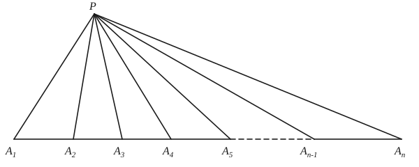

> 原书 PDF 第 13-19 页

## 球与罐子：允许重复的排列

许多计数问题涉及将一些东西安放在某个位置上.虽然总体思想比较简单，但是这些问题因根据允许安排的类型所确定的规则而千变万化.在本章和下一章中，我们将深入研究这些问题中的某些广泛的不太典型的类型.我们将看到各种各样的情况，在这些情况中，主要的角色是“对象”和“位置”.在所进行的讨论中，保持不变的唯一法则是我们的“位置”是有区别的.

虽然我们的位置是有区别的，但我们的对象却可以是有区别的或者是无区别的，例如，假定我们有两个球和两个罐子，有多少种方法把球放入罐子里去？

这个问题依赖于球是否有区别.如果球是同样的(无区别的)，那么有三种方法把球放入我们看来是不同的罐子里:两个球都放入左边的罐子里，或者两个球都放入右边的罐子里，或者每个罐子各放一个球.但是如果一个球是蓝色的，另一个球是红色的，那么我们能看到球的分布有四种可能性:两个球都放在左边的罐子里，或者两个球都放在右边的罐子里，这两种情况现在还是有的，但是现在还有红色球放在左边的罐子里，蓝色球放在右边的罐子里，以及蓝色球放在左边的罐子里，红色球放在右边的罐子里这两种情况.

是否允许重复？我们必须考虑的另一种可能性是能否规定几样东西放入同一个位置.在上面，我们假定每个罐子都足够大，能容纳许多球.如果加以限制，每个罐子必须是空的或者恰能放一个球，在这种情况下，只有一种方法把两个无区别的球放入罐子里(每罐一球)；如果规定两球有区别，那么就有两种放法(红球放入左罐，蓝球放入右罐以及相反).

我们能否说出如何应用于哪一种情况呢？这就是计数问题需要技巧之处，通过各章中的例题和亲自实践，你将学会识别问题所提供的暗示，逐渐地轻松分辨出对象和位置(球和罐子).如果你还不能判断出要用什么情况，那么你所能做的一切就是明确地陈述你的假定，然后尽力去解决问题.

我们来看四种基本类型的问题，本章中有三种，下一章中有一种，各种情况我们总结了四种重要的将一再出现的形式.利用乘法原理，并仔细考虑确定不做过量的计算，是能够找到这些形式的.应该经常使用这些公式，以至于很有希望最终熟记这些公式.但是，知道如何推导将有助于你更好地记住这些公式，使你更有效地确定哪一个公式适用于哪种特定的情况，让你学会使用这种能解决更为复杂的计数问题的思想方法.

为了有助于说明问题中的形式，假定小镇上新开张了一家冰淇淋商店，该店提供 $n$ 种不同口味的冰淇淋.为了吸引顾客，他们决定进行一系列的促销活动.

**开张日：各勺冰淇淋的顺序有区别，口味允许重复**

开张日商店决定提供能装 $k$ 勺冰淇淋的蛋筒打折出售.因为 $k$ 勺冰淇淋在一个蛋筒上，所以这 $k$ 勺冰淇淋是有顺序的，因此说明是有区别的.

一勺香草冰淇淋在一勺巧克力冰淇淋的上面区别于一勺巧克力冰淇淋在一勺香草冰淇淋的上面.但是你要什么口味并不受限制，你可以选取 $k$ 种不同的口味，或者 $k$ 种同样的口味，或者选取任意多少种口味.根据这样的标准，可能有多少种不同的蛋筒？

先从一个蛋筒开始，加上冰淇淋，第一勺冰淇淋的口味有多少种不同的选择呢？因为有 $n$ 种口味，所以有 $n$ 种选择.那么第二勺呢？因为选择口味没有限制，所以仍然有 $n$ 种选择，事实上，我们所加的每一勺，无论加的是什么口味，都恰有 $n$ 种可能.这就是说，根据乘法原理，我们总共可以做出

$$
\underbrace{n\cdot n\cdot\cdots\cdot n}_{k\text{ 个因数}}=n^{k}
$$

种可能的蛋筒.

同样的方法可应用于我们以前推导过的经典的“球和罐子”问题:

**例12** 把 $k$ 个有区别的球放到 $n$ 个有区别的罐子里有多少种不同的放法(这里有区别的意思是可将球从 $1$ 到 $k$ 编号，将罐子从 $1$ 到 $n$ 编号)?

**解** 对于第一个球，把这个球分配到哪一个罐子里有 $n$ 种选择.同样第二个球也有 $n$ 种选择，等等.这 $k$ 个球都有 $n$ 种选择.根据乘法原理，把这些球放到罐子里总共有 $n^{k}$ 种放法.

我们可以设想把一个球当作一勺冰淇淋，各个罐子表示不同的口味，于是这个问题就变为对冰淇淋计数了.当然我们的对象是有区别的，并且超过一个对象可以出现在一个指定的位置上时，答案总是 $n^{k}$.

**第二天：各勺冰淇淋的顺序有区别，口味不允许重复**

我们回到冰淇淋商店，假定老板意识到开张那天太早就吃完了特色口味的冰淇淋，所以营业结束得太早.为了避免这种问题再次发生，第二天商店改变了促销条件.当顾客们还是想得到有 $k$ 勺冰淇淋的蛋筒时，那么任意一种指定口味的冰淇淋只能有一勺.

先考虑特殊情况，假定我们想要得到一个有 $n$ 勺冰淇淋的蛋筒(口味也是 $n$ 种).因为口味不能重复，也就是说，每一种口味恰好用一次，所以我们必须做的事情就是将口味排序.那么有多少种方法进行排序呢？

## 定义2：有序组的排列

下面的定义将帮助我们着手解决这一问题.

**定义2** 不同对象的有序组的排列是对同样这些对象以可能的不同顺序进行的排列.

例如，下面各种情况都是对有序三数组 $(1,2,3)$ 的一种排列

$$
(1,2,3),(1,3,2),(2,1,3),(2,3,1),(3,1,2),(3,2,1)
$$

像前面一样，我们从最下面开始，用一勺一勺冰淇淋构成蛋筒，有多少种口味选择最下面的一勺冰淇淋呢？我们可以在 $n$ 种可选的口味中任选一种，所以有 $n$ 种可能.下一勺呢？既然已经有了最下面的一勺冰淇淋，那我们知道不能选取那种口味的冰淇淋了，只有余下的 $n-1$ 种冰淇淋可供选择.同样第三勺只有 $n-2$ 种选择，这是因为有两种口味已经用过了.这种方式一直用到最上面的一勺冰淇淋.除了最后一种口味外都用过了，所以可供选择的口味只有一种了.利用乘法原理，可以做出

$$
n\cdot(n-1)\cdot(n-2)\cdot\cdots\cdot3\cdot2\cdot1
$$

种可能的蛋筒.

由于上述乘法在组合数学中经常出现，所以我们给它取一个名称并给出记号，我们把 $1$ 到 $n$ 的整数的乘积叫作 $n$ 的阶乘，记作 $n!$.我们认为 $n!$ 是对 $n$ 个不同的对象进行排序的总数.我们说 $0!=1$ 是因为对 $0$ 个对象排列只有一种排法，即不排(你也可以认为是“没有”乘积，于是等于 $1$;还可以认为:由 $(n-1)!=\frac{n!}{n}$ ，得到 $0!=\frac{1!}{1}=1$).

现在我们关注 $k \leqslant n$ 的一般情况.也就是说，在总共有 $n$ 种口味的冰淇淋中取出 $k$ 勺冰淇淋能做成多少种冰淇淋蛋筒(每一种口味至多只能用一次)？

就像我们恰好有 $n$ 勺冰淇淋的情况，最下面一勺冰淇淋的口味有 $n$ 种选择，第二勺冰淇淋有 $n-1$ 种选择，因为不允许使用与最下面一勺同样口味的冰淇淋.继续使用这种方法.这些数的乘积中最小的数是什么呢？因为第一个数是 $n$，第二个数是 $n-1$，第三个数是 $n-2,\cdots$，第 $k$ 个数是 $n-(k-1)=n-k+1$.一般情况下，我们有

$$
\underbrace{n\cdot(n-1)\cdot(n-2)\cdot\cdots\cdot(n-k+2)\cdot(n-k+1)}_{k\text{ 个因数}}=\frac{n!}{(n-k)!}
$$

种符合要求的蛋筒.

有人把这种结构称作“降幂”或“降因子”，并给出一个记号，如 $n^{k}$ 或 $(n)_{k}$.在本书中我们不采用这种记号，不过，它有助于我们记住表达式 $\frac{n!}{(n-k)!}$ 并不是过分复杂的事情，它只是 $k$ 个因子的乘积，与普通的幂并无太大的区别.

排列也有一个类似于球和罐子的问题.我们也能看出 $\frac{n!}{(n-k)!}$ 表示把 $k$ 个有区别的球放入 $n$ 个有区别的罐子中，每个罐子至多放一个球的放法的总数.

**第三天：各勺冰淇淋的顺序无区别，口味不允许重复**

经过两天把冰淇淋堆积到一个蛋筒上后，商店的工作人员需要休息一下.第三天，他们决定对口味加以限制(每一种口味最多只能用一次)，用大碗代替蛋筒.这些碗足够大，把冰淇淋按照顺序放也没问题，这样顾客可以在任何时候用勺子吃他(她)想要吃的那种冰淇淋(不像蛋筒那样只能从上到下吃冰淇淋，否则就要坍塌).一勺巧克力冰淇淋在一勺香草冰淇淋下面的蛋筒与一勺香草冰淇淋在一勺巧克力冰淇淋下面的蛋筒被认为是不同的蛋筒，但是放有一勺巧克力冰淇淋和一勺香草冰淇淋的碗只算一种.根据新的规定，有多少种不同的 $k$ 勺冰淇淋的碗①

<small>① 口味仍有n种.——译者注</small>

这个问题的答案记作 $\binom{n}{k}$ (读作“$n$ 选 $k$”).也就是说，$\binom{n}{k}$ 是从 $n$ 种口味的冰淇淋中选出 $k$ 勺冰淇淋的不同的碗的个数，但这 $n$ 种口味中的每一种最多只能用一次.我们的目标是寻求 $\binom{n}{k}$ 的公式.

回想一下第二天.我们还是有任何口味的冰淇淋至多用一次的规定，但当时我们考虑是有顺序的，结果共有 $\frac{n!}{(n-k)!}$ 种不同的蛋筒.

假定当时我们盛放 $k$ 勺冰淇淋的是碗，并且每一勺冰淇淋的口味都不同，有多少种方法把这些勺冰淇淋放入一个蛋筒呢？这就是 $k$ 勺冰淇淋的一个排列.我们从上面的特殊情况知，排列 $k$ 种不同的对象有 $k!$ 种方法.我们可以看出，从每种口味至多用一次的 $n$ 种口味的冰淇淋中取出由 $k$ 勺冰淇淋组成的蛋筒的总数恰恰是从 $n$ 种口味的冰淇淋中选取 $k$ 种口味的冰淇淋，然后对这 $k$ 种口味的冰淇淋在蛋筒上以某种顺序排列的总数.于是根据乘法原理，得

$$
\binom{n}{k}\cdot k!=\frac{n!}{(n-k)!}
$$

由此得

$$
\binom{n}{k}=\frac{n!}{k!(n-k)!}
$$

这就是 $\binom{n}{k}$ 的公式.$\binom{n}{k}$ 也称为二项式系数(后面我们将会看到为什么叫这个名称).

$\binom{n}{k}$ 这个值是把 $k$ 个有区别的球放入 $n$ 个有区别的罐子里放法的总数，其中每个罐子的容量是至多一个球(再想想，每个罐子对应于一种特定口味的冰淇淋，每一个球表示一勺冰淇淋).$\binom{n}{k}$ 的另一种常用的应用如下:

## 例13：二项式系数就是子集个数

**例13** 证明:$\binom{n}{k}$ 是集合 $\{1,2,\cdots,n\}$ 的含有 $k$ 个元素的子集的个数.

**证明** 假定 $n$ 种口味的冰淇淋中的每一种都用一个数表示，那么一杯有 $k$ 勺没有重复口味的冰淇淋恰好对应 $\{1,2,\cdots,n\}$ 的一个有 $k$ 个元素的子集.

看看你是否能够用一个直接的理由去检验这是否正确.你的理由将十分类似于冰淇淋的例子.

一般地，我们称 $\binom{n}{k}$ 为组合数.

## 定义3：组合

**定义3** 组合是一组不同对象的一个子集(与顺序无关，$\{1,2,4\}$ 与 $\{4,2,1\}$ 是同一个组合).

注意，我们已经建立了排列和组合的公式，现在举例说明:

## 例14：圆桌坐法

**例14** $n$ 个人坐在一张圆桌旁可能有多少种坐法？如果在两种排列中每个人的左边相同，右边也相同，那么认为这两种排列是同一种排列.

**解** 如果两种排列成旋转对称，那么就是同一种排列，所以可以把一个人作为参照点，从那个位置开始进行排列.首先选择坐在参照人右边的人，因为这个位置不能是原参照人，所以这个位置有 $n-1$ 种选择，然后选择一个坐在那人右边的人，因为有两个人已经就座，所以有 $n-2$ 种选择.用这样的方法继续围桌就座，就得到 $(n-1)\cdot(n-2)\cdot\cdots\cdot1$，所以有 $(n-1)!$ 种坐法.

注意，一旦有了参照人，任何坐法都对应 $n-1$ 个人的唯一的排列.我们早就可以直接看出答案是 $(n-1)!$.第三种方法是考虑这 $n$ 种排列是旋转对称的.于是在这 $n$ 个人的每 $n$ 种排列中只算一种，于是得到 $\frac{n!}{n}=(n-1)!$.

## 定义4：格子路径

现在我们来定义格子路径的记号.实践证明“东北格子路径”在组合数学中是经常使用的.

**定义4** 假定我们站在坐标平面的原点 $(0,0)$ 处.在平面内以水平方向或竖直方向的单位长度作为步子进行移动，例如，第一步在 $(1,0),(0,1),(-1,0)$ 或 $(0,-1)$ 处结束.一系列这样的步子就称为格子路径.如果我们把四种可能的方向局限于只能向右(“东”)或向上(“北”)的步子，那么就有“东北格子路径”这一名称.

现在我们从这些路径的基本计数开始.

## 例15：从 (0,0) 到 (a,b) 的东北格子路径

**例15** 设 $a,b$ 是正整数，从 $(0,0)$ 到 $(a,b)$ 有多少种“东北格子路径”？

**解** 为了到达 $(a,b)$ 处，必须向右走 $a$ 步，向上走 $b$ 步(共走 $a+b$ 步).我们可以将此看作从集合 $\{1,\cdots,a+b\}$ 中选出 $a$ 个数，对于每一个选出的 $i$，第 $i$ 步是向右的.一旦我们确定了哪几步是向右的，那么其余的步子都必定向上.我们知道从一个大小为 $a+b$ 的集合中取出一个大小为 $a$ 的子集的总数是 $\binom{a+b}{a}$，这就给出了从 $(0,0)$ 到 $(a,b)$ 的东北格子路径数.

## 定义5：双射

例15的解题过程描述了计数问题中的一个重要技巧，这种技巧也能正式地用于前面的一些例子中，我们已说明了将此用于每一个从 $(0,0)$ 到 $(a,b)$ 的东北格子路径，并将此与集合 $\{1,\cdots,a+b\}$ 的一个有 $a$ 个元素的子集相联系.反之，每一个这样的子集来自于格子路径.这就是双射的一个例子，双射是在两个集合间一对一地进行配对.较为正式的提法是:

**定义5** 两个集合 $X,Y$ 之间的一个双射指的是一个函数 $f:X\rightarrow Y$，并且对于每一个 $y \in Y$,存在唯一的 $x \in X$，有 $f(x)=y$.在这种情况下，我们也可以说 $f$ 是 $X$ 到 $Y$ 的双射，$X$ 和 $Y$ 属于双射.显然，如果两个集合属于双射，那么它们的元素的个数相同(具有相同基数的无限集也可以这样定义).

我们将经常用双射将一个特定问题中的对象与我们已经计数过的某个集合建立起关系.这是数学家最喜欢使用的技巧:把一个新的问题归结为他们已经知道如何解决的问题.

## 例16：扑克牌的五种牌型计数

**例16** 让我们来玩玩扑克牌吧！在下面的各个部分，我们把从一副有 $52$ 张牌的正规扑克牌中取出的 $5$ 张牌称为一手牌.“花式”指一张牌是不是黑桃、红心、方块和草花中的一种.“等级”指的是从 A 开始，依次是从 $2$ 到 $10$ 的这些数，再到 J，Q，K 的值.一手牌中的各张牌的顺序是无关紧要的.

(a) 有多少种不同的一手牌？

(b) 有多少种持有黑桃 A 的不同的一手牌？

(c) 有多少种方法可得到同花的一手牌(一手牌中的所有牌的花式相同)？

(d) 有多少种方法可得到有 $4$ 张牌值相同的一手牌(手里的牌中同一个等级的 $4$ 种可能的花式都有)？

(e) 你能得到多少种顺次，但不是同花顺次(手里持有的 $5$ 张连续等级的牌都是同样的花式.不允许环圈顺次，例如 Q，K，A，2，3 不算顺次，但是 A 既可以算作 $2$ 下面的 $1$，也可以作为 K 之上的最高等级的牌)的一手牌？

(f) 扑克牌中有多少种一手“烂”牌(手中没有高等级的牌)？这样的一手牌中没有同花，所有的 $5$ 张牌都必须是不同的等级(但不是顺次).

**解** (a) 一手牌中的 $5$ 张牌取自于总共 $52$ 张牌.因为这 $5$ 张牌与顺序无关，所以总数是 $\binom{52}{5}$.

(b) 如果我们手中持有黑桃 A，那么手中的其余 $4$ 张牌取自于这副牌中的其余 $51$ 张牌.于是有 $\binom{51}{4}$ 种持有黑桃 A 的不同的一手牌.

(c) 一手同花牌的花式有 $4$ 种选择，在给定的花式中有 $13$ 张牌，在同一花式中选 $5$ 张牌有 $\binom{13}{5}$ 种方法，所以总共有 $4 \cdot \binom{13}{5}$ 种一手同花牌.

(d) $4$ 张同等级的牌有 $13$ 种可能.因为必须有这一等级的所有 $4$ 种花式，所以只要确定手中的最后一张牌.这副牌中还有另外 $48$ 张牌，所以有 $48 \cdot 13$ 种 $4$ 张牌值相同的一手牌.

(e) 我们将对所有的顺次计数，然后减去同花顺次的种数.在顺次中等级最低的牌有 $10$ 种可能(一旦确定了这张等级最低的牌，其余等级的牌也就确定了)，手中 $5$ 张牌中的每一张都有 $4$ 种花式的选择，所以共得到 $10 \cdot 4^{5}$ 种顺次.我们需要减去同花顺次的种数.在同花顺次中等级最低的牌仍有 $10$ 种可能，但是因为手中的牌必须是同一种花式，所以花式只有 $4$ 种选择.于是虽然是顺次，但不是同花顺次的一手牌共有 $10 \cdot 4^{5}-10 \cdot 4$ 种.

(f) 我们可以在 $\binom{13}{5}$ 种一手牌中选出 $5$ 种不同的等级，但是组成一个顺次可供选择的等级有 $10$ 种，于是有 $\binom{13}{5}-10$ 种方法选择符合题意的等级.接着要注意的是，有 $4^{5}$ 种方法选择 $5$ 张牌的花式，其中有 $4$ 种方法会导致所有的 $5$ 张牌有同一种花式，所以花式总共有 $4^{5}-4$ 种可能.利用乘法原理，一手“烂”牌的总数是

$$
\left(\binom{13}{5}-10\right)\cdot\left(4^{5}-4\right)
$$

## 例17：图1 中的三角形个数

**例17** 图1中共有 $120$ 个各种大小的三角形，也就是说，我们所画的线都是直线，所有 $n$ 个点都在水平的基线上，$n$ 的值是多少？

图1

**解** 图1中的每一个三角形都由三个顶点确定，其中一个顶点是 $P$，另外两个顶点是水平基线上的不同的点.于是图1中三角形的个数恰好就是水平基线上的顶点对的个数.有这样 $n$ 个点，从中选取两点(因为不考虑顺序，所以我们选取顶点的顺序不会改变我们得到的三角形是什么三角形)的方法数是 $\binom{n}{2}$.我们又知道一共有 $120$ 个三角形，所以

$$
\binom{n}{2}=\frac{n!}{2!(n-2)!}=\frac{n(n-1)}{2}=120
$$

整理后，得

$$
n^{2}-n-240=(n-16)(n+15)=0
$$

因为 $n$ 必须是正整数，所以得 $n=16$.
