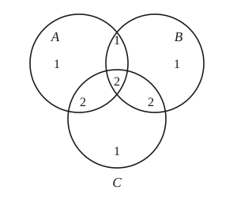
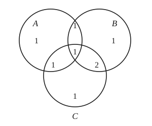

> 原书 PDF 第 29-36 页

## 容斥原理的两个与三个集合情形

有时候，我们试图计算的集合能表示为另几个集合的并.如果这些集合不交，那么我们就能用加法原理确定最后的总数.但是这些集合有重叠呢？这里容斥原理(PIE)就起作用了.

先看几个小例子，然后把这一原理推广到一般形式.假定我们有两个集合 $A,B$，要求 $A \cup B$ 的大小.如果我们将 $|A|$ 和 $|B|$ 相加，这样就对既属于集合 $A$ 又属于集合 $B$(即属于 $A \cap B$)的元素算了两次.为了避免重复计算，需要减去交集的大小，于是得

$$
\left| A \cup B \right| = \left| A \right| + \left| B \right| - \left| A \cap B \right| \quad (\text{两个集合的 } \mathrm{PIE})
$$

但是如果不是两个集合，而是三个集合，那将会发生什么情况呢？事情变得稍微有点复杂.举个例子，假定我们有一个班级的学生，这个班级的每名学生喜欢用犰狳、虎皮鹦鹉、水豚这三种动物进行一些组合(每名学生至少喜欢这些动物中的一种).设 $A$ 是喜欢犰狳的学生集合，$B$ 是喜欢虎皮鹦鹉的学生集合，$C$ 是喜欢水豚的学生集合，我们想知道班里共有多少名学生，也就是说，要求出 $|A \cup B \cup C|$.

我们从 $|A|+|B|+|C|$ 开始计算，因为要保证每名学生至少算到一次.我们在计算这个和的时候重复计算了什么?利用“文氏图”能帮助我们弄清楚这一点.图5中每个区域的数告诉我们该区域中的学生被计算过的次数.

$|A|+|B|+|C|$

图5

可以肯定地看出还有重复计算的部分.实际上，喜欢两种动物的学生计算了两次，喜欢所有三种动物的学生计算了三次.为了纠正这些重复的计算，我们设法对两个集合做些什么，即减去 $|A \cap B|$，也要减去 $|A \cap C|$，最后减去 $|B \cap C|$.下面是用“文氏图” (图6)表示进行上面的每一个步骤后的结果.

(a) $|A|+|B|+|C|-|A \cap B|$ (b) $|A|+|B|+|C|-|A \cap B|-|A \cap C|$ (c) $|A|+|B|+|C|-|A \cap B|-|A \cap C|-|B \cap C|$

图6

现在我们要保证最中心的区域(喜欢所有三种动物的学生)被计算过.为此，我们可以把所有这三个集合的交加回去，使每名学生都恰好被计算一次，总结一下，我们发现

$$
\left| A \cup B \cup C \right| = \left| A \right| + \left| B \right| + \left| C \right| - \left| A \cap B \right| - \left| A \cap C \right| - \left| B \cap C \right| + \left| A \cap B \cap C \right| \quad (\text{三个集合的 } \mathrm{PIE})
$$

但是更多的集合呢？你可以猜一猜，用更多次的加法和减法可以补上缺少的计算部分，排除重复的计算部分，从而进行纠正.幸运的是存在启动容斥原理的模式，我们从开始的两个集合和三个集合的例子中已经看出了.为了得到若干个集合的并的大小，我们:

从集合的大小开始；

减去两个集合的交的大小；

加上三个集合的交的大小；

等等.

我们减去所有偶数个集合的交，加上所有奇数个集合的交，直到得到最后的结果(所有集合的交).

## 定理3：容斥原理

**定理3(容斥原理)** 如果有 $n$ 个集合 $A_{1},A_{2},\cdots,A_{n}$，那么

$$
\left| A_{1} \cup A_{2} \cup \cdots \cup A_{n} \right| = \sum_{i = 1}^{n} \left| A_{i} \right| - \sum_{i < j} \left| A_{i} \cap A_{j} \right| + \sum_{i < j < k} \left| A_{i} \cap A_{j} \cap A_{k} \right| - \cdots + (-1)^{n-1} \left| A_{1} \cap A_{2} \cap \cdots \cap A_{n} \right|
$$

## 本章重点例题

下面我们来看如何将容斥原理应用于一些特定的问题.本章中例33～35题值得特别注意，这三道例题只凭各自的名称就显示出都是重要的定理，即关于函数的计数、欧拉(Euler)函数、“错排公式”.其中每一个都要用到容斥原理的证明.

## 例27：喜欢 pie、π 和 PIE 的学生

某学校有 145 名学生喜欢 pie(饼图)，有 103 名学生喜欢 π(圆周率)，有 78 名学生喜欢 PIE(容斥原理)，有 54 名学生喜欢 pie 和 π，42 名学生喜欢 π 和 PIE，33 名学生喜欢 pie 和 PIE，有 9 名学生三个都喜欢.假定每名学生都喜欢 pie，π，PIE 中的至少一种，那么该学校有多少名学生?

**解** 直接利用容斥原理就可以解决这个问题.设喜欢 pie 的人是集合 $A$，喜欢 π 的人是集合 $B$，喜欢 PIE 的人是集合 $C$.容斥原理告诉我们

$$
\begin{aligned}
\left| A \cup B \cup C \right| &= \left| A \right| + \left| B \right| + \left| C \right| - \left| A \cap B \right| - \\
&\quad \left| A \cap C \right| - \left| B \cap C \right| + \left| A \cap B \cap C \right|
\end{aligned}
$$

把适当的数据代入后，得

$$
|A \cup B \cup C| = 145 + 103 + 78 - 54 - 33 - 42 + 19 = 216
$$

名学生.

## 例28：三门学科都不喜欢的学生

一个班级有 40 名学生.其中 14 名学生喜欢数学，16 名学生喜欢物理，11 名学生喜欢化学.7 名学生数学和物理都喜欢，8 名学生物理和化学都喜欢，5 名学生数学和化学都喜欢，4 名学生所有三门学科都喜欢.这三门学科都不喜欢的学生有多少名？

**解** 这个问题也要用到容斥原理，还要用补计数法，这两种技巧经常同时使用.设喜欢数学的学生是集合 $A$，喜欢物理的学生是集合 $B$，喜欢化学的学生是集合 $C$.于是这三门学科都不喜欢的学生的集合是 $40-|A \cup B \cup C|$.下面用容斥原理计算 $|A \cup B \cup C|$，得

$$
40-\left|A\cup B\cup C\right|=40-\left(14+16+11-7-8-5+4\right)=15
$$

所以有 15 名学生这三门学科都不喜欢.

## 例29：1 到 240 中 4 或 6 的倍数

1 到 240 中有多少个整数是 4 或 6 的倍数?

**解** 我们知道在 1 到 240 中，4 的倍数有 $\frac{240}{4} = 60$ 个，6 的倍数有 $\frac{240}{6} = 40$ 个.如果把这两个数相加，那么 4 和 6 的最小公倍数 $(4,6)=12$ 的倍数就计算了两次.因为这些倍数在每一类中都被计算了一次.为了纠正这一点，因此要减去 12 的倍数共 $\frac{240}{12} = 20$ 个，得到 $60+40-20=80$ 个整数.

## 关于对称性的说明

当我们有 $n$ 个集合时，容斥原理的公式中的集合 $A_{1},A_{2},\cdots,A_{n}$ 的子集的每一个非空交集都有一项，这就是说，容斥原理的公式(定理3)的右边有 $2^{n} - 1$ 项.如果不太幸运，即当 $n$ 很大时，这就使容斥原理变得不实用了.

幸好，有时候会出现一些对称性.在这种情况下，我们并不害怕 $n$ 为很大的值.例如，对于任何 $k$，有 $\binom{n}{k}$ 项表示有 $k$ 个集合的交.当这些交的大小相同时，情况怎么样呢?于是我们可以对任意一个交集计数，然后乘以 $\binom{n}{k}$，这样可使问题变得容易一些.我们把这种方法用于下面的例题.

## 例30：四个集合的并

设 $A,B,C,D$ 四个集合中每一个集合都有 400 个元素.任何两个集合的交都有 115 个元素，任何三个集合的交都有 53 个元素，所有这四个集合的交有 28 个元素.这四个集合的并有多少个元素?

**解** 这又是一个直接利用容斥原理的问题.我们知道每个集合都有 400 个元素，且 $n = 4$.每两个集合的交有 115 个元素，这样的一对集合共有 $\binom{4}{2}$ 对.每三个集合的交有 53 个元素，这样的三元组共有 $\binom{4}{3}$ 组.最后，所有四个集合的交有 28 个元素.于是得

$$
| A \cup B \cup C \cup D | = 4 \cdot 400 - \binom{4}{2} \cdot 115 + \binom{4}{3} \cdot 53 - 28 = 1\ 094
$$

(你也许会有疑惑 $\binom{4}{1}$ 和 $\binom{4}{4}$ 是否该出现在公式中，它们去哪儿了？)

## 例31：MEMENTO 的字母排列

把单词 MEMENTO 中的各个字母排列，使同一个排列中相同的字母不相邻的排法有多少种？

**解** 由多项式系数我们知，把单词 MEMENTO 中的各个字母排列的总数是 $\frac{7!}{2!2!}$.

两个 M 连续出现的种数是 $\frac{6!}{2!}$，这是因为我们把两个 M 捆在一起当作一个字母，用同样简单的逻辑，把两个 E 捆在一起当作一个字母，有 $\frac{6!}{2!}$ 种排法.减去这两个数以后，就对既有两个 M 连续出现，又有两个 E 连续出现的情况多减了，所以必须加回去.把 M 作为一组和把 E 作为一组处理时，就得到 5 个对象，所以有 $5!$ 种排列.于是有

$$
\frac{7!}{2!2!}-2\cdot\frac{6!}{2!}+5!=660
$$

种符合条件的排列.

## 例32：有上界限制的整数解

方程

$$
w+x+y+z=11
$$

有多少组整数解满足 $0 \leqslant w \leqslant x \leqslant y \leqslant z \leqslant 4$?

**解** 由例22可知方程 $w+x+y+z=11$ 有 $\binom{14}{3} = 364$ 组非负整数解.但是这只考虑条件 $w,x,y,z \geqslant 0$.我们用补计数法，先计算原方程的非负整数解 $w,x,y,z$ 中至少有一个数大于 4 的解有多少个.

现在假定至少有一个变量太大，那么有 4 种方法选择哪一个变量使它超过上界 4.我们可以把 5 个单位先分配给这个所选的变量，再分配余下的另外 6 个单位，有 $\binom{9}{3}$ 种方法把这 6 个单位分配给所有 4 个变量.

现在假定至少有两个变量太大，那么有 $\binom{4}{2}$ 种方法选择哪两个变量.对这两个变量各分配 5 个单位时，还多 1 个单位分配给所有 4 个变量，有 $\binom{4}{3}$ 种方法分配.注意，因为所有 4 个变量都是非负的，所以要使两个以上的变量超过上界是不可能的，否则 4 个变量的和至少是 15.于是利用容斥原理，有

$$
\binom{14}{3} - 4 \cdot \binom{9}{3} + \binom{4}{2} \cdot \binom{4}{3} = 52
$$

组解满足 $0 \leqslant w \leqslant x \leqslant y \leqslant z \leqslant 4$.(你对原来的 364 组中的大部分都超过这个范围感到奇怪吗?)

## 关于变量替换的说明

当问题中包含的变量并不是实际的数时，问题可能变得更复杂，但是只要记住容斥原理的一般模式还是可以解决的.如果你发现这些变量把你所要的计数搞混了，那你可以用某些小的值代替这些变量，使你在处理一般情况之前知道如何进行下去.

## 例33：满射函数的计数

回忆一下，从 $X$ 到 $Y$ 上的函数 $f$ 指的是对每一个 $y \in Y$，存在某个 $x \in X$，使 $y = f(x)$，即 $X$ 的每一个元素都被 $f$ 映射到 $Y$ 中某一个元素上.证明:当 $|X| = n$，$|Y| = m$ 都是正整数时，“到……上”的函数 $f : X \to Y$ 的个数 $s_{m,n}$ 可由式(1)给出

$$
s_{m,n}=m^{n}-\binom{m}{1}(m-1)^{n}+\binom{m}{2}(m-2)^{n}-\cdots+(-1)^{m-1}\binom{m}{m-1}1^{n}\tag{1}
$$

(“到……上”的常用的同义词是满射).

**证明** 本题中有两个变量，初看有些复杂.我们用一个小的值代替 $m$(例如，取 $m = 4$)，看看会发生什么情况.

如何计算这个“到……上”的函数的个数并不是马上就清楚的，但是我们知道，不是“在……上”的函数必定“遗漏”了到 $Y$ 的某个元素的映射.计算这些函数似乎比较合适，所以我们尝试用补计数和容斥原理.设 $A_{i}$ 是所有遗漏了 $Y$ 中的第 $i$ 个元素 $(1 \leq i \leq 4)$ 的函数的集合.于是我们要计算的是

$$
\text{函数的总数} - \left| A_{1} \cup A_{2} \cup A_{3} \cup A_{4} \right|
$$

首先，从 $X$ 到 $Y(|Y| = 4)$ 的函数有多少个?对于每一个 $x \in X$，我们必须选择 $Y$ 的某个元素即 $f(x)$，所以对每个 $x$ 有 4 个可能的函数 $f(x)$.由乘法原理知，有 $4^{n}$ 个从 $X$ 到 $Y$ 的函数.

现在对函数个数的计算并不是“到……上”.这意思是说，至少有 1 个 $Y$ 的元素被遗漏了.假定 $a$ 是 $Y$ 的某个元素，我们希望计算所有使 $a$ 不被 $X$ 中任何元素映射到的函数的个数.也就是说，对于每一个 $f(x)$ 只有 3 个可能的值，所以最后得到 $3^{n}$ 个函数遗漏了 $a$.对于 $a$ 会是什么有多少种可能呢?有 $\binom{4}{1} = 4$ 种可能.于是总的来说有 $\binom{4}{1} \cdot 3^{n}$ 个函数至少遗漏了 $Y$ 的 1 个元素.

我们知道这里已经多计算了一些函数的个数(遗漏了超过 1 个元素的函数)，于是根据容斥原理继续计数.接着计算遗漏了 $Y$ 的 2 个元素(比如说 $a$ 和 $b$)的函数的个数.既遗漏 $a$ 又遗漏 $b$ 的函数有 $2^{n}$ 个，而且对哪两个作为 $a$ 和 $b$ 的选择有 $\binom{4}{2}$ 种可能，这样总共就有 $\binom{4}{2} \cdot 2^{n}$ 个函数.类似地，有 $\binom{4}{3} \cdot 1^{n}$ 个函数遗漏了 $Y$ 的 3 个元素.遗漏了 $Y$ 的所有 4 个元素的函数是没有的，因为 $X$ 的每个对象都必须映射到 $Y$ 的某个元素上.

利用常用的容斥原理公式，得

$$
s_{4,n}=4^{n}-\binom{4}{1}\cdot 3^{n}+\binom{4}{2}\cdot 2^{n}-\binom{4}{3}\cdot 1^{n}
$$

这与问题中的命题给出的公式当 $m = 4$ 时一致.看看我们能否把这个问题一般化.

与当 $m = 4$ 时的情况一样，我们将用补计数和容斥原理确定“到……上”的函数个数.由于 $|Y| = m$，$|X| = n$，所以对于每一个 $x$，有 $m$ 种选择，所以共有 $m^{n}$ 个函数 $f : X \to Y$.

我们可以像前面那样，从至少遗漏 1 个元素，至少遗漏 2 个元素，等等的情况进行下去.现在来看能否直接考虑遗漏 $k$ 个元素的情况，使这个过程快一点，这里 $k$ 是满足 $1 \leqslant k < m$ 的某个整数.

假定有一个函数至少遗漏了 $Y$ 的 $k$ 个元素的某个集合 $S$.也就是说，$S \subset Y$，$|S| = k$ 且对于每一个 $s \in S$，不存在 $x \in X$，使 $f(x) = s$.这就是说，$X$ 的每一个元素必须由 $f$ 映射到属于 $Y \setminus S$ 的一个元素，这样的元素有 $m-k$ 个.于是有 $(m - k)^{n}$ 个函数不是 $S$.总之，大小为 $k$ 的子集 $S$ 有 $\binom{m}{k}$ 个.利用容斥原理，得

$$
\begin{aligned}
s_{m,n} &= \sum_{k=0}^{m} (-1)^k \binom{m}{k} (m-k)^n \\
&= m^n - \binom{m}{1} (m-1)^n + \binom{m}{2} (m-2)^n - \cdots + (-1)^{m-1} \binom{m}{m-1} 1^n
\end{aligned}
$$

这正是我们要证明的.

## 例34：欧拉函数

欧拉函数 $\varphi(n)$ 是小于或等于 $n$ 且与 $n$ 互质(与 $n$ 没有大于 1 的公约数)的正整数的个数.如果 $n$ 的质因数分解式是 $n = p_{1}^{\alpha_{1}}p_{2}^{\alpha_{2}}\cdots p_{k}^{\alpha_{k}}$，其中 $p_{1},p_{2},\cdots,p_{k}$ 是不同的质数，$\alpha_{1}, \alpha_{2}, \cdots, \alpha_{k}$ 是正整数，证明

$$
\varphi(n)=n(1-\frac{1}{p_{1}})(1-\frac{1}{p_{2}})\cdots(1-\frac{1}{p_{k}})
$$

**证明** 这一问题具有相当大的挑战性，在很大程度上是由于变量的个数难以确定.特别是这里要用 $n$ 的一个具体的值去尝试一下对这种模式的感觉，在进入一般情况之前，先考察当 $n = 360$ 时会发生什么情况.我们知道 360 的质因数分解式是 $2^{3} \cdot 3^{2} \cdot 5$.我们利用补计数和容斥原理处理这一问题.

我们来计算有多少个小于或等于 360，且与 360 有大于 1 的公约数的正整数的个数.这样的数必定是 2,3 或 5 的倍数.所以设到 360 为止 2 的正倍数的集合为 $A$，到 360 为止 3 的正倍数的集合为 $B$，到 360 为止 5 的正倍数的集合为 $C$，于是答案是

$$
\begin{aligned}
\varphi(360) &= 360 - \left| A \cup B \cup C \right| \\
&= 360 - ( \left| A \right| + \left| B \right| + \left| C \right| - \left| A \cap B \right| - \left| A \cap C \right| - \left| B \cap C \right| + \left| A \cap B \cap C \right| )
\end{aligned}
$$

集合 $A \cap B$ 恰含有 2 的倍数和 3 的倍数，即 $2 \cdot 3 = 6$ 的倍数.类似地，集合 $A \cap C$ 含有 10 的倍数，集合 $B \cap C$ 含有 15 的倍数，集合 $A \cap B \cap C$ 恰含有 30 的倍数.把这些值恰当地代入后，得

$$
\begin{aligned}
\varphi(360) &= 360-\frac{360}{2}-\frac{360}{3}-\frac{360}{5}+\frac{360}{6}+\frac{360}{10}+\frac{360}{15}-\frac{360}{30} \\
&= 360-(1-\frac{1}{2}-\frac{1}{3}-\frac{1}{5}+\frac{1}{2\cdot3}+\frac{1}{2\cdot5}+\frac{1}{3\cdot5}-\frac{1}{2\cdot3\cdot5}) \\
&= 360(1-\frac{1}{2})(1-\frac{1}{3})(1-\frac{1}{5})
\end{aligned}
$$

这是预料之中的.现在转向一般的 $n$.

像前面一样，计算有多少个小于或等于 $n$，且与 $n$ 有大于 1 的公约数的正整数的个数.$p_{i}$ 的任何倍数与 $n$ 有公约数 $p_{i}$，有 $\frac{n}{p_{i}}$ 个小于或等于 $n$ 的自然数是 $p_{i}$ 的倍数.将 $i$ 的所有的值相加，得到 $\sum_{i = 1}^{k} \frac{n}{p_{i}}$.

但是我们知道，这样的计算过度了.根据容斥原理，减去有两个 $p_{i}$ 的倍数的所有自然数，这样的数有 $\sum_{1 \leqslant i_{1} \leqslant i_{2} \leqslant k} \frac{n}{p_{i_{1}} p_{i_{2}}}$ 个.然后再加回有三个 $p_{i}$ 的倍数的所有自然数，得到 $\sum_{1 \leqslant i_{1} \leqslant i_{2} \leqslant i_{3} \leqslant k} \frac{n}{p_{i_{1}} p_{i_{2}} p_{i_{3}}}$ 个.

重复这一过程直到 $n$ 的质因数分解式中有 $k$ 个质约数的倍数，得到要加到和式中的 $(-1)^{k-1}\frac{n}{p_{1}p_{2}\cdots p_{k}}$.将 $n$ 减去这个结果，得

$$
\varphi(n)=n-\sum_{i=1}^{k}\frac{n}{p_{i}}+\sum_{1\leqslant i\leqslant j\leqslant k}\frac{n}{p_{i}p_{j}}-\cdots+(-1)^{k}\frac{n}{p_{1}p_{2}\cdots p_{k}}\tag{1}
$$

最后，式(1)可分解为

$$
\varphi(n)=n(1-\frac{1}{p_{1}})(1-\frac{1}{p_{2}})\cdots(1-\frac{1}{p_{k}})
$$

这就是所要求的.

## 例35：错排公式

一个有若干个对象组成的集合的“错排”指的是没有一个对象在其原来所在位置上的一个排列.例如，4,3,1,2 就是 1,2,3,4 的一个错排.

关于错排的问题通常是由一个故事引出的.例如，假定把 $n$ 本课外作业本任意发还给 $n$ 名学生，有多少种方法使没有学生拿回自己的课外作业本(1,2,…,n 有多少种错排)?

**解** 毫无疑问，我们要用到容斥原理和补计数.设 $A_{i}$ 是学生 $i(1 \leq i \leq n)$ 拿回自己的课外作业本的集合.我们要求发还作业本的方法的总数，减去 $\left| A_{1} \cup A_{2} \cup \cdots \cup A_{n} \right|$.我们知道不受限制的发还作业本的方法的总数是 $n$ 个对象的排列，即 $n!$.现在确定至少有一名学生拿回自己的作业本的方法的总数.

这里是开始用容斥原理的地方了.首先，我们必须将每个特定的集合的大小相加.注意，因为所有学生是平等对待的，所以可以利用对称性.对任何一名学生 $i$，$\left| A_{i} \right|$(他能拿回自己作业本的方法的总数)是 $(n-1)!$(其余 $n-1$ 个人可以任意发还).因为有 $n$ 个这样的集合，相加后得到 $n \cdot (n - 1)!$.

那么两个集合的交 $\left| A_{i} \cap A_{j} \right|$(学生 $i$ 和 $j$ 拿回自己的作业本)是什么情况呢?我们可以用任意的方法发还其余的作业本，所以有 $(n - 2)!$ 种可能.两个集合的交有多少个呢?这恰好是从总共 $n$ 名学生中选取两名学生的方法数，我们知道这个数是 $\binom{n}{2}$.于是要从我们进行的计数中减去 $\binom{n}{2} \cdot (n - 2)!$.

继续这样做，这一模式也继续形成.如果 $k$ 名学生拿回自己的作业本，那么有 $\binom{n}{k}$ 种方法选取这 $k$ 名学生，于是有 $(n - k)!$ 种方法发还其余的作业本.最后得到

$$
n \cdot (n - 1)! - \binom{n}{2} \cdot (n - 2)! + \binom{n}{3} \cdot (n - 3)! + \cdots + (-1)^{n-1} \binom{n}{n} \cdot 0!
$$

记住这就是我们需要计数的对象的补，所以要用发还的总数($n!$)减去这个数

$$
\begin{aligned}
&n! - n \cdot ( n - 1 )! + \binom{n}{2} \cdot ( n - 2 )! - \binom{n}{3} ( n - 3 )! + \cdots + ( - 1 )^{n} \binom{n}{n} \cdot 0! \\
&\quad = \sum_{k = 0}^{n} ( - 1 )^{k} \binom{n}{k} ( n - k )!
\end{aligned}
$$

我们可以用代数的方法化简这个式子，求出 $n$ 个对象错排的个数是

$$
\begin{aligned}
\sum_{k = 0}^{n} ( - 1 )^{k} \binom{n}{k} \cdot (n - k)! &= \sum_{k = 0}^{n} ( - 1 )^{k} \frac{n!}{k!(n - k)!} (n - k)! \\
&= n! \sum_{k = 0}^{n} \frac{( - 1 )^{k}}{k!}
\end{aligned}
$$

(这就是著名的“错排公式”.如果你学习过幂级数的话，那么这个和可能对你来说是很熟悉的.如果没有学过，那么有许许多多的数学趣事等待着你呢!)
