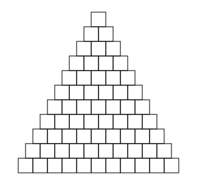
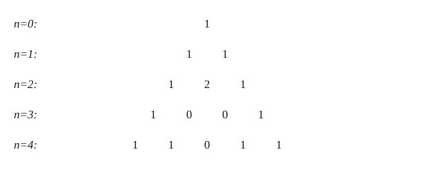

> 原书 PDF 第 37-44 页

## 第5章帕斯卡三角形和二项式定理

帕斯卡(Pascal)三角形是一种十分迷人的结构.本章一开始，很少描述其许多神奇之处.在本章结束之前，我们将看到一些强有力的证明技巧，还将告诉你为什么帕斯卡三角形中的各数称作“组合数”(图7).

$$
\begin{array}{rccccccccc}
n=0: &  &  &  &  & 1 &  &  &  &  \\
n=1: &  &  &  & 1 &  & 1 &  &  &  \\
n=2: &  &  & 1 &  & 2 &  & 1 &  &  \\
n=3: &  & 1 &  & 3 &  & 3 &  & 1 &  \\
n=4: & 1 &  & 4 &  & \boxed{6} &  & 4 &  & 1
\end{array}
$$

图7

帕斯卡三角形各行从n=0开始，每一行中的各数都从k=0开始.例如，n=4的行中k=2的数(带有方框的数)是 $\binom{4}{2} = 6,$

最上面的一行(n=0)只有一个数1.下面标号为n的每一行有n+1个数，第一个和最后一个数(k=0和k=n)都是1，除了这些1以外，每个数都是它上面两个数的和.

我们发现，在标号为n的行中标号为k的数是 $\binom{n}{k}$ (这就是行从0开始数，每行中的数从0开始数的原因).

为什么是这种情况呢？原来当 $n \geqslant 2, 0 < k \leqslant n$ 时，有

$$
\binom{n}{k} = \binom{n-1}{k} + \binom{n-1}{k-1}
$$

由于二项式系数与我们构造三角形的方法有同样的规律，所以我们构造的三角形中的每一个新的数都是相应二项式的系数.

当然，我们还需要证明帕斯卡恒等式.证明的方法很多，其中之一是从前面见到的

$$
\binom{n}{k} = \frac{n!}{k!(n-k)!}
$$

开始.你可以自己检验这种证法.而现在我们提供的却是一个组合的方法

证明背后的思路是确定一个集合，然后用两种不同的方法计算它的个数，我们要找的两个表达式必须相等，因为它们是对同一个集合计数，有时，把这种方法称为“双重计

数”法，这是组合数学中的一个重要技巧.

现在正式叙述这个定理.

定理4(帕斯卡恒等式)对一切 $0 < k \leq n$ ,有

$$
\binom{n}{k} = \binom{n-1}{k} + \binom{n-1}{k-1}
$$

甚至也有人对k不属于0到n的范围时，定义表达式 $\binom{n}{k}$ ，认为对任何 $k < 0$ 或 $k > n$有 $\binom{n}{k} = 0 .$ .如果我们采用这个定义，那么定理4的应用范围就更广泛了:当 $n \geqslant 1,k$ 是任意整数时，定理4都成立.为简单起见(这样做是使我们的计数有意义)，我们假定 $0 < k \leq$ n.

证明:一个班级有n名学生，从中选出由k名学生组成的班委会有多少种选法？

证明我们从n个不同的人组成的集合中选k个人.每个人至多能选一次，选出的这些人代表的顺序无关紧要.由此得到的结果是 $\binom{n}{k}$

我们关注班级里的一名特定的学生，比如说是Jenny.这里假定 $n \geqslant 1$ 是很重要的，否则我们将不能选Jenny了.此时有两种可能，即Jenny进班委会，或不进班委会.如果她进班委会，那么要从其余n-1名学生中再选另外k-1名学生组成班委会，有 $\binom{n - 1}{k - 1}$ 种选法.另外，如果她不进班委会，那么必须从其余的n-1名学生中选出所有k个成员，有$\binom{n - 1}{k}$ 种选法.根据加法原理，组成班委会的选法总数是 $\binom{n - 1}{k} + \binom{n - 1}{k - 1}$

因为我们用两个表达式对同一件事计数，所以它们必相等.于是有

$$
\binom{n}{k} = \binom{n - 1}{k} + \binom{n - 1}{k - 1}
$$

这就是我们要证明的.

应该记住在证明含有二项式系数的某个组合恒等式时，像这样组成班委会的论证方法是一个很好的技巧，另一类常用的论证方法包含在前面例15中见到的东北格子路径我们可以给出用东北格子路径证明帕斯卡恒等式的另一种方法

证明:从（0,0）到 $(k,n-k)$ 有多少条东北格子路径?

证明我们在整个路径中共走n步，其中k步向右，n-k步向上.选择哪k步向右的方法有 $\binom{n}{k}$ 种，其余的n-k步向上.

我们来看两种情况，最后一步向上和最后一步向右的情况.

如果最后一步向上，那么在到达(k，n-k)之前已经到 $f(k,n-k-1)$ .从(0,0）到$(k,n-k-1)$ 的格子路径数是 $\binom{n - 1}{k}$ (我们共走了n-1步，选择k步向右).

如果最后一步向右，那么在到达(k，n-k)之前所到的点是 $(k - 1, n - k)$ .从(0,0)到$(k - 1, n - k)$ 的格子路径数是 $\binom{n - 1}{k - 1}$ (我们共走了n-1步，选择k-1步向右).

因为我们只有两种情况，所以用加法原理可求出从(0,0)到(k，n-k)共有 $\binom{n - 1}{k} +$ $\binom{n - 1}{k - 1}$ 条东北格子路径.

因为我们用两个表达式对同一件事计数，所以它们必相等.于是我们证明了

$$
\binom{n}{k} = \binom{n - 1}{k} + \binom{n - 1}{k - 1}
$$

这就是我们要证明的.

除了帕斯卡恒等式以外，帕斯卡三角形还有很多有趣的性质.例如，如果计算帕斯卡三角形的各项的和，我们会发现什么(在例6以前我们已经见到过这一论证的一部分).

例36用计数法证明帕斯卡三角形中标号为n的行的各元素的和是 $2 ^ { n }$ ,即

$$
\sum_{k = 0}^{n} \binom{n}{k} = \binom{n}{0} + \binom{n}{1} + \cdots + \binom{n}{n} = 2^{n}
$$

证明:一个班级的n名学生可组成多少个班委会(人数不限)?

证明我们知道从n个人中选出k个人组成班委会的方法有 $\binom{n}{k}$ 种，现在只要把k的一切可能值求和.由于班委会的人数可以少到0人，多到所有n个人，所以k可以取从 $0 -$直到 n. 于是有

$$
\binom{n}{0} + \binom{n}{1} + \cdots + \binom{n}{n} = \sum_{k=0}^{n} \binom{n}{k}
$$

对每名学生都有两种可能，这名学生要么进班委会，要么不进班委会，根据乘法原理完成此事的方法有 $2^{n}$ 种.

因为我们用两个表达式对同一件事计数，所以它们必相等.于是我们证明了

$$
\sum_{k = 0}^{n} \binom{n}{k} = 2^{n}
$$

这就是我们要证明的.

注意我们已经很容易地证明了 $\{ 1, 2, \cdots, n \}$ 有多少个子集？”我们把在这里的证明模式化了(在例6中就是这样提出的).我们如何描述这些要计数对象的集合并不重要，只要其大小适合即可.一般来说，根据你要设法证明的等式的一边，你会想到集合计数，下面的挑战就是找到获得另一边的计数过程.

现在我们把注意力集中到帕斯卡三角形的斜线上.这个结果称为“曲棍球杆定理”(尝试把帕斯卡三角形的恒等式中的所有数圈出来，你就会明白是怎么回事了).有一个利用帕斯卡恒等式就能证明的代数方法这里就不推导了.但是，我们将提供两种方法证明，即组成班委会的方法和格子路径的方法.

定理5(曲棍球杆定理) 如果 $n \geqslant k \geqslant 0$ ,那么

$$
\binom{k}{k} + \binom{k+1}{k} + \binom{k+2}{k} + \cdots + \binom{n}{k} = \binom{n+1}{k+1}
$$

证明:有多少种方法从n+1名选手中选出k+1名选手组成曲棍球队（球衣的号码是1到n+1)?

证明 只要求得从n+1个不同的选手集合中选出k+1个人的方法总数，我们知道这个数是 $\binom{n + 1}{k + 1}$

假定球队中选手的号码数最大的是r+1,那么另外k名选手的号码数必是r或更小的数，所以选择这k个人的方法有 $\binom{r}{k}$ 种.r+1至少必须是k+1(否则球队里就没有足够多的球员了)，而且这个数能大到n+1，于是数r从k取到n.将r的一切可能值相加，得

$$
\sum_{r = k}^{n} \binom{r}{k} = \binom{k}{k} + \binom{k + 1}{k} + \cdots + \binom{n}{k}
$$

因为我们用两个表达式对同一件事计数，所以它们必相等.于是我们证明了

$$
{k \choose k} + {k+1 \choose k} + \cdots + {n \choose k} = {n+1 \choose k+1}
$$

这就是我们要证明的.

对于用格子路径证明，为了更方便使用这个技巧，我们将这样重写这个恒等式:设$m = n - k$ ，则该恒等式用m和k表示，变为

$$
\binom{k}{k} + \binom{k+1}{k} + \cdots + \binom{m+k}{k} = \binom{m+k+1}{k+1}
$$

证明:从(0,0)到(k+1,m)的东北格子路径有多少条？

证明 我们的路径必有k+1步向右，m步向上.选择哪几步向右的方法有$\binom{m + k + 1}{k + 1}$ 种(其余的都向上).

我们将进入以下情况，根据最小数的l，使得(k+1，l)在路径上(路径第一次到达直线 $x = k + 1$ .因为定义l是最小的这样的值，所以我们知道路径到达(k+1,l)之前的一步是向右的，所以我们要对从(0,0）到(k，l)的路径计数。这样的路径有 $\binom{l + k}{k}$ 条.因为我们只允许路径是向右或向上，所以一旦路径到达 $(k + 1, l)$ ，那么其余的步子都必须向上，于是只有一种方法到达 $(k + 1, m)$ .由于l可以从0到m，所以将l的一切可能值相加，就有

$$
\sum_{l = 0}^{m} \binom{k + l}{k} = \binom{k}{k} + \binom{k + 1}{k} + \binom{k + 2}{k} + \cdots + \binom{m + k}{k}
$$

因为我们用两个表达式对同一事件计数，所以它们必相等，于是我们证明了

$$
{k \choose k} + {k+1 \choose k} + {k+2 \choose k} + \cdots + {m+k \choose k} = {m+k+1 \choose k+1}
$$

这就是我们要证明的.

二项式与多项式.我们在考察多项式时，关于二项式的知识也可能对我们有所帮助

定理6(二项式定理)对于一个非负整数 $n(n \geqslant 1)$ ,有

$$
(x + y)^n = \binom{n}{0} x^0 y^n + \binom{n}{1} x^1 y^{n-1} + \cdots + \binom{n}{n} x^n y^0 = \sum_{k=0}^{n} \binom{n}{k} x^k y^{n-k}
$$

现在我们来看“二项式系数”这一术语的由来。它们都是二项式展开式中项的系数.我们往后将用归纳法给出这一定理的证明(见例62)，但是这里只是根据计数原理对其正确性提出一个理由.

首先考察指数较小的n=4的情况，把 $(x + y)^{4}$ 改写为

$$
(x + y)(x + y)(x + y)(x + y)
$$

利用分配律展开，不化简且不合并同类项，得到下面的式子

$$
\begin{array} { l } { x \bullet x \bullet x \bullet x + x \bullet x \bullet x \bullet y + x \bullet x \bullet y \bullet x + x \bullet x \bullet y \bullet y + } \\ { x \bullet y \bullet x \bullet x + x \bullet y \bullet x \bullet y + x \bullet y \bullet y \bullet x + x \bullet y \bullet y \bullet y + } \\ { y \bullet x \bullet x \bullet x + y \bullet x \bullet x \bullet y + y \bullet x \bullet y \bullet x + y \bullet x \bullet y \bullet y + } \\ { y \bullet y \bullet x \bullet x + y \bullet y \bullet x \bullet y + y \bullet y \bullet y \bullet x + y \bullet y \bullet y \bullet y } \end{array}
$$

哪些项可化简为 $x^{2}y^{2}$ 恰好在某个排序中含有2个x,2个y的项.这样的排序有多少种呢?总共有4个字母，我们希望选出2个字母是x,有 $\binom{4}{2}$ 种方法.这表示在和式中有$\binom{4}{2}$ 项含有2个x,2个y，于是 $x^{2}y^{2}$ 的系数是 $\binom{4}{2}$ .像这样检验其他系数可以看出，这样的做法确实是可行的.

下面考虑一般情况 $(x + y)^{n}$ ，这里n是非负整数. $x^{k}y^{n - k}$ 的系数是什么呢？能化简为$x^{k}y^{n - k}$ 的项恰好是在某个排序中由k个x和n-k个y组成的项.这些字母的可能排序数是在n个字母中选择k个字母是x的方法数，即 $\binom{n}{k}$ .在展开式中最后出现乘积为 $x^{k}y^{n - k}$的有 $\binom{n}{k}$ 次，所以其系数为 $\binom{n}{k}$ .多项式有一个类似的定理，(凭直觉就知道）称为多项式定理.它告诉我们是如何展开一个n次多项式的，即

$$
\left( x_{1} + x_{2} + \cdots + x_{m} \right)^{n} = \sum_{k_{1} + k_{2} + \cdots + k_{m} = n} \left( \frac{n}{k_{1}}, \frac{1}{k_{2}}, \cdots, \frac{1}{k_{m}} \right) x_{1}^{k_{1}} x_{2}^{k_{2}} \cdots x_{m}^{k_{m}}
$$

其理由与二项式定理的这一论证情况相同，所以这里就不讨论了

与此相反，我们要引进一些例子，说明如何将二项式定理和多项式定理应用于可能遇到的问题(不只是多项式的问题).

例37这里我们利用二项式定理和多项式定理求多项式的一些项的系数.

(a) $(x + 2y)^{5}$ 的展开式中 $x^{2}y^{3}$ 项的系数是什么？

(b) $(2x - 3y)^{6}$ 的展开式中 $x^{3}y^{3}$ 项的系数是什么？

(c) $(x - 2y + 3)^{8}$ 的展开式中 $x^{3}y^{3}$ 项的系数是什么？

解（a）由二项式定理可知，含有 $x^{2}y^{3}$ 的项是 $\binom{5}{2} x^{2}(2y)^{3}$ ，所以系数是 $2^{3} \binom{5}{2} = 80$该项是 $80 x ^ { 2 } y ^ { 3 }$

(b)由二项式定理可知，含有 $x^{3}y^{3}$ 的项是 $\binom{6}{3}(2x)^{3}(-3y)^{3}$ ，所以系数是$2^{3}(-3)^{3}\binom{6}{3}=-4\ 320$ ，该项是 $-4\ 320x^{3}y^{3}$

(c)由多项式定理可知，含有 $x^{3}y^{3}$ 的项是 $\binom{8}{3, 3, 2} x^{3} ( - 2y )^{3} 3^{2}$ ，所以系数是$( - 2 ) ^ { 3 } 3 ^ { 2 } \binom{8}{3,3,2} = - 40\ 320$ ，该项是 $-40320x^{3}y^{3}$

例38 前面我们用计数的方法证明了

$$
\sum_{k = 0}^{n} \binom{n}{k} = \binom{n}{0} + \binom{n}{1} + \cdots + \binom{n}{n} = 2^{n}
$$

现在用二项式定理证明上式。

证明 二项式定理告诉我们

$$
(x + y)^n = \binom{n}{0} x^0 y^n + \binom{n}{1} x^1 y^{n-1} + \cdots + \binom{n}{n} x^n y^0
$$

取 $x = y = 1$ ,得

$$
\begin{aligned}2^{n} &= (1 + 1)^{n} = \binom{n}{0}1^{0}1^{n} + \binom{n}{1}1^{1}1^{n - 1} + \cdots + \binom{n}{n}1^{n}1^{0} \\&= \binom{n}{0} + \binom{n}{1} + \cdots + \binom{n}{n}\end{aligned}
$$

这就是所求的.

例39 $2011^{2011}$ 的百位数字是多少?

解稍动脑筋就可利用多项式定理解决本题.注意，我们可以将 $2 011^{2 011}$ 改写为$(2\ 000 + 10 + 1)^{2\ 011}$ ，然后由多项式定理，得

$$
\sum_{a + b + c = 2\ 011}^{} \binom{2\ 011}{a,b,c} 2\ 000^{a}\ 10^{b}\ 1^{c}
$$

注意我们关注的是百位数字，所以含有2000的正整数次幂的项不予考虑.这就可以处理 $a = 0$ 的情况.被上式改写为只有一个变量的项(如同我们用于二项式定理那样)，有

$$
\sum_{k = 0}^{2011} \binom{2011}{k} 10^{k} 1^{n - k}
$$

这里还可以略去许多项. $k \geqslant 3$ 的任何项都有因数1000，这不影响百位数字，于是得

$$
\left( 2 0 1 1 \right) 1 0 ^ { 0 } + \left( 2 0 1 1 \right) 1 0 ^ { 1 } + \left( 2 0 1 1 \right) 1 0 ^ { 2 } = 1 + 2 0 1 1 0 + 2 0 2 1 0 5 5 0 0
$$

所以 $2011 ^ { 2011 }$ 的百位数字是6.

除了在帕斯卡三角形和二项展开式中出现的一些有趣的性质外，二项式系数还要在其他一些背景中展现，如下面的例题。

例40在一个由正方形搭成的三角形图案中，第1行有1个正方形，第2行有2个正方形.一般地，第k行有k个正方形，这里 $1 \leq k \leq 11$ .除了最下面一行以外，每一个正方形都靠在下面2个正方形上(图8).第11行中的每一个正方形中填一个0或一个1.然后在其余各正方形中填数，每一个正方形中填的数都是下面2个正方形中数的和.

在最下面一行中的0和1最初有多少种填法，使得最上面的1个正方形中的数是3的倍数？

解最下面一行中的正方形从左到右分别标以 $a,b,c,d,e,f,g,h,i,j,k$ ，每一个字母表示0或1.如果看到最下面一行中最左边的数，那么就是a.倒数第二行的最左边的数就是 $a + b$ ，它上面一行最左边的数是 $a + 2b + c$ ，再上面一行最左边的数是 $a+3b+3c+$ $d$ ，再上面一行最左边的数是 $a+4b+6c+4d+e$

注意表示这些数的变量的系数对应于帕斯卡三角形中的元素。特别是第l行的最左边的数的各变量的系数对应于帕斯卡三角形中(第0行数起)第11-l行的系数，这里 $1 \leqslant$ $l \leqslant 11$ .于是表示最上面正方形的各项系数相应于帕斯卡三角形中第10行的各项系数由此可知，这个正方形中的数是

图8

$$
a+10b+45c+120d+210e+252f+210g+120h+45i+10j+k
$$

因为我们只关心这个数是3的倍数，所以把3的倍数提取出来，得

$$
3(3b + 15c + 40d + 70e + 84f + 70g + 40h + 15i + 3j) + (a + b + j + k)
$$

因为第一部分总是3的倍数，所以只需考虑 $a+b+j+k,a,b,j$ ，因为k这4个数中每一个都是0或1，所以它们的和必是0或3.只有当a,b，j，k都等于0时，它们的和是0.只有当a，b，j，k这4个数中的3个是1，最后一个是0时，它们的和是3.有 $\binom{4}{3}$ 种方法可能是这样(取3个是1).其余7个变量自由分配0或1，共有 $2 ^ { 7 }$ 种方法分配.于是总的分布数是 $5 \cdot$ $2^{7} = 640$ 种.

我们可以用许多方法计算:写出帕斯卡三角形的前11行，用公式 $\binom{n}{k} =$ $\frac{n!}{k!(n-k)!}$ ，等等.一个十分简洁的方法是把帕斯卡三角形中的各数只留下除以3的余数，因为我们只关心除以3的余数.例如，前几项如图9所示.

图9

之所以喜欢用这种计算系数的方法，是因为速度快，而且可以降低计算错误的可能性.