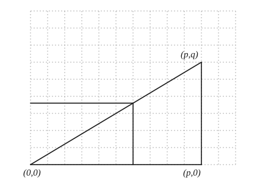

> 原书 PDF 第 45-51 页

## 第6章用一种以上的方法计数

双重计数原理是组合数学中最重要、最基本的技巧之一.表示这一原理的一般情况是:如果把问题中所给的信息放置在一张表中，然后将各列相加或各行相加，利用这两种方法就能得到信息的总和.

使这一原理形象化的具体方法是我们描述某个集合S，然后用两种方法对其元素计数，于是就归结为左边=右边的这类等式.一种方法就会给出左边，另一种方法就会给出右边.

我们将使用在前面第5章中用于证明定理4和定理5以及例36的技巧，使用双重计数原理是最基本的技巧和证明之一，通常可称其为“组合证明”.组合证明让人开阔视野，读写都很有趣.在这类问题中唯一难处理的就是正确地寻找集合S并进行计数

我们从这些例题开始着手，这样会对这一原理有更好的感觉.

例41 证明

$$
\tau(1)+\tau(2)+\cdots+\tau(n)=\left\lfloor\frac{n}{1}\right\rfloor+\left\lfloor\frac{n}{2}\right\rfloor+\cdots+\left\lfloor\frac{n}{n}\right\rfloor
$$

这里 $\tau ( k )$ 表示正整数k的正约数的个数， $\lfloor x \rfloor$ 表示实数x的整数部分

证明设S是有序数对(d,k)的集合，其中 $1 \leqslant d \leqslant k \leqslant n,d$ 是k的一个约数.

一方面，现在要问对于给定的k，有多少个这样的 $d ?$ 答案很明显，根据定义这就是$\tau ( k )$ .于是对所有的k求和，得

$$
S \mid = \tau(1) + \tau(2) + \cdots + \tau(n)
$$

另一方面，换个看法，如果固定d，我们能找出多少个这样的k，使 $d \mid k$ ，且 $1 \leq k \leq$ $n 9$ 答案是 $\frac { n } { d }$ .于是再对d的所有选择求和，得

$$
| S | = \lfloor \frac{n}{1} \rfloor + \lfloor \frac{n}{2} \rfloor + \cdots + \lfloor \frac{n}{n} \rfloor
$$

例42证明

$$
\sum_{d \mid n} \varphi(d) = n
$$

其中 $\varphi ( x )$ 表示欧拉函数，即小于或等于x，且与x互质的正整数的个数

证明我们用两种方法计算集合 $\hat{A}=\left\{\frac{a}{n} \mid 1 \leqslant a \leqslant n\right\}$ 中分数的个数.首先，显然有n个这样的分数.

另一方面，有些分数可以约分，约分之后可以看到每一个都可以表示为 $\frac{p}{d}$ 的形式，其中 $d \mid n$ ,且 $(p,d)=1$ .于是对于每一个 $d \mid n$ ,有 $\varphi ( d )$ 个分母为d的分数.

这就推出集合A中有 $\sum_{d \mid n} \varphi(d)$ 个分数，所以 $\sum_{d \mid n} \varphi(d) = n.$

例 43设 $a_{1} \leqslant a_{2} \leqslant \cdots \leqslant a_{n}=m$ 是正整数，用 $b _ { k }$ 表示满足 $a_{i} \geqslant k$ 的 $\alpha _ { i }$ 的个数.证明

$$
a_{1} + a_{2} + \cdots + a_{n} = b_{1} + b_{2} + \cdots + b_{m}
$$

证明 改变一下对 $b _ { k }$ 的看法.如果我们取下面n个区间 $\left[ 1 , a _ { 1 } \right] , \left( a _ { 1 } , a _ { 2 } \right] , \cdots$ $\left( a _ { i } , a _ { i + 1 } \right] \left( 1 \leqslant i \leqslant n - 1 \right)$ ，于是在 $\left\{ 1, 2, \cdots, n \right\}$ 中的每一个数k恰属于一个这样的区间.对于属于 $\left[ 1 , a _ { 1 } \right]$ 的每一个j，有 $b _ { j } = n ,$ 类似地，对于属于区间 $\left( a _ { i } , a _ { i + 1 } \right] \left( 1 \leqslant i \leqslant n - 1 \right)$ 的每一个j，我们有 $b_{j} = n - i.$ 于是

$$
b_{1}+b_{2}+\cdots+b_{n}=na_{1}+\sum_{i = 1}^{n - 1}(n - i)(a_{i + 1}-a_{i})=a_{1}+a_{2}+\cdots+a_{n}
$$

例44设 $p_{n}(k)$ 是集合 $\left\{ 1, 2, \cdots, n \right\}$ 的恰有k个固定点的排列总数.证明

$$
\sum_{k = 0}^{n}kp_{n}(k) = n!
$$

证明首先看左边.这是对该集合的所有排列中计算各个固定点的个数.更精确地说，这个表达式是计算二元组 $(\pi, x)$ 的个数，其中π是 $\left\{ 1, 2, \cdots, n \right\}$ 的一个排列，x是π的一个固定点.对于每一个 $k = 0, 1, \cdots, n$ ,有 $p_{n}(k)$ 个有k个固定点的排列π.每一个都对应于k个二元组 $( \pi , x )$ .所以左边给出这个总个数.

现在换个看法，我们可以计算根据x划分的同样个数的二元组.对于每一个x，构造一个固定x的一个排列，其余各数可以任意排列，于是有 $(n - 1)!$ 个固定x的排列.所以总共有 $n \cdot (n - 1)! = n!$ 个二元组.因此得到该恒等式

例45有200名学生参加数学竞赛，他们要解6道题，已知每道题至少有120名参赛者正确解出.证明:必定有2名这样的参赛者，他们中至少有1人解出每一道题.

证明我们用两种方法计算参赛者中有多少对这样的学生，这2人都没有解出这次数学竞赛中的任何一道题.

根据已知条件，我们知道任何一道题至多有80名参赛者没有解出.于是对每一道题至多有 $\binom{80}{2}$ 对参赛者没有解出.另一方面，由于有 $\binom{200}{2}$ 对参赛者，并且 $6 \cdot \binom{80}{2} <$ $\binom{200}{2}$ ，所以必定至少有1对这样的参赛者:这2人中有1人解出6道题中的任何一道题

例46 已知 $\hat { P }$ 和q是正整数，证明

$$
\left\lfloor \frac{p}{q} \right\rfloor + \left\lfloor \frac{2p}{q} \right\rfloor + \cdots + \left\lfloor \frac{(q-1)p}{q} \right\rfloor = \left\lfloor \frac{q}{p} \right\rfloor + \left\lfloor \frac{2q}{p} \right\rfloor + \cdots + \left\lfloor \frac{(p-1)q}{p} \right\rfloor
$$

这里x」表示实数x的整数部分.

证明这是一个非常典型的格点(纵坐标和横坐标都是整数的点）计数问题.我们考虑笛卡儿(Descartes)坐标平面内顶点坐标分别为(0,0)，(p,0)，(p，q)的三角形的内部或边上的格点个数(图10).

图10

我们用沿着水平线和竖直线这两种方法进行计数

于是取一点(m,0)，其中 $1 \leqslant m \leqslant p - 1$ .通过这一点画一条竖直线与从(0,0)到$( p , q )$ 的直线相交于纵坐标等于 $-\frac{qm}{p}$ 的点.恰好有 $\frac{qm}{p}$ 个格点，总共得到 $\sum_{m = 1}^{p - 1} \lfloor \frac{qm}{p} \rfloor$ 个格点.

对于水平线，我们再取坐标为 $( p , q - n )$ 的点，在三角形的内部画一条水平线与从(0,0)到 $( p , q )$ 的直线相交，交点的坐标是 $(p - \frac{np}{q}, q - n)$ .每一条这样的水平线上有$\lfloor \frac { \not { p } n } { q } \rfloor$ 个格点.于是总数是 $\sum _ { m = 1 } ^ { q - 1 } \lfloor \frac { p _ { m } } { q } \rfloor$ 个格点.

例47 在一次竞赛中有a名参赛者和b名裁判员，其中b是奇数， $b \geqslant 3 ,$ 每一名裁判员对每一名参赛者评定“通过”或“不通过”.假定k是这样的数，对于任何2名裁判员，他们对至多k名参赛者的评定一致.证明

$$
\frac{k}{a} \geq \frac{b - 1}{2b}
$$

证明我们画一张a行b列的表格，其中行表示参赛者，列表示裁判员.再在格子$( i , j )$ 中做记录，这里 $1 \leqslant i \leqslant a,1 \leqslant j \leqslant b.$ 如果裁判员j对参赛者i评定通过，那么填一个p，如果不通过，则填一个f.

用行与列两种方法统计评定一致，即 $( p , p )$ 或 $(f,f)$ 的总对数记作A.

对于列，看不同的裁判员的评定。利用已知条件，我们知道 $\binom{b}{2}$ 对裁判员中的每一对，

他们至多对k名参赛者的评定一致，所以 $A \leqslant k \binom{b}{2}$

对于行，注意这种情况对参赛者是独立的，所以我们可以对每一名参赛者进行统计，并乘以参赛者的人数a.于是考虑第一名参赛者，假设他得到m次通过，n次不通过.注意，有 $m + n = b$

于是评定的总数是

$$
\begin{aligned}\binom{m}{2} + \binom{n}{2} = & \frac{m^{2} + n^{2} - (m + n)}{2} \\= & \frac{(m + n)^{2} + (m - n)^{2} - 2(m + n)}{4} \\= & \frac{b^{2} - 2b + (m - n)^{2}}{4}\end{aligned}
$$

因为b是奇数， $m ; n$ 是整数，可推得 $|m - n| \geqslant 1$ ，所以第一名参赛者得到的一致评定的总数至少是 $\frac{(b - 1)^{2}}{4}$

于是得到一致评定的总数的下界，即

$$
A \geqslant a \cdot \frac{(b - 1)^{2}}{4}
$$

两者结合后，得到

$$
a \cdot \frac{(b - 1)^{2}}{4} \leqslant A \leqslant k \binom{b}{2}
$$

所以

$$
a \cdot \frac{(b - 1)^{2}}{4} \leqslant k \binom{b}{2}
$$

于是得到所求的不等式，即 $\frac{k}{a} \geq \frac{b - 1}{2b}$

例48设 $A_{1},A_{2},\cdots,A_{n}$ 是 $\{ 1 , 2 , \cdots , n \}$ 的子集，其中每一个至少有 $\frac { n } { 2 }$ 个元素，并且当$i \neq j$ 时，有 $\mid A_{i} \cap A_{j} \mid \leqslant \frac{n}{4}$ .证明

$$
\left| \bigcup_{i = 1}^{k} A_{i} \right| \geqslant \frac{k}{k + 1}n
$$

证明设 $\bigcup_{i = 1}^{k} A_{i} = \left\{ b_{1}, b_{2}, \cdots, b_{m} \right\}$ .我们的目标是要证明 $m \geqslant \frac{k}{k + 1}n.$

考虑以下的表格:集合 $A_{1},A_{2},\cdots,A_{k}$ 表示行，元素 $b_{1},b_{2},\cdots,b_{m}$ 表示列.如果 $b _ { j }$ 是集合 $A _ { i }$ 的元素，则在格子 $(i,j)(1 \leqslant i \leqslant k,1 \leqslant j \leqslant m)$ 中填1.设 $\mathcal { X } _ { i }$ 是在第i列中1的个数，或等价地出现元素 $b_{i}(1 \leqslant i \leqslant m)$ 的集合的个数.

现在有 $S = \sum_{i = 1}^{m} x_{i}$ 等于整个表格中各数的和，对各行求和，得

$$
\sum_{i = 1}^{m}x_{i} = \sum_{i = 1}^{k}\left| A_{i} \right| \geqslant \frac{nk}{2}
$$

现在再看 $\sum_{1 \leqslant i \leqslant j \leqslant k} \left| A_{i} \cap A_{j} \right|$ .它等于在同一列中取出两个1的取法总数.但是这可以改写为用和式和组合数这两种记号表示，得

$$
\sum_{1 \leqslant i \leqslant j \leqslant k} \left| A_{i} \cap A_{j} \right| = \sum_{i = 1}^{m} \binom{x_{i}}{2}
$$

根据已知条件，每个交集至多有 $\frac{\pi}{4}$ 个元素，所以

$$
\sum_{i = 1}^{m} \binom{x_{i}}{2} \leqslant \frac{n}{4} \binom{k}{2}\tag{1}
$$

注意到利用柯西一施瓦兹(Cauchy-Schwartz)不等式，得

$$
\sum_{i = 1}^{m}\left( \frac{x_{i}}{2} \right) = \frac{1}{2}\left( \sum_{i = 1}^{m}x_{i}^{2} - \sum_{i = 1}^{m}x_{i} \right) \geqslant \frac{1}{2}\left( \frac{S^{2}}{m} - S \right) = \frac{S^{2} - mS}{2m}
$$

因为 $S - \frac{m}{2} \geqslant \frac{nk}{2} - \frac{m}{2} \geqslant 0$ ，我们有

$$
S^{2}-mS+\frac{m^{2}}{4}\geqslant \frac{n^{2}k^{2}}{4}-\frac{mnk}{2}+\frac{m^{2}}{4}
$$

所以

$$
\sum_{i = 1}^{m} \binom{x_{i}}{2} \geqslant \frac{n^{2}k^{2} - 2mnk}{8m}
$$

与式(1)结合，就推得

$$
\frac{n^{2}k^{2}-2mnk}{8m}\leqslant\frac{n}{4}\binom{k}{2}
$$

稍微进行一些运算，就可得

$$
m \geqslant \frac{k}{k + 1}n
$$

最后，我们以三个也包含几何内容的例题结束本章，这些例题在计数上给了一些限制，因为在欧几里得(Euclid)几何中出现这些限制是很自然的.

例49平面内有n个点，其中无三点共线.证明:顶点选自这n个点，且面积是1的三角形的个数不大于 $\frac{2}{3}(n^{2} - n)$

证明 我们称面积是1的三角形是“好”的，设T是这样的三角形的个数。我们看

“好”三角形的边.每一个三角形有三条边，所以线段的总数等于3T.

另一方面，如果有一条给定的线段AB，那么它至多是四个“好”三角形的一部分.

假定以上命题不成立，那么这些点中有三个点位于以AB为边界的半个平面内，设这三个点是X,Y，Z.下面是一个初等几何的事实:如果 $| \boldsymbol{A} \boldsymbol{B} \boldsymbol{C} | = | \boldsymbol{A} \boldsymbol{B} \boldsymbol{D} |$ (这是面积的记号)，且C,D两点在AB边的同侧，那么 $\overline { C D } / / A B$ .于是 $XY \parallel AB,YZ \parallel AB$ ,所以X,Y, Z三点共线，这与本题的已知矛盾

因为这一点，以及在n点之间画的线段的最大条数是 $\binom{n}{2}$ ，所以可以推出现在“好”三角形中的线段数至多是 $4\binom{n}{2}$

于是

$$
3T \leqslant 2n(n - 1)
$$

$$
T \leqslant \frac{2}{3}(n^{2} - n)
$$

例50 设k，n是正整数，S是平面内无三点共线的n个点的集合，对于每一个点 $P \in$ S,至少有k个属于S的点与点P等距离.证明 $k < \frac{1}{2} + \sqrt{2n}$

证明设这n个点分别为 $P_{1},P_{2},\cdots,P_{n}$ 考虑以 $P_{i}$ 为圆心的圆 $C_{1},C_{2},\cdots,C_{n}$ ,对于每一个 $P_{i}$ ,到 $P_{i}$ 等距离的最大点集在圆 $C_{i}$ 上.

我们考虑三元组 $(P_{i},P_{j},P_{k})$ ,满足 $j < k, P_j, P_k$ 在圆 $C _ { i }$ 上.对于每一个下标i至少有k个点在圆 $C _ { i }$ 上.于是以 $P_{i}$ 为第一点的三元组 $(P_{i},P_{j},P_{k})$ 至少有 $\binom{k}{2}$ 个，所以三元组的总数至少有 $m \binom{{ \tilde k }}{2}$ 个.

另外，对于每一对点 $(P_{j},P_{k})$ ，如果这一对点都在圆 $C _ { i }$ 上，那么该圆的圆心 $P_{i}$ 必在${ P } _ { j } { P } _ { k }$ 的垂直平分线上.因为S中无三点共线，所以后两点是 $(P_{j},P_{k})$ 的三元组至多有两个，所以总共至多有 $2 \binom{n}{2}$ 个三元组。

将这两次计数的结果相结合，得

$$
n \binom{k}{2} \leqslant 2 \binom{n}{2} \text{ 即 } k(k-1) \leqslant 2(n-1)
$$

该式可改写为

$$
(k - \frac{1}{2})^2 \leqslant 2n - \frac{7}{4} < 2n \quad \text{即} \quad k < \frac{1}{2} + \sqrt{2n}
$$

例 51 设M是平面内 $n(n \geqslant 4)$ 个点的集合，且无三点共线，都不在同一个圆上.求

所有的函数 $f : M \to \mathbb{R}$ ，满足对于任何包含M中的至少三点的圆C，有

$$
\sum_{P \in C \cap M} f(P) = 0
$$

解我们把至少包含M中三点的圆称为“好”圆.每一个三点组恰好属于一个“好”圆.先引进以下引理:

引理

$$
\sum_{P \in M} f(P) = 0
$$

证明对于三点组 $T = \{ P, Q, R \}$ ,设 $f(T)=f(P)+f(Q)+f(R)$ .考虑 $\sum_{T \subseteq M} f(T)$这里T跑遍每一个可能的三点组.

一方面，M的每一个点都恰好包括在 $\binom{n - 1}{2}$ 个三点组内，所以

$$
\sum_{T \subset M} f(T) = \binom{n - 1}{2} \sum_{P \in M} f(P)
$$

另一方面，假定我们选择一个“好”圆C，并计算完全在该圆上的所有三点组的个数。然后如果该圆有M中的k个点，那么每个点都包括在 $\binom{k - 1}{2}$ 内，于是

$$
\sum_{T \subset M \cap C} f(T) = \binom{k - 1}{2} \sum_{P \in M \cap C} f(P) = 0
$$

现在只要对所有的“好”圆求和.因为每一个三点组恰好包括在一个“好”圆内，所以得

$$
\sum_{T \subset M} f(T) = 0
$$

结合这两个等式就证明了引理.

设A，B是任意两点，S是经过这两点的所有“好”圆的集合.M的所有点不共圆，于是$| \textit { S } | > 1$ .除属于M的A，B以外的每一个点恰好属于S的一个圆，所以

$$
0 = \sum_{C \in S} \sum_{P \in C \cap M} f(P) = |S| \left[ f(A) + f(B) \right] + \sum_{P \in M \setminus \{A,B\}} f(P)
$$

利用引理，我们有

$$
0 = ( \mid S \mid - 1 ) \left[ f ( A ) + f ( B ) \right]
$$

由于 $| \hat { S } | > 1$ ，所以

$$
f(A) + f(B) = 0
$$

证明的其余部分就容易了，对于任意三点A,B,C,有

$$
2f(A)=\left[f(A)+f(B)\right]+\left[f(A)+f(C)\right]-\left[f(B)+f(C)\right]=0
$$

所以唯一的函数是零函数.