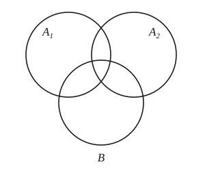

> 原书 PDF 第 56-64 页

## 归纳法的三个部分

归纳法是一种数学技巧，用来证明一个命题对于一切大于或等于某一确定的值(通常是对于一切非负整数，或者一切正整数)都成立.当我们考虑到如何用归纳法有效时，想象为推倒一排多米诺骨牌那样是经常有用的.随着我们较为详细地研究证明过程，对这种比喻的基本情况将变得很清楚.

**基础情况** 对于基础情况，我们要证明命题对于我们所关注的 $n$ 的最小值成立(证明我们能推倒第一块多米诺骨牌).

我们把用作基础情况的 $n$ 值设为一个特定的数.

对于大多数问题，基础情况是 $n=0$ 或 $n=1$.但是，如果你需要证明对 $n \geqslant 6$ 成立的某个命题，那么你的基础情况可能是 $n=6$.

有时候也许会用到，或者甚至是必须要用到多于一个的基础情况.为了确保能有足够的基础情况往后推，但是也要避免多于你所需要的基础情况.做一些额外的事情反而会不符合归纳法的要点.

**归纳假定** 归纳假定是我们要证明的命题对某个 $n=k$ 成立的假定，这里 $k$ 是大于或等于基础情况值的某个整数(即假定我们知道能推倒第 $k$ 块多米诺骨牌).

为什么不假定我们要证明的东西呢？在我们试图证明的命题和归纳假定(我们要断言的命题对 $n$ 的哪些值成立)之间有一个微妙但关键的区别.归纳假定只是对 $n$ 的一个值断言.这里我们不需要分清这个精确的数值，只是把 $k$ 用作一个位置.另一方面，我们的命题是对提出的命题做一个断言，认为我们的命题对大于或等于基础情况值的每一个 $n$ 值成立.

这一区别就是归纳步骤很重要的原因.如果我们止于归纳假定，那么实际上就不能证明任何东西.

注意不要假定 $k$ 在这里或在归纳步骤中有任何特定的性质.这样的假定导致你仅仅对具有那些特殊性质的 $n$ 值的命题进行了证明，而不是一切可能的值.

**归纳步骤** 现在我们知道如果归纳假定正确(对于 $k$ 成立)，那么命题必须对 $n=k+1$ 也成立(多米诺骨牌是这样排列的:如果第 $k$ 块骨牌被推倒，那么第 $k+1$ 块骨牌也被推倒).

从 $n=k+1$ 开始，把命题分成几个较小的部分，这样你可以用归纳假定证明命题正确.虽然这可能很诱人，避免从 $n=k$ 的情况开始，试图推进到 $n=k+1$ 的情况，对于某些问题，从较小的情况开始推进将是有效的，但是在另一些情况下可能会使你遗漏一些次要的情况.从 $n = k + 1$ 的一般情况开始，然后归结为一个较小的问题将会确保你涵盖一切情况.

确保你不要假定当 $n = k + 1$ 时情况成立.如果你这样假定的话，那你就是把要证明的东西做了假定，并不是实际上在证明它.如何避免这种情况呢？举个例子，如果在处理一个等式，从等式的一边开始对表达式进行一系列的变形，得到等式的另一边的表达式，那么在变形过程的某处将会用到归纳假定.

## 归纳法为什么能把命题一路推下去

一旦完成了这三个部分，我们就大功告成了！我们证明了命题对某个基础的值成立(例如，当 $n=1$ 时，命题成立)，我们还要证明如果命题对某个一般的值 $n=k$ 成立，那么命题对 $n = k + 1$ 也成立.这就是说，因为命题对 $n = 1$ 成立，所以对 $n = 1 + 1 = 2$ 也成立；因为命题对 $n = 2$ 成立，所以对 $n = 2 + 1 = 3$ 也成立；因为命题对 $n = 3$ 成立，所以对 $n = 3 + 1 = 4$ 也成立，等等.这就是我们在归纳假定或归纳步骤中对 $k$ 的某个特定的值不做任何假定的重要原因.把 $k$ 留作一个特殊位置的变量可以让我们去确立这个多米诺骨牌的连锁效应.

## 卡住时先用小值试一试

如果你在处理一个归纳问题时陷入困境的话，那么可以尝试一下将一个较小的值代替 $n$，探求一个进行下去的方式.这总是解题的一个好的出发点，而且对归纳证明特别有用.

## 从一个熟悉的恒等式开始

为了说明证明的每一个步骤在实践中是如何起作用的，我们考察下面这个熟知的恒等式.

## 例61：前 n 个正整数之和的公式

**例61** 证明: $\sum_{i = 1}^{n}i = 1 + 2 + 3 + \cdots + n = \frac{n(n + 1)}{2}.$

**证明** 有多种方法证明这一结果.这里我们用对 $n$ 归纳的方法证明.

**基础情况** 当 $n=1$ 时，代入后，看到 $\sum_{i = 1}^{1}i = 1 = \frac{1 \cdot 2}{2}$，所以基础情况成立.

**归纳假定** 假定当 $n = k$ 时命题成立，即对某个 $k \geqslant 1$，有

$$
\sum_{i = 1}^{k}i = 1 + 2 + 3 + \cdots + k = \frac{k(k + 1)}{2}
$$

**归纳步骤** 当 $n = k + 1$ 时，考虑等式的左边，表达式变为 $\sum_{i = 1}^{k + 1}i$.注意

$$
\sum_{i = 1}^{k + 1}i = (k + 1) + \sum_{i = 1}^{k}i
$$

根据归纳假定，我们知道

$$
\sum_{i = 1}^{k} i = \frac{k(k + 1)}{2}
$$

将这一式子代入上面的式子，有

$$
\begin{aligned}
\sum_{i = 1}^{k + 1}i &= k + 1 + \frac{k(k + 1)}{2} = \frac{2k + 2}{2} + \frac{k^{2} + k}{2} \\
&= \frac{k^{2}+3k+2}{2} = \frac{(k+1)(k+2)}{2} \\
&= \frac{(k+1)[(k+1)+1]}{2}
\end{aligned}
$$

因为已经证明 $\sum_{i = 1}^{k + 1}i = \frac{(k + 1)(k + 2)}{2}$，所以我们知道，如果恒等式对 $n = k$ 成立，那么对 $n = k + 1$ 也成立.根据数学归纳法原理，这就推得我们的证明.

## 例62：用归纳法证明二项式定理

我们也可以用归纳法证明前面见到过的一个结果:

**例62** 利用归纳法证明:对 $n \geqslant 1$，二项式定理

$$
(x + y)^n = \sum_{j = 0}^{n} \binom{n}{j} x^j y^{n - j}
$$

**证明** 我们对 $n$ 归纳.

**基础情况** 当 $n=1$ 时，我们有

$$
(x + y)^{1} = x + y = \binom{1}{0} x^{0} y^{1 - 0} + \binom{1}{1} x^{1} y^{1 - 1}
$$

所以基础情况成立.

**归纳假定** 假定对某个 $k \geqslant 1$，当 $n=k$ 时，结论成立，即

$$
(x + y)^k = \sum_{j = 0}^{k} \binom{k}{j} x^j y^{k - j}
$$

**归纳步骤** 当 $n = k + 1$ 时，考虑等式的左边.根据归纳假定，我们有

$$
(x + y)^{k + 1} = (x + y)(x + y)^k = (x + y)\sum_{j = 0}^{k}\binom{k}{j}x^{j}y^{k - j}
$$

展开后重新排列，有

$$
\begin{aligned}
(x + y)^{k + 1} &= \sum_{j = 0}^{k} \binom{k}{j} x^{j + 1} y^{k - j} + \sum_{j = 0}^{k} \binom{k}{j} x^{j} y^{k - j + 1} \\
&= \sum_{j = 1}^{k + 1} \binom{k}{j - 1} x^{j} y^{k - j + 1} + \sum_{j = 0}^{k} \binom{k}{j} x^{j} y^{k - j + 1} \\
&= \binom{k}{0} x^{0} y^{k + 1} + \binom{k}{k} x^{k + 1} y^{0} + \sum_{j = 1}^{k} \left[ \binom{k}{j} + \binom{k}{j - 1} \right] x^{j} y^{k - j + 1}
\end{aligned}
$$

利用帕斯卡恒等式以及以下事实

$$
\binom{k}{0} = \binom{k + 1}{0} = \binom{k}{k} = \binom{k + 1}{k + 1} = 1
$$

化简后得

$$
\begin{aligned}
(x + y)^{k + 1} &= \binom{k + 1}{0} x^{0} y^{k + 1} + \binom{k + 1}{k + 1} x^{k + 1} y^{0} + \sum_{j = 1}^{k} \binom{k + 1}{j} x^{j} y^{k - j + 1} \\
&= \sum_{j = 0}^{k + 1} \binom{k + 1}{j} x^{j} y^{k - j + 1}
\end{aligned}
$$

这就是要证明的.根据数学归纳法原理，这就推得我们的证明.

## 例63：并集对交集分配律推广到 n 个集合

**例63** 对于一切 $n > 1$，有集合 $B,A_{1},A_{2},A_{3},\cdots,A_{n}$，证明

$$
( A_{1} \cap A_{2} \cap \cdots \cap A_{n} ) \cup B = ( A_{1} \cup B ) \cap ( A_{2} \cup B ) \cap ( A_{3} \cup B ) \cap \cdots \cap ( A_{n} \cup B )
$$

**证明**

**基础情况** 当 $n = 2$ 时，我们希望证明

$$
(A_{1} \cap A_{2}) \cup B = (A_{1} \cup B) \cap (A_{2} \cup B)
$$

我们可以直接做到这一点，只要对一个文氏图(图11)中相应的区域涂上阴影，并注意到这个结果对等式两边是相同的.

图11

**归纳假定** 假定当 $n = k$ 时，对某个 $k \geqslant 2$，结论成立，即对任何集合 $B,A_{1},A_{2},A_{3},\cdots,A_{k}$，有

$$
( A_{1} \cap A_{2} \cap \cdots \cap A_{k} ) \cup B = ( A_{1} \cup B ) \cap ( A_{2} \cup B ) \cap ( A_{3} \cup B ) \cap \cdots \cap ( A_{k} \cup B )
$$

**归纳步骤** 考虑当 $n = k + 1$ 时，有

$$
(A_{1} \cap A_{2} \cap \cdots \cap A_{k+1}) \cup B
$$

设 $C = A_{1} \cap A_{2} \cap \cdots \cap A_{k}$.于是上述表达式变为 $(C \cap A_{k+1}) \cup B$.根据基础情况，上式等于

$$
(C \cup B) \cap (A_{k+1} \cup B) = \left[ (A_1 \cap A_2 \cap \cdots \cap A_k) \cup B \right] \cap (A_{k+1} \cup B)
$$

现在对第一项用归纳假定，得

$$
\left[ \left( A_{1} \cup B \right) \cap \left( A_{2} \cup B \right) \cap \left( A_{3} \cup B \right) \cap \cdots \cap \left( A_{k} \cup B \right) \right] \cap \left( A_{k+1} \cup B \right)
$$

即

$$
( A_{1} \cup B ) \cap ( A_{2} \cup B ) \cap ( A_{3} \cup B ) \cap \cdots \cap ( A_{k} \cup B ) \cap ( A_{k+1} \cup B )
$$

这就是所要证明的.因为我们没有对集合做出任何假定，所以对任何集合 $B,A_{1},A_{2},\cdots,A_{k},A_{k+1}$，命题都成立，这就推得我们的证明.

## 命题不是等式的情形

归纳法还能用于要证明的命题不是等式的情况.看一些例子.

## 例64：L 形三米诺骨牌铺满缺一格的棋盘

**例64** 证明:对于任何 $n \geqslant 1$，一个 $2^{n} \times 2^{n}$ 的板去掉任何一个单位格子后恰能被形如 L 的三米诺骨牌无重叠地覆盖.

**证明** 我们对 $n$ 进行归纳.

**基础情况** 当 $n=1$ 时，我们有一个去掉一个小正方形的 $2 \times 2$ 的网格.余下部分恰是排成 L 形的三个正方形，恰好能被一个三米诺骨牌覆盖.

**归纳假定** 假定对某个 $k \geqslant 1$，当 $n=k$ 时命题成立，即一个 $2^{k} \times 2^{k}$ 的板去掉一个正方形后能用形如 L 的三米诺骨牌铺砌.

**归纳步骤** 考虑当 $n = k + 1$ 时一个 $2^{k + 1} \times 2^{k + 1}$ 的板去掉一个正方形的网格.我们可以将这个网格分成四块大小相等的 $2^{k} \times 2^{k}$ 的板，其中有一块去掉一个正方形.根据归纳假定，这一块能用形如 L 的三米诺骨牌铺砌.把一块三米诺骨牌放在其余三块板的中间，覆盖每一块板的角上的一个正方形.我们可以把这三块板中被一块三米诺骨牌覆盖的格子当作这三块板中被去掉的格子，所以剩下的三块都是去掉一个正方形的 $2^{k} \times 2^{k}$ 的网格.根据归纳假定，这三块网格中每一块都能被形如 L 的三米诺骨牌铺砌，所以我们用这些三米诺骨牌覆盖整个网格.于是，任何 $2^{k + 1} \times 2^{k + 1}$ 的板去掉一个正方形后能用形如 L 的三米诺骨牌铺砌.根据数学归纳法原理，就推得我们的证明.

## 只对整数的某个无限子集成立的命题

有时候我们可能要证明一个命题只对整数的某个无限子集成立(正奇数，只是除以 $4$ 余 $1$ 的整数，等等).在这种情况下，我们可以把所需要的值写成对要归纳变量的一个函数，并从这里进行归纳.在下面的例子中，我们希望只对奇数大小的范围内证明一个命题.

## 例65：奇数名儿童互相扔蛋挞

**例65** 有 $n(n \geqslant 3)$ 名儿童在操场上玩耍.每个人都拿着一个蛋挞，突然每名儿童都把自己的蛋挞扔在最靠近他(她)的儿童的脸上.假定所有儿童之间的距离都不相同，用归纳法证明:如果 $n$ 是奇数，那么至少有一名儿童没有被别人扔蛋挞.

**证明** 为确保 $n$ 是奇数，设 $n = 2k - 1$.对 $k$ 进行归纳.

**基础情况** 当 $k=2$ 时，注意他们之间距离最近的两名儿童将相互扔蛋挞，第三名儿童把自己的蛋挞扔向这两名儿童之一，但是他(她)没有被别人扔蛋挞.于是命题成立.

**归纳假定** 假定对于某个 $k \geqslant 2$，对于一群 $n = 2k - 1$ 名儿童的任意分布至少有一名儿童没有被别人扔蛋挞.

**归纳步骤** 考虑 $n = 2(k + 1) - 1 = 2k + 1$ 名儿童的情况.设 Alice 和 Bob 是他们之中距离最近的两名儿童.于是 Alice 把她的蛋挞扔向 Bob，Bob 把他的蛋挞扔向 Alice.暂不考虑 Alice 和 Bob，根据归纳假定，我们知道在另外 $2k-1$ 名儿童中必有某一名儿童 Joy 没有被别人扔蛋挞，他也没有被 Alice 和 Bob 扔蛋挞，所以不会引起包括 Alice 和 Bob 在内的另一名儿童把目标转向 Joy(一名儿童只能把自己的目标转向 Alice 或 Bob).于是 Joy 没有被别人扔蛋挞.根据数学归纳法原理，就推得我们的证明.

## 例66：循环赛中按胜负排出一列选手

**例66** 有 $n$ 个人参加一次循环赛.每一场比赛的结局有胜负之分(没有平局).有没有可能对这 $n$ 名选手编号为 $P_{1},P_{2},P_{3},\cdots,P_{n}$，使得 $P_{1}$ 胜 $P_{2},P_{2}$ 胜 $P_{3}, \cdots, P_{n-1}$ 胜 $P_{n}$.

**解** 对 $n$ 进行归纳.

**基础情况** 当 $n = 2$ 时，有一场两名选手进行的比赛，比赛一胜一负.胜者编号为 $P_{1}$，负者编号为 $P_{2}$.这样的排序符合要求.

**归纳假定** 假定对某个 $k \geqslant 2$，当 $n = k$ 时，在一次有 $k$ 个人参加的循环赛中，我们能对这 $k$ 名选手编号为 $P_{1},P_{2},P_{3},\cdots,P_{k}$，使得 $P_{1}$ 胜 $P_{2},P_{2}$ 胜 $P_{3}, \cdots, P_{k-1}$ 胜 $P_{k}$.

**归纳步骤** 考虑一次有 $k+1$ 名选手参加的循环赛.挑出一名选手 $X$，暂时不考虑选手 $X$.这样就考虑留下的 $k$ 名选手.根据归纳假定，存在某个顺序 $P_{1}^{\prime},P_{2}^{\prime},\cdots,P_{k}^{\prime}$，有 $P_{1}^{\prime}$ 胜 $P_{2}^{\prime},P_{2}^{\prime}$ 胜 $P_{3}^{\prime}, \cdots, P_{k-1}^{\prime}$ 胜 $P_{k}^{\prime}$.我们需要在这一顺序中找到一个位置插入选手 $X$；如果我们能够找到这样一个位置，那么就得到对所有 $k + 1$ 名选手的一个符合规则的排序.

如果选手 $X$ 没有负过，那么就取顺序为 $X,P_{1}^{\prime},P_{2}^{\prime},\cdots,P_{k}^{\prime}$，对相应的选手编号.如果与其他选手的比赛中至少负过一次.设 $j(1 \leqslant j \leqslant k)$ 是在战胜选手 $X$ 的选手 $P_{j}^{\prime}$ 中下标最大的.因为下标 $j$ 最大，所以选手 $X$ 必胜选手 $P_{j + 1}^{\prime}$(或 $j = k$)，于是顺序 $P_{1}^{\prime},P_{2}^{\prime},\cdots,P_{j}^{\prime},X,P_{j + 1}^{\prime}, \cdots, P_{k}^{\prime}$ 是符合规则的一个有效的排序.

根据数学归纳法原理，就推得我们的证明.

## 例67：每场锦标赛都有一只鸡王

**例67** 一群鸡有 $n$ 只，进行一对一的锦标赛.每一场对决的结局有胜负之分(没有平局).先啄到对方的鸡为胜者.如果鸡 $u$ 啄到另一只鸡 $w$，而鸡 $w$ 啄到鸡 $v$，那么就说，鸡 $u$ 间接啄到另一只鸡 $v$.在锦标赛结束时，如果有一只鸡啄到或者间接啄到其他所有的鸡，那么就称这只鸡为这次锦标赛的鸡王.证明:每一次锦标赛都有一只鸡王.

**证明** 对 $n$ 进行归纳.

**基础情况** 当 $n = 2$ 时，范围最小的，且能称得上锦标赛的是有两只鸡的锦标赛.必有一只鸡啄到另一只鸡，这只鸡就是鸡王.于是任何有两只鸡参加的锦标赛有一只鸡王.

**归纳假定** 假定当 $n = k$ 时，结论成立.也就是说，对某个 $k \geqslant 2$，有 $k$ 只鸡参加的锦标赛有一只鸡王.

**归纳步骤** 考虑有 $k+1$ 只鸡参加的锦标赛.我们暂时把一只鸡放在一边(比如说，小鸡)，然后关注其余 $k$ 只鸡.根据归纳假定，在这 $k$ 只鸡中，必有一只鸡是在 $k$ 只鸡参加的亚锦标赛中的鸡王.现在考虑小鸡.

如果小鸡被亚锦标赛的鸡王啄到，那么这只鸡王就是整个锦标赛的鸡王.

如果小鸡被另一只鸡啄到，而这另一只鸡被亚锦标赛的鸡王啄到，那么这只鸡王间接啄到小鸡，于是这只亚锦标赛的鸡王就是整个锦标赛的鸡王.

余下的情况是小鸡啄到亚锦标赛的鸡王，但是没有被任何亚锦标赛中鸡王啄到的鸡啄到(小鸡啄到所有被亚锦标赛的鸡王啄到的鸡).在这种情况下，我们就称小鸡为鸡王.注意，任何没有被小鸡啄到的鸡也没有被亚锦标赛的鸡王啄到.于是这只鸡必定被亚锦标赛的鸡王啄到的某一只鸡啄到.因为小鸡啄到所有被鸡王啄到的鸡，这就是说，小鸡间接啄到这只鸡，于是小鸡啄到或者间接啄到所有另外的鸡.

根据数学归纳法原理，就推得我们的证明.

## 强归纳法

归纳法有许多变式.这里我们将讨论一种常用的变式(“强归纳法”).

强归纳法与“正常的”归纳法有何区别？

唯一的变化是归纳假定.强归纳法不是假定命题，当 $n=k$($k$ 是某个大于或等于基础情况值的整数)时命题成立，而是假定命题对于每一个大于或等于基础情况的值，但是小于或等于 $k$ 的每一个整数都成立.

例如，如果基础情况是 $n = 1$，那么我们的归纳假定是:假定命题对 $n = 1,n = 2,n = 3,\cdots,n = k$ 都成立.

## 这种方法为什么还是正确的

初看，似乎我们的假定有一大堆.但是当我们的归纳假定失效时，与正常的归纳法恰有同样的多米诺骨牌效应.我们还是从基础情况开始(比如说，$n = 1$).接下来，我们证明如果命题对每一个整数 $n(1 \leqslant n \leqslant k)$ 成立，则命题对 $n = k + 1$ 成立.

现在从基础情况开始推进.因为命题对每一个整数 $n(1 \leqslant n \leqslant k)$ 成立，必定对 $n = 1 + 1 = 2$ 也成立.因为命题对满足 $1 \leqslant n \leqslant 2$ 的每一个整数 $n$ 成立，所以对 $n = 3$ 也成立.这一方式可以一直进行下去.

## 我们怎么知道什么时候用强归纳而不用正常归纳

采用哪一种方法是没有明确规定的，但是一般应该是在正常归纳不能用时才用.如果你要进行归纳步骤($n = k + 1$ 的情况)，发现你不能想出归结为 $n=k$ 的情况的方法，但是能想出归结为对 $n$ 的一个较小的值的一种(或几种)情况的方法，此时，看来可以加强你的假定，利用强归纳法会有帮助.

强归纳法的一个典型应用是证明由递推关系确定的数列的通项.如果你不熟悉递推关系，那么下一章我们将进行详细的研究.

## 例68：用比内公式给出斐波那契数列的通项

**例68** 证明:比内(Binet)公式给出斐波那契(Fibonacci)数列的通项

$$
F_{n}=\frac{1}{\sqrt{5}}\left[\left(\frac{1+\sqrt{5}}{2}\right)^{n}-\left(\frac{1-\sqrt{5}}{2}\right)^{n}\right]
$$

回忆一下，斐波那契数定义为 $F_{0}=0,F_{1}=1$ 以及当 $n \geqslant 2$ 时，$F_{n}=F_{n - 1}+F_{n - 2}$.

**证明**

**基础情况** 为了利用递推关系，需要两个基础情况 $n = 0$ 和 $n = 1$.我们有

$$
\frac{1}{\sqrt{5}}\left[\left(\frac{1+\sqrt{5}}{2}\right)^{0}-\left(\frac{1-\sqrt{5}}{2}\right)^{0}\right]=\frac{1}{\sqrt{5}}(1-1)=0=F_{0}
$$

和

$$
\frac{1}{\sqrt{5}}\left[\left(\frac{1+\sqrt{5}}{2}\right)^{1}-\left(\frac{1-\sqrt{5}}{2}\right)^{1}\right]=\frac{1}{\sqrt{5}}(\sqrt{5})=1=F_{1}
$$

所以基础情况成立.

**归纳假定** 假定对一切 $n(1 \leqslant n \leqslant k-1)$，比内公式给出第 $n$ 个斐波那契数.

**归纳步骤** 考虑 $F_{k}$.由递推关系，我们知道

$$
F_{k} = F_{k - 1} + F_{k - 2}
$$

根据强归纳假定可以用比内公式，得

$$
\begin{aligned}
F_{k} &= F_{k - 1} + F_{k - 2} \\
&= \frac{1}{\sqrt{5}}\left[\left(\frac{1 + \sqrt{5}}{2}\right)^{k - 1} - \left(\frac{1 - \sqrt{5}}{2}\right)^{k - 1}\right] + \frac{1}{\sqrt{5}}\left[\left(\frac{1 + \sqrt{5}}{2}\right)^{k - 2} - \left(\frac{1 - \sqrt{5}}{2}\right)^{k - 2}\right] \\
&= \frac{1}{\sqrt{5}}\left[\left(\frac{1 + \sqrt{5}}{2}\right)^{k - 2}\left(\frac{3 + \sqrt{5}}{2}\right) - \left(\frac{1 - \sqrt{5}}{2}\right)^{k - 2}\left(\frac{3 - \sqrt{5}}{2}\right)\right]
\end{aligned}
$$

注意到

$$
\left( \frac{1 + \sqrt{5}}{2} \right)^{2} = \frac{3 + \sqrt{5}}{2} \quad \text{和} \quad \left( \frac{1 - \sqrt{5}}{2} \right)^{2} = \frac{3 - \sqrt{5}}{2}
$$

所以化简后得

$$
F_{k}=\frac{1}{\sqrt{5}}\left[\left(\frac{1+\sqrt{5}}{2}\right)^{k}-\left(\frac{1-\sqrt{5}}{2}\right)^{k}\right]
$$

这就是所要求的.根据数学归纳法原理，就推得我们的证明.

## 例69：正整数的二进制表示

**例69** 证明:每一个正整数 $n$ 有一个二进制表示法.也就是说，要证明每一个正整数 $n$ 能表示为

$$
n = c_{j}2^{j} + c_{j-1}2^{j-1} + \cdots + c_{2}2^{2} + c_{1}2^{1} + c_{0}2^{0}
$$

这里每一个 $c_{i}$ 都取 $0$ 或 $1$.

**证明** 我们对 $n$ 进行强归纳.

**基础情况** 当 $n = 1$ 时，$1$ 就是 $1 \cdot 2^{0}$，所以它是一个二进制表示法.

**归纳假定** 假定对一切 $n(1 \leqslant n \leqslant k-1)$，$n$ 有一个二进制表示法.

**归纳步骤** 对 $n = k$，考虑 $k$ 的奇偶性两种情况.如果 $k$ 是奇数，那么 $k-1$ 是偶数，所以 $\frac{k - 1}{2}$ 是小于 $k$ 的正整数，根据归纳假定，它必有某个二进制表示法

$$
\frac{k - 1}{2} = c_{j}2^{j} + c_{j - 1}2^{j - 1} + \cdots + c_{2}2^{2} + c_{1}2^{1} + c_{0}2^{0}
$$

乘以 $2$ 后，得到 $k-1$ 的一个二进制表示法

$$
k - 1 = c_{j}2^{j + 1} + c_{j - 1}2^{j} + \cdots + c_{2}2^{3} + c_{1}2^{2} + c_{0}2^{1}
$$

两边加 $1$，得到 $k$ 的一个二进制表示法

$$
k = c_{j}2^{j+1} + c_{j-1}2^{j} + \cdots + c_{2}2^{3} + c_{1}2^{2} + c_{0}2^{1} + 1 \cdot 2^{0}
$$

另一方面，假定 $k$ 是偶数，注意到 $\frac{k}{2}$ 是小于 $k$ 的正整数，根据归纳假定，我们知道它有某个二进制表示法

$$
\frac{k}{2}=c_{j}2^{j}+c_{j-1}2^{j-1}+\cdots+c_{2}2^{2}+c_{1}2^{1}+c_{0}2^{0}
$$

乘以 $2$ 后，得

$$
k = c_{j}2^{j + 1} + c_{j - 1}2^{j} + \cdots + c_{2}2^{3} + c_{1}2^{2} + c_{0}2^{1}
$$

这是 $k$ 的二进制表示法.因为每一个正整数或者是奇数，或者是偶数，根据数学归纳法原理，就推得我们的证明.
