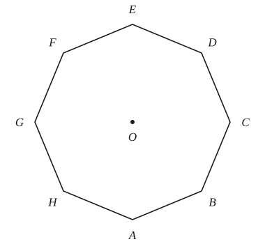

> 原书 PDF 第 65-74 页

## 第9章递推关系

虽然加法原理和乘法原理为计数提供了强有力的工具，但是有一些问题并不是只用这两个原理就很容易解决的.有些问题利用比较直接的方法难以解决，而利用递推关系却十分容易解决.在这类问题中，我们要进行的计数是有一个一般方法的，那就是依赖于一个自由参数，比如说n.例如，回到例6，我们本来是要计算集合 $\left\{ 1 , 2 , \cdots , n \right\}$ 的子集的个数.解决这个问题的一种方法是当n变化时，计算所有这样数列的个数.在例6的情况下，我们设 $(a_{n})_{n \geqslant 0}$ 是 $a_{n}$ 的一个数列，它等于 $\left\{ 1 , 2 , \cdots , n \right\}$ 的子集的个数.从例6可知 $a_{n} = 2^{n}$但是我们暂时假装不知道，不去寻找 $a_{n}$ 的一个公式，而是寻找一个用数列 $a_{1},a_{2},\cdots,a_{n-1}$的所有前面的项表示 $a _ { n }$ 的一个公式.在例6的情况下，这是非常容易的. $\left\{ 1, 2, \cdots, n \right\}$ 的一个子集或者包含n,或者不包含n.如果这个子集包含n,那么在 $\left\{ 1, 2, \cdots, n-1 \right\}$ 的子集中添加n;如果这个子集不包含n，那么已经是{1,2，…，n-1}的一个子集了.于是，我们看到有 $a_{n - 1}$ 个子集包含n,另外还有 $a_{n - 1}$ 个子集不包含n. 于是 $a_{n} = 2a_{n - 1}$

递推关系和归纳法有类似之处.在一个（强）归纳证明的归纳步骤中，我们让读者看到，如果我们能证明归纳假定的前面所有情况，那么我们就能证明下一种情况.递推关系告诉我们，如果我们知道数列 $\left( a_{n} \right)$ 中的前面所有项，那么我们就能计算出下一项

如果我们能够找到数列 $\left( \vec{a}_{n} \right)$ 的一个递推关系，那么就可以合理而有效地计算出$a _ { n }$ (大致有n步).对于有些问题，这是能做的最好方法.但是，对于许多递推关系，我们可以用递推求得一般项 $a _ { n }$ 的一个通项公式.例如，对于递推关系 $a_{n} = 2a_{n - 1}$ ，容易看出这一递推关系的一般解是 $a_{n} = C 2^{n}$ ，这里C是某个常数.利用该数列的任意一项(比如说 $a_{0} = 1$因为空集的唯一子集就是空集本身)，就能确定 $C = 1$ ,于是又有 $a_{n} = 2^{n}$ .在上一章中的例68提供了另一个例子，在这个例子中，我们把斐波那契数的递推关系转换为一个具体的公式.我们在附录中为读者提供解递推关系的一些理论成果.

例70有足够多的形如一个 $2 \times 1$ 和 $1 \times 1$ 的砖块.设 $n(n>3)$ 是一个自然数.有多少种方法能用这些砖块铺砌一个 $3 \times n$ 的矩形，使得没有两块 $2 \times 1$ 的矩形有共同的边界(相邻的边界)，并且每个矩形的长边平行于大矩形的短边.

解 我们把没有两块 $2 \times 1$ 的矩形有公共点的这种铺砌称为一个“好”铺砌.用 $a _ { n }$ 表示一个 $3 \times n$ 的矩形的好铺砌的个数.我们将从n=1开始，把所有 $2 \times 1$ 矩形的长边竖放.对于 $n \geqslant 3$ ，这才符合题意.画出可能的图之后，就看到有三种方法铺砌一个 $3 \times 1$ 的矩形，所以 $a _ { 1 } = 3$

当n=2时，把3×2的矩形分割成两个3×1的竖直的矩形条.如果我们把一个 $2 \times$

1的矩形放入其中一个矩形条中，那么我们就不能把2×1这样的矩形放入另一个矩形条中，所以必须用正方形填补其余部分.有四个可能的位置把这个矩形放在这两个矩形条中，于是用一个矩形的铺砌有四种.加上只用1×1的正方形的铺砌，得到 $a_{2} = 5$

我们把这种方法推广到一般的情况.对于一个 $3 \times (n + 1)$ 的矩形有n+1个长为3的竖直的矩形条，如果把一个2×1的矩形放在第n+1个矩形条内，那么就不能再把 $2 \times 1$的矩形放在第n个矩形条内.于是，第n个矩形条只用 $1 \times 1$ 的正方形铺砌.因为有两种方法把这个2×1的矩形放在最后一个矩形条内，并且可以把任意一个 $3 \times (n - 1)$ 的矩形的“好”铺砌放在前n-1个矩形条中，可以看出，这种形式的铺砌有 $2a_{n - 1}$ 种.另一方面，如果在最后一个矩形条内不放一个2×1的矩形，那么唯一的可能是用 $1 \times 1$ 的正方形铺砌.在其余n个矩形条中可以任意放3×n的矩形的“好”铺砌，这就给出 $a _ { n }$ 种可能的铺砌.把这两种情况相结合，得到递推关系 $a_{n + 1} = a_{n} + 2a_{n - 1} \quad (n \geqslant 2)$

我们可以应用二阶常系数线性递推理论把这个递推关系写出 $a_{n}$ 的一个一般公式.这个线性递推关系的特征多项式是 $r^{2}-r-2=0$ ,其根为 $r_{1} = 2$ 和 $r_{2} = - 1$ .于是我们就得到数列 $\mathbb { Z } ^ { n }$ 和 $( = 1 ) ^ { n }$ 满足这一递推关系.因此，这样数列的一般形式是对于某两个常数 $C _ { 1 }$和 $C _ { 2 }$ ,有 $a_{n}=C_{1}2^{n}+C_{2}(-1)^{n}$ .将初始值 $a_{1} = 1$ 和 $a _ { 2 } = 5$ 代入后，就得到线性方程 $2C_{1} =$ $C_{2} = 3$ 和 $4C_{1} + C_{2} = 5$ .解出 $C_{1} = \frac{4}{3}, C_{2} = -\frac{1}{3}$ ，因此，得

$$
a_{n} = \frac{2^{n + 2} + ( - 1)^{n + 1}}{3}
$$

(如果我们早就从 $a _ { 0 } = 1$ 开始递推，那么原本可以使算术运算稍稍简单一些.)

例71 求 $\left\{ 1, 2, \cdots, n \right\}$ 的不包含两个连续整数的子集的个数.

解设这样的子集的个数是.为了得到一个递推关系，我们看最后一个元素n.如 $a_{n}$果n属于这个集合，那么n-1就不属于这个集合，所以就看 $\left\{ 1, 2, \cdots, n - 2 \right\}$ 的类似的子集.注意到对每一个这样的子集，我们可以把n加进去，得到一个没有连续整数的集合.于是这些包含n，但没有连续元素的子集与{1，2，…，n-2}的没有连续整数的子集形成双射，所以有 $a_{n - 2}$ 个这样的子集.

另一种情况是当n不属于这个子集时，我们就有一个 $\left\{ 1, 2, \cdots, n - 1 \right\}$ 的没有连续整数的子集，所以有 $a_{n - 1}$ 个这样的子集.

将这两种情况合在一起，得到递推关系 $a_{n}=a_{n - 1}+a_{n - 2}$ .注意到 $a_{1} = 2, a_{2} = 3$ ，所以我们看出 $a_{n} = F_{n + 2}$ ,这里 $F_{n}$ 是斐波那契数.

例72求由n个字母组成的字母串的个数，其中每一个字母是A，B，C，D中的一个，并且同一个字母不能连续出现三次.

解我们称这样的字母串是“好的”.看一看当我们把一个新的字母加到一个长度为n-1的字母串的末尾时会发生什么情况.通常有4种选择，但是如果字母串的末尾是两个相同的字母，那么后面不能再放同样的字母，于是只有3种选择

这个想法是要确定两个数列.设 $a _ { n }$ 是长度为n的“好”字母串， $b_{n}$ 是长度为n，末尾是两个相同字母的“好”字母串.我们将分别寻找关于 $a _ { n }$ 和 $b_{n}$ 与前面几项的两个递推关系.寻找单个数列的一个递推关系较为有效，而且它使单个递推关系简单一些，使我们能够依次寻找出更为复杂的递推关系.

上面我们几乎已经找到了 $a _ { n }$ 的递推关系.如果一个长度为n-1的“好”字母串不是以两个相同的字母结尾(这样的字母串有 $a _ { n - 1 } - b _ { n - 1 }$ 个)，那么我们有4种方法在末尾加一个字母得到一个长度为n的“好”字母串；如果一个长度为n-1的“好”字母串以两个相同的字母结尾，那么只有3种方法加一个字母.于是得到 $a_{n}=4(a_{n - 1} - b_{n - 1}) + 3b_{n - 1} = 4a_{n - 1} -$ $b_{n - 1}$

$b _ { n }$ 的递推关系类似.如果一个长度为n-1的“好”字母串不是以两个相同的字母结尾，那么重复最后一个字母得到一个长度为n，以两个相同的字母结尾的“好”字母串；如果长度为n-1的“好”字母串以两个相同的字母结尾，那么无法加一个字母得到一个长度为n，以两个相同的字母结尾的“好”字母串.因此得到 $b_{n}=a_{n - 1}-b_{n - 1}$

因为我们不需要计算数列 $b _ { n }$ ，所以我们可以由这两个递推关系消去 $b _ { n }$ ，得到一个只包括 $\mathcal { Q } _ { n }$ 的递推关系，由第一个递推关系，得 $b_{n - 1} = 4a_{n - 1} - a_{n}$ ,因此 $b_{n} = 4a_{n} - a_{n + 1}$ .把这个式子代入第二个递推关系，得 $4a_{n}-a_{n+1}=a_{n-1}-(4a_{n-1}-a_{n})$ ,或者 $a_{n + 1} = 3a_{n} + 3a_{n - 1}$ .把下标改动一下，得到 $a_{n}=3a_{n - 1}+3a_{n - 2} \quad (n>3)$ .计算该数列的前两项是很容易的 $(a_{1} = 4$ $a_{2} = 16$ ，于是可以计算出任何 $a _ { n }$

为了得到 $a _ { n }$ 的一个通项公式，我们看该递推关系的特征多项式 $r^{2}-3r-3=0$ ,这个多项式的根是

$$
r_{1}=\frac{3+\sqrt{21}}{2},r_{2}=\frac{3-\sqrt{21}}{2}
$$

因此，这一递推关系的一般解是对于常数 $C _ { 1 }$ 和 $C _ { 2 }$ ,有

$$
a_{n}=C_{1}\left(\frac{3+\sqrt{21}}{2}\right)^{n}+C_{2}\left(\frac{3-\sqrt{21}}{2}\right)^{n}
$$

将该数列的前两项代入上式，解所得的关于 $C _ { 1 }$ 和 $C _ { 2 }$ 的两个方程，经过一些代数运算后求出

$$
a_{n}=\frac{4}{3\sqrt{21}}\left[\left(\frac{3+\sqrt{21}}{2}\right)^{n+1}+\left(\frac{3-\sqrt{21}}{2}\right)^{n+1}\right]
$$

例73将一个圆分割成n个扇形，用m种颜色对这n个扇形涂色，使得相邻两个扇形的颜色都不相同，求不同涂色的种数.

解将这样的涂色称为“好的”涂色.设将一个圆分割成n个扇形后“好的”涂色的种数为 $C _ { n }$ .我们用乘法原理进行仔细计算涂色的种数会发现什么情况.选取一种颜色对第一个扇形涂色有m种方法，对第二个扇形涂色有m-1种方法，对再下面一个扇形涂色有m-1种方法，继续这一过程直到对最后一个扇形涂色有m-1种方法.这就给出总共有$m(m - 1)^{n - 1}$ 种涂色.

我们马上会注意到这样的计数并不正确。因为我们没有确定第一个扇形和最后一个扇形的颜色应该不同.重要的是，如果我们较为仔细地考虑所进行的计数，那么就会得到一个关于数列 $C _ { n }$ 的递推关系.

如果第一个扇形和最后一个扇形的颜色不同，那么我们就得到一个对n个扇形的“好的”涂色.根据定义有 $c _ { n }$ 个这样的涂色.如果得到第一个扇形和最后一个扇形的颜色相同的结果，那么我们就没有得到一个“好的”涂色.但是在这种情况下，我们可以把第一个扇形和最后一个扇形合并，就得到将一个圆分割成n-1个扇形的“好的”涂色.于是这类涂色有 $c_{n - 1}$ 种，因此得到递推关系 $c_{n}+c_{n - 1}=m(m - 1)^{n - 1}$ .我们可要小心，这只是对 $n \geqslant 3$ 时成立.如果写下对 $n = 2$ 时的递推关系，我们就得到 $c_{1} + c_{2} = m(m - 1)$ .容易计算 $c _ { 2 } =$ $m(m - 1),c_{1} = m$ ，所以这是一个问题.我们可以对 $C_{1}$ 取一个不正确的值，就假想为0，于是实际上比较容易用算术法解出该递推关系.为了求 $C_{n}$ 的通项，我们来看和式

$$
\sum_{j = 2}^{n} (-1)^{n - j} \left(c_{j} + c_{j - 1}\right)
$$

一方面，如果逐项写出这个和式，那么可以看出连续两项可以抵消，结果这个和式等于$c_{n}+(-1)^{n-2}c_{1}=c_{n}$ .另一方面，由上面的递推关系，它等于 $m \sum_{j = 2}^{n} (-1)^{n - j} (m - 1)^{j - 1}$ .这个和式是一个几何级数，于是得

$$
c_{n}=m\frac{(m-1)^{n}+(-1)^{n}(m-1)}{m-1+1}=(m-1)^{n}+(-1)^{n}(m-1)
$$

例74已知函数 $f : \{ 1 , 2 , \cdots , n \} \rightarrow \{ 1 , 2 , 3 , 4 , 5 \}$ ，且对一切 $k = 1,2,\cdots,n - 1$ ，有$\left| f(k + 1) - f(k) \right| \geqslant 3$ ,求函数f的个数.

解思想方法直截了当，我们必须根据f(n)的值把问题分开考虑，然后得到递推关系.必须注意有一个小小的陷阱，如果n=1，那么容易看出有5个这样的函数，因为f(1)可取任何值.但是如果 $n \geqslant 2$ ，那么函数f永远不能取3这个值，因为这将与不等式矛盾.这样一来，将使我们比预期的要晚一些开始递推。

所以设 $a_{n},b_{n},c_{n}$ 和 $d _ { n }$ 分别是当 $f(n)=1,f(n)=2,f(n)=4$ 和 $f(n) = 5$ 时，这样的函数的个数.我们所关注的是当 $n \geqslant 2$ 时，函数的总数 $S_{n}=a_{n}+b_{n}+c_{n}+d_{n}$ (对于 $n = 1$函数的总个数是 $S_{1} = 5$ ，但是 $a_{1} + b_{1} + c_{1} + d_{1} = 4$

对于 $f(n)=1,f(n-1)$ 的可能性是4和5，所以 $a_{n} = c_{n - 1} + d_{n - 1}$ \*0

对于f(n)=2，唯一的可能是 $f(n - 1) = 5$ ,所以 $b_{n} = d_{n - 1}$

对于f(n)=4,又只能有 $f(n - 1) = 1$ ，所以 $c_{n} = a_{n - 1}$ ##

最后，如果 $f(n) = 5$ ,那么 $f(n - 1)$ 有两个值，即1和2，于是 $d_{n}=a_{n - 1}+b_{n - 1}$

现在将第一个等式和最后一个等式相加，得

$$
a_{n}+d_{n}=a_{n-1}+b_{n-1}+c_{n-1}+d_{n-1}=S_{n-1}
$$

将中间两个等式相加，得

$$
b_{n} + c_{n} = a_{n - 1} + d_{n - 1} = S_{n - 2}
$$

最后，全部相加，当 $n \geqslant 4$ 为保证 $n - 2 \geq 2)$ 时，有 $S_{n} = S_{n - 1} + S_{n - 2}$ .注意到 $S_{2} = 6$ $S_{3} = 10$ ，看出这是斐波那契递推关系，对 $n \geqslant 2$ ,有 $S_{n} = 2F_{n + 2}$

例75 如果对 $\left\{ 1, 2, \cdots, n \right\}$ 的子集X，有 $| X | \in X$ (对于集合 $A , \mid A \mid$ 表示集合A的元素的个数)，那么称X是“利己”集，求没有利己真子集这一性质的利己集的个数.

解如果要求递推关系，那就看最后一个元素n，这又是一个好主意.n可能属于一个最小的利已集，也可能不属于.设 $a _ { n }$ 是包含n的最小利已集， $,b_{n}$ 是不包含n的最小利己集.

容易看出，不包含n的那些集合就是 $\left\{ 1, 2, \cdots, n-1 \right\}$ 的最小利己集，所以 $b_{n} = a_{n - 1} +$ $b_{n - 1}$

现在考虑包含n的最小利己集.如果 $n > 1$ ，那么这样的集合不能包含1(因为如果包含1的话，那么{1}就是一个利已真子集)，于是基数不等于n.因此这样的一个集合必定至少有两个不同的元素，即n和它的基数

现在我们可以实施以下技巧，把n从该集合中除去，并将集合中余下的数都减少1.注意，这样不会得到一个0，因为1不能属于这个集合.这个集合的基数也比原来的基数小1.因此，得到集合 $\left\{ 1, 2, \cdots, n-2 \right\}$ 的利己子集.我们断言它是最小的.

这是正确的，因为我们可以把这个过程倒过来.也就是说，如果Y是去掉n后的集合的一个利已真子集，那么我们把Y的每一个元素都加上1，再补上n.这样又给出原集合的一个利己真子集

于是有 $a_{n}=a_{n - 2}+b_{n - 2}$ .我们关注的是最小利己集的总个数 $c_{n}=a_{n}+b_{n}$ .将这两个关系式合起来，得到 $c_{n}=c_{n - 1}+c_{n - 2}$

我们看出这就是斐波那契递推关系.因为 $c_{1} = 1 , c_{2} = 1$ ，所以可推得 $c_{n} = F_{n}$ ,即第n个斐波那契数.

例76 求由数字{0,1,2}组成的长度为n的数字串的个数，但不包含数字串100，101,200或201.

解我们从一个长度为n-1的数字串引申出去看看会发生什么情况，这又是一个好主意.像往常一样，如果一个数字串不包含本命题所排除的任何子数字串，那么就称这个数字串为“好”数字串.设 $S _ { n }$ 是长度为n的数字串的个数， $a _ { n }$ 是长度为n且末尾是1或2的“好”数字串的个数， $,b_{n}$ 是长度为n且末尾是10或20的“好”数字串的个数(为方便起见，这里设 $a_{0}=b_{0}=b_{1}=0$

如果长度至少是2的数字串的末尾不是1,2,10或20,那么其末尾必是00.因为数字串100,200已经排除，这就是说，其末尾必是 $000(n = 2)$ .继续这一个过程，我们看到这个数字串必定全部是零.也容易看出对n=0或1，由 $S_{n}$ 算出，而不是由 $a _ { n }$ 或 $b_{n}$ 算出的仅有的数字串只有0的数字串.因此，可以得到对一切n，有 $s_{n}=a_{n}+b_{n}+1$

我们总是可以把一个2放到任何一个长度为n-1的“好”数字串的后面，得到一个长度为n且末尾是2的“好”数字串.但是要得到一个长度为n且末尾是1的“好”数字串，我们只能把一个1放到一个长度为n-1且末尾是1或2的“好”数字串的后面，或者放在全部是0的数字串的后面.于是得到 $a_{n} = s_{n - 1} + a_{n - 1} + 1$

最后，一个长度为n且末尾是10或20的数字串显然可以由一个长度为n-1且末尾是1或2的“好”数字串的后面补一个0得到.于是 $b_{n} = a_{n - 1}$

容易看出这三个递推关系(以及上面的初始值)让我们可以对一切 $n \geqslant 0$ ,计算 $a_{n},b_{n}$和 $S_{n}$ .为了得到 $S _ { n }$ 的一个通项公式，我们首先由这些递推关系消去 $a_{n}$ 和 $b_{n}$ .消去 $b _ { n }$ 很容易，为了消去 $a_{n}$ ，将前两个递推关系相加和相减，得到 $s_{n}-s_{n-1}=2a_{n-1}+2,s_{n}+s_{n-1}=2a_{n}$将第二个递推关系的下标稍作改动，用来消去 $a_{n - 1}$ ，得到

$$
s_{n}-s_{n-1}=s_{n-1}+s_{n-2}+2
$$

即

$$
s_{n} = 2s_{n - 1} + s_{n - 2} + 2
$$

这类递推关系称为非齐次递推关系，因为它多一个不依赖于数列 $S_{n}$ 的项.为了解这类递推关系，注意到 $t_{n} = s_{n} + 1$ 满足齐次递推关系 $t_{n} = 2t_{n - 1} + t_{n - 2}$ .(求得这个递推关系的一个方法是猜想对于某个常数 $c,t_{n}=s_{n}+c$ 应该满足一个齐次递推关系.用 $s_{n}=t_{n}-c$ 代入后，进行一些代数运算，就得到 $t_{n}=2t_{n - 1}+t_{n - 2}+(2 - 2c)$ ，因此，如果 $c = 1$ ,那么得到这个等式是齐次的.)

为了解这个递推关系，注意到特征多项式

$$
r^{2}-2r-1=0
$$

有根 $r_{1}=1+\sqrt{2},r_{2}=1-\sqrt{2}$ .因此

$$
t_{n}=C_{1}(1+\sqrt{2})^{n}+C_{2}(1-\sqrt{2})^{n}
$$

由初始条件 $t_{0} = s_{0} + 1 = 2$ 和 $t_{1} = s_{1} + 1 = 4$ ,得到

$$
C_{1} + C_{2} = 2, \quad (1 + \sqrt{2})C_{1} + (1 - \sqrt{2})C_{2} = 4
$$

解这两个线性方程，得到 $C_{1}=1+\frac{1}{\sqrt{2}},C_{2}=1-\frac{1}{\sqrt{2}}$ .所以经过一些变形后，得

$$
s_{n} = \frac{1}{\sqrt{2}}\left[ (1 + \sqrt{2})^{n + 1} - (1 - \sqrt{2})^{n + 1} \right] - 1
$$

例77如图12所示，设A和E是一个正八边形的两个相对的顶点.一只青蛙从顶点A起跳，从E以外的任何顶点跳到任意两个相邻的顶点之一，跳到E就停止跳跃.设 $a_{n}$ 是恰好跳n次跳到E的不同的路径数.证明

$$
a_{2n - 1} = 0, a_{2n} = \frac{1}{\sqrt{2}}\left[ (2 + \sqrt{2})^{n - 1} - (2 - \sqrt{2})^{n - 1} \right]
$$

图12

证明想法又是求得递推关系.设 $a_{n},b_{n},c_{n},d_{n},e_{n},f_{n},g_{n}$ 和 $h_{n}$ 是长度为n，分别结束于A，B,C,D,E,F,G,H的不同路径数，我们需要得到 $e _ { n }$

由图像的对称性可知， $b_{n}=h_{n},c_{n}=g_{n},d_{n}=f_{n}$ .两个相对的顶点到出发点A的距离相等.现在容易看出

$$
\begin{aligned}a_{n} = d_{n - 1} + f_{n - 1} = 2d_{n - 1} \\d_{n} = c_{n - 1} \\a_{n} = 2b_{n - 1} \\c_{n} = b_{n - 1} + d_{n - 1} \\b_{n} = a_{n - 1} + c_{n - 1}\end{aligned}
$$

从前两个等式得到 $d_{n}=\frac{e_{n + 1}}{2},c_{n}=\frac{e_{n + 2}}{2}$ .代入第四个等式，得到 $b_{n - 1} = \frac{e_{n + 2} - e_{n}}{2}$ .从第三个等式得到 $a_{n} = e_{n + 2} - e_{n}$

一起代人第五个等式，得到递推关系

$$
e_{n + 3} - 4e_{n + 1} + 2e_{n - 1} = 0
$$

于是得到特征方程 $x^{4}-4x^{2}+2=0$ ,其根是 $x = \pm \sqrt{2 \pm \sqrt{2}}$ .所以有

$$
e_{n}=\left[A+\left(-1\right)^{n}B\right]\left(\sqrt{2+\sqrt{2}}\right)^{n}+\left[C+\left(-1\right)^{n}D\right]\left(\sqrt{2-\sqrt{2}}\right)^{n}
$$

最后注意到 $e_{1}=e_{2}=e_{3}=0,e_{4}=2$ 由 $e_{1} = 0 = e_{3} = 0$ ,得到 $A = B, C = D$

因此，得

$$
A(2+\sqrt{2})+C(2-\sqrt{2})=0
$$

和

$$
A(2+\sqrt{2})^{2}+C(2-\sqrt{2})^{2}=1
$$

第一式乘以 $2 + \sqrt{2}$ ，然后相减得

$$
C=-\frac{2+\sqrt{2}}{4\sqrt{2}},A=\frac{2-\sqrt{2}}{4\sqrt{2}}
$$

代入后就得到所求的结果.

例78设 $n \geqslant 1$ 是一个整数.如果一个集合 $S \subset \{ 0,1,\cdots,4n-1 \}$ 对于任何 $k \in \{ 0$ $1,\cdots,n-1\}$ ，满足以下条件:

(i) 集合 $S \cap \left\{ 4k - 2, 4k - 1, 4k, 4k + 1, 4k + 2 \right\}$ 至多有两个元素；

(ii) 集合 $S \cap \left\{ 4k + 1, 4k + 2, 4k + 3 \right\}$ 至多有一个元素。那么称集合S是“罕见的”.

证明:集合{0,1，…，4n-1}恰有 $8 \cdot 7 ^ { n - 1 }$ 个“罕见的”子集.

证法1设 $a_{n}$ 是 $\left\{ 0,1,\cdots,4n-1 \right\}$ 的“罕见”的子集个数， $b _ { n }$ 是 $\left\{ 0,1,\cdots,4n-1 \right\}$ 的不包含4n-1或4n-2的“罕见”的子集个数.下面设法求递推关系.

注意到因为对 $k = n - 1$ 应用第二个条件，所以差 $a_{n} - b_{n}$ 是只包含4n-1和 $4n - 2$ 之一的“罕见”的子集个数

如果该集合包含4n-1,那么由第一个条件中的k=n-1得到S∩{4n-6,4n-5，4n-4}至多有两个元素，因为第二个条件迫使4n-3不属于该集合，可以推得4n-4属于该集合与否，与其他选择无关，所以得到 $2 a_{n - 1}$ 个这类“罕见”子集.

如果该集合包含4n-2，那么又由第一个条件知， $S \cap \left\{ 4n - 6, 4n - 5, 4n - 4 \right\}$ 至多有一个元素.如果4n-4属于该集合，那么该集合必不包含4n-6=4(n-1)-2或 $4n - 5 = 4(n - 1) - 1$ ，所以得到 $b_{n - 1}$ 个这样的集合.如果4n-4不属于该集合，那么恰好得到$\left\{ 1,2,\cdots,4(n-1)-1 \right\}$ 的一个“罕见”子集，于是共有 $a_{n - 1}$ 个.

这样就得到 $b_{n - 1} + a_{n - 1}$ 个集合.

总的说来，得到

$$
3a_{n - 1} + b_{n - 1} = a_{n} - b_{n}\tag{1}
$$

下面需要得到一个关于 $b _ { n }$ 的递推关系. $b_{n}$ 是不包含4n-1或4n-2的“罕见”子集.于是，第一个条件告诉我们， $S \cap \left\{ 4n - 6, 4n - 5, 4n - 4, 4n - 3 \right\}$ 至多有两个元素.如果4n-4或 $4n = 3$ 中恰有一个属于该集合，或者两者都不属于该集合，那么再将其除去，最后得到{1,2，…，4(n-1)-1}的一个“罕见”子集，所以有 $3a_{n - 1}$ 个“罕见”子集.如果 $4 n =$ 1,4n-3都属于该集合，那么除去后又得到一个不含有4(n-1)-2或 $4(n - 1) - 1$ 的{1,2，…,4(n-1)-1}的一个“罕见”子集，于是得到 $b _ { n - 1 }$ 个这样的集合.

我们得到

$$
b_{n} = 3a_{n - 1} + b_{n - 1}\tag{2}
$$

比较式(1)和式(2)，得到 $b_{n}=3a_{n - 1}+b_{n - 1}=a_{n}-b_{n}$ .因此 $a_{n} = 2b_{n}$ ，将其代回式(2)，得

到 $a_{n} = 7a_{n - 1}$ .因为 $a _ { 1 } = 8$ ，所以 $a_{n} = 8 \cdot 7^{n - 1}$

证法2可对加强的命题P(n)进行归纳得到:{1,2，…，n}的“罕见”子集的个数恰好是 $8 \cdot 7 ^ { n - 1 }$ ，且恰好是不包含4n-1或 $4 n - 2$ 的集合的一半.利用这一点，关于 $a_{n}$ 的递推关系恰好变为 $\frac{1}{2}a_{n - 1} \cdot 6 + \frac{1}{2}a_{n - 1} \cdot 8$ ，其中第一项来自于既包含 $4n - 6$ ,又包含 $4 n - 5$ ,或者包含两者之一的集合，第二项来自于两者都不包含的集合。

例79证明:有超过 $8 ^ { n }$ 个n位数不含有任何一个(任何长度的）数字串出现两次.

证明 我们称具有这一性质的数为“好”数.设 $\tilde{a}_{n}$ 是n位“好”数的个数.我们将证明的是 $a_{n} \geqslant 8a_{n - 1}$ .因为 $a_{1} = 9$ ，所以如果得到 $a_{n} \geqslant 8^{n - 1}a_{1} > 8^{n}$ ，那么就将得证.

像前面的一些例子一样，关键是要弄清楚在构成n-1位“好”数字串时会发生什么情况.我们可以在末位添加任何数字，只要不得到一个有重复的数字串.

显然，有重复的数字串只能发生在这个数的末尾，因为我们是从“好”数字串开始的.显然，有重复的数字串的长度可以是1到 $\left[ \frac{n}{2} \right]$ 的任何数.最后，我们注意到，如果缩减掉这个在末尾重复的数字串，那么我们将得到一个长度为 $n - k$ 的“好”数字串.于是得到构成长度为n-1，末尾为有重复数字的“好”数字串的方法种数等于 $\sum \limits _ { k = 1 } ^ { \left[ \frac { n } { 2 } \right] } a _ { n - k }$

于是 $a_{n}=10a_{n - 1}-\sum_{k = 1}^{\left \lfloor \frac{n}{2} \right \rfloor}a_{n - k}$ .我们可以用强归纳法证明所求的不等式完成证明

因为 $a_{2}=81 \geqslant 8 \cdot 9=8a_{1}$ ，第一步完成.

现在，利用归纳假定，对每一个 $j = 1,2,\cdots,n - 1$ ,有 $a_{n - j} \leqslant \frac{1}{8^{j - 1}} \cdot a_{n - 1}$ .用递推关系，于是得

$$
a_{n} \geqslant a_{n - 1}(10 - \sum_{j = 0}^{\left\lfloor \frac{n}{2} \right\rfloor - 1}\frac{1}{8^{j}}) > a_{n - 1}(10 - \sum_{j = 0}^{\infty}\frac{1}{8^{j}}) \\= a_{n - 1}(10 - \frac{8}{7}) > 8a_{n - 1}
$$

归纳步骤完成，不等式证毕.

例80象棋比赛中“自我避让”，“車”在棋盘上的走法(单位正方形的矩形网格）是从一个小方格平行于棋盘边缘走到另一个小方格，每一步从上一步结束的小方格开始，但是不能越过前面走过的小方格，即“車”的路径没有交叉

设 $R(m,n)$ 是自我避让“車”在一个 $m \times n ( m$ 行，n列）的棋盘上从左下角开始到左上角结束的走法种数。例如，对所有自然数m，有 $R(m,1)=1,R(2,2)=2,R(3,2)=4$ $R(3,3)=11$ .对每一个自然数n，求 $R(3,n)$

解用 $r _ { n }$ 表示所求的 $R(3,n)$ .初始值是 $r_{1} = 1 , r_{2} = 4$ .现在假定 $n \geqslant 3$ ，我们要寻求一个递推关系.

注意到自我避让“車”在 $3 \times n$ 的棋盘上行走的路径归结为以下类型之一:

向上的行棋路线为 $(1,1) \to (2,1) \to (3,1)$

不进入(2，1)的行棋路线.任何这样的行棋路线每一步必须以(1，1)→（1,2)开始，以 $(3,2) \to (3,1)$ 结束，于是除去第一列，就有一个与自我避让“車”在 $3 \times (n - 1)$ 的棋盘上的行棋路线的双射.我们有 $r_{n - 1}$ 种这样的行棋路线

以 $(1,1) \to (1,2) \to (2,2)$ 开始，不回到第一行的行棋路线.这些行棋路线必须从某个(2,k)进入第三行 $(2 \leqslant k \leqslant n)$ ，向左到达(3，1)，于是有n-1种这样的行棋路线.

对某个 $2 \leq k \leq n - 1$ ，开始的行棋路线是 $(1,1) \to (1,2) \to (2,2) \to \cdots \to (2,k) \to$ $(1,k) \to (1,k+1)$ ,结束的行棋路线是 $(3,k+1) \rightarrow (3,k) \rightarrow (3,k-1) \rightarrow \cdots \rightarrow (3,1)$ .在除去前k列后，这些行棋路线对应于一个 $3 \times (n - k)$ 的棋盘.于是加起来就得到 $r _ { n - 2 } +$ $r_{n - 3} + \cdots + r_{1}$ 种这样的行棋路线.

与第三类的行棋路线成水平反射的行棋路线.这种行棋路线以(1,1)→(1,2)开始，从不进入第三行直到最后一格.同样的理由又得到n-1种这样的行棋路线.

最后，与第四类的行棋路线成水平反射的行棋路线.又得到 $r_{n - 2} + r_{n - 3} + \cdots + r_1$ 种这样的行棋路线.

将所有这些行棋路线相加，得

$$
r_{n}=1+r_{n-1}+2(n-1)+2(r_{n-2}+\cdots+r_{1})
$$

这一递推关系式是有技巧的，因为右边的项数随着n的增加而增多.这个技巧是把n换成n+1，重写这个等式，有

$$
r_{n + 1} = 1 + r_{n} + 2n + 2(r_{n - 1} + \cdots + r_{1}) \\= r_{n} + 2 + r_{n - 1} + 1 + r_{n - 1} + 2(n - 1) + 2(r_{n - 2} + \cdots + r_{1}) \\= 2r_{n} + r_{n - 1} + 2
$$

这类递推关系不是齐次多项式，我们必须寻找一个常数c，将其变为齐次多项式.设$x_{n}=r_{n}+c$ ,要有 $x_{n + 1} = 2x_{n} + x_{n - 1}$

于是 $-c=-2c-c+2$ ,或 $c = 1$ .现在我们必须解递推关系 $x_{n + 1} = 2x_{n} + x_{n - 1}, x_{1} = 2$ $x_{2} = 5$ .特征方程是 $r^{2}-2r-1=0$ ，特征根是 $r_{1}=1+\sqrt{2},r_{2}=1-\sqrt{2}$ .于是

$$
x_{n}=C_{1}\left(1+\sqrt{2}\right)^{n}+C_{2}\left(1-\sqrt{2}\right)^{n}
$$

由初始条件解出 $C _ { 1 }$ 和 $C _ { 2 }$ ，然后得到

$$
r_{n}=\frac{1}{2\sqrt{2}}(1+\sqrt{2})^{n+1}-\frac{1}{2\sqrt{2}}(1-\sqrt{2})^{n+1}-1
$$