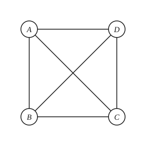
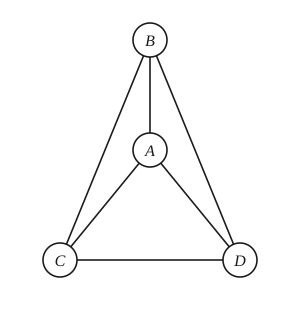
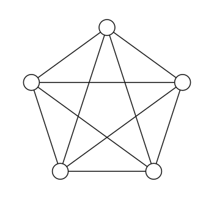

> 原书 PDF 第 75-80 页

## 第10章 图论

图论与组合数学有关，也是数学有魅力的一个分支，仅是图论一个内容就能够写出整整一本教材和教程.无须多说，在本书中我们只能选出很一小部分篇幅接触一下图论.实际上，我们将引进一些基本术语以及关于图的一些事实，看一看称为“树”的这类图，接触一下着色图的概念.除了构建一些新的技巧以外，在前几章使用过的如基本的计数原理、归纳法和鸽巢原理这样一些技巧，我们将能在整章的讨论中使用.

**一、基本术语**

按照正规的说法，一张图G(V，E)就是一对元素，其中V是顶点(我们称其为点）的一个有限集，E是棱(V的二元子集）的集合.图G中的顶点u和v之间的一条棱用uv或vu表示.对于我们的课题，我们关注的是“简单图”:不包含环路(从一个顶点出发回到本身的棱)，或者是多重棱(两个特定的点之间有多条棱)，并且棱没有方向(如果u和v是图G中的顶点，那么uv和vu是同一条棱）的图.

直观上，我们用点表示顶点，画一条联结相应两点的线表示棱.有许多不同的方法画一张图，但是只要顶点和棱的集合相同，就是同一张图.例如，下面就是两种不同的方法画的同一张图(图13，图14).

图13

图14

图 13 和图14 都是 $K_{4}$ ，即是4个顶点的完全图.一般来说，n个顶点的完全图 $K_{n}$ 指的是n个顶点具有一切可能的棱的图.

如果在两个顶点 $u,v(u,v \in V)$ 之间有一条棱，那么就说u和v相邻.顶点 $v \in V$ 的度数是以v为一个端点的棱的条数，记作 $d ( v )$

例81(握手引理)G中所有顶点的度数之和是G中棱数的两倍，即

$$
\sum_{v \in V(G)} d(v) = 2 \mid E \mid
$$

证明我们对形如 $( v , e )$ 的二元对的个数证明这一事实.这里v是G的一个顶点，e 是附属v的一条棱.

首先，我们对每一个顶点计数，有多少个二元对包含一个特定的顶点 $v ? v$ 恰好出现在每一条所附属的棱一次，于是v出现在恰好 $d ( v )$ 个二元对中.对一切可能的v相加，得到 $\sum_{v \in V(G)} d(v)$ 个二元对.

现在我们对每一条棱计数.一条特定的棱恰好附属两个顶点，所以每一条棱出现在恰好两个二元对中.于是共有2|E|个二元对.

因为这两个表达式计算出同一件事，所以它们必相等.于是有 $\sum_{v \in V(G)} d(v) = 2 \mid E$ ,这就是所求的.

例82 完全图 $K_{n}$ 有多少条棱 $? K_{n}$ 的每一个顶点的度数是多少?

解法1完全图 $K_{n}$ 是n个顶点都含有所有可能的棱的图.这就是说，每一对顶点都存在一条棱，所以一个 $K_{n}$ 恰好有 $\binom{n}{2}$ 条棱.

解法2因为图中的每一个顶点与图 $K_{n}$ 中的另一个顶点都相邻，所以每一个顶点的度数都是 $n = 1$ .于是握手引理告诉我们

$$
\mid E \mid = \frac{1}{2} \sum_{v \in K_n} d(v) = \frac{1}{2} \sum_{v \in K_n} (n - 1) = \frac{n(n - 1)}{2} = \binom{n}{2}
$$

这与解法1相同.

图 G 的子图 H 是满足 $V(H) \subseteq V(G)$ 和 $E(H) \subseteq E(G)$ 的图.

例83 考虑图 $K_{6}$ 是有6个顶点的完全图，每个顶点都有 $\binom{6}{2} = 15$ 条棱.对这15条棱涂上红色或蓝色.证明:不管我们如何对棱涂色，必有一个同色的子图 $K_{3}$ ，并证明这对 $K_{5}$未必正确.

证明考虑一个特定的顶点v.因为我们的图是 $K_{6}$ ，每个顶点的度数都是5，所以根据鸽巢原理，v是至少3条同色棱的一个端点.比如说，不失一般性，设至少有3条红色棱，把与这3条棱并与v相连的3个顶点称作 $u_{1},u_{2}$ 和 $u _ { 3 }$

如果 $u _ { i }$ 之间有一条棱是红色的，那么这两个 $u _ { i }$ 和v是一个红色的 $K_{3}$ 的顶点.否则$u_{1}u_{2},u_{1}u_{3},u_{2}u_{3}$ 都是蓝色的，此时 $u _ { 1 } , u _ { 2 }$ 和 $u _ { 3 }$ 是一个蓝色的 $K_{3}$ 的顶点.因此，不管如何对棱涂色， $K_{6}$ 必定包含一个红色 $K_{3}$ ，或蓝色 $K_{3}$ .这样就推出了我们的证明.

最后一步，我们要证明存在一个既无红色 $K_{3}$ ，又无蓝色 $K_{3}$ 的 $K_{5}$ 的涂色.如果我们用“常用”的方法画一个 $K_{5}$ (其顶点形成一个正五边形的顶点)，我们可以对外面的正五边形涂上一种颜色，在内部的正五角星涂上另一种颜色(图15).

图15

图15中的一个步子是相邻顶点的一个序列.路径是所有顶点都不相同的步子；环路是除了最后一个顶点与第一个顶点相同以外，其余的顶点都不相同的步子.如果对于所有的顶点对 $(u,v) \in V(G)$ ，存在一条从u到v的路径，那么我们就说图是连通的.G的成分是G的最大(不能再添加任何东西）的连通子图.

树的定义:

连通的，且没有环路的图式称为树.树中度数为1的顶点称为叶.树是特别有用的一类图，在计算机科学(作为数据结构和算法的学科）中经常使用。下面来看树的一些有趣的性质。

例84 设T是至少有两个顶点的树，证明:T必定至少有两个叶.

证明在证明中我们关注极端情况，并推出矛盾.设 $P = \left( v _ { 1 } , v _ { 2 } , \cdots , v _ { k - 1 } , v _ { k } \right)$ 是T中最长的路径.我们断言 $w _ { 1 }$ 和 $\mathcal { U } _ { k }$ 是叶.

用反证法，假定 $v _ { 1 }$ 不是叶，那么 $v _ { 1 }$ 在T中有一个相邻的顶点w，但不是 $v _ { 2 }$ .因为T没有环路，所以 $w \notin P .$ 但这意味着 $(w, v_1, v_2, \cdots, v_{k-1}, v_k)$ 是T中比P更长的路径.于是，这必定是使我们的假定出现问题的情况，所以 $v _ { 1 }$ 事实上是叶.用类似的逻辑，可推得 $v _ { k }$ 必定是叶.

例85 证明:如果T是树，l是T的叶，那么图T-l也是树(除去l和它在T中所附属的一条棱以后形成的图).

证明为了证明图T-l是树，必须证明它是连通的，且没有环路。注意到，如果T-l中有一个环路，那么我们把l和所附属的棱放回T中后，这个环路也存在于T中，所以T-l是无环路的.现在考虑任何两个顶点 $u,v \in V(T - l)$ .我们知道T中存在某个 $(u,v)$路径，这条路径仍然存在于 $T - l$ 中. 除非路径中这两个顶点中有一个是l.

因为l是叶，我们知道它在T中恰好有一个相邻的顶点，比如说是 $w .$ 那么经过l的任何步子 $(u,v)$ 必定形如 $(u,\cdots,w,l,w,\cdots,v)$ .但是wω在这个序列中出现两次，所以这就不是路径了.于是，我们推得必定存在某个不经过l的 $(u,v)$ 路径，这条路径存在于T-l中.因为这对任何 $u,v \in V(T - l)$ 成立，所以就可推出T-l是连通的.

因为T-l是连通的，且没有环路，所以它必定是树

例 86 证明:有n个顶点的树恰好有n-1条棱.

证明 我们对n进行归纳.

基础情况:当n=1时，只有一个顶点的树没有棱，所以基础情况成立

归纳假定:假定对某个 $k \geqslant 1, \cdots$ 切有n= k 个顶点的树都恰有k-1条棱.

归纳步骤:考虑有 $n = k + 1$ 个顶点的树.因为 $k + 1 \geqslant 2$ ，由例84知，T有叶l.由例85我们知， $T = l$ 是有k个顶点的树，根据归纳假定， $T = l$ 恰有k-1条棱.T比T-l恰多1条棱，即这条棱有一个端点是l.于是T必有k条棱，这就是所求的.

根据数学归纳法原理，我们这就推出要求的证明.

**二、染色图**

对于 $k \geqslant 1$ ，如果存在一个映射 $f : V \to \{ 1 , 2 , \cdots , k \}$ ，使得由 $w v \in E$ ，推得 $f(u) \neq$ $f ( v )$ (我们可以用k种颜色中的一种给每一个顶点涂色，使相邻的顶点不同色)，那么我们就说 $G = (V, E)$ 有一个正规的k一着色.如果G有一个正规的k一着色，那么就说G是k一可着色的.使得G是k一可着色的最小的k称为G的色数，用 $\chi ( G )$ 表示.

例87 $\overline{K_{n}}$ 是没有棱的n个顶点的图，确定 $\chi(K_{n})$ 和 $\overline{x(K_n)}$

解因为 $\overline{K_{n}}$ 没有棱，我们可以对所有的顶点涂同样的颜色，于是没有两个相邻的顶点同色.于是 $\chi(\overline{K_{n}}) = 1$

显然 $K_{n}$ 是n一可着色的，因为我们可以用n种颜色对每一个顶点涂一种不同的颜色.于是 $\chi(K_{n}) \leq n$ .假定我们要用少于n种颜色对 $K_{n}$ 涂色.根据鸽巢原理，必有两个顶点同色.但是，因为 $K _ { n }$ 的每一对顶点都是相邻的，所以这就不是正规涂色.于是n就是我们用来得到一个正规涂色的颜色的最小数。因此 $\chi(K_{n}) = n$

对于所有的正整数k，图 $G = (V, E)$ 的“涂色多项式”(用 $\chi ( G ; k )$ 表示）是这样的函数:用k种或更少种颜色得到G的不同的涂色数.对于一切 $k < x ( G )$ ,我们知道 $\chi(G;k) = 0$

例88 $P_{n}$ 是有n个顶点的一个路径，求 $\chi(P_{n};k)$ 的公式.

解假定 $P_{n}$ 的顶点是 $v_{1},v_{2},\cdots,v_{n}$ ,并且 $\mathcal { V } _ { i }$ 和 $v_{i+1}(1 \leqslant i \leqslant n-1)$ 相邻.我们顺次对这些顶点涂色.涂 $w _ { 1 }$ 的颜色有k种选择，因为 $v _ { 2 }$ 与 $v _ { 1 }$ 的颜色必须不同，所以 $v _ { 2 }$ 只有k-1种选择.类似地，对每一个 $v_{i}(i > 2)$ ,因为 $\mathcal{W}_{i}$ 与 $v _ { i - 1 }$ 有不能同色的限制，所以有k-1种选择.根据乘法原理，我们有 $\chi(P_{n};k)=k(k-1)^{n-1}$

如果 $G = (V, E)$ 是有棱 $e = u v \in E$ 的图，那么 $G \cdot e$ 读作G缩减e)是用单个顶点 $w$替换u和v得到的图.w是G中所有与u或v相邻(或与u或v都相邻)的顶点(我们除去任何一条多重棱或环路)

例89 设e是图G的一条棱，证明

$$
\chi ( G ; k ) = \chi ( G - e ; k ) - \chi ( G * e ; k )
$$

证明 我们将用两种不同的方法计算 $G - e$ 的正规涂色的个数来证明

$$
\chi (G - e; k) = \chi (G; k) + \chi (G \cdot e; k)
$$

(a) 根据涂色多项式的定义 $,G \cdots e$ 有 $\chi (G - e; k)$ 种正规的k一着色.

(b)假定e的两个端点是u和v.考虑两种情况:①u和v不同色的涂色；②u和v同色的涂色.如果u和v不同色，那么 $G - e$ 的涂色必定也是G的正规涂色.我们知道这样的涂色种数是 $\chi ( G ; k )$

另外，如果u和v同色，那么实质上我们把u和v当作这种颜色的一个单个顶点处理，所以这个涂色必定是 $G \cdot e$ 的一个正规涂色。于是 $G = e$ 的正规k一着色有 $\chi(G;k)+$ $\chi(G \cdot e; k)$ 个.

因为这两个回答是对同一个量进行计数，所以它们必相等.这就证明了我们的断言

应用上面的例子可以帮助我们推导有环路的图的涂色多项式.注意，事实上这与例73中的公式相同.但是这里采用不同的方法描述并证明这个结果.

例90证明: $\chi \left( C _ { n } ; k \right) = \left( k - 1 \right) ^ { n } + \left( - 1 \right) ^ { n } \left( k - 1 \right)$ ,这里 $C _ { n }$ 是有n个顶点的环路.

证明 我们对环路的顶点数n进行归纳.

基础情况:当 $n = 3$ 时，我们对 $C _ { 3 }$ 的第一个顶点涂色有k种选择.因为下一个顶点与第一个顶点相邻，所以只有k-1种颜色的选择.最后一个顶点与前面两个顶点都相邻，所以有 $k = 2$ 种选择.根据乘法原理，得

$$
\chi \left( C _ { 3 } ; k \right) = k \left( k - 1 \right) \left( k - 2 \right) = k ^ { 3 } - 3 k ^ { 2 } + 2 k ^ { 3 } \\ = \left( k - 1 \right) ^ { 3 } + \left( - 1 \right) ^ { 3 } \left( k - 1 \right)
$$

所以基础情况成立.

归纳假定:假定对某个 $l \geqslant 3$ ,结果对n=l成立，即有

$$
\chi \left( C _ { l } ; k \right) = \left( k - 1 \right) ^ { l } + \left( - 1 \right) ^ { l } \left( k - 1 \right)
$$

归纳步骤:考虑图 $C_{l + 1}$ .由例89我们知道，对于图G中的棱e，有

$$
\chi (G;k) = \chi (G - e;k) - \chi (G * e;k)
$$

设G就是 $C_{i+1}$ ，于是有

$$
V(C_{l+1}) = \{v_1, v_2, \cdots, v_l, v_{l+1}\}
$$

和

$$
E(C_{i+1}) = \left\{ v_i v_{i+1} (1 \leqslant i \leqslant l) \right\} \cup \left\{ v_{l+1} v_1 \right\}
$$

设 $e = v_{l + 1} v_{1}$ .应用上述公式.

首先， $C_{l + 1} - e$ 就是有l+1个顶点的路径 $P_{l+1}$ .我们知道

$$
\chi(P_{i+1};k)=k(k-1)^{i}
$$

还有， $C_{l+1} \cdot e$ 就是图 $C_{t}$ .由归纳假定，知

$$
\chi \left( C _ { l } ; k \right) = \left( k - 1 \right) ^ { l } + \left( - 1 \right) ^ { l } \left( k - 1 \right)
$$

代入例89的公式后，得

$$
\chi(C_{i+1};k)=\chi(P_{i+1};k)-\chi(C_{i};k)\\=k(k-1)^{i}-\left[(k-1)^{i}+(-1)^{i}(k-1)\right]\\=k(k-1)^{i+1}+(-1)^{i+1}(k-1)
$$

这就是所求的.根据数学归纳法原理，我们就推出对于所有的 $n \geqslant 3$ 和所有的k，有

$$
\chi \left( C _ { n } ; k \right) = ( k - 1 ) ^ { n } + ( - 1 ) ^ { n } ( k - 1 )
$$