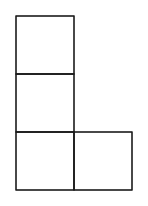
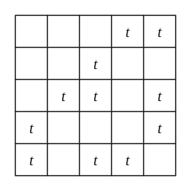

> 原书 PDF 第 81-88 页

## 常见的几类不变量

不变量问题包括某种类型的过程.我们可以把这种问题与在这一过程中所进行的变换下保持不变的数和量相联系.通常，一旦找到了合适的不变量以后，不变量的问题就变得十分容易了.但是要找到这个合适的不变量却不容易！实际上，寻找一个合适的不变量是一种艺术，这些问题难就难在这里，只有通过实践才能较好地把握如何去假想或者构造不变量.我们经常可以留意的几类不变量是:

涂色:用两种或两种以上的颜色对网格中的方格涂色.对棋盘这种模式，这通常是一种不错的选择，但是有时候也可以用于其他模式，分别考虑每一种颜色的方格.

代数式:给出一组值，看它们的差、和、平方和或积.如果你要处理的是整数，那么可以尝试把这些值去模(某个数 $n$)，通常挑选模质数或质数的幂.

角和棱:对于由网格构成的问题，考虑所形成的任何形状.它们的边界有多少条棱？有多少个角?

倒置:如果你要排列一个数组，可以考虑颠倒这些数，也就是说，将数对 $(i,j)$ 中的 $i$，$j$ 颠倒一下.颠倒的总次数和它的奇偶性都是有用的.

整数和有理数:你是否能从问题中编造出一个保持递减的正整数？或者使有理数的分母保持递减？

对称性:你能否保证每一步以后，一个图形还是某种形式的对称？

也许你可以根据类似的性质把对象分成几类；也许该问题能分成两个本质相同的子问题？这对于像博弈论那样的问题特别有用.

让我们通过一些例子，随着我们的进程，读者将会对所涉及的这类问题有一个较好的认识.

## 例91：黑板上数字之积是不变量

**例91** 在黑板上写着若干个 $1$ 和 $-1$.Alice随机选择两个数，比如说 $x,y$.如果这两个数相等，那么擦去后换成 $1$，否则就换成 $-1$.重复这个过程，直到黑板上只剩一个数.证明:结果与Alice的操作顺序无关.

**证明** 我们先试验一下.取 $4$ 个数 $(1,1,-1,-1)$ 为例.可能的变动顺序是 $(1,1,-1,-1)\rightarrow(1,-1,-1)\rightarrow(1,1)\rightarrow1$.另一种可能是 $(1,1,-1,-1)\rightarrow(1,1,1)\rightarrow(1,1)\rightarrow1$.

仔细观察我们会发现在每一阶段中，各数的积保持不变，我们来切实地证明发生的这种现象.如果我们有两个数相等，或者都是 $1$，或者都是 $-1$，那么它们的积是 $1$，积确实保持不变.如果两个数不同，那么它们的积是 $-1$，擦去后换成 $-1$，积也保持不变.

这的确与Alice的操作顺序无关，黑板上最后留下的就是原来写在黑板上的各数的积.

## 例92：去掉对角两格的棋盘能否用骨牌铺砌

**例92** 把 $8 \times 8$ 的国际象棋盘上相对的两个角除去，是否能用 $2 \times 1$ 的骨牌不重叠地铺砌？

**解** 这是一个用标准方法，即黑白相间对棋盘涂色的经典问题.原来有 $32$ 个白格，$32$ 个黑格，把两个角上的方格除去，也就是把两个同色的方格除去.比如说，把两个黑色的方格除去.于是 $W-B=2$.

现在注意到我们放置的任何 $2 \times 1$ 的骨牌都覆盖一白一黑的方格.于是，如果要覆盖每一个方格，那么必须黑白的方格数相同，即 $W=B$.

这就产生了矛盾，于是证毕.

## 例93：2013 次交换后能否回到原来的顺序

**例93** 将 $1,2,\cdots,2014$ 依次写在一张纸上，Bob随机选择两个数交换位置，经过 $2013$ 次交换后是否可能使这些数达到原来的顺序？

**解** 这是一个典型计算倒置的问题，也就是说，当 $x>y$ 时，$x$ 在 $y$ 后面的一个位置时的量 $I$.对相差 $k$ 个位置的两数的任何交换都可以看作对相邻两数的 $2k-1$ 次交换.Bob无论在何时交换相邻两数，如果这两数按顺时针方向，那么 $I$ 就增加 $1$;如果这两数按逆时针方向，那么 $I$ 就减少 $1$.

现在回到两数相差 $k$ 个距离的情况.如果用 $a$ 表示计算中 $1$ 的增量值的个数，用 $b$ 表示计算中 $-1$ 的增量值的个数，那么 $I$ 就变动了 $a-b$.因为 $a+b$ 就是连续交换的次数 $2k-1$，于是 $I$ 的奇偶性改变.

因此在经过 $2013$ 次交换后 $I$ 是一个奇数.但是如果这些数按顺时针方向排列，那就没有按逆时针方向排列，所以这表示我们不能到达原来的顺序.

## 例94：L 形四米诺骨牌能否铺砌板

**例94** 是否有可能将L形(图16)的四米诺骨牌铺砌 $2014 \times 2014$ 的板？四米诺骨牌可以翻转或旋转.

图16

**解** 这次的关键是对各行依次一黑一白涂色，注意黑白方格的个数都是 $2 \cdot 1007^{2}$ 个.

现在把一块L形的四米诺骨牌放在板上，看看会发生什么情况.如果它不旋转 $90^{\circ}$，那么它或者覆盖到两个白行和一个黑行，于是有 $3$ 个白方格和 $1$ 个黑方格；或者覆盖到两个黑行和一个白行，于是有 $3$ 个黑方格和 $1$ 个白方格.另一方面，它确实旋转 $90^{\circ}$，那么它在同一行占 $3$ 个方格，于是它覆盖了 $3$ 个白方格和 $1$ 个黑方格，或者覆盖了 $3$ 个黑方格和 $1$ 个白方格.

我们按照四米诺骨牌覆盖较多的颜色称这个四米诺骨牌是黑的或白的.因为板上的黑白方格数相同，如果用四米诺骨牌铺砌这块板，那么黑白四米诺骨牌的块数应该相同，于是四米诺骨牌的总块数是偶数.

但是这意味着这块板的面积应该能被 $8$ 整除，可是板的面积等于 $4 \cdot 1007^{2}$，却不是这种情况.

## 例95：把较小的数换成积除以差的绝对值

**例95** 把两个不同的正整数 $a,b$ 写在黑板上，擦去较小的数，然后换成 $\frac{ab}{\left| a-b \right|}$.只要写在黑板上的数不同，就重复这一过程.证明:这样的过程必然会结束.

**证明** 我们先做一些试验.对于 $(3,5)\rightarrow(5,\frac{15}{2})\rightarrow(\frac{15}{2},15)\rightarrow(15,15)$；对于 $(4,5)\rightarrow(5,20)\rightarrow(\frac{20}{3},20)\rightarrow(10,20)\rightarrow(20,20)$;对于 $(3,6)\to(6,6)$;对于 $(2,8)\rightarrow(\frac{8}{3},8)\rightarrow(4,8)\rightarrow(8,8)$.

经过一些计算，我们可以发现这种模式似乎是以我们选取的两个数的最小公倍数结束的，下面我们来证明这一点.

首先，注意到我们可以在黑板上写的两个数形如 $(\frac{ab}{x},\frac{ab}{y})$，用第二块黑板以保留对 $x$，$y$ 这两个数进行操作的痕迹，我们永远考虑 $x>y$ 的情况(否则就换个位).我们断言，每一次擦去后在第二块黑板上的效果就是根据顺序用 $(x-y,y)$ 或 $(y,x-y)$ 代替 $(x,y)$.

为了看清这一点，注意到

$$
\frac{\frac{ab}{x} \cdot \frac{ab}{y}}{\left| \frac{ab}{x} - \frac{ab}{y} \right|} = \frac{ab}{\left| x - y \right|}
$$

这就证明我们的断言.

熟悉的读者现在将看出对 $(x,y)$ 实施的操作过程就是欧几里得除法.我们来证明这种操作实际上就变为 $(x,y)$ 的最大公约数.因为我们从 $(a,b)$ 开始，这将结束这一问题.

于是设 $a<b$，根据剩余定理，$b=ac_{1}+b_{1}\ (0 \leqslant b_{1}<a)$.如果 $b_{1}=0$，那么经过 $c_{1}-1$ 步，就以 $(a,a)$ 结束，操作完成.否则经过 $c_{1}$ 步后，就得到数组 $(b_{1},a)$，这里 $b_{1}<a$.现在对 $a=b_{1}c_{2}+a_{1}$ 重复一下，得到数组 $(a_{1},b_{1})$.显然在每一步中，数组中较大的数递减，所以这一过程必定结束.显然也是以 $(m,0)$ 告终，所以在这一步时，两个数才相等.

最后，注意这样的操作留下的是这两个数的最大公约数，这是一个不变量，所以我们得到的两个数实际上就是 $(a,b)$ 的最大公约数，证毕.

## 例96：长条上搬动糖果

**例96** 把一些糖果放在(两个方向上)无限长的方格长条上.只要一个方块上至少有四颗糖果，那么就把其中的四颗糖果中的两颗放到前一个方格中，两颗放到后一个方格中.经过有限次搬动，是否有可能将这些糖果还原成原来的位置？

**解** 如果你对这个问题做试验，那么一眼就会注意到这样的现象:或者一大堆糖果出现在一个方格上，或者有些糖果被放到离开始时的方格越来越远的地方.为了证明我们不能还原到原来的样子，很自然地去寻找每一次搬动时增加的某个量.注意到这个量不能回到出发时的状况.注意到搬动基本的趋势是迫使糖果越来越远，因此我们需要寻找一个量去探索这一问题.

我们用连续的整数对长条上的方块做标记，设 $c_{i}$ 是放第 $i$ 颗糖果的方格.考虑量 $C=\sum c_{i}^{2}$.当我们进行一次搬动，从编号为 $a$ 的方格取出四颗糖果时，量 $C$ 就减少 $4a^{2}$.当我们放置这四颗糖果时，观察到新的量 $C$ 增加 $2(a-1)^{2}+2(a+1)^{2}=4a^{2}+4$，这是因为把两颗糖果放到方格 $a$ 的左边，两颗糖果放到方格 $a$ 的右边.

因此，对于一次搬动，量 $C$ 就增加 $4$，所以经过有限次搬动，不可能将这些糖果还原到原来的位置.

## 例97：2014 只泰迪熊放进 127 个盒子

**例97** 我们把 $2014$ 只泰迪熊随机地放入 $127$ 个盒子里.只要不是所有的泰迪熊都在同一个盒子里，就把一只泰迪熊从一个盒子取出后放入另一个盒子里，但这另一个盒子至少有我们选取的盒子里那么多只泰迪熊.证明:最终所有的泰迪熊都放入一个盒子里.

**证明** 首先，我们注意到结果似乎是合理的.有许多泰迪熊的盒子将有越来越多的泰迪熊，而泰迪熊少的盒子里的泰迪熊将越来越少.所以结果应该是最终所有的泰迪熊都放入一个盒子里.问题是如何使这个理由变得很严格.

我们需要构建一个像例96那样的一个不变量.因为泰迪熊的总数不变，所以考虑和式 $T=\sum_{i=1}^{127}t_{i}^{2}$，其中 $t_{i}$ 是第 $i$ 个盒子中泰迪熊的只数.我们的断言是每一次搬动，$T$ 都增加.

为此，假定从有 $n$ 只泰迪熊的盒子中取出一只泰迪熊放到一个有 $m(m \geqslant n)$ 只泰迪熊的盒子中.对 $T$ 的纯粹的效果是加了一个 $(m+1)^{2}+(n-1)^{2}$ 和 $m^{2}+n^{2}$ 的差.注意到 $(m+1)^{2}+(n-1)^{2}-m^{2}-n^{2}=2m-2n+2 \geqslant 2$，所以 $T$ 至少增加 $2$.

把 $2014$ 只泰迪熊放入 $127$ 个盒子的分布总数是有限的，所以 $T$ 只有有限多种可能性，这就是说，不可能永远增加.只要有两个装有泰迪熊的盒子，我们就能重复这一过程，并增加 $T$，于是这个过程必将以所有的泰迪熊在同一个盒子里告终.

## 例98：取走白牌并翻转两侧的标识牌

**例98** 有 $n$ 个标识牌，每个标识牌都是一面白，另一面黑，排成一行使白面朝上.如果有可能，那么选择一张白面朝上的标识牌(但不是最旁边的)取走，并将其两边的标识牌翻个面.证明:当且仅当 $3 \nmid (n-1)$ 时，才能达到只有两张标识牌的情形.

**证明** 用一串字母 $W$，$B$，$x$ 表示标识牌的情形，这里一个 $W$ 表示一张白面朝上的标识牌，一个 $B$ 表示一张黑面朝上的标识牌，一个 $x$ 表示一张被取走的标识牌.用 $x$ 是为了保持被取走的标识牌的张数的痕迹.如果不考虑被取走的标识牌，那么这些 $x$ 就没有实际必要了.

首先，对我们能达到目标的一系列动作做一个试验

$$
WWWWWWW\cdots \Rightarrow BxBWWW\cdots \Rightarrow BxWxBW\cdots \Rightarrow WxxxWW\cdots
$$

这表明如果我们有 $n(n \geqslant 5)$ 张白牌，那么总能达到有 $n-3$ 张白牌的情形.因此，如果 $n=3m$，我们就能重复这一动作，达到 $3$ 张白牌的一种情形，然后再操作一次，就留下 $2$ 张黑牌.如果 $n=3m+2$，那么重复这一动作，我们就能达到 $2$ 张白牌的情形.

为了完善这一问题，我们还需要证明当 $n=3m+1$ 时不能达到只有 $2$ 张标识牌的情形.虽然上面的动作不能达到只有 $2$ 张标识牌的情形，但是这并不能证明什么，因为还有许多与我们使用不同的动作.问题的这一部分我们将需要一个不变量.

人们可能注意到第一个不变量是黑牌的张数永远是偶数.这是容易证明的.一次动作取走 $1$ 张白牌(不改变黑牌张数的奇偶性)，把 $2$ 张标识牌翻个面.任何翻转 $1$ 张牌都改变黑牌张数的奇偶性，所以翻转 $2$ 张牌奇偶性不变.这证明了(上面我们已经看到)，如果最终以 $2$ 张牌告终，那么这 $2$ 张牌必定同色.

不幸的是，仅有这个不变量是不解决问题的.我们需要如下一个改良的不变量.给每一张标识牌一个重量，所有黑牌的重量都是 $0$.如果一张白牌的左边有偶数张黑牌，那么给这张白牌的重量 $+1$;如果一张白牌的左边有奇数张黑牌，那么给这张白牌的重量 $-1$.设 $S$ 是所有标识牌的重量和.

现在来看，我们如果做一个动作，和 $S$ 是如何变化的.假定对一张重量是 $w$ 的白牌做一个动作.要注意，第一个是一张标识牌在这个动作后不变，那么它的重量也不变，从奇偶性相同可以推出上面的命题，并且不再重复.因此我们只要分析这一动作所牵涉的三张牌.对中间一张牌的效果很容易:从提供 $w$ 到被取走，于是就变为 $0$.对于左边的牌有两种情况:如果在动作前左边的牌是白牌，那么它在这个动作前的重量是 $w$，动作后变为黑牌，于是重量为 $0$;如果在动作前左边的牌是黑牌，那么它在这个动作前的重量是 $0$，动作后变为 $-w$(因为它左边的黑牌比中间牌左边的黑牌少一张).从这两种情况可以看出，左边的牌所提供的重量要减少 $w$，右边牌的情况类似，也可得到减少 $w$.如果右边的牌原来是白牌，那么它的重量从 $w$ 变为 $0$.如果右边的牌原来是黑牌，那么它的重量从 $0$ 变为 $-w$(因为翻转左边的牌意味着右边的牌在动作后奇偶性与中间的牌在动作前的奇偶性相反).于是我们看到 $S$ 减少 $3w$.因此 $S$ 模 $3$ 不变.

这就是我们所需要的不变量.如果 $n=3m+1$，那么我们从所有的白牌的重量为 $1$ 开始，因此 $S=3m+1 \equiv 1 \pmod{3}$.但是如果以 $2$ 张牌结束，那么我们或者有 $2$ 张白牌 $S=2$，或者有 $2$ 张黑牌 $S=0$.于是不能达到有 $2$ 张标识牌的情形.

## 例99：网格中加减 1 能否使所有数相等

**例99** 给出一个 $n \times n$ 的网格，有 $n$ 个方格包含一个 $1$，其余的方格都包含一个 $0$.可以选择一个方格，把这个方格中的数减去 $1$，这个方格所在的同一行同一列中所有的数都加上 $1$.是否可能得到方格中所有数都相等的一个网格？

**解** 不可能.首先，注意到原来的网格中必有一个 $2 \times 2$ 的网格，其中 $3$ 个方格是 $0$，一个方格是 $1$.从这个事实可以推出有一行只包含 $0$，因此与只包含一个 $1$ 的相邻的行中有一行只包含 $0$.把这样的方格称为特殊方格.

现在考虑网格中的任何一个 $2 \times 2$ 的正方形，称其为 $K$.设沿着行从左上角到右下角的数依次是 $a,b,c,d$.考虑 $S=(a+d)-(b+c)$.我们将证明:$S$ 模 $3$ 不变.

我们来看进行一次操作会发生什么情况.如果我们减去数所在的方格不是 $K$ 的一部分，那么容易看出 $S=S'$，因为它或者没有改变 $K$ 中的数，或者恰好改变两个值，都增加 $1$，这两个值都不在 $K$ 的对角线上.

如果我们减去数所在的方格是 $K$ 的一部分，因为这种情况是对称的，所以我们可以假定它在左上角，于是 $a'=a-1,b'=b+1,c'=c+1,d'=d$.于是有 $S'=S-3$.我们的断言得证.

现在我们看到在特殊的方格中永远不会使这些数相等，因为 $S$ 应该保持模 $3$ 余 $1$，所以得证.

## 例100：5×5 灯阵中开关拨动后唯一的亮灯

**例100** 一些排成 $5 \times 5$ 的正方形的这些灯不正常.拨动一盏灯的开关会引起与它同一行同一列中相邻的每一盏灯同时改变状况，即从开到关，从关到开.原来所有的灯都关着.在几次拨动开关后恰有一盏灯开着.求这盏灯的所有可能的位置.

**解** 这又是一个典型的不变量问题.这一次我们要画一张图表示不变的量，并限定开着的灯的可能.

考虑图17的情况.

| 1 | 1 | 0 | 1 | 1 |
| --- | --- | --- | --- | --- |
| 0 | 0 | 0 | 0 | 0 |
| 1 | 1 | 0 | 1 | 1 |
| 0 | 0 | 0 | 0 | 0 |
| 1 | 1 | 0 | 1 | 1 |

图17

我们要寻求的不变量是开着灯的标号数的和的奇偶性.关键在于观察到每一个 $1$ 恰好有一个 $1$ 相邻，每一个 $0$ 都有偶数个 $1$ 与其相邻.

现在可以确定关于对角线对称，或者旋转 $90^{\circ}$ 后的新的标号(图18).

一个类似的命题表明，灯处于开的状况时标号的和的奇偶性是一个不变量.

因为原来的和是 $0$，所以我们需要弄清楚两次标号都是 $0$ 的情况，显然在方格 $(2,2)$，$(2,4)$，$(3,3)$，$(4,4)$ 中的标号就是这种情况.

| 1 | 0 | 1 | 0 | 1 |
| --- | --- | --- | --- | --- |
| 1 | 0 | 1 | 0 | 1 |
| 0 | 0 | 0 | 0 | 0 |
| 1 | 0 | 1 | 0 | 1 |
| 1 | 0 | 1 | 0 | 1 |

图18

留下的唯一的事情是构造一个使这些方格能达到所需情况拨动开关的序列.只要对中心和 $(2,4)$ 的方格进行即可，因为其余的方格都可以由对称性推出.

对于 $(3,3)$，我们应该做以下动作(图19):

图19

最后，对于 $(2,4)$，我们应该做以下一系列动作(图20):

|  | t |  | t |  |
| --- | --- | --- | --- | --- |
| t | t |  | t | t |
|  | t |  |  |  |
|  |  | t | t | t |
|  |  |  | t |  |

图20

## 例101：正五边形顶点上的操作必然结束

**例101** 对正五边形的每一个顶点填一个整数，使得所有五个数的和是正的.如果三个连续顶点的数分别是 $x,y,z$，且 $y<0$，那么下面的操作是允许的:分别用 $x+y$，$-y$，$z+y$ 代替 $x,y,z$.只要这五个数中至少有一个是负数，就重复进行这样的操作.确定经过有限次这样的操作，这一过程是否能够结束.

**解** 考虑一些较小的数的例子，应该很快地猜出经过有限步这一过程是能够结束的.为了证明这一点，我们要寻求不变量.有许多这样的选择.

因为和保持不变，所以我们想尝试寻求这些顶点上的数的平方和.对一些例子进行试验很快证明这并不是我们所要求的做法.另一个错误的猜测，是取这些数的最小值.如果 $x,y,z$ 都是负的，那么这个最小值减少，于是并不是不变量.

因此，我们看到一个不变量应该考虑到每个顶点的两个相邻顶点.于是我们考虑

$$
I(a_{1},a_{2},a_{3},a_{4},a_{5})=\sum_{i=1}^{5}a_{i}^{2}+\sum_{i=1}^{5}(a_{i}+a_{i+1})^{2}
$$

假定我们进行中心在 $a_{2}<0$ 的操作，那么 $I$ 的新的值是

$$
I(a_{1}+a_{2},-a_{2},a_{3}+a_{2},a_{4},a_{5})=I(a_{1},a_{2},a_{3},a_{4},a_{5})+2a_{2}(a_{1}+a_{2}+a_{3}+a_{4}+a_{5})
$$

$I$ 的值显然是正整数，因为 $a_{2}<0$，所以每一次操作都单调递减，于是我们知道这些顶点处的值的和是正的.因此，可能只有有限多步.
