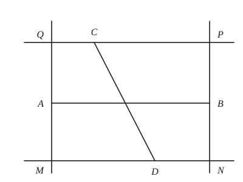
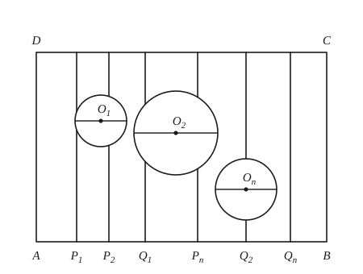

> 原书 PDF 第 89-97 页

## 组合几何中的常用思想方法

这一领域的问题是几何学与组合学的混合体，论证中常用的思想方法是:

极端元素法.也就是说，取一个最大值和最小值都是一个确定量的形态.必须考虑到要证明这种极端情况的存在，但是通常这一事实的结果是只存在有限多种可能的形态，例如:射影、凸性、鸽巢原理.

随着我们的进程，我们将证明某些经典的结果，这些结果将有证明，但不是解，可以作为在任何问题或数学内容中的结果.

## 例102：Sylvester-Gallai 定理

**例102(Sylvester-Gallai)** 考虑平面内的有限多个点，经过其中给定的点中的两点的任何直线包含更多给定的点.证明:这些点都在同一直线上.

**证明** 用反证法，考虑形如 $(P,l)$ 的二元对，其中 $l$ 是一条经过给定两点的直线，$P$ 是集合中的一点，$P \notin l$.

因为这些点不都在一条直线上，所以存在这样的二元对，这样的二元对有有限多个，所以可以选择距离 $(P,l)$ 最小的一个二元对.设 $C$ 是 $P$ 到 $l$ 的垂线的垂足.注意到直线 $l$ 必包含集合中的至少三点，比如说 $A$，$B$，$D$.不失一般性，可设 $D$ 和 $A$ 在 $C$ 关于 $l$ 的同侧，$A$ 在 $C$ 与 $D$ 之间.于是，容易看出 $\text{距离}(A,PD) < PC = \text{距离}(P,l)$，这与原来对二元对 $(P,l)$ 的选取矛盾.

## Sylvester-Gallai 定理的另一种叙述

在多于一种方法的情况下重新叙述 Sylvester-Gallai 定理通常是方便的:如果平面内有一个不全共线的 $n$ 个点的集合，那么存在一条直线恰好经过其中两点.

## 例103：不共线的 n 个点至少确定 n 条直线

**例103** 证明:不全在同一直线上的 $n(n \geqslant 3)$ 个点，至少确定 $n$ 条直线.

**证明** 对 $n$ 进行归纳.对于 $n=3$，这是显然的.

假定命题对 $n$ 成立，接下来，对于点 $\left\{ P_{1}, \cdots, P_{n+1} \right\}$，存在一条只经过其中两点的直线，不失一般性，设该直线过 $P_{n+1}$ 和 $P_{n}$ 两点.注意如果所有的 $P_{1},\cdots,P_{n}$ 共线，那么可以容易得到过 $P_{n+1}$ 和 $P_{1},P_{2},\cdots,P_{n}$ 中的每一点的直线，共 $n+1$ 条，命题得证.

否则就除去点 $P_{n+1}$，得到一个不全共线的 $n$ 个点的集合.于是可用归纳步骤，至少得到 $n$ 条直线，再把点 $P_{n+1}$ 放回，至少得到一条新的直线，即联结 $P_{n}$ 和 $P_{n+1}$ 的直线.因此，至少有 $n+1$ 条直线.

## 例104：两两不平行且交点处至少三线共点的直线族

**例104** 考虑平面内的有限多条直线，其中任意两条直线都不平行，并且对于其中任何两条直线的交点，在给定的直线中至少一条以上的直线也经过它.那么所有这些直线共点.

**解** 用反证法.假定不是所有的直线共点.考虑二元对 $(P,l)$，其中 $P$ 是一个交点，$l$ 是给定集合中的直线之一，$P \notin l$.

因为这样的二元对 $(P,l)$ 有有限多个，所以可以选择距离 $(P,l)$ 最小的一个二元对.设 $C$ 是 $P$ 到 $l$ 的垂线的垂足.在给定的直线集合中至少有三条直线经过点 $P$，比如说 $l_{1}$，$l_{2}$，$l_{3}$ 经过点 $P$.设这三条直线分别与 $l$ 交于 $A$，$B$，$D$ 三点.不失一般性，可设对于 $l$，$A$ 和 $D$ 在 $C$ 的同一侧，且 $A$ 在 $C$ 与 $D$ 之间.注意到像例102中同样的不等式 $\text{距离}(A,PD) < PC = \text{距离}(P,l)$，于是得到矛盾.

## 例105：面积为 1 的凸多边形含于面积为 2 的矩形

**例105** 证明:任何面积为 $1$ 的凸多边形 $G$ 能包含于一个面积为 $2$ 的矩形内.

**证明** 设点 $A$，$B$ 是凸多边形 $G$ 的顶点中距离最大的两个顶点.把直线 $AB$ 看作水平放置的，并使用相应的术语.过点 $A$ 和点 $B$ 各画一条竖直的直线.首先，肯定该多边形的任何顶点都必定在这两条直线之间的带状区域内，如果顶点 $X$ 在这个带状区域外，那么容易看出 $AX$ 或 $BX$ 大于 $AB$，这与点 $A$ 与点 $B$ 的选择矛盾.

其次，设点 $C$ 是凸多边形 $G$ 中在直线 $AB$ 的上方距离 $AB$ 最远的顶点，点 $D$ 是 $G$ 中在直线 $AB$ 的下方距离 $AB$ 最远的顶点(如果凸多边形 $G$ 整个位于直线 $AB$ 的一侧，那么点 $C$ 或点 $D$ 也在这一侧).过点 $C$ 和点 $D$ 各画一条水平方向的直线，得到包含 $G$ 的矩形 $MNPQ$(图21).

图21

设 $[\cdot]$ 表示一个图形的面积.$\triangle ABC$ 和矩形 $ABPQ$ 的高相等(把 $AB$ 看作这两个图形的底).于是 $[ABPQ] = 2[ABC]$.类似地，$[MNBA] = 2[ADB]$.还注意到 $A,B,C$ 和 $D$ 是凸多边形 $G$ 的顶点，所以凸多边形 $G$ 包含四边形 $ADBC$，因此 $[MNPQ] = 2[ADBC] \leqslant 2[G] = 2$.

## 例106：可扩展为平行四边形的有限点集

**例106** 求平面内所有具有以下性质的有限点集 $S$:对于 $S$ 中任意不同的三点 $A$，$B$，$C$，在 $S$ 中存在第四点 $D$，使得点 $A,B,C,D$(以某种顺序)是一个平行四边形的顶点.

**解** 我们说的是对于三点或更多点的集合，只有一个平行四边形的四个顶点是满足条件的.少于三点的集合谈不上满足这一条件.

假定存在三点或更多点的集合 $S$ 满足条件.注意因为共线的三点不能扩展为平行四边形，所以 $S$ 中没有三点共线.从 $S$ 中取出三点为顶点，使这三点组成的 $\triangle ABC$ 的面积最大.过 $\triangle ABC$ 的每一个顶点画平行于对边的直线.这三条直线形成 $\triangle DEF$，其中 $A$ 是 $EF$ 的中点，$B$ 是 $DF$ 的中点，$C$ 是 $DE$ 的中点.

要注意的第一件事是:$\triangle ABC$ 是面积最大的，意味着 $S$ 完全包含在 $\triangle DEF$ 中.为了证明这件事，假定 $X \in S$ 在 $\triangle DEF$ 外.不失一般性，设 $X$ 与 $F$ 在直线 $DE$ 的两侧.因为 $C$ 在直线 $DE$ 上，且 $AB \parallel DE$，所以 $X$ 距离 $AB$ 比 $C$ 距离 $AB$ 远.于是 $[ABX] > [ABC]$，这与 $\triangle ABC$ 的选择矛盾.

要注意的第二件事是:$D$，$E$，$F$ 是能与 $A$，$B$，$C$ 形成平行四边形的顶点的三个点.根据 $S$ 的性质，其中有一点属于 $S$.不失一般性，假定这一点是 $D$.因为 $[ABC] = [BCD]$，所以 $\triangle BCD$ 的面积也最大.于是可以重复使用上面两章的结论，找到第二个包含 $S$ 的三角形.这个三角形与 $\triangle DEF$ 相交，可以推出 $S$ 完全包含在平行四边形 $ABDC$ 内.

如果 $S$ 不恰好是一个平行四边形的顶点，那么它必定包含第五点 $X$.根据对称性，可以假定 $X$ 在 $\triangle BCD$ 的内部.$S$ 中必存在一点 $Y$，使得 $B,D,X,Y$(以某种顺序)是一个平行四边形的顶点.如果该平行四边形是 $BXDY$，那么 $XY$ 的中点也是 $BD$ 的中点，其在直线 $DF$ 上.因此 $Y$ 与 $X$ 在直线 $DF$ 的两侧，于是在 $\triangle DEF$ 的外部，这与上面的结果矛盾.如果平行四边形是 $BDXY$ 或 $BDYX$，那么 $XY \parallel BD$，$XY \parallel AC$，于是与 $BD$ 重合.因此 $Y$ 不能在平行四边形 $ABDC$ 的内部，这是一个矛盾.

## 例107：单位正方形内的圆与相交直线

利用射影是另一个重要的工具，请看下面的例子.

**例107** 在一个单位正方形内放若干个圆，这些圆的周长的和等于 $10$.证明:存在一条直线至少与其中四个圆相交.

**证明** 设 $O_{1},O_{2},\cdots,O_{n}$ 是这些圆的圆心.考虑每一个圆在该正方形的边 $AB$ 上的射影(图22).

图22

容易看出每一个射影是圆的平行于 $AB$ 的直径给出的.设 $P_{i}Q_{i}$ 是边 $AB$ 上的线段.于是，根据已知条件，我们知道 $\sum_{i=1}^{n} l(P_{i}Q_{i}) = \frac{10}{\pi}$.

如果假定不存在四条线段的交，这意味着 $AB$ 上的每一点至多被三条线段覆盖，于是 $\sum_{i=1}^{n} l(P_{i}Q_{i}) \leqslant 3AB = 3$.这就是说，$\frac{10}{\pi} \leqslant 3$，这是一个矛盾.

因此必有四条线段的交，过交点作垂直于 $AB$ 的直线与四个圆相交，这四个圆的射影就包含这个交点.

## 例108：凸包的存在性与唯一性

**例108** 如果 $A_{1},A_{2},\cdots,A_{n}(n \geqslant 3)$ 是平面内的点，其中没有三点共线，那么存在一个凸多边形 $P$，它的顶点是点 $A_{i}$ 中的某些点，其余的点都在 $P$ 的内部.这个凸多边形 $P$ 称为点 $A_{1},A_{2},\cdots,A_{n}$ 的凸包.

**解** 对 $n$ 进行归纳.对于 $n=3$，因为三点形成一个三角形的顶点，结论显然成立.假定结论对 $n$ 个点的集合成立，考虑加上第 $n+1$ 个点 $A_{n+1}$.设 $P$ 是这 $n$ 个点的凸包.如果第 $n+1$ 个点在 $P$ 的内部，那就证得结果，所以假定它在 $P$ 的外部.那么在 $P$ 的边界上有一个最接近 $A_{n+1}$ 的点 $X$(这并不是完全明显的，但 $X$ 必定或者是 $P$ 的一个顶点，或者是点 $A_{n+1}$ 到 $P$ 的一边的垂足，因为这只有有限多种可能，因此它必定是最接近的).考虑过 $A_{n+1}$ 且垂直于 $XA_{n+1}$ 的直线 $l$.凸多边形 $P$ 不能与 $l$ 相交.如果 $P$ 交 $l$ 于 $Y$，那么线段 $XY$ 将在 $P$ 的内部，$A_{n+1}$ 到 $XY$ 的垂线上的某处将是 $P$ 的边界上距离 $A_{n+1}$ 比 $X$ 距离 $A_{n+1}$ 更近的一个点，这是一个矛盾.因此 $P$ 完全落在由 $l$ 确定的半平面内.

现在来看，从 $A_{n+1}$ 出发经过 $P$ 的顶点的射线与射线 $A_{n+1}X$ 形成带有正负号的角.存在 $P$ 的某个顶点 $B$，构成最小的带有正负号的角；存在 $P$ 的某个顶点 $C$，构成最大的带有正负号的角.于是 $P$ 全部落入 $\angle BA_{n+1}C$ 内.直线 $BC$ 将 $P$ 分割成两个凸多边形(因为分割只会使内角减小).设 $B = B_{1}, B_{2}, \cdots, B_{k} = C$ 是一个多边形的顶点，该多边形与 $A_{n+1}$ 在直线 $BC$ 的两侧.于是多边形 $Q = A_{n+1}B_{1}B_{2}\cdots B_{k}$ 是所求的凸包.因为 $B$ 与 $C$ 在 $l$ 的同侧，所以顶点在 $A_{n+1}$ 处的内角小于 $180^{\circ}$，因为 $B_{2}$ 和 $B_{k-1}$ 在 $\angle BA_{n+1}C$ 内，所以顶点在 $B$ 和 $C$ 处的角小于 $180^{\circ}$.其他所有顶点处的内角都没有变，所以由归纳假定，它们都小于 $180^{\circ}$.$Q$ 的内部包含 $\triangle A_{n+1}BC$ 的内部，$\triangle A_{n+1}BC$ 依次包含 $P$ 的一部分，这部分与 $A_{n+1}$ 在 $BC$ 的同一侧.因此，$Q$ 包含 $P$ 以及所有的点 $A_{1},A_{2},\cdots,A_{n}$，这些点不在 $Q$ 的边界上，而在 $Q$ 的内部.

还可以相当容易地说凸包是唯一的.当且仅当存在一条经过 $A_{k}$ 的直线，使得 $P$ 的所有其余顶点 $A_{1},A_{2},\cdots,A_{k-1},A_{k+1},\cdots,A_{n}$ 都在该直线的同一侧，那么点 $A_{k}$ 是凸包 $P$ 的一个顶点.

## 例109：五点中取出的凸四边形

**例109** 平面内有五个点，没有三点共线.证明:可以取出四个点，使这四个点是一个凸四边形的顶点.

**解** 考虑这五个点的凸包，有两种情况.如果该凸包是一个五边形或凸四边形的顶点，那么已证毕，于是可以假定该凸包是一个三角形.设这个三角形是 $\triangle ABC$，$D$，$E$ 是其内部的点.$\triangle ABC$ 的顶点中有两个在 $DE$ 的同一侧.不失一般性，设这两点是 $B$，$C$.因为线段 $DE$ 位于 $\triangle ABC$ 的内部，所以它不能与 $BC$ 相交，因此 $D$ 和 $E$ 在 $BC$ 的同一侧.不失一般性，进一步假定 $D$ 距离 $AC$ 比 $E$ 距离 $AC$ 近.因此，四边形 $BCDE$ 是一个凸四边形.

## 例110：面积可分解为三点权和的点集

**例110** 求所有的整数 $n(n>3)$，平面内存在没有三点共线的 $n$ 个不同的点，还存在实数 $r_{1}, r_{2}, \cdots, r_{n}$，对于不同的 $i,j,k$，$\triangle A_{i}A_{j}A_{k}$ 的面积是 $r_{i} + r_{j} + r_{k}$.

**解** 注意，如果命题对某 $k$ 个点不成立，那么对任何点数大于 $k$ 的数也不成立.容易证明当 $n = 3$ 或 $n = 4$ 时，命题成立.对于 $n = 4$，画两张图.如果四边形 $A_{1}A_{2}A_{3}A_{4}$ 是一个凸四边形，那么沿对角线分割表示面积，我们有

$$
r_{1} + r_{2} + r_{3} + r_{1} + r_{4} + r_{3} = r_{2} + r_{1} + r_{4} + r_{2} + r_{3} + r_{4}
$$

或

$$
r_{1} + r_{3} = r_{2} + r_{4}
$$

否则，假定 $A_{4}$ 在 $\triangle A_{1}A_{2}A_{3}$ 内.那么用两种方法表示 $\triangle A_{1}A_{2}A_{3}$ 的面积，即用 $A_{4}$ 分割或用已知条件得到

$$
r_{4} = - \frac{r_{1} + r_{2} + r_{3}}{3}
$$

考虑 $n = 5$，我们分析凸包的各种可能性:

如果凸包是一个三角形，不失一般性，设这个三角形是 $\triangle A_{1}A_{2}A_{3}$，那么 $A_{4},A_{5}$ 两点在内部，由上面的结论可知

$$
r_{4}=r_{5}=-\frac{r_{1}+r_{2}+r_{3}}{3}
$$

但是现在要把 $A_{5}$ 放到 $\triangle A_{1}A_{2}A_{4},\triangle A_{1}A_{3}A_{4}$ 或 $\triangle A_{2}A_{3}A_{4}$ 的一个中去.用三角形的边和这两点，我们看到 $r_{5} < r_{4}$，除非这两点重合，否则这两种情况都产生矛盾.

如果凸包是一个凸四边形，比如说四边形 $A_{1}A_{2}A_{3}A_{4}$，那么看由对角线相交形成的四个三角形，我们知道 $A_{5}$ 必不在其中的两个之中.于是 $A_{5}$ 必在该四边形的同一边所对的两个三角形中，假定这两个三角形是 $\triangle A_{1}A_{2}A_{3}$ 和 $\triangle A_{1}A_{2}A_{4}$，那么再用这两个三角形的分割，得

$$
r_{5}=-\frac{r_{1}+r_{2}+r_{3}}{3}=-\frac{r_{1}+r_{2}+r_{4}}{3}
$$

所以 $r_{3} = r_{4}$.

利用 $r_{1} + r_{3} = r_{2} + r_{4}$ 得到 $r_{2} = r_{1}$.最后可以用 $A_{5}$ 分割四边形，所以

$$
4r_{5}+2\left(r_{1}+r_{2}+r_{3}+r_{4}\right)=r_{1}+r_{3}+2\left(r_{2}+r_{4}\right)
$$

于是 $4r_{5} + r_{1} + r_{3} = 0$，再看 $3r_{5} + 2r_{1} + r_{3} = 0$，得到 $r_{5} = r_{1}$.

因此，我们明白了 $\left( A_{3}A_{4}A_{1} \right) = \left( A_{3}A_{4}A_{2} \right) = \left( A_{3}A_{4}A_{5} \right)$，这里 $(X)$ 表示图形 $X$ 的面积.一个基本事实是:如果 $A_{1},A_{2},A_{5}$ 在 $A_{3}A_{4}$ 的同一侧，那么 $A_{1}A_{5} \parallel A_{3}A_{4}$ 以及 $A_{3}A_{4} \parallel A_{2}A_{5}$，我们就得到这个所求的矛盾，因为我们不能过 $A_{5}$ 画两条直线平行于 $A_{3}A_{4}$，除非这一点是共线的，但这又是已知条件所不允许的.

如果是凸五边形 $A_{1}A_{2}A_{3}A_{4}A_{5}$，那么用一个顶点和从该顶点出发的对角线可以用五种不同的方法表示五边形的面积，即

$$
\begin{aligned} &3r_{1} + 2(r_{3} + r_{4}) + r_{2} + r_{5} \\&3r_{2} + 2(r_{4} + r_{5}) + r_{1} + r_{3} \\&3r_{3} + 2(r_{1} + r_{5}) + r_{2} + r_{4} \\&3r_{4} + 2(r_{1} + r_{2}) + r_{3} + r_{5}\\ \end{aligned}
$$

和

$$
3r_{5}+2(r_{2}+r_{3})+r_{1}+r_{4}
$$

所有这些都必须相等，进行一些代数运算后，必有 $r_{1}=r_{2}=r_{3}=r_{4}=r_{5}$.

于是又像上面那样得到矛盾，因此

$$
\left( A_{1}A_{2}A_{3} \right) = \left( A_{1}A_{2}A_{4} \right) = \left( A_{1}A_{2}A_{5} \right)
$$

## 定义6：凸图形

关于凸集的另一个有用的结果是赫尔利(Helly)定理.

**定义6** 如果对于在图形 $F$ 中的任意两点 $A$，$B$，线段 $AB$ 也包含于 $F$ 中，则称图形 $F$ 是凸图形.

## 例111：赫尔利定理

**例111(赫尔利定理)** 假定平面内有 $n(n \geqslant 4)$ 个凸图形 $F_{1},\cdots,F_{n}$.如果对于任何 $1 \leqslant i < j < k \leqslant n$，有 $F_{i} \cap F_{j} \cap F_{k} \neq \varnothing$，那么

$$
\bigcap_{i = 1}^{n} F_{i} \neq \varnothing
$$

**证明** 对 $n$ 进行归纳.基础情况是 $n = 4$.设 $A_{4} \in F_{1} \cap F_{2} \cap F_{3}$，$A_{3} \in F_{1} \cap F_{2} \cap F_{4}$，$A_{2} \in F_{1} \cap F_{3} \cap F_{4}$，$A_{1} \in F_{2} \cap F_{3} \cap F_{4}$，是交集中的四点.我们分析以下几种情况:

如果这四点共线.那么不失一般性，我们可以假定这四点在直线上的顺序是 $A_{1},A_{2},A_{3},A_{4}$.于是注意 $A_{1}$ 和 $A_{3}$ 是 $F_{2}$ 中的点，而 $F_{2}$ 是凸图形，所以 $A_{1}A_{3} \in F_{2}$.因为 $A_{2}$ 在线段 $A_{1}A_{3}$ 上，所以 $A_{2} \in F_{2}$.于是 $A_{2}$ 属于所有这些图形的交.

如果凸包是一个三角形，假定 $A_{4}$ 在 $\triangle A_{1}A_{2}A_{3}$ 的内部.因为 $A_{1},A_{2},A_{3}$ 这三个顶点属于 $F_{4}$，容易看出整个三角形包括边界和内部都属于 $F_{4}$.于是，此时 $A_{4}$ 属于所有这些图形的交.

最后，如果凸包是一个凸四边形，不失一般性，设该凸四边形是 $A_{1}A_{2}A_{3}A_{4}$.考虑对角线 $A_{1}A_{3}$ 和 $A_{2}A_{4}$，其交点 $P$ 就是所有这些凸图形的交.

这就证明 $n = 4$ 的情况.假定命题对 $n > 4$ 成立，那么考虑 $n+1$ 个集合，且任意三个集合的交非空.设 $J_{i} = F_{i} \cap F_{n+1}(1 \leqslant i \leqslant n)$.因为 $n = 4$ 的情况，所以任意三个 $J_{i}$ 的交非空.于是所有 $J_{i}$ 的交非空，但是这个交就等于所有 $J_{i}(1 \leqslant i \leqslant n+1)$ 的交.

## 例112：任意三点可覆盖则全体可覆盖

现在来看这一定理的一个应用.

**例112** 平面内给定 $n$ 个点，其中任意三点都能被一个单位圆盘覆盖，证明:所有这 $n$ 个点被一个单位圆盘覆盖.

**证明** 设这 $n$ 个点是 $P_{1},P_{2},\cdots,P_{n}$，以每一个 $P_{i}$ 为圆心，$1$ 为半径画圆 $C_{i}$.我们的目标是证明 $\bigcap_{i=1}^{n} C_{i} \neq \varnothing$;如果考虑交集中的点 $O$，那么以 $O$ 为圆心，$1$ 为半径画圆将覆盖所有这些点.

由于这些圆盘是凸图形，因此，根据前面的定理只要证明任意三个圆盘相交.因为命题对于所有每一对点都相同，所以不失一般性，假定看前三个点.我们知道存在一个半径为 $1$ 的圆盘覆盖这三个点，称这个圆的圆心为 $S$.因为 $P_{1}S \leqslant 1$，$P_{2}S \leqslant 1$，$P_{3}S \leqslant 1$，于是推得 $S \in C_{1} \cap C_{2} \cap C_{3}$，证毕.

## 例113：正 n 边形顶点上的函数方程

最后我们以一些不同的问题结束，在这些问题的解中包含一些有用的很好的思想方法.

**例113** 设 $n(n \geqslant 3)$ 是一个确定的自然数，求所有的函数 $f : \mathbb{R}^{2} \to \mathbb{R}$，对于正 $n$ 边形的任何顶点 $A_{1},A_{2},\cdots,A_{n}$，有

$$
f(A_{1}) + f(A_{2}) + \cdots + f(A_{n}) = 0
$$

**解** 我们将证明仅有的可能是 $f = 0$.设 $A$ 是任意一点.考虑正 $n$ 边形 $AA_{1}A_{2}\cdots A_{n-1}$.设 $k$ 是一个整数 $(0 \leqslant k \leqslant n-1)$，以 $A$ 为中心，旋转角是 $\frac{2k\pi}{n}$ 的旋转将多边形 $AA_{1}A_{2}\cdots A_{n-1}$ 变为 $A_{k0}A_{k1}A_{k2}\cdots A_{k,n-1}$，其中 $A_{k0} = A$，对一切 $i = 1,2,\cdots,n-1$，$A_{ki}$ 是 $A_{i}$ 的像.

由命题的条件，有

$$
\sum_{k = 0}^{n - 1} \sum_{i = 0}^{n - 1} f(A_{ki}) = 0
$$

观察到 $f(A)$ 在和式中出现 $n$ 次，于是

$$
nf(A)+\sum_{k = 0}^{n - 1}\sum_{i = 1}^{n - 1}f(A_{ki})=0
$$

另一方面，因为多边形 $A_{0i}A_{1i}A_{2i}\cdots A_{n-1,i}$ 都是正 $n$ 边形(它们的中心都是 $A$，绕 $A$ 旋转得到点 $A_{0i}$)，所以

$$
\sum_{k = 0}^{n - 1}\sum_{i = 1}^{n - 1}f(A_{ki}) = \sum_{i = 1}^{n - 1}\sum_{k = 0}^{n - 1}f(A_{ki}) = 0
$$

从上面两个等式推得 $f(A) = 0$，因此 $f$ 是零函数.

## 例114：Erdős-Anning 定理

**例114(Erdős-Anning)** 对于任何自然数 $n$，存在不共线的 $n$ 个点的集合，使得任何两点之间的距离是整数.再证明:具有这样性质的集合不是无限集.

**解法1** 为了构造这样的 $n$ 个点的集合，我们在一个圆上取间隔相等的点.这要利用给出的较小的不同的距离.实际上，我们要在圆心(在原点的单位圆上)找一些所有的相互之间的距离都是有理数的点.利用一个足够高的幂仍是有理数，然后去分母就可以找到所求的这些点.

我们知道存在一个角 $\theta$，使 $\sin(\theta) = \frac{3}{5}$，$\cos(\theta) = \frac{4}{5}$.从 $x$ 轴的正半轴开始，在单位圆上取点 $P_{k}$，使中心角与 $2k\theta$ 对于模 $2\pi$ 同余(当 $k$ 较大时，意味着必须绕着圆走).现在 $P_{i}$ 与 $P_{j}$ 之间的距离是

$$
P_{i}P_{j}=2\left|\sin[(i-j)\theta]\right|
$$

证明对于任何整数 $k$，$\sin(k\theta)$ 是有理数很容易.一种方法是由棣莫弗(de Moivre)公式，得

$$
\cos(k\theta) + \mathrm{i}\sin(k\theta) = \left(\frac{4 + 3\mathrm{i}}{5}\right)^k
$$

**解法2** 用以下公式推导

$$
\sin \left[ (k + 1) \theta \right] = 2 \cos (\theta) \sin (k \theta) - \sin \left[ (k - 1) \theta \right]
$$

因为点是绕着圆走的，可能重叠，所以唯一微妙之处在于取点.这将会使有些距离为零，所以只有对某个 $k$ 有 $\sin(k\theta) = 0$ 时，才可能发生这种情况.但是，在证明 $\sin(k\theta)$ 是有理数时，如果稍微小心一点，就能证明更多的东西，即 $\sin(k\theta) = \frac{m^{k}}{5^{k}}$，其中 $m^{k}$ 是一个不能被 $5$ 整除的整数.于是，实际上有 $\sin(k\theta) \neq 0$.

对于后一个命题，假定这样的无限集存在，那么取 $A$ 和 $B$ 两点.对于另一点 $P$，由三角形不等式，得到 $|PA - PB| \leqslant AB$.由鸽巢原理，对一个确定的整数 $k$，存在无穷多个 $P$，使 $PA - PB = k$.考虑所有这样的点 $P$ 的轨迹，这是一条双曲线，称其为 $H_{1}$.现在把注意力集中于 $H_{1}$ 上的点.这又是一个无限集.于是，在 $H_{1}$ 上取 $C$ 和 $D$ 两点，再利用同样的方法找到一条不同的双曲线 $H_{2}$，它包含无穷多个 $H_{1}$ 上的点.但一个熟知的几何事实是:不同的双曲线至多有四个交点，但我们找到的交集是无限的，这就给出了我们所求的矛盾.

## 例115：直角三角形个数的上界

**例115** 证明:对于某个常数 $c(c>0)$，平面内 $n$ 个点至多确定 $cn^{2}\sqrt{n}$ 个直角三角形.

**证明** 用 $f(n)$ 表示平面内 $n$ 个点的任何分布时直角三角形的最大个数.我们的目标是证明 $f(n) \leqslant n^{2}\sqrt{n}$.对于 $n=1,2,3,4,5$，命题无须研究.假定不是这样，那么存在一个最小的 $n$，有 $f(n) > n^{2}\sqrt{n}$.

设平面内的点 $P_{1},P_{2},\cdots,P_{n}$ 给出 $f(n)$ 这个数.我们断言，必定存在一条直线包含这 $n$ 个点中的 $2\sqrt{n}$ 个.

考虑所有可能的有序点组 $(P_{i},P_{j})$，并给直角顶点为 $P_{i}$ 的每一个直角 $\triangle P_{i}P_{j}P_{k}$ 的一个数.这个数就是经过 $P_{i}$ 且垂直于 $P_{i}P_{j}$ 的直线上的点的个数.这些数的和是直角三角形的个数的两倍，即比 $2n^{2}\sqrt{n}$ 大.

另一方面，因为和中的项数至多是 $n(n - 1)$ 这个数，有一个加数必包含至少 $2\sqrt{n}$ 项，这部分完成了.

现在除去这条直线上的点，并分析有多少直角三角形不出现了.我们分成两组:

直角三角形的直角顶点没有了.对于这样一个直角三角形的斜边，我们有 $\frac{n(n - 1)}{2}$ 种选择，一长条线段最多作为两个这类直角三角形的斜边，所以三角形的个数至多去掉 $n(n - 1) < n^{2}$.

直角顶点不在该直线上，但有一个顶点在该直线上的直角三角形.在这种情况下，对于不要求在这条直线上的那些顶点有 $\frac{n(n - 1)}{2}$ 种选择，于是在这条关键的直线上至多选两点使它与确定的一对点 $P_{i},P_{j}$ 一起构成一个三角形，所以直角顶点是 $P_{i}$ 或 $P_{j}$.因此，对于这一种情况至多有 $n(n - 1) < n^{2}$ 个三角形.

于是，除去该直线上的点至多减少 $2n^{2}$ 个直角三角形，留下的 $n - 2\sqrt{n}$ 个点至少包括 $n^{2}\sqrt{n}-2n^{2}$ 个直角三角形.但是根据 $n$ 的选择，我们必须有

$$
n^{2}\sqrt{n}-2n^{2}<(n-\sqrt{n})^{2}\sqrt{n-2\sqrt{n}}
$$

解这个不等式，得到 $n \leqslant 4$，这是一个矛盾.
