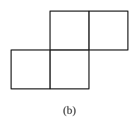

> 原书 PDF 第 122-126 页

## 第16章提 高题

1.确定元素都是0或1，每一行每一列都有奇数个1的 $8 \times 8$ 的矩阵的个数.

2.恰有三个不同数字的七位数有多少个?

3.一个动物庇护所里有n只猫、3n条狗.每只猫都恰好讨厌3条狗，没有两只猫讨厌同一条狗.求给每一只猫分配一个猫不讨厌的狗窝的方法数公式.

4.有两种不同的旗杆和19面旗，其中有10面相同的蓝旗，9面相同的绿旗.设N是所有旗帜不同排列的个数，每个旗杆至少有一面旗，在两个旗杆上都没有两面相同相邻的绿旗，求N除以1000的余数.

5. 推导一个由m个1和n个0组成的k组1的排列种数的(没有加法的）公式，其中组的意思是最多个连续相同值的数串.

6.在一次超级英雄和超级恶棍的大会上，5对英雄和恶棍坐成一排，所坐之处放着一块条板.当然，如果任何超级英雄坐在他(她）的对手(恶棍）旁边，那么混乱必将爆发，会议将不能召开.有多少种方法安排这些人，使大会能够顺利地进行下去？

7.考虑三个集合X,Y,Z,有 $\left| X \right| = m, \left| Y \right| = n, \left| Z \right| = r$ ，以及 $Z \subset Y .$ 用 $\mathcal { S } _ { m , \textit { n } , \textit { r } }$ 表示对 $Z \subseteq f(X)$ ,函数 $f : X \to Y$ 的个数.证明

$$
s_{m,n,r}=m^{n}-\binom{r}{1}(m-1)^{n}+\binom{r}{2}(m-2)^{n}-\cdots+(-1)^{n}(m-r)^{n}
$$

8.一个由n个X和r个Y组成的字母组，求由X和Y组成的不同的单词(序列）的个数，使得每个序列中必须包含n个X(不必包含所有的Y).

9. 设A,B,C是三个集合.如果 $\mid A \cap B \mid = \mid B \cap C \mid = \mid C \cap A \mid = 1 , A \cap B \cap C { = } \varnothing$那么就定义有序三元组(A，B，C)为最小交集三元组.例如，({1,2}，{2,3}，{1,3，4})就是一个有序最小交集三元组.求每个集合都是{1，2,3,4，5,6,7}的子集的有序最小交集三元组的个数.

10.对于字母{H，T}的回文序列指的是由H和T组成的，从左到右读和从右到左读是相同的序列.于是HTH，HTTH,HTHTH和HTHHTH分别是长度为3,4,5,6的回文序列.设P(n)表示长度为n的字母{H，T}的回文序列的个数.n有多少个值，使$1\ 000<P(n)<10\ 000?$

11.不等式 $n_{1}+n_{2}+\cdots+n_{k} \leqslant m$ 有多少组非负整数解？

12.对于方程 $x + y + z = 30$ 的使 $x , y , z$ 都不是3的倍数的非负整数解有多少组？

13.求正整数的三数组 $(a,b,c)$ 的个数，其中每一个正整数都取自于1到9的数，且乘

积 abc 能被 10 整除.

14.将数1,2，…,8分成三个非空集合，求有多少种分法，例如，{1,3,6,7}，{2,5}，{4,8}就是一种分法，与这三个集合的顺序无关.

15.设 $S _ { 1 }$ 和 $S _ { 2 }$ 表示两个长度为n的二进制数串. $S _ { 1 }$ 和 $S _ { 2 }$ 不同位置的个数称为 $S _ { 1 }$ 和$S _ { 2 }$ 的海明(Hamming)距离，用 $H(S_{1},S_{2})$ 表示.例如，H(001011,101001)=2.给定正整数n和k， $k \leqslant n .$ 计算长度为n的有序二进制数串 $S_{1}$ 和 $S _ { 2 }$ 的二元对 $(S_{1},S_{2})$ 的个数，使$H(S_{1},S_{2}) = k$

16.在由5个A,5个B,5个C共15个字母组成的排列中，前5个字母中没有A，中间5个字母中没有B，后5个字母中没有C的排列有多少个?

17.考虑各位数字都不相同的数，第一位数字不是0，数字之和是36.这样的数有 $N \times$ 7！个，N的值是什么？

18.在一系列扔硬币的结果中，我们可以把背面接着是正面，和正面接着又是正面等情况记录下来.我们用TH，HH，等等表示.例如，在扔15次硬币的序列HHTTHHHHTHHTTTT 中，观察到有5个HH,3个HT,2个TH 和4个 TT的子序列.在扔15次硬币的序列中，多少个不同序列恰好包含2个HH,3个HT,4个TH和5个TT的子序列?

19.表达式 $(x + y + z)^{2006} + (x - y - z)^{2006}$ 经过展开和合并同类项后得以化简，在化简后的表达式中有多少项？

20. 多项式 $1 - x + x^{2} - x^{3} + \cdots + x^{16} - x^{17}$ 可改写成 $a_{0}+a_{1}y+a_{2}y^{2}+\cdots+a_{16}y^{16}+a_{17}y^{17}$的形式，其中 $y = x + 1, a_{i}$ 是常数，求 $a_{2}$ 的值.

21.设 S是包含n个元素的集合，证明

$$
\sum_{A \subseteq S} \sum_{B \subseteq S} \left| A \cap B \right| = n \cdot 4^{n - 1}
$$

22.证明:任何不能被5整除的奇数必整除形如10101…01的某一个1和0交替出现的数串.例如,13整除10101,17整除101010101010101,9和19整除10101010101010101.

23.证明:对于每一个16位数，都存在一个或几个连续的数字组成的数字串，使这些数字的积是完全平方数.

24.从1到100选取10个整数.证明:我们能找到两个所选取整数不交的非空子集，使这两个子集的元素的和相等.

25.平面内每个点是红色、绿色、蓝色三种颜色中的一种.证明:该平面内存在一个顶点都同色的矩形.

26.Jenny有一堆共n块的石块，n是正整数， $n \geqslant 2$ 每一步，她取一堆石块分成两小堆.如果新的两堆石块分别是a块和b块，那么把积ab写在黑板上.她继续重复这一过程，直到每堆石块都恰好是1块.证明:不管怎样分石块，黑板上数的和始终不变

(例如，如果Jenny从12块石块的一堆开始，她可以分成一堆5块，一堆7块，并把 $5$ $7 = 35$ 写在黑板上.然后可以把5块一堆的石块分成2块一堆，3块一堆，然后把 $2 \cdot 3 = 6$写在黑板上.)

27.证明:对一切有n个顶点的树T，有 $\chi(T;k)=k(k-1)^{n-1}$

28.证明:每一张有n个顶点，至少有n条棱的图包含一个环路.

29.设 $p > 2$ 是质数.在 $\left\{ 1, 2, \cdots, p - 1 \right\}$ 的子集中，求和能被 $\dot{p}$ 整除的子集的个数.

30.一副牌有32张，其中有两张是不同的丑角牌，丑角牌的标号是0.10张红牌的标号是1到10.类似地，蓝牌和绿牌也是如此.从这副牌中选取若干张牌组成一手牌.如果这手牌中的一张牌标有数k，那么这张牌的值就是 $2 ^ { k }$ ，这手牌的值就是手中的牌的值的和.确定值为2004的一手牌有多少种.

31.自然数集合可分割成有限多个算术数列 $\left\{ a _ { i } + d r _ { i } \right\} , 1 \leqslant i \leqslant n ,$ 证明:

(a) $\sum _ { i = 1 } ^ { n } \frac { 1 } { r _ { i } } = 1$

(b) 存在 $i \neq j$ ,但 $r _ { i } = r _ { j }$

(c) $\sum_{i = 1}^{n}\frac{a_{i}}{r_{i}} = \frac{n - 1}{2}.$

32.求一切自然数n，存在两个不同的整数集 $\left\{ a_{1}, a_{2}, \cdots, a_{n} \right\}$ 和 $\left\{ b_{1}, b_{2}, \cdots, b_{n} \right\}$ ,使多重集

$$
\left\{ a_{i} + a_{j} \mid 1 \leqslant i < j \leqslant n \right\} \text{ 和 } \left\{ b_{i} + b_{j} \mid 1 \leqslant i < j \leqslant n \right\}
$$

重合.

33.是否存在具有以下性质的非负整数的一个子集X:对于任何整数n，方程 $a + 2b =$ n恰有一组解， $a,b \in X$

34.设n是正整数， $X = \{ 1, 2, \cdots, 2n \}$ ，X有多少个没有两个元素 $x,y(x,y \in S)$ 相差2的子集 $S 9$

35.有一个由 $200 \times 3$ 个单位正方形组成的矩形.证明:把这个矩形分割成大小为 $1 \times$ 2的矩形的方法个数能被3 整除.

36.一个单词是由 $\{ a , b , c , d \}$ 组成的n个字母的一个序列.如果这个单词包含连续两个同样的字母组，那么就说这个单词是复杂的.例如，单词caab，baba和 $c a b a b d c$ 都是复杂单词，而 $b a c b a , d c b d c$ 却不是.一个单词如果不是复杂单词，那么就是简单单词.证明:如果n是正整数，那么有n个字母的简单单词超过 $2^{n}$ 个.

37.有一个排列 $\sigma:\{1,2,\cdots,n\}\rightarrow\{1,2,\cdots,n\}$ .当且仅当对于每一个整数 $k,1 \leqslant k \leqslant$ $n = 1 , \sigma$ 满足以下不等式

$$
\left| \sigma(k) - \sigma(k - 1) \right| \leqslant 2
$$

则称排列 $\sigma$ 为直接排列.求存在2003个直接排列的最小的n.

38.16名学生参加一次数学竞赛，每一道题都是有四个选项的多项选择.竞赛后发现任何两名学生至多有一个共同的答案.证明:这次竞赛至多有5道题

39.已知10个人去书店，每个人恰好都买了3本书.对于每两个人，至少有一本书是两人都买的.有一本书买的人最多，至少有多少人买了这本书？

40.设 X是有n个元素的集合.给定 X的 $k(k \geqslant 2)$ 个子集，每一个集合至少有r个元素，证明:能够找出其中的两个子集，它们的交至少有 $r = \frac{nk}{4(k - 1)}$ 个元素.

41.设X是有n个元素的有限集， $A_{1},A_{2},\cdots,A_{m}$ 是集合X的有三个元素的子集，且对一切 $i \neq j$ ,有 $\left| A_{i} \cap A_{j} \right| \leqslant 1$ .证明:存在X的至少有 $\sqrt { 2 n }$ 个元素的子集A不包含 $A_{i}$的任何元素.

42.设T是大于1的整数的有限集合.如果对于任何 $t \in T$ ，能找到 $s \in S$ ，使得t,s不互质，则称T的子集S为T的好子集.证明:T的好子集的个数是奇数

43.证明:对于平面内任何有n个点的集合，在这些点中至多存在 $c n \sqrt { n }$ 个点的距离等于1，这里 $c > 0$ 是某个绝对常数.

44.在黑板上写1到2015的数.数学博士每秒钟擦去形如 $a,b,c,a+b+c$ 的四个数，并用 $a+b,b+c,c+a$ 代替.证明:这一操作至多持续9min.

45.有若干块石头放在一条(双向)无限长标有整数的方格带状条上.我们实施一系列搬动石头的操作，每次搬动是以下两类之一:

(a) 从方格n-1和方格n中各取出一块石头，放到方格 $n + 1$

(b)从方格n中取出两块石头，在方格n-2和方格 $n + 1$ 各放一块石头.

证明:任何这样一系列搬动都会导致不能再进行下去的情况，并且这种情况与搬动的顺序无关.

46.考虑各元素都是整数的矩阵，把同一个整数加到一行的所有元素上，或者一列中，这就称为一次操作.已知对于无穷多个正整数n，虽然经过有限多次操作，还是可以得到一个所有元素都能被n整除的矩阵.证明:经过有限多次操作可以得到一个所有元素都是零的矩阵.

47.在正六边形的顶点上放六个非负整数，使这六个数的和是n.允许做以下形式的操作:他(她)可以取一个顶点，用写在两个相邻顶点之间数的差的绝对值代替写在那里的数.证明:如果n是奇数，那么进行一系列操作后可以使0出现在所有六个顶点上

48.有一块 $(2n + 1) \times (2n + 1)$ 的板要用图23所示形状的薄片砖块铺砌，允许旋转和翻转.证明:第一类的砖块至少要用 $4 n + 3$ 块.

(a)

(b)

图23

(c)

49.给定一个正2004边形，所有的对角线都已画好.除去一些边和对角线，每个顶点至多发出5条线段。证明:可以用两种颜色对顶点涂色，使至少有 $\frac{3}{5}$ 的其余线段的端点不同色.

50. 设 A 是模 $N^{2}$ 的N个余数的集合.证明:存在一个模 $N^{2}$ 的N个余数的集合B，使$A + B = \left\{ a + b \mid a \in A, b \in B \right\}$ 至少有 $\frac { N ^ { 2 } } { 2 }$ 个元素.

51.对一个 $m \times n$ 的棋盘随机涂色:每一个方格都是独立地涂红色或黑色，概率都是$\frac{1}{2}$ .如果有一条公共边的同色方格序列从 $\hat { P }$ 出发到 $q$ 结束，我们就说 $\mathcal { P }$ 与 $q$ 属于同一个同色连通区域.证明:同色连通区域的期望值大于 $\frac { m n } { 8 }$

52.一堆有限个正方形，其总面积是4.证明:这些正方形能覆盖一个边长是1的正方形.

53.平面内给定 $2 n + 3$ 个点，没有三点共线，也没有四点共圆.证明:存在一个经过其中三点的圆，使其余n个点在该圆的内部.

54.设 $n \geqslant 4$ 是确定的正整数.给出平面内无三点共线，无四点共圆的n个点的集合$S = \left\{ P_{1}, P_{2}, \cdots, P_{n} \right\}$ .对于 $1 \leq t \leq n$ ,设点 $P_{t}$ 在圆 $P_{i}P_{j}P_{k}$ 的内部， $;a_{i}$ 是 $P_{i}$ 的个数，再设$m(S) = \sum_{i = 1}^{n} a_{i}$ .证明:存在一个只与n有关的正整数 $f(n)$ ，当且仅当 $m(S) = f(n)$ 时，S的点是一个凸多边形的顶点

55.设S是平面内有n个点的集合，S中无三点共线.证明:存在一个包含 $2 n - 5$ 个点，且满足以下条件的集合P:三个顶点都是S的元素的每一个三角形的内部有一点是 $P$ 的元素.

56.A是封闭的多边形的集合.对于A中的任意两点，联结这两点的线段完全在A内.证明:A中存在一点O，对于任何点在A的边界上的 $X , X ^ { \prime }$ ，使O位于线段 $X X ^ { \prime }$ 上，且

$$
\frac{1}{2} \leqslant \frac{OX}{OX'} \leqslant 2
$$