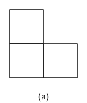
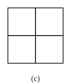

> 原书 PDF 第 122-126 页

## 第1-10题

1.确定元素都是 $0$ 或 $1$，每一行每一列都有奇数个 $1$ 的 $8 \times 8$ 的矩阵的个数.

2.恰有三个不同数字的七位数有多少个?

3.一个动物庇护所里有 $n$ 只猫、$3n$ 条狗.每只猫都恰好讨厌 $3$ 条狗，没有两只猫讨厌同一条狗.求给每一只猫分配一个猫不讨厌的狗窝的方法数公式.

4.有两种不同的旗杆和 $19$ 面旗，其中有 $10$ 面相同的蓝旗，$9$ 面相同的绿旗.设 $N$ 是所有旗帜不同排列的个数，每个旗杆至少有一面旗，在两个旗杆上都没有两面相同相邻的绿旗，求 $N$ 除以 $1000$ 的余数.

5. 推导一个由 $m$ 个 $1$ 和 $n$ 个 $0$ 组成的 $k$ 组 $1$ 的排列种数的(没有加法的)公式，其中组的意思是最多个连续相同值的数串.

6.在一次超级英雄和超级恶棍的大会上，$5$ 对英雄和恶棍坐成一排，所坐之处放着一块条板.当然，如果任何超级英雄坐在他(她)的对手(恶棍)旁边，那么混乱必将爆发，会议将不能召开.有多少种方法安排这些人，使大会能够顺利地进行下去？

7.考虑三个集合 $X,Y,Z$，有 $|X| = m, |Y| = n, |Z| = r$，以及 $Z \subset Y$.用 $s_{m,n,r}$ 表示对 $Z \subseteq f(X)$，函数 $f:X \to Y$ 的个数.证明

$$
s_{m,n,r}=m^{n}-\binom{r}{1}(m-1)^{n}+\binom{r}{2}(m-2)^{n}-\cdots+(-1)^{n}(m-r)^{n}
$$

8.一个由 $n$ 个 $X$ 和 $r$ 个 $Y$ 组成的字母组，求由 $X$ 和 $Y$ 组成的不同的单词(序列)的个数，使得每个序列中必须包含 $n$ 个 $X$(不必包含所有的 $Y$).

9. 设 $A,B,C$ 是三个集合.如果 $|A \cap B| = |B \cap C| = |C \cap A| = 1$,$A \cap B \cap C = \varnothing$ 那么就定义有序三元组 $(A,B,C)$ 为最小交集三元组.例如，$(\{1,2\},\{2,3\},\{1,3,4\})$ 就是一个有序最小交集三元组.求每个集合都是 $\{1,2,3,4,5,6,7\}$ 的子集的有序最小交集三元组的个数.

10.对于字母 $\{H,T\}$ 的回文序列指的是由 $H$ 和 $T$ 组成的，从左到右读和从右到左读是相同的序列.于是 HTH，HTTH,HTHTH 和 HTHHTH 分别是长度为 $3,4,5,6$ 的回文序列.设 $P(n)$ 表示长度为 $n$ 的字母 $\{H,T\}$ 的回文序列的个数.$n$ 有多少个值，使 $1\ 000<P(n)<10\ 000?$

## 第11-20题

11.不等式 $n_{1}+n_{2}+\cdots+n_{k} \leqslant m$ 有多少组非负整数解？

12.对于方程 $x + y + z = 30$ 的使 $x,y,z$ 都不是 $3$ 的倍数的非负整数解有多少组？

13.求正整数的三数组 $(a,b,c)$ 的个数，其中每一个正整数都取自于 $1$ 到 $9$ 的数，且乘积 $abc$ 能被 $10$ 整除.

14.将数 $1,2,\cdots,8$ 分成三个非空集合，求有多少种分法，例如，$\{1,3,6,7\}$，$\{2,5\}$，$\{4,8\}$ 就是一种分法，与这三个集合的顺序无关.

15.设 $S_{1}$ 和 $S_{2}$ 表示两个长度为 $n$ 的二进制数串.$S_{1}$ 和 $S_{2}$ 不同位置的个数称为 $S_{1}$ 和 $S_{2}$ 的海明(Hamming)距离，用 $H(S_{1},S_{2})$ 表示.例如，$H(001011,101001)=2$.给定正整数 $n$ 和 $k$，$k \leqslant n$.计算长度为 $n$ 的有序二进制数串 $S_{1}$ 和 $S_{2}$ 的二元对 $(S_{1},S_{2})$ 的个数，使 $H(S_{1},S_{2}) = k$.

16.在由 $5$ 个 $A$,$5$ 个 $B$,$5$ 个 $C$ 共 $15$ 个字母组成的排列中，前 $5$ 个字母中没有 $A$，中间 $5$ 个字母中没有 $B$，后 $5$ 个字母中没有 $C$ 的排列有多少个?

17.考虑各位数字都不相同的数，第一位数字不是 $0$，数字之和是 $36$.这样的数有 $N \times 7!$ 个，$N$ 的值是什么？

18.在一系列扔硬币的结果中，我们可以把背面接着是正面，和正面接着又是正面等情况记录下来.我们用 TH，HH，等等表示.例如，在扔 $15$ 次硬币的序列 HHTTHHHHTHHTTTT 中，观察到有 $5$ 个 HH,$3$ 个 HT,$2$ 个 TH 和 $4$ 个 TT 的子序列.在扔 $15$ 次硬币的序列中，多少个不同序列恰好包含 $2$ 个 HH,$3$ 个 HT,$4$ 个 TH 和 $5$ 个 TT 的子序列?

19.表达式 $(x + y + z)^{2006} + (x - y - z)^{2006}$ 经过展开和合并同类项后得以化简，在化简后的表达式中有多少项？

20. 多项式 $1 - x + x^{2} - x^{3} + \cdots + x^{16} - x^{17}$ 可改写成 $a_{0}+a_{1}y+a_{2}y^{2}+\cdots+a_{16}y^{16}+a_{17}y^{17}$的形式，其中 $y = x + 1, a_{i}$ 是常数，求 $a_{2}$ 的值.

## 第21-30题

21.设 $S$ 是包含 $n$ 个元素的集合，证明

$$
\sum_{A \subseteq S} \sum_{B \subseteq S} \left| A \cap B \right| = n \cdot 4^{n - 1}
$$

22.证明:任何不能被 $5$ 整除的奇数必整除形如 $10101 \cdots 01$ 的某一个 $1$ 和 $0$ 交替出现的数串.例如,$13$ 整除 $10101$,$17$ 整除 $101010101010101$,$9$ 和 $19$ 整除 $10101010101010101$.

23.证明:对于每一个 $16$ 位数，都存在一个或几个连续的数字组成的数字串，使这些数字的积是完全平方数.

24.从 $1$ 到 $100$ 选取 $10$ 个整数.证明:我们能找到两个所选取整数不交的非空子集，使这两个子集的元素的和相等.

25.平面内每个点是红色、绿色、蓝色三种颜色中的一种.证明:该平面内存在一个顶点都同色的矩形.

26.Jenny有一堆共 $n$ 块的石块，$n$ 是正整数，$n \geqslant 2$.每一步，她取一堆石块分成两小堆.如果新的两堆石块分别是 $a$ 块和 $b$ 块，那么把积 $ab$ 写在黑板上.她继续重复这一过程，直到每堆石块都恰好是 $1$ 块.证明:不管怎样分石块，黑板上数的和始终不变.

(例如，如果Jenny从 $12$ 块石块的一堆开始，她可以分成一堆 $5$ 块，一堆 $7$ 块，并把 $5 \cdot 7 = 35$ 写在黑板上.然后可以把 $5$ 块一堆的石块分成 $2$ 块一堆，$3$ 块一堆，然后把 $2 \cdot 3 = 6$ 写在黑板上.)

27.证明:对一切有 $n$ 个顶点的树 $T$，有 $\chi(T;k)=k(k-1)^{n-1}$.

28.证明:每一张有 $n$ 个顶点，至少有 $n$ 条棱的图包含一个环路.

29.设 $p > 2$ 是质数.在 $\{1,2,\cdots,p - 1\}$ 的子集中，求和能被 $p$ 整除的子集的个数.

30.一副牌有 $32$ 张，其中有两张是不同的丑角牌，丑角牌的标号是 $0$.$10$ 张红牌的标号是 $1$ 到 $10$.类似地，蓝牌和绿牌也是如此.从这副牌中选取若干张牌组成一手牌.如果这手牌中的一张牌标有数 $k$，那么这张牌的值就是 $2^{k}$，这手牌的值就是手中的牌的值的和.确定值为 $2004$ 的一手牌有多少种.

## 第31-40题

31.自然数集合可分割成有限多个算术数列 $\{a_{i} + d r_{i}\},1 \leqslant i \leqslant n$.证明:

(a) $\sum_{i = 1}^{n}\frac{1}{r_{i}} = 1$

(b) 存在 $i \neq j$,但 $r_{i} = r_{j}$

(c) $\sum_{i = 1}^{n}\frac{a_{i}}{r_{i}} = \frac{n - 1}{2}$

32.求一切自然数 $n$，存在两个不同的整数集 $\{a_{1},a_{2},\cdots,a_{n}\}$ 和 $\{b_{1},b_{2},\cdots,b_{n}\}$，使多重集

$$
\left\{ a_{i} + a_{j} \mid 1 \leqslant i < j \leqslant n \right\} \text{ 和 } \left\{ b_{i} + b_{j} \mid 1 \leqslant i < j \leqslant n \right\}
$$

重合.

33.是否存在具有以下性质的非负整数的一个子集 $X$:对于任何整数 $n$，方程 $a+2b=n$ 恰有一组解，$a,b \in X$.

34.设 $n$ 是正整数，$X = \{1,2,\cdots,2n\}$，$X$ 有多少个没有两个元素 $x,y(x,y \in S)$ 相差 $2$ 的子集 $S$?

35.有一个由 $200 \times 3$ 个单位正方形组成的矩形.证明:把这个矩形分割成大小为 $1 \times 2$ 的矩形的方法个数能被 $3$ 整除.

36.一个单词是由 $\{a,b,c,d\}$ 组成的 $n$ 个字母的一个序列.如果这个单词包含连续两个同样的字母组，那么就说这个单词是复杂的.例如，单词 caab，baba 和 cababdc 都是复杂单词，而 bacba,dcbdc 却不是.一个单词如果不是复杂单词，那么就是简单单词.证明:如果 $n$ 是正整数，那么有 $n$ 个字母的简单单词超过 $2^{n}$ 个.

37.有一个排列 $\sigma:\{1,2,\cdots,n\} \to \{1,2,\cdots,n\}$.当且仅当对于每一个整数 $k,1 \leqslant k \leqslant n-1$，$\sigma$ 满足以下不等式

$$
\left| \sigma(k) - \sigma(k - 1) \right| \leqslant 2
$$

则称排列 $\sigma$ 为直接排列.求存在 $2003$ 个直接排列的最小的 $n$.

38.$16$ 名学生参加一次数学竞赛，每一道题都是有四个选项的多项选择.竞赛后发现任何两名学生至多有一个共同的答案.证明:这次竞赛至多有 $5$ 道题.

39.已知 $10$ 个人去书店，每个人恰好都买了 $3$ 本书.对于每两个人，至少有一本书是两人都买的.有一本书买的人最多，至少有多少人买了这本书？

40.设 $X$ 是有 $n$ 个元素的集合.给定 $X$ 的 $k(k \geqslant 2)$ 个子集，每一个集合至少有 $r$ 个元素，证明:能够找出其中的两个子集，它们的交至少有 $r - \frac{nk}{4(k - 1)}$ 个元素.

## 第41-50题

41.设 $X$ 是有 $n$ 个元素的有限集，$A_{1},A_{2},\cdots,A_{m}$ 是集合 $X$ 的有三个元素的子集，且对一切 $i \neq j$,有 $|A_{i} \cap A_{j}| \leqslant 1$.证明:存在 $X$ 的至少有 $\left\lfloor \sqrt{2n} \right\rfloor$ 个元素的子集 $A$ 不包含 $A_{i}$ 的任何元素.

42.设 $T$ 是大于 $1$ 的整数的有限集合.如果对于任何 $t \in T$，能找到 $s \in S$，使得 $t,s$ 不互质，则称 $T$ 的子集 $S$ 为 $T$ 的好子集.证明:$T$ 的好子集的个数是奇数.

43.证明:对于平面内任何有 $n$ 个点的集合，在这些点中至多存在 $c n \sqrt{n}$ 个点的距离等于 $1$，这里 $c > 0$ 是某个绝对常数.

44.在黑板上写 $1$ 到 $2015$ 的数.数学博士每秒钟擦去形如 $a,b,c,a+b+c$ 的四个数，并用 $a+b,b+c,c+a$ 代替.证明:这一操作至多持续 $9$ min.

45.有若干块石头放在一条(双向)无限长标有整数的方格带状条上.我们实施一系列搬动石头的操作，每次搬动是以下两类之一:

(a) 从方格 $n-1$ 和方格 $n$ 中各取出一块石头，放到方格 $n + 1$

(b) 从方格 $n$ 中取出两块石头，在方格 $n-2$ 和方格 $n + 1$ 各放一块石头.

证明:任何这样一系列搬动都会导致不能再进行下去的情况，并且这种情况与搬动的顺序无关.

46.考虑各元素都是整数的矩阵，把同一个整数加到一行的所有元素上，或者一列中，这就称为一次操作.已知对于无穷多个正整数 $n$，虽然经过有限多次操作，还是可以得到一个所有元素都能被 $n$ 整除的矩阵.证明:经过有限多次操作可以得到一个所有元素都是零的矩阵.

47.在正六边形的顶点上放六个非负整数，使这六个数的和是 $n$.允许做以下形式的操作:他(她)可以取一个顶点，用写在两个相邻顶点之间数的差的绝对值代替写在那里的数.证明:如果 $n$ 是奇数，那么进行一系列操作后可以使 $0$ 出现在所有六个顶点上.

48.有一块 $(2n + 1) \times (2n + 1)$ 的板要用图23所示形状的薄片砖块铺砌，允许旋转和翻转.证明:第一类的砖块至少要用 $4n + 3$ 块.

(a)

(b)

(c)

图23

49.给定一个正 $2004$ 边形，所有的对角线都已画好.除去一些边和对角线，每个顶点至多发出 $5$ 条线段.证明:可以用两种颜色对顶点涂色，使至少有 $\frac{3}{5}$ 的其余线段的端点不同色.

50. 设 $A$ 是模 $N^{2}$ 的 $N$ 个余数的集合.证明:存在一个模 $N^{2}$ 的 $N$ 个余数的集合 $B$，使 $A + B = \{a + b \mid a \in A, b \in B\}$ 至少有 $\frac{N^{2}}{2}$ 个元素.

## 第51-56题

51.对一个 $m \times n$ 的棋盘随机涂色:每一个方格都是独立地涂红色或黑色，概率都是 $\frac{1}{2}$.如果有一条公共边的同色方格序列从 $p$ 出发到 $q$ 结束，我们就说 $p$ 与 $q$ 属于同一个同色连通区域.证明:同色连通区域的期望值大于 $\frac{mn}{8}$.

52.一堆有限个正方形，其总面积是 $4$.证明:这些正方形能覆盖一个边长是 $1$ 的正方形.

53.平面内给定 $2n + 3$ 个点，没有三点共线，也没有四点共圆.证明:存在一个经过其中三点的圆，使其余 $n$ 个点在该圆的内部.

54.设 $n \geqslant 4$ 是确定的正整数.给出平面内无三点共线，无四点共圆的 $n$ 个点的集合 $S = \{P_{1},P_{2},\cdots,P_{n}\}$.对于 $1 \leqslant t \leqslant n$，设点 $P_{t}$ 在圆 $P_{i}P_{j}P_{k}$ 的内部，$a_{t}$ 是 $P_{t}$ 的个数，再设 $m(S) = \sum_{i = 1}^{n} a_{i}$.证明:存在一个只与 $n$ 有关的正整数 $f(n)$，当且仅当 $m(S) = f(n)$ 时，$S$ 的点是一个凸多边形的顶点.

55.设 $S$ 是平面内有 $n$ 个点的集合，$S$ 中无三点共线.证明:存在一个包含 $2n - 5$ 个点，且满足以下条件的集合 $P$:三个顶点都是 $S$ 的元素的每一个三角形的内部有一点是 $P$ 的元素.

56.$A$ 是封闭的多边形的集合.对于 $A$ 中的任意两点，联结这两点的线段完全在 $A$ 内.证明:$A$ 中存在一点 $O$，对于任何点在 $A$ 的边界上的 $X,X^{\prime}$，使 $O$ 位于线段 $XX^{\prime}$ 上，且

$$
\frac{1}{2} \leqslant \frac{OX}{OX'} \leqslant 2
$$
