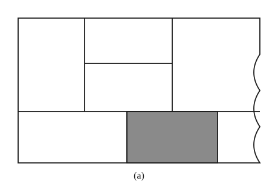
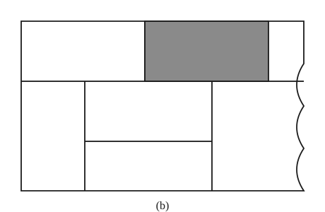
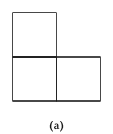
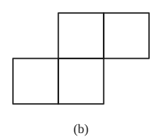
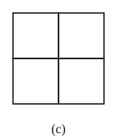

> 原书 PDF 第 151-181 页

## 第18章 提高题的解答

1.确定元素都是0或1，每一行每一列都有奇数个1的 $8 \times 8$ 的矩阵的个数.

解 我们将逐行构造矩阵.我们可以对矩阵的特定一行中的前七个数任意取0或1.但是，第八个数由在前七个数中1的个数决定:如果已经有奇数个1了，那么最后一个元素必定是 $0 ;$ 否则就是1.因为前七个数中的每一个都有两种选择，于是共有 $2 ^ { 7 }$ 种方法构造这样的一行.这个过程可以对前七行中的每一行实施，所以有 $(2^{7})^{7} = 2^{49}$ 种方法.现在考虑最后一行.对这一行的最后一个元素用类似的逻辑，这一行已完全预先确定了，因为这一行的每一个元素都是一列的最后一个元素.我们最终只要计算矩阵中的所有1的个数的奇偶性就可以保证最后一行有奇数个1.明确地说，因为我们构造了最后一行，所以每一列都有奇数个1，于是矩阵中1的总个数必定是偶数(八个奇数的和是偶数).该矩阵的前七行中有奇数个1(七个奇数的和是奇数)，于是必存在最后一行中有奇数个1，使得所有的数的和是偶数。于是，有 $2 ^ { 49 }$ 个满足所给条件的矩阵

2.恰有三个不同数字的七位数有多少个？

解首先，计算由字母{X，Y，Z}组成的长度为7的数串的个数，每个字母都至少出现一次，容易用容斥原理计数.长度为7的数串有 $3 ^ { 7 }$ 个，但是包括了3个字母都不出现的情况.对每一个字母来说，都有 $2 ^ { 7 }$ 个数串不出现该字母，因此总共有 $3 \cdot 2 ^ { 7 }$ 个.如果我们减去这个数，那么将减去恰有1个字母出现两次的情况.于是，正确的结果是 $3^{7} - 3 \cdot 2^{7} + 3$注意到这与所求的个数很有关系.如果我们用不同的数字代替X,Y和Z，那么我们必须担心两件事.首先，那么我们不允许以0开头，实际上我们得到一个七位数，不只是一个数串.其次，在字母串X，Y，Z中有对称性，对于任何这样的数串，我们可以搬动字母得到另一个这样的数串.例如，可用XXZYXYZ表示数1123132，这里 $X = 1, Y = 3, Z = 2$ ，也可以用ZZYXZXY表示，这里 $X = 3, Y = 3, Z = 1$ .我们观察到因为字母X,Y,Z有 $3 ! = 6$ 种排列，结果我们对每个数串计算了6次.于是，把原数串的个数除以6才符合第二个问题.现在我们将对每个字母分配一个数值，我们可以用任何非零的数字代替数串中的第一个字母，有9种选择.第二个出现的字母可以是除了第一个字母以外的任何数字(有9种选择)，第三个字母是余下的数字之一(有8种选择).总共有 $9 \cdot 9 \cdot 8 \cdot ( \frac{3^{7} - 3 \cdot 2^{7} + 3}{6} ) =$ 195048个恰有三个不同数字的七位数.

3.一个动物庇护所里有n只猫、3n条狗.每只猫都恰好讨厌3条狗，没有两只猫讨厌同一条狗.求给每一只猫分配一个猫不讨厌的狗窝的方法数公式.

解这是错排问题的一个变式(见例35).假定我们知道对于某k只猫 $( 0 \leq k \leq n )$分配给它讨厌的狗窝.对那k只猫中的每一只都有三种方法分配给它讨厌的狗窝.对于其余n-k只猫，有3n-k种方法分配一个狗窝给第一只猫， $3 n - k - 1$ 种方法分配一个狗窝给下一只猫，一直到 $3n - k - (n - k) + 1 = 2n + 1$ 种方法分配一个狗窝给最后一只猫.注意这些项的乘积是 $\frac{(3n - k)!}{(2n)!}$ .于是有 $3^{k} \cdot \frac{(3n - k)!}{(2n)!}$ 种方法分配给选出的k只猫，它们讨厌的狗窝.因为有 $\binom{n}{k}$ 种方法选择使这群猫不舒服，根据容斥原理，总共有

$$
\sum_{k = 0}^{n} ( - 1)^{k} \binom{n}{k} 3^{k} \frac{(3n - k)!}{(2n)!}
$$

种这样的方法分配狗窝给猫，没有猫不高兴

4.有两种不同的旗杆和19面旗，其中有10面相同的蓝旗，9面相同的绿旗，设N是所有旗帜不同排列的个数，每个旗杆至少有一面旗，在两个旗杆上都没有两面相同相邻的绿旗，求N除以1000的余数.

解我们把10面蓝旗排成一行，加一面红旗表示分成两个旗杆.这样在10面蓝旗之间或两侧就有11个位置，所以有11个位置可插这面红旗.接下来，我们放绿旗，使红旗和蓝旗之间的每一个空位置至少有一面绿旗，这就保证每一对绿旗被至少一面蓝旗隔开，或者在红旗分割绿旗的情况下，题中在不同的旗杆有上绿旗.在12个位置放9面绿旗，有$\binom{12}{9} = 220$ 种方法插进绿旗.于是总数是 $11 \cdot 220 = 2\ 420$ 种排列.

结果给出我们把旗帜放置在旗杆上的唯一方法:从左边开始从下到上放置旗帜。遇到红旗时，换一根旗杆.我们需要考虑的唯一情况是一根旗上没有旗帜，这只有在红旗位于所有旗帜的左边或右边的情况.把红旗放在两边有两种选择，于是其余旗帜有 $\binom{11}{9} =$ 55种排列，所以最后的排列种数 $N=2\ 420-2\cdot 55=2\ 310$ .因此除以1000的余数是310.

5. 推导一个由m个1和n个0组成的k组1的排列种数的(没有加法的)公式，其中组的意思是最多个连续相同值的数串.

解首先，把m个1分成k组.每一组至少包含一个1，所以有m-k个1要安排.我们会想到星星和杠杠的问题:m-k颗星(表示1)和k-1条杠(表示两组之间的空位置)，有 $\binom{m - 1}{k - 1}$ 种排法.

其次，安置0.把k-1个0分到m-k组1中，其余n-k+1个0可以放到k组1之间，或之前，或之后的k+1个空位置中的任何一个空位置处.我们又想到星星和杠杠的情况，其中0是星星，k条杠杠分割所有可能的空位置，有 $\binom{n + 1}{k}$ 种方法把0放到1中.一共得到 $\binom{m - 1}{k - 1} \cdot \binom{n + 1}{k}$ 组1的排列.

6.在一次超级英雄和超级恶棍的大会上，5对英雄和恶棍坐成一排，所坐之处放着一块条板。当然，如果任何超级英雄坐在他（她）的对手（恶棍）旁边，那么混乱必将爆发，会议将不能召开，有多少种方法安排这些人，使大会能够顺利地进行下去？

解这里我们将用补计数和容斥原理.首先，计算出对10个人的排列方法有10！种.其次，减去至少一对英雄(恶棍)坐在一起的情况.选择哪对坐在一起的方法有 $\binom{5}{1}$ 种，选择这一对中谁坐在左边的方法有2种，还有9！种方法安排每一个人(因为一对中的两个人必会相邻坐，所以可以当作一个整体处理).这就共给出 $\binom{5}{1} \cdot 2 \cdot 9!$ 种排法.但是，我们重复计算了至少有两对坐在一起的情况，所以必须减去 $( 5 ) \cdot 2 ^ { 2 } \cdot 8 ! \binom{5}{2}$ 是选择哪两对人相邻坐的方法种数，有2种方法安排每一对人，有8！种方法安排每一个人).继续这样的模式，最后得到的结果是$10! - \binom{5}{1} \cdot 2 \cdot 9! + \binom{5}{2} \cdot 2^{2} \cdot 8! - \binom{5}{3} \cdot 2^{3} \cdot 7! + \binom{5}{4} \cdot 2^{4} \cdot 6! - \binom{5}{5} \cdot 2^{5} \cdot 5!$

7.考虑三个集合X,Y,Z,有 $\left| X \right| = m, \left| Y \right| = n, \left| Z \right| = r$ ,以及 $Z \subset Y .$ 用 $S_{m,\ n,r}$ 表示对 $Z \subseteq f(X)$ ，函数 $f : X \to Y$ 的个数.证明

$$
s_{m,n,r}=m^{n}-\binom{r}{1}(m-1)^{n}+\binom{r}{2}(m-2)^{n}-\cdots+(-1)^{n}(m-r)^{n}
$$

证明这里我们用补计数和容斥原理得到 $S_{m,n,r}$ 我们知道有 $m^{n}$ 个函数 $f : X \to Y .$如果 $Z \notin f(X)$ ，那么必定存在某个元素 $z \in Z$ ,没有 $x \in X$ ，使 $f(x) = z$ .考虑Z的包含k个元素的子集S.因为Y中余下的 $m - k$ 个元素都被X的每一个元素映射到，所以S中没有元素属于 $f(X)$ 的函数的个数是 $(m - k)^{n}$ .大小为k的Z的子集有 $\binom{r}{k}$ 个，所以由容斥原理，得

$$
s_{m,n,r} = \sum_{k=0}^{r} (-1)^k \binom{r}{k} (m-k)^n \\= m^n - \binom{r}{1} (m-1)^n + \binom{r}{2} (m-2)^n - \cdots + (-1)^n (m-1)^n.
$$

8.一个由n个X和r个Y组成的字母组，求由X和Y组成的不同的单词(序列)的个

数，使得每个序列中必须包含n个X(不必包含所有的Y).

解只要我们用杠杠代替X，用星星代替Y，那这就是一个星杠类的问题.我们增加一个X,对n+1个X和r个Y进行排列.这样的序列都由出现在第n+1个X之前的所有元素组成.注意到用这种方法得到的每一个序列都是唯一的.这个过程保证我们用到所有的X，但是在第n+1个X之后的Y必须除去，所以我们没有必要必须用所有这些Y.在总共n+r+1个字母中必须选取r个空位置给Y.于是有 $\binom{n + r + 1}{r}$ 个这样的序列.

9. 设A,B,C是三个集合.如果 $\mid A \cap B \mid = \mid B \cap C \mid = \mid C \cap A \mid = 1 , A \cap B \cap C = \varnothing$那么就定义有序三元组(A，B,C)为最小交集三元组.例如，({1,2}，{2,3}，{1,3，4})就是一个有序最小交集三元组.求每个集合都是{1,2,3,4,5,6,7}的子集的有序最小交集三元组的个数.

解首先，选择分别属于A∩B,B∩C，C∩A的元素.因为原集合中有7个元素，所以对A∩B的元素有7种选择，对B∩C的元素有6种选择，对C∩A的元素有5种选择.现在已经满足了 $\mid A \cap B \mid = \mid B \cap C \mid = \mid C \cap A \mid = 1$ 的条件，也没有违反 $A \cap B \cap$ $C = \varnothing$ 的条件.对于余下的每一个元素，因为没有一个元素能出现在多重集合中，所以有4种选择:出现在三个集合A，B，C之一的元素，或者不出现在任何一个集合之中的元素.因为余下4个元素，所以有 $7 \cdot 6 \cdot 5 \cdot 4^{4} = 53\ 760$ 个有序最小交集三元组.

10.对于字母{H，T}的回文序列指的是由H和T组成的，从左到右读和从右到左读是相同的序列.于是HTH，HTTH，HTHTH 和HTHHTH分别是长度为3,4,5,6的回文序列.设P(n)表示长度为n的字母{H，T}的回文序列的个数.n有多少个值，使$1\ 000<P(n)<10\ 000?$

解我们对两种情况确定P(n)的一般形式:n是偶数的情况和n是奇数的情况.如果n是偶数，那么点对序列的前 $\frac{n}{2}$ 个字母的每一个都有两种选择.于是后 $\frac{n}{2}$ 个字母可以用得到回文序列的方法排列(使对k从 $\frac{n}{2}$ 到n,第k个元素与第n-k+1个元素相同).于是当n是偶数时，长度为n的回文序列有 $2 ^ { \frac { n } { 2 } }$ 个.类似地，如果n是奇数，那么点对序列的前$\frac{n + 1}{2}$ 个字母是H或T，但是其余的字母必须使得到的序列是回文序列.于是，当n是奇数时，长度为n的回文序列共有 $2 \frac { \pi + 1 } { 2 }$ 个.

我们的目标是 $1\ 000 < P(n) < 10\ 000$ .因为P(n)永远是2的幂，所以要寻找大于1000的2的最小的幂和小于10000的2的最大的幂.我们有 $1024 = 2^{10}$ ，所以使 $P(n) >$ 1 000的 n的最小值是 $10=\frac{n+1}{2}$ ,则 $n = 19$ .我们还有 $8192 = 2^{13}$ ，所以使 $P(n) < 10\ 000$的 n的最大值是 $13 = \frac{n}{2}$ ，则 $n = 26$ 于是对 $19 \leq n \leq 26$ ,有 $1\ 000 < P(n) < 10\ 000$ 于是我们可以推出，n有8个值，使 $1\ 000 < P(n) < 10\ 000$

11.不等式 $n_{1}+n_{2}+\cdots+n_{k} \leqslant m$ 有多少组非负整数解？

解我们想找出一种巧妙的方法把该不等式变为方程，以便可以使用我们已经知道的方法.为此我们随手加一个变量s，把原不等式变为方程 $n_{1}+n_{2}+\cdots+n_{k}+s=m$ ,这里$n_{1},n_{2},\cdots,n_{k},s$ 都是非负整数.注意到由于s是非负整数，所以可以取所有可能值，于是$n_{1} + n_{2} + \cdots + n_{k}$ 可以取0到m的一切可能值.在例22中讨论过，因为我们有k+1个变量和m个1，所以这样的方程的解的组数是 $\binom{m+k}{m}$

12.对于方程 $x + y + z = 30$ 的使 $x , y , z$ 都不是3的倍数的非负整数解有多少组？

解为了使 $x , y , z$ 的和是30(是3的倍数)，且 $x , y , z$ 都不是3的倍数，这三个数除以3的余数必定相同.我们看两种情况:每个数都除以3余1和每个数都除以3余2.如果$x , y , z$ 除以3的余数都是1，那么设 $x=3a+1,y=3b+1,z=3c+1$ .这样就得到

$$
x+y+z=3a+1+3b+1+3c+1=3(a+b+c)+3=30
$$

可化简为 $3(a + b + c) = 27$ ，然后 $a+b+c=9$ ,其中 $a , b , c$ 是非负整数.我们已经明白如何用前面的例22中星星和杠杠的方法解决这类问题，得到的结果是 $\binom{11}{2}$ .类似地，如果$x , y , z$ 除以3的余数都是2,那么设 $x=3a+2,y=3b+2,z=3c+2$ .这样化简后就得到$a+b+c=8$ ,有 $\binom{10}{2}$ 组非负整数解.于是方程 $x + y + z = 30$ 的使 $x , y , z$ 都不是3的倍数的非负整数解一共有 $\binom{11}{2} + \binom{10}{2} = 100$ 组.

13.求正整数的三数组 $(a,b,c)$ 的个数，其中每一个正整数都取自于1到9的数，且乘积 $a b c$ 能被10整除.

解为了使 $a b c$ 能被10整除，则 $a , b , c$ 中至少有一个必定是偶数，且至少有一个必能被5整除.因为所有三个数都取自于1到9，这表示其中之一必定是5.这里用补计数法，并利用容斥原理.首先，计算没有限制的所有可能的有序三数组的个数.其次，减去没有5和没有偶数的三数组.但是，这样就把既没有5又没有偶数的三数组减了两次，所以必须加回.

对于 $a , b , c$ 中的每个数都有9种选择，所以没有限制的三数组共有 $9 ^ { 3 }$ 个.如果这三个数中没有5，那么余下的每一个数都只有8种选择，所以没有5的三数组共有 $8^{3}$ 个.如果不允许有偶数，那么每个数都有5种可能的选择(1,3，5，7,9)，所以没有偶数的三数组共有$5 ^ { 3 }$ 个.最后，如果我们既排除偶数，又排除5，那么对余下的每个数取自于(1，3，7，9)，于是

有 $4 ^ { 3 }$ 个三数组.这样，最后的结果是

$$
9^{3}-8^{3}-5^{3}+4^{3}=156
$$

个使 $a b c$ 能被10整除的有序三数组.

14.将数1,2，…,8分成三个非空集合，求有多少种分法，例如，{1,3,6,7}，{2,5}，{4,8}就是一种分法，与这三个集合的顺序无关.

解首先，假定与这三个集合的顺序无关.此时把8个数中每一个数放到一个集合有3种选择，所以有 $3 ^ { 8 }$ 种分法把这些数分成三个集合.但是，这并没有排除一个或多个集合是空集的可能性.如果这些集合中至少有一个集合是空集，那么有 $\binom{3}{1} = 3$ 种方法使哪一个集合必须是空集，每个数都有2种选择分配到那一个集合，所以共有 $3 \cdot 2 ^ { 8 }$ 种方法.但是，我们少算了有两个集合是空集的情况，有三种方法可能发生(只要选择一个集合非空).最后，我们调整计数的情况以保证与集合的顺序无关.三个非空集合的排列有3！种，因为我们不考虑顺序，所以应把结果除以3！.这样就得

$$
\frac{3^{8}-3\cdot 2^{8}+3}{3!}=966
$$

种分法将数1,2，…，8分成三个非空集合，且与这三个集合的顺序无关.

15.设 $S _ { 1 }$ 和 $S _ { 2 }$ 表示两个长度为n的二进制数串. $S _ { 1 }$ 和 $S _ { 2 }$ 不同位置的个数称为 $S _ { 1 }$ 和$S _ { 2 }$ 的海明(Hamming)距离，用 $H(S_{1},S_{2})$ 表示.例如，H(001011,101001)=2.给定正整数n 和 $k , k \leqslant n .$ 计算长度为n的有序二进制数串 $S_{1}$ 和 $S _ { 2 }$ 的二元对 $(S_{1},S_{2})$ 的个数，使$H(S_{1},S_{2}) = k$

解首先，构造 $S _ { 1 }$ .对于 $S _ { 1 }$ 的n个位置中的每一个都有2种选择(0或1)，所以有 $2^{n}$种方法构造 $S _ { 1 }$ .其次，我们必须选择 $S _ { 2 }$ 的k个位置与 $S_{1}$ 不同，有 $\binom{n}{k}$ 种方法选择一些位置不同.一旦我们选择了这些位置， $S _ { 2 }$ 就完全确定了.于是有 $\binom { n } { k } 2 ^ { n }$ 个海明距离为k，长度为n的有序二进制数串对.

16.在由5个A,5个B,5个C共15个字母组成的排列中，前5个字母中没有A，中间5个字母中没有B,后5个字母中没有C的排列有多少个?

解 假定在前5个字母中用k个 $B(0 \leqslant k \leqslant 5)$ .于是前5个字母中用5-k个C，有$\binom{5}{k}$ 种方法选择B.一旦选择B的位置，其余的位置必须用 $C$ 补满.余下的k个C与5-k个A必须一起用到第二组的5个字母中，所以又有 $\binom{5}{k}$ 种方法安排这些字母，最后，末5个字母中有k 个A和5-k 个B,于是有 $\binom{5}{k}$ 种方法安排这些字母.总共有$\sum_{k = 0}^{5} \binom{5}{k}^{3} = 2\ 252.$

种排列.

17.考虑各位数字都不相同的数，第一位数字不是0，数字之和是36.这样的数有 $N \times$ 7！个，N的值是什么？

解所有0，1，…，9的数字的和是45，所以我们不能使用数字的和是9的一组数字.现在来看不能用的数字有多少种不同的情况.如果不考虑数字9，那么有9！种方法排列0，1，…，8.如果把0放在第一个数字，那么把这个0除去，得到各位数字的和是36，且没有0或9的数.

另一种可能是我们可以不考虑一对和是9的非零的数字.有4对这样的数字(1和8，2和7,3和6，4和5).对于每一对数，都有8！种方法排列其余8个数字.如果0是第一个数字，我们就要除去它，得到另一个合格的数.

最后，我们除去数字的和是9的非零的三数组.这样的三数组有3组({1,2,6}，{1,3，5}，{2，3，4}).对于每一个三数组，都有7！种方法排列其余7个数字(如果第一个数字是0，那么就除去).我们不能除去4个或更多的非零数字使得到各位数字的和是36，这是因为 $1+2+3+4=10$ ，而且这是我们可能除去的最小的数字，这样总共有

$$
+ 4 \cdot 8! + 3 \cdot 7! = (9 \cdot 8 + 4 \cdot 8 + 3) \cdot 7! = 107 \cdot 7!
$$

个可能的数，于是 $N = 107$

18.在一系列扔硬币的结果中，我们可以把背面接着是正面，和正面接着又是正面等情况记录下来.我们用TH，HH，等等表示.例如，在扔15次硬币的序列HHTTHHHHTHHTTTT中,观察到有5个 HH,3个HT,2个TH和4个TT的子序列.在扔15次硬币的序列中，多少个不同序列恰好包含2个HH，3个HT，4个TH和5个TT的子序列？

解我们首先关注从背面到正面和从正面到背面的转换，寻找一个一般的结构.因为我们有3个HT和4个TH，所以我们的序列一定形如 $T_{1}H_{1}T_{2}H_{2}T_{3}H_{3}T_{4}H_{4}$ ,其中 $T _ { i }$表示一个背面的字母串(包括最后一个背面)， $H _ { i }$ 表示一个正面的字母串(包括最后一个正面).因为每一个字母串必须至少包含一个正(背)，所以我们必须附加2个H到某个 $H_{i}$的组合中，附加5个T到某个 $T _ { i }$ 的组合中得到2个HH和5个TT.我们知道在4组中安排2个同样的对象有 $\binom{5}{2} { = } 10 .$ 种方法，在4组中安排5个同样的对象有 $\binom{8}{5} = 56$ 种方法，所以共有 $10 \cdot 56 = 560$ 个给定子序列的序列.

19.表达式 $(x + y + z)^{2006} + (x - y - z)^{2006}$ 经过展开和合并同类项后得以化简，在化

简后的表达式中有多少项?

解 由多项式定理，有

$$
\begin{aligned}&\left(x+y+z\right)^{2006}+\left(x-y-z\right)^{2006}\\=&\sum_{a+b+c=2006}\left(2006\right)x^{a}y^{b}z^{c}+\sum_{a+b+c=2006}\left(2006\right)x^{a}\left(-y\right)^{b}\left(-z\right)^{c}\\=&\sum_{a+b+c=2006}\left[1+\left(-1\right)^{b+c}\right]\left(2006\right)x^{a}y^{b}z^{c}\\=&\sum_{a+b+c=2006}\left[1+\left(-1\right)^{b+c}\right]\left(2006\right)x^{a}y^{b}z^{c}\end{aligned}
$$

项数是有序非负整数三数组 $(a,b,c)$ 的个数，其中 $a+b+c=2\ 006,  b+c$ 是偶数(在$(-1)^{b+c} = 1$ 的情况下，有一个非零系数).为了使 $b + c$ 是偶数，a必须是偶数.特别地，设$a = 2k$ ，于是有 $2\ 006 - 2k + 1$ 项(因为b可以从0取到2006-2k).于是，总项数是

$$
\sum_{k = 0}^{1003} (2\ 006 - 2k + 1) = 1\ 004 \cdot 2\ 007 - 2\sum_{k = 0}^{1003} k = 1\ 004 \cdot 2\ 007 - 2\frac{1\ 004 \cdot 1\ 003}{2} = 1\ 004 = 1\ 008\ 016
$$

20.多项式 $1 - x + x^{2} - x^{3} + \cdots + x^{16} - x^{17}$ 可改写成 $a_{0}+a_{1}y+a_{2}y^{2}+\cdots+a_{16}y^{16}+a_{17}y^{17}$的形式，其中 $y = x + 1, a_{i}$ 是常数，求 $a_{2}$ 的值.

解因为 $y = x + 1$ ，所以 $x = y - 1$ .代入原多项式，有

$$
\begin{aligned} &1 - x + x^{2} - x^{3} + \cdots + x^{16} - x^{17}\\ &= 1 - (y - 1) + (y - 1)^{2} - (y - 1)^{3} + \cdots + (y - 1)^{16} - (y - 1)^{17}\\ \end{aligned}
$$

由二项式定理，我们知道 $(y - 1)^{n}$ 中 $y ^ { 2 }$ 的系数是 $(-1)^{n-2} \binom{n}{2}$ ，所以取自于上面的式子中的系数的和是

$$
{2 \choose 2} + {3 \choose 2} + \cdots + {16 \choose 2} + {17 \choose 2}
$$

根据曲棍球杆恒等式，上式可化简为 $\binom{18}{3} = 816$ ，所以 $a_{2} = 816$

另外，我们可以观察到

$$
1 - x + x^{2} - x^{3} + \cdots + x^{16} - x^{17} = \frac{1 - x^{18}}{1 + x} = \frac{1 - (y - 1)^{18}}{y}
$$

于是， $y ^ { 2 }$ 的系数 $a _ { 2 }$ 是 $1 - (y - 1)^{18}$ 中 $y ^ { 3 }$ 的系数.利用二项式定理得到

$$
a_{2}=-(-1)^{15}\binom{18}{3}=816
$$

21.设S是包含n个元素的集合，证明

$$
\sum_{A \subseteq S} \sum_{B \subseteq S} \left| A \cap B \right| = n \cdot 4^{n-1}
$$

证明 我们提供一个组合的证明.计算S的所有有序子集对的交的大小的和的值.

(a)这恰好是对左边的计数.|A∩B|是A和B交的大小，允许A和B跑遍S的一切可能的子集.

(b)考虑一个特定的元素 $x \in S .$ 我们将确定x在和式中计算了多少次.当A和B都包含x时，元素x从1分布到|A∩B|.于是我们需要计算有多少个A和B都包含x的有序子集对(A，B).对于S中除x以外的n-1个元素的每一个，我们都有4种选择:属于A但不属于B的元素，属于B但不属于A的元素，既不属于A也不属于B的元素，既属于A又属于B的元素.因此有 $4 ^ { n - 1 }$ 个A和B都包含x的有序子集对(A,B).因为这对任何$x \in S$ 和 $| S | = n$ 都成立，所以总个数是 $n \cdot 4 ^ { n - 1 }$

因为我们是对同一件事计数，所以它们必定相等，于是

$$
\sum_{A \subseteq S} \sum_{B \subseteq S} \left| A \cap B \right| = n \cdot 4^{n - 1}
$$

这就是所求的.

22.证明:任何不能被5整除的奇数必整除形如1010101的某一个1和0交替出现的数串.例如,13整除10101,17整除101010101010101,9和19整除10101010101010101.

证明 设n是不能被5整除的奇数.考虑前n+1个这样的数

$$
1,101,10101,1010101,\cdots,\underbrace{1010\cdots101}_{\text{2n+1 位数}}
$$

把这n+1个数除以n，有n种可能的余数.根据鸽巢原理，至少有两个数的余数相同.假定这两个数是

$$
\underbrace{1010 \cdots 101}_{\text{2i+1 位数}} \text{ 和 } \underbrace{1010 \cdots 101}_{\text{2j+1 位数}} \quad (i > j)
$$

当我们作这两个数的差时，就得到一个能被n整除的数.我们有

$$
\underbrace{1010 \cdots 101}_{\text{2i+1 位数}} - \underbrace{1010 \cdots 101}_{\text{2j+1 位数}} = \underbrace{1010 \cdots 101}_{\text{2i-2j-1 位数}} \underbrace{00 \cdots 0}_{\text{2j+2 个 0}} = \underbrace{1010 \cdots 101}_{\text{2i-2j-1 位数}} \bullet 10^{2j+2}
$$

因为n是不能被5整除的奇数，所以n与 $10^{2j+2}$ 互质.于是n必整除所求形式的数1010…101.于是，每一个不能被5整除的奇数必整除形如10101…01的某一个数.

23.证明:对于每一个16位数，都存在一个或几个连续的数字组成的数字串，使这些数字的积是完全平方数.

证明 假定该16位数的第k位数是 $n_{k}(1 \leqslant k \leqslant 16)$ .定义 $N_{k}=n_{1}\cdot n_{2}\cdot n_{3}\cdot\cdots\cdot n_{k}$ $( 0 \leq k \leq 16 )$ .所以 $N_{0}=1,N_{1}=n_{1},N_{2}=n_{1}\cdot n_{2},N_{3}=n_{1}\cdot n_{2}\cdot n_{3},\cdots$ .注意到每一个 $n _ { k }$都是该16位数的连续数字的积.

其次，注意到因为每个 $n _ { k }$ 都是一个数字，所以 $n _ { k }$ 的质因数分解式形如 $2^{a_{1}}3^{a_{2}}5^{a_{3}}7^{a_{4}}$ $\left( \alpha _ { i } \geqslant 0 \right)$ ，对于 $17N_{k}$ 的各质因数的指数奇偶性分布有 $\tilde { 2 } ^ { 4 } = 1 \tilde { 6 }$ 种.根据鸽巢原理，至少有两个数的奇偶性分布相同，假定这两个数是 $N_{i}$ 和 $N_{j}(i < j)$ ,于是

$$
\frac{N_{j}}{N_{i}}=\frac{n_{1} \cdot n_{2} \cdot \cdots \cdot n_{j}}{n_{1} \cdot n_{2} \cdot \cdots \cdot n_{i}}=n_{i+1} \cdot n_{i+2} \cdot \cdots \cdot n_{j}
$$

给出一个完全平方数，这是因为 $N_{j}$ 除以 $N_{i}$ 的结果是奇偶性相同的指数相减，结果指数都是偶数.因为这也是原16位数的连续数字的积，所以我们证明了存在一个或几个连续的数字组成的数字串，使这些数字的积是完全平方数

24.从1到100选取10个整数.证明:我们能找到两个所选取整数不交的非空子集，使这两个子集的元素的和相等.

证明考虑S是从1到100选取10个整数组成的一个集合.我们知道S有 $2^{10} - 1 =$ 1023个非空子集，也知道S的元素的和至多是 $\sum_{i = 91}^{100} i = 995$ .注意，S的任何子集的元素和都小于或等于S本身的元素和.根据鸽巢原理，因为S有1023个非空子集，对于这些子集可能的元素和少于995种，所以S中必存在两个子集(比如说 $S _ { 1 }$ 和 $S_{2}$ .如果 $S _ { 1 }$ 和 $S _ { 2 }$ 不交，那么已经证毕.否则， $S_{1} \setminus (S_{1} \cap S_{2})$ 和 $S_{2} \setminus (S_{1} \cap S_{2})$ 不交，因为从每个集合中除去共同的元素，所以元素的和仍然相同.于是，对于选自1到100的10个整数的任何集合中能找到两个所选整数的不交的非空子集，且元素的和相等，这就是我们所求的.

25.平面内每个点是红色、绿色、蓝色三种颜色中的一种.证明:该平面内存在一个顶点都同色的矩形.

证明我们将关注的是在平面内的点集 $( x , y )$ ，其中x，y为整数， $1 \leqslant x \leqslant 4,1 \leqslant$ $y \leqslant 82$ .在这个点集中y值相同的四点作为“行”.用红色、绿色、蓝色三种颜色对这一行涂色有 $3^{4} = 81$ 种方法.因为共有82行，根据鸽巢原理，存在两行同色，就取这两行.因为每行有四点和三种颜色，根据鸽巢原理，在我们选定的行中某种颜色至少出现两次.在这一行中取同色的两点以及在另一行的相应位置上的两点就是顶点都同色的一个矩形

26.Jenny有一堆共n块的石块，n是正整数， $n \geqslant 2 .$ 每一步，她取一堆石块分成两小堆.如果新的两堆石块分别是a块和b块，那么把积 $a b$ 写在黑板上.她继续重复这一过程，直到每堆石块都恰好是1块.证明:不管怎样分石块，黑板上数的和始终不变

(例如，如果Jenny从12块石块的一堆开始，她可以分成一堆5块，一堆7块，并把 $5 :$ $7 = 35$ 写在黑板上.然后可以把5块一堆的石块分成2块一堆，3块一堆，然后把 $2 \cdot 3 = 6$写在黑板上.)

证明 先看n较小时的情况.

当n=2时，如果我们从2块石块的一堆开始，只有一种可能，即两堆都是1块石块.我们把 $1 \cdot 1 = 1$ 写在黑板上，这就是最后的和.

当 $n = 3$ 时，我们从3块石块的一堆开始，必须分成2块一堆和1块一堆.我们把 $2 \bullet$

1=2写在黑板上.然后把2块石块的一堆分成的两堆都是1块，再在黑板上写上1·1=1，这就给出和 $2+1=3$

当n=4时，我们有两种可能把4块石块的一堆分成两小堆.虽然命题认为无论怎么分，结果总是相同的，但我们还是要检验两种可能性来肯定n=4的情况，

4块石块的一堆分成每堆都是2块，然后再把每一堆都分成两堆都是1块石块，最后的和是 $2 \cdot 2 + 1 \cdot 1 + 1 \cdot 1 = 6$

另一种分法，我们分成3块一堆和1块一堆.3块一堆的石块必须像n=3的情况那样分，所以得到 $3 \cdot 1 + 2 \cdot 1 + 1 \cdot 1 = 6$ .这与前面的分法结果相同.

当n=5时，我们从5块石块的一堆开始，结果和是10(读者可以用各种可能的分法检验这种情况).

到目前为止，我们得到的和是1,3，6，10.我们注意到这些数都是三角形数，所以我们猜想对有n块石块的一堆，最后的这个和是 $\frac{n(n - 1)}{2}$ .现在需要证明的是实际上这与分法无关.我们对n用强归纳法.

基础情况:我们已经检验了对n=2的情况.

归纳假定:假定对有 $n(2 \leqslant n \leqslant k)$ 块一堆的石块，不管如何分，最后的和都是$\frac{n(n - 1)}{2}$

归纳步骤:考虑有k+1块石块的一堆.第一次必须用某种方法把石块分成两堆，比如说是a块一堆和b块一堆 $(a+b=k+1,1 \le a,b \le k)$ ，这样就把a·b作为最后的和.接着我们需要把a块一堆的石块分成a堆，每堆都是1块.因为 $1 \leq a \leq k$ ，所以可以用强归纳法使最后的和是 $\frac{a(a - 1)}{2}$ .类似地，把b块一堆的石块分成b堆，每堆都是1块，可以得到 $\frac{b(b - 1)}{2}$ ，再把这个数加上原来的和 $\frac{a(a - 1)}{2}$ ,得

$$
\begin{aligned}ab + \frac{a(a - 1) + b(b - 1)}{2} &= \frac{a^{2} + b^{2} + 2ab - a - b}{2} \\&= \frac{(a + b - 1)(a + b)}{2} \\&= \frac{k(k - 1)}{2}\end{aligned}
$$

这就是所求的.根据数学归纳法原理，这就推出了证明.

27.证明:对一切有n个顶点的树T，有 $\chi(T;k)=k(k-1)^{n-1}$

证明我们对n进行归纳.

基础情况:当n=1时，只有一个顶点，可以用k种颜色中的任意一种涂色，所以有k种方法对这棵树涂色.这与 $k(k = 1)^{0}$ 一致，于是基础情况成立.

归纳假定:假定对某个 $m \geqslant 1$ ,对一切有m个顶点的树T，有

$$
\chi(T;k)=k(k-1)^{m-1}
$$

归纳步骤:考虑有m+1个顶点的树T.因为 $m + 1 \geqslant 2$ ，由例84可知，树T至少有两片叶子.假定一片叶子是l，由例85可知，T-l是有m个顶点的树.根据归纳假定，用k种颜色对 $T - l$ 涂色的方法有 $k(k - 1)^{m - 1}$ 种.现在必须对l涂一种颜色.因为l是叶，所以恰好有一个相邻的顶点.l不能与相邻的顶点同色，但是可以有另外k-1种颜色中的任意一种.于是，根据乘法原理，有

$$
\chi \left( T ; k \right) = \left( k - 1 \right) \chi \left( T - l ; k \right)^{m - 1} = k \left( k - 1 \right)^m
$$

这就是所求的.根据数学归纳法原理，这就推出了证明.

28.证明:每一张有n个顶点，至少有n条棱的图包含一个环路.

证明设 $G = (V, E)$ 是一张有n个顶点，至少有n条棱的图.假定G有k个成分，标号为 $H_{1},H_{2},\cdots,H_{k}$ ,且 $H_{i}$ 包含 $n _ { i }$ 个顶点.于是必有 $\sum _ { i = 1 } ^ { k } n _ { i } = n$ 我们断言，存在某个至少有 $n_j$ 个顶点的成分 $H_{j}$ .如果不是这种情况，那么每个成分 $H_{i}$ 必包含少于 $n _ { i }$ 条棱，这表明图中的总棱数 $| E | < \sum_{i = 1}^{k} n_{i} = n$ ，这是一个矛盾.于是必存在一个至少有 $n _ { j }$ 条棱连通的成分 $H _ { j }$ .我们断言，这个 $H_{j}$ 包含一个环路.由例86可知，如果一个有n个顶点的树，那么它必定恰好有n-1条棱.因为 $H_{j}$ 有 $n _ { j }$ 个顶点，至少有 $n _ { j }$ 条棱，这表明它不是树.树的定义是连通的，没有环路的图；因为 $H_{j}$ 的构成是连通的，这就是说，不能满足另一个要求，于是 $H_{j}$ 不是没有环路的.这表明 $H _ { j }$ 包含一个环路，因此整个图包含一个环路.

29.设 $p > 2$ 是质数.在 $\left\{ 1, 2, \cdots, p - 1 \right\}$ 的子集中，求和能被 $\dot { P }$ 整除的子集的个数

解 考虑母函数

$$
\prod_{j = 1}^{p - 1} \left( 1 + X^{j} \right) = \sum_{A \subseteq \{ 1, 2, \cdots, p - 1 \}} X^{\sigma(A)}
$$

其中 $\sigma(A)$ 表示A的元素的和.根据定义，如果是空集，就取这个和是0.如果取 $X = \omega$ 是1的 $\hat { p }$ 次单位根，并对 $i = 1,2,\cdots,p - 1$ ,用 $a _ { i }$ 表示有 $\sigma \left( A \right) \equiv i \left( \bmod p \right)$ 的集合A的个数，那么

$$
\prod_{j = 1}^{p - 1} \left( 1 + \omega^{j} \right) = a_{0} + a_{1}\omega + \cdots + a_{p - 1}\omega^{p - 1}
$$

对于 $j = 1,2,\cdots,p - 1,\omega^{j}$ 是多项式

$$
X^{p - 1} + X^{p - 2} + \cdots + X + 1 = \frac{X^p - 1}{X - 1} = \prod_{j = 1}^{p - 1} (X - \omega^j)
$$

的根.将X=-1代入后得 $\prod_{j = 1}^{p - 1} \left( 1 + \omega^{j} \right) = 1$ .最后根据在例126中已经证明的结论，可以推得 $a_{0}-1=a_{1}=\cdots=a_{p-1}$ ，所以 $(p - 1)(a_{0} - 1) + a_{0} = 2^{p - 1}$ ,于是

$$
a_{0}=\frac{2^{p - 1} + p - 1}{p}
$$

30.一副牌有32张，其中有两张是不同的丑角牌，丑角牌的标号是0.10张红牌的标号是1到10.类似地，蓝牌和绿牌也是如此.从这副牌中选取若干张牌组成一手牌，如果这手牌中的一张牌标有数k，那么这张牌的值就是 $2 ^ { k }$ ，这手牌的值就是手中牌的值的和.确定值为2004的一手牌有多少种。

解 这又是一个利用母函数容易解决的问题，即设

$$
F(X)=(1+X)^{2}\left(1+X^{2}\right)^{3}\left(1+X^{2^{2}}\right)^{3}\cdots\left(1+X^{2^{n}}\right)^{3}
$$

于是所求一手牌的种数是 $F(X) \text{ 中 } X^{2004}$ 的系数.第一个因式对应于值为 $2 ^ { 0 }$ 的两张丑角牌，其余的因式对应于标号为 $k(1 \leqslant k \leqslant 10)$ ,值为 $2^{k}$ 的三张牌.

再看改写成简便形式的F.

容易看出，重复使用恒等式 $(1 - a)(1 + a) = 1 - a^{2}$ ,得到

$$
(1 - X)^{3}(1 + X)F(X) = (1 - X^{2^{11}})^{3}
$$

于是

$$
F(X)=\frac{(1-X^{2^{11}})^3}{(1-X)^3(1+X)}
$$

用1代替分子不影响次数低于 $X^{2^{11}} = X^{2048}$ 的任何系数，所以只要求$\frac{1}{(1 - X)^3(1 + X)}$ 中的 $X^{2004}$ 的系数即可.

如第14章那样，写成部分分式

$$
\frac{1}{(1 - X)^3(1 + X)} = \frac{1}{2(1 - X)^3} + \frac{1}{4(1 - X)^2} + \frac{1}{8(1 - X)} + \frac{1}{8(1 + X)}
$$

下面，我们由一般形式的二项式定理

$$
(1 + X)^{\alpha} = \sum_{n \geqslant 0} \binom{\alpha}{n} X^n
$$

得

$$
\frac{1}{(1 - X)^3(1 + X)} = \sum_{n \geq 0} \left[ \frac{1}{2} \binom{n + 2}{2} + \frac{1}{4} \binom{n + 1}{1} + \frac{1}{8} + \frac{(-1)^n}{8} \right] X^n
$$

于是，得到的结果是有

$$
\frac{1}{2}\binom{2\ 006}{2}+\frac{2\ 005}{4}+\frac{1}{8}+\frac{1}{8}=\frac{1}{2}\binom{2\ 006}{2}+\frac{2\ 006}{4}=1\ 003^{2}
$$

种值为2004的一手牌.

31.自然数集合可分割成有限多个算术数列 $\left\{ a _ { i } + d r _ { i } \right\} , 1 \leqslant i \leqslant n .$ 证明:

$(a) \sum_{i = 1}^{n} \frac{1}{r_{i}} = 1;$

(b) 存在 $i \neq j$ ,但 $r _ { i } = r _ { j }$ \*0.

(c) $\sum_{i = 1}^{n}\frac{a_{i}}{r_{i}} = \frac{n - 1}{2}.$

证明 我们在考虑x的几何级数时，注意到有以下恒等式

$$
\sum_{n \geqslant 0} X^{n} = \sum_{i = 1}^{n} \sum_{d \geqslant 0} X^{a_{i} + dr_{i}}
$$

于是

$$
\frac{1}{1 - X} = \sum_{i = 1}^{n} X^{a_{i}} \sum_{d \geqslant 0}^{n} \left( X^{r_{i}} \right)^{d} = \sum_{i = 1}^{n} \frac{X^{a_{i}}}{1 - X^{r_{i}}}\tag{1}
$$

由此推出

$$
1 = \sum_{i = 1}^{n}\frac{X^{a_{i}}(1 - X)}{1 - X^{r_{i}}} = \sum_{i = 1}^{n}\frac{X^{a_{i}}}{1 + X + X^{2} + \cdots + X^{r_{i} - 1}}
$$

对于(a)，把X=1代入上式，得到所求的结果.

对于(b)，我们假定所有的数都不相同，取 $r _ { 1 }$ 是其中最大的数.如果把1的 $r _ { 1 }$ 次单位根，比如说 $\omega$ 是 $r _ { 1 }$ 次单位根，代入式(1)，我们看到左边有意义，所以右边应该有某些项抵消.那仅仅是当存在一个 $r _ { j }$ ，使得 $\omega^{r_{j}} = 1$ 时才有可能.但是那意味着 $r _ { 1 } \mid r _ { j }$ ，这与 $r _ { 1 }$ 的选择矛盾.

对于(c)，我们已经有恒等式

$$
1 = \sum_{i = 1}^{n}\frac{X^{a_{i}}}{1 + X + X^{2} + \cdots + X^{r_{i} - 1}}
$$

如果取这个关系式的导数，那么得到

$$
0 = \sum_{i = 1}^{n} \frac{a_{i}X^{n_{i} - 1}\left( 1 + X + X^{2} + \cdots + X^{n_{i} - 1} \right) - X^{n_{i}}\left[ 1 + 2X + 3X^{2} + \cdots + \left( r_{i} - 1 \right)X^{r_{i}} - 2 \right]}{\left( 1 + X + X^{2} + \cdots + X^{r_{i} - 1} \right)^{2}}
$$

又如果把X=1代入上式，那么有

$$
0 = \sum_{i = 1}^{n} \frac{a_{i}r_{i} - \left[ 1 + 2 + \cdots + (r_{i} - 1) \right]}{r_{i}^{2}}
$$

把上式改写为

$$
0 = \sum_{i = 1}^{n} \frac{a_{i}}{r_{i}} - \sum_{i = 1}^{n} \frac{r_{i}(r_{i} - 1)}{r_{i}^{2}}
$$

于是再一次利用入门题中已证明过的命题，得

$$
\sum_{i = 1}^{n}\frac{a_{i}}{r_{i}} = \sum_{i = 1}^{n}\left( \frac{1}{2} - \frac{1}{r_{i}} \right) = \frac{n}{2} - \frac{1}{2}\sum_{i = 1}^{n}\frac{1}{r_{i}} = \frac{n - 1}{2}
$$

32.求一切自然数n，存在两个不同的整数集 $\left\{ a_{1}, a_{2}, \cdots, a_{n} \right\}$ 和 $\left\{ b_{1}, b_{2}, \cdots, b_{n} \right\}$ ，使多重集

$$
\left\{ a_{i} + a_{j} \mid 1 \leqslant i < j \leqslant n \right\} \text{ 和 } \left\{ b_{i} + b_{j} \mid 1 \leqslant i < j \leqslant n \right\}
$$

重合.

解 我们将证明只有2的害虫满足要求的性质，考虑

$$
f(X)=\sum_{i = 1}^{n}X^{a_{i}},g(X)=\sum_{i = 1}^{n}X^{b_{i}}
$$

注意到

$$
f^{2}(X)=\sum_{i = 1}^{n}X^{2a_{i}}+2\sum_{1 \leqslant i < j \leqslant n}X^{a_{i}+a_{j}}
$$

和

$$
g^{2}(X)=\sum_{i = 1}^{n}X^{2b_{i}}+2\sum_{1 \leqslant i < j \leqslant n}X^{b_{i}+b_{j}}
$$

于是

$$
f^{2}(X)-g^{2}(X)=\sum_{i = 1}^{n}X^{2a_{i}}-\sum_{i = 1}^{n}X^{2b_{i}}=f(X^{2})-g(X^{2})
$$

观察到 $f(1) = g(1) = n$ 是有用的，这意味着 $(X - 1) \mid \left[ f(X) - g(X) \right]$ .所以设

$$
f(X)-g(X)=(X-1)^{k}h(X),h(1)\neq0
$$

然后我们可把上述关系式改写成

$$
\left[ f(X) - g(X) \right] \left[ f(X) + g(X) \right] = (X^2 - 1)^k h(X^2)
$$

上式进一步等价于

$$
(X - 1)^{k}h(X)\left[ f(X) + g(X) \right] = (X^{2} - 1)^{k}h(X^{2})
$$

两边除以 $(X - 1)^{k}$ ,得

$$
h(X)[f(X)+g(X)]=(X+1)^{k}h(X^{2})
$$

将X=1代入后得 $2nh(1)=2^{k}h(1)$ ,约去2h(1),得 $n \rightleftharpoons 2 ^ { k - 1 }$

这些集合的结构可以用对j归纳得到，这里 $n = 2 ^ { j }$ .对于 $j = 1$ ,可取 $A_{1} = \left\{ 1,4 \right\},B_{1} =$ {2,3}.

现在对 $j \geqslant 1$ 构造递推关系

$$
A_{j + 1} = A_j \cup (2^{j + 1} + B_j), B_{j + 1} = B_j \cup (2^{j + 1} + A_j)
$$

这里使用记号 $x + M = \left\{ x + m \mid m \in M \right\}$ .下面留给读者检验.

33.是否存在具有以下性质的非负整数的一个子集 $X_{3}$ 对于任何整数n，方程 $a + 2b =$ n恰有一组解， $a,b \in X$

证明 取0作为X的一个元素.考虑

$$
f(T) = \sum_{a \in X} X^a
$$

我们有

$$
f(T)f(T^2) = \sum_{a,b \in X} X^{a+2b}
$$

根据已知条件，因为每个非负整数可唯一地表示为 $a + 2 b$ 的形式，所以上式等于

∑x.于是，我们有i≥0

$$
f(T)f(T^{2}) = \frac{1}{1 - T}
$$

现在的技巧是把这一关系写成 $T^{2},T^{4},T^{8},\cdots$ 的关系，得

$$
\frac{f(T)}{f(T^{2^{k+1}})}=\frac{1-T^2}{1-T}\cdot\frac{1-T^6}{1-T^4}\cdot\cdots\cdot\frac{1-T^{2^{2k+1}}}{1-T^{2^{2k}}}=\prod_{k=1}^{\frac{1}{2}}(1+T^{2^{2k+1}})
$$

让i任意大，注意到0属于我们的集合，容易看出 $f(T^{2^{2i+1}})$ 将变为1.于是

$$
f(T) = \prod_{i = 1}^{\infty} (1 + T^{2^{2k + 1}})
$$

用我们的语言表达，这就是由自然数构成的二进制展开式，0在奇数位上，这个展开式从右读到左.

34. 设 n是正整数， $X = \left\{ 1, 2, \cdots, 2n \right\}$ ,X有多少个没有两个元素 $x,y(x,y \in S)$ 相差2的子集S?

解 对于任何这样的集合S，设

$$
A = \left\{ a \mid 2a \in S \right\} , B = \left\{ b \mid 2b - 1 \in S \right\}
$$

于是，A和B是 $\left\{ 1 , 2 , \cdots , n \right\}$ 的没有两个元素相差1的两个子集.由例71可知，这样的集合有 $F_{n + 2}$ 种可能.反之，给出这样的两个集合A和B，我们可以取 $S = (2A)$ ∪(2B-1)构造一个集合 S.于是有 $F_{n + 2}^{2}$ 个这样的集合.

35.有一个由 $200 \times 3$ 个单位正方形组成的矩形.证明:把这个矩形分割成大小为 $1 \times$ 2的矩形的方法个数能被3 整除.

证明 我们将推导铺砌一个 $2 n \times 3$ 的矩形方法数 $t _ { n }$ 的递推关系.

先看对 $(2n + 2) \times 3$ 的矩形铺砌时第一块 $1 \times 2$ 的矩形的情况.有三种方法安放这块$1 \times 2$ 的矩形，把对 $(2n + 2) \times 3$ 的矩形的铺砌转变为对 $2 n \times 3$ 的矩形铺砌，但要注意有两种例外的情况(图25).

(a)

(b)

图 25

当这种情况发生时，余下的是一个缺少一个小方格的 $(2n - 1) \times 3$ 的矩形.我们把铺砌这种情况的种数称为 $r _ { n }$ .于是有递推关系 $t_{n + 1} = 3t_{n} + 2r_{n}$

对于缺少一个小方格的 $(2n + 1) \times 3$ 的矩形只有两种方法覆盖靠边的一个 $2 \times 1$ 的部分.我们可以竖直使用 $1 \times 2$ 的砖块.这就变为要铺砌一个 $2 n \times 3$ 的矩形，所以有 $t _ { n }$ 种方法铺砌.另一方面，我们可以使用3个水平方向的 $1 \times 2$ 的矩形.这就变为要铺砌一个缺少一个小方格的 $(2n - 1) \times 3$ 的矩形，所以有 $r _ { n }$ 种方法铺砌.

于是， $r_{n + 1} = t_{n} + r_{n}$ 根据上面一个递推关系，得到 $r_{n}=\frac{t_{n + 1}-3t_{n}}{2}$ ，再代人 $r_{n + 1} = t_{n} + r_{n}$得到递推关系 $t_{n + 2} = 4t_{n + 1} - t_{n}$

我们可以用初始条件 $t_{1} = 3$ 和 $t_{2}=3t_{1}+2r_{1}=3\cdot 3+2\cdot 1=11$ 和这个递推关系得到$t _ { n }$ 的一个通项公式.但是，因为我们只关注模3的余数，所以对递推关系模3就容易一些了，看看会发生什么情况.如果这样做了，就会发现 $t_{n} \pmod{3}$ 是0,2,2,0,1,1,0,2, $2 , \cdots .$ 于是我们看到只有当 $n = 3m + 1$ 时 $,t_{n}$ 是3的倍数.特别是 $t_{100}$ 是3的倍数.

36.一个单词是由 $\{ a, b, c, d \}$ 组成的n个字母的一个序列.如果这个单词包含连续两个同样的字母组，那么就说这个单词是复杂的.例如，单词caab,baba和cababdc都是复杂单词，而bacba，dcbdc却不是。一个单词如果不是复杂单词，那么就是简单单词.证明:如果n是正整数，那么有n个字母的简单单词超过 $2 ^ { n }$ 个.

证明用 S(n)表示长度为n的简单单词的集合 $\therefore S_{n}$ 表示长度为n的简单单词的个数.如果在S(n)的每个单词的末尾添加一个字母，那么得到一个有n+1个字母的集合$T(n + 1)$ ,并且 $\mid T(n + 1) \mid = 4s_{n}$

显然 $S(n + 1) \subset T(n + 1)$ ，但是二者并不相等，因为添加一个字母后可能会使简单单词变为复杂单词.现在我们来分析一下会发生什么情况.

注意到对于 $1 \leqslant k \leqslant m - \lfloor \frac{n + 1}{2} \rfloor$ ，在末尾恰有两段k个字母重复就会发生这种情况设 $T_{k}(n + 1)$ 表示这些恰有两段k个字母重复的坏单词的集合.显然有

$$
s_{n + 1} \geqslant \left| T(n + 1) \right| - \left| T_1(n + 1) \right| - \left| T_2(n + 1) \right| - \cdots - \left| T_m(n + 1) \right|
$$

因为对于这样的单词我们可以缩减最后k个字母，得到有n+1-k个字母的简单单词，并且它们显然是不同的，所以 $\left| T_{1}(n + 1) \right| = s_{n}$ 和 $T_{k}(n + 1) \leqslant s_{n + 1 - k}$

于是有不等式

$$
s_{n + 1} \geqslant 3s_{n} - s_{n - 1} - s_{n - 2} - \cdots - s_{n + 1 - m}
$$

因为 $s_{1} = 4, s_{2} = 12$ ，所以只要用强归纳法证明 $s_{n + 1} > 2s_{n}$ 就够了.

利用上面的结论，归纳步骤很容易

$$
s_{n + 1} \geqslant 3s_{n} - \frac{1}{2}s_{n} - \frac{1}{4}s_{n} - \cdots > 3s_{n} - s_{n} = 2s_{n}
$$

37.有一个排列 $\sigma:\{1,2,\cdots,n\}\rightarrow\{1,2,\cdots,n\}$ ，当且仅当对于每一个整数 $k,1 \leqslant k \leqslant$ $n - 1, \sigma$ 满足以下不等式

$$
\left| \sigma(k) - \sigma(k - 1) \right| \leqslant 2
$$

则称排列σ为直接排列①.求存在2003个直接排列的最小的n.

解主要的思想方法是看n放在什么位置.根据这个想法，设所有直接排列的个数为 $\mathcal{X}_{n}$ ，第一位是n的直接排列的个数为 $a _ { n }$ ,即 $\sigma(1) = n.$ 我们先求 $a _ { n }$ 的递推关系.

容易算出前几项 $a_{1}=1,a_{2}=1,a_{3}=2$ .假定 $n \geqslant 4$ ，第二位有两种可能，即n-1和 $n -$ 2. 如果 $\sigma(2)=n-1$ ，那么在抹去第一个n后，留下的是第一位是n-1的 $\left\{ 1, 2, \cdots, n-1 \right\}$的直接排列，反之亦然.于是这样的排列有 $a_{n - 1}$ 种.

另一种可能是第二位是 $n - 2, \sigma(2) = n - 2$ 如果n-1不在第三位，那么只有相邻的是n-3这一种可能.再进行迭代，可见 $\sigma(3) = n - 4$ ，等等，于是这类排列只有一种.另外，如果 $\sigma(3) = n - 1$ ，那么就得到 $\sigma(4) = n - 3$ ，此时抹去前三项后，留下的是 $\left\{ 1, 2, \cdots, n-3 \right\}$的一个直接排列，反之亦然.于是这种形式的排列有 $a_{n - 3}$ 种.将所有这些情况相结合，得到递推关系

$$
a_{n}=a_{n - 1}+a_{n - 3}+1
$$

现在考察n可能的另一个位置.如果n在最后一个位置，那么由对称性，又得到 $a_{n}$ 种直接排列.否则，n在中间的某个位置.对 $n \geqslant 2$ ,设 $b_{n}=x_{n}-2a_{n}$ 是这种排列的种数.现在需要推导 $b _ { n }$ 的递推关系.

注意到如果n在中间的某个位置，那么与它相邻的必定是n-1和n-2.如果抹去n，那么唯一一对新的相邻的数就是这两个数.于是又得到两个最高的值相邻的一个直接排列.如果n-1在一端，那么这就是我们分析过的得到 $a _ { n }$ 的递推关系的第一种情况.对于两端都有 $a_{n - 2}$ 种这样的排列，总数是 $2a_{n - 2}$ 种.如果n-1不在两端，那么它在中间(于是n-2必是两邻之一). 根据定义，这种排列有 $b _ { n - 1 }$ 种.因此 $b_{n}=b_{n - 1}+2a_{n - 2}$

我们可以将这一递推关系转化为数列 $x_{n}$ 的递推关系.一种可能是对于 $n \geqslant 5$ ,有 $x_{n} =$ $x_{n - 1} + x_{n - 3} + 2n - 4$ .但是这一递推关系的特征方程是四次方程 $r^{4}-r^{3}-1=0$ ，所得到的$x_{n}$ 的公式十分麻烦.我们只能用递推法计算 $x_{n}$ .因为各项的数值增加相对很快，所以不难计算.这一计算表明我们所求的数是n=16(表2).

表2

| n | $a_{n}$ | $b _ { n }$ | $\mathcal { X } _ { \mathcal { H } }$ |
| --- | --- | --- | --- |
| 1 | 1 |  | 1 |
| 2 | 1 | 0 | 2 |
| 3 | 2 | 2 | 6 |
| n | $\mathcal { Q } _ { n }$ | $b _ { n }$ | $\mathcal { X } _ { n }$ |
| 4 | 4 | 4 | 12 |
| 5 | 6 | 8 | 20 |
| 6 | 9 | 16 | 34 |
| 7 | 14 | 28 | 56 |
| 8 | 21 | 46 | 88 |
| 9 | 31 | 74 | 136 |
| 10 | 46 | 116 | 208 |
| 11 | 68 | 178 | 314 |
| 12 | 100 | 270 | 470 |
| 13 | 147 | 406 | 700 |
| 14 | 216 | 606 | 1038 |
| 15 | 317 | 900 | 1534 |
| 16 | 465 | 1 332 | 2262 |

<small>① σ(k) 表示第 k 位上的数.—— 译者注</small>

38.16名学生参加一次数学竞赛，每一道题都是有四个选项的多项选择.竞赛后发现任何两名学生至多有一个共同的答案.证明:这次竞赛至多有5道题.

证明我们构造一张学生和问题的表格，其中学生是列，问题是行，每个方格记录答案 A,B,C或D.

再计算一致的个数.考虑列，根据已知条件，任何两名学生至多有一个共同答案。于是这个数至多是学生对的个数，即这个数小于或等于 $\binom{16}{2} = 120.$

考虑行，注意我们只能对其中的一行计算其下界，然后乘以问题的个数n.

现在，比如说a名学生答A,b名学生答B,c名学生答C,最后d名学生答D.

首先，有 $a+b+c+d=16$ .答案一致的个数显然是 $\binom{a}{2} + \binom{b}{2} + \binom{c}{2} + \binom{d}{2}$

为了得到所求的下界，我们再使用延森(Jensen)不等式，有

$$
\binom{a}{2} + \binom{b}{2} + \binom{c}{2} + \binom{d}{2} \geqslant 4 \binom{4}{2} = 24
$$

于是由行得到至少有24n个答案一致.利用列的上界推得 $24n \leq 120$ ，于是 $n \leqslant 5$

39.已知10个人去书店，每个人恰好都买了3本书.对于每两个人，至少有一本书是两人都买的.有一本书买的人最多，至少有多少人买了这本书？

解画一张常用的表格.假定总共卖掉k本书.用列表示这10个人，行表示买的书.如果这个人买这本书，那么在这个方格内填1.设 $a_{i}$ 是第i行中1的个数， $1 \leq i \leq k$ .问题告诉我们 $\max_{i} a_{i}$ 的最小值可能是什么.

将行和列全部相加，得到 $\sum_{i = 1}^{k} a_{i} = 30$ .其次，我们计算有多少对1.按列来算，因为每两个人买一本同样的书，所以至少有 $\binom{10}{2}$ 对1.

另外，根据行，我们得这个数是 $\sum_{i = 1}^{k} \binom{a_i}{2}$

于是，以下不等式成立

$$
\sum_{i = 1}^{k} \binom{a_{i}}{2} \geqslant \binom{10}{2}
$$

展开后得到等价的不等式

$$
\sum_{i = 1}^{k}a_{i}^{2} \geqslant 90 + \sum_{i = 1}^{k}a_{i} = 90 + 30 = 120
$$

现在注意 $\max_{i} a_{i} \geqslant 5$ .事实上，假定不是这样的话，那么有

$$
\sum_{i = 1}^{k}a_{i}^{2} \leqslant 4\sum_{i = 1}^{k}a_{i} = 120
$$

于是等号应该成立，即每个数都应该等于4.但是4不能被30整除，所以完成

还要对这种情况做一个方案.对于书本，取 $k = 6$ 表示书.于是可以这样分配

$$
B _ { 1 } \xrightarrow { } \{ P _ { 1 } , P _ { 2 } , P _ { 3 } , P _ { 5 } , P _ { 6 } \} , B _ { 2 } \xrightarrow { } \{ P _ { 1 } , P _ { 3 } , P _ { 4 } , P _ { 7 } , P _ { 8 } \} ,
$$

$$
B _ { 3 } \rightarrow \left\{ P _ { 1 } , P _ { 2 } , P _ { 4 } , P _ { 9 } , P _ { 1 0 } \right\} , B _ { 4 } \rightarrow \left\{ P _ { 2 } , P _ { 5 } , P _ { 6 } , P _ { 7 } , P _ { 8 } \right\} ,
$$

$$
B_{5} \rightarrow \left\{ P_{3},P_{7},P_{8},P_{9},P_{10} \right\},B_{6} \rightarrow \left\{ P_{4},P_{5},P_{6},P_{9},P_{10} \right\}
$$

这里箭头表示卖掉， $P_{j}$ 表示人

40. 设 X是有n 个元素的集合.给定 X的 $k(k \geqslant 2)$ 个子集，每一个集合至少有r个元素，证明:能够找出其中的两个子集，它们的交至少有 $r - \frac{nk}{4(k - 1)}$ 个元素.

证明设这k个子集是 $A_{1},A_{2},\cdots,A_{k}$ .可以假定 $\bigcup_{i = 1}^{k} A_{i} = X$ ，否则我们可以利用并的基数小于n的命题得到更好的界.考虑以下表格，行用 $A_{1},A_{2},\cdots,A_{k}$ 表示，列用X的元素$x_{1},x_{2},\cdots,x_{n}$ 表示.对于 $1 \leqslant i \leqslant k,1 \leqslant j \leqslant n$ ,如果 $x _ { j }$ 是集合 $A _ { i }$ 的元素，那么在方格 $( i , j )$中放一个1.设 $a_{i}$ 是第i列中1的个数，或者等价地说， $a_{i}$ 是出现元素 $x_{i}(1 \leqslant i \leqslant k)$ 的集合的个数.现在有

$$
S = \sum_{i = 1}^{n} a_{i}
$$

等于整个表格中的数的和，计算各行的和，得

$$
\sum_{i = 1}^{n} a_{i} = \sum_{i = 1}^{k} \left| A_{i} \right| \geqslant k r
$$

再进一步看

$$
\sum_{1 \leqslant i < j \leqslant k} \mid A_{i} \cap A_{j} \mid
$$

它等于在同一列中出现多少对1.但这等价于用以下记号时

$$
\sum_{1 \leqslant i < j \leqslant k} \left| A_{i} \cap A_{j} \right| = \sum_{i = 1}^{n} \binom{a_{i}}{2}
$$

对凸函数 $\binom{x}{2}$ 用延森不等式，得

$$
\sum_{i = 1}^{n} \binom{a_{i}}{2} \geqslant \frac{kr(kr - n)}{n}.
$$

于是

$$
\sum_{1 \leqslant i < j \leqslant k} \left| A_{i} \cap A_{j} \right| \geqslant \frac{kr(kr - n)}{2n}
$$

设这些交的最大值是M，则M满足

$$
M \geqslant \frac{r(kr - n)}{(k - 1)n}
$$

但是这看上去并不像我们要求的.幸运的是奇迹发生了，我们有

$$
r - \frac{nk}{4(k - 1)} \leq \frac{r(kr - n)}{(k - 1)n}
$$

这是因为它等价于

$$
4kr^{2}-4nr+n^{2}k-4n(k-1)r\geqslant 0
$$

再进一步可推得 $k(2r - n)^{2} \geqslant 0$ ，这就是要证明的.

41.设X是有n个元素的有限集 $A_{1},A_{2},\cdots,A_{m}$ 是集合X的有三个元素的子集，且对一切 $i \neq j$ ,有 $\mid A_{i} \cap A_{j} \mid \leqslant 1$ .证明:存在X的至少有 $\sqrt{2n}$ 个元素的子集A不包含 $A_{i}$的任何元素.

证明设A是不包含 $A_{i}$ 的任何元素的元素个数最多的X的子集， $k = | A |$

关键是要选取最大的A.现在来看属于X但不属于A的元素.

由于A是最大的，所以对于任何 $x \in X, A \cup \{x\}$ 不满足题目的条件.于是存在一个下标 $i(x),A_{i(x)} \subset A \cup \{x\}$

我们可以把它改写为 $x \in A_{i(x)}$ 以及有两个元素的集合 $C_{x}=A_{i(x)}\backslash\{x\}\subset A.$ 因为$\mid A_{i} \cap A_{j} \mid \leqslant 1$ ，所以所有的集合 $C _ { x }$ 都不相同.

现在这些集合 $C _ { x }$ 是A的两个元素的子集，所以至多有 $\binom{k}{2}$ 个.因为属于 $X - A$ 的每一

个x，都有一个集合，所以得

$$
n - k \leqslant \binom{k}{2}
$$

展开后，得到二次不等式 $k^{2}+k-2n\geqslant 0$ 于是

$$
k \geqslant \frac{-1+\sqrt{8n+1}}{2} > \sqrt{2n}-1
$$

证明完毕.

42.设T是大于1的整数的有限集合.如果对于任何 $t \in T$ ，能找到 $s \in S$ ,使得t,s不互质，则称T的子集S为T的好子集.证明:T的好子集的个数是奇数

证明对于T的任何子集S，如果T中有一个整数与S的一切元素互质，那么把T中的这个整数称为S的一个古板数.观察到一个好集合是没有古板数的.对于任何集合S，设P(S)是S的所有古板数的集合(所以，如果S是一个好子集，那么 $P(S) = \varnothing$

对于T的任何子集A，B，当且仅当对任何 $x \in A, y \in B, (x, y) = 1$ 时，称有序二元对(A，B)是“坏对”.容易看出这些有序二元对(A，B)的个数是奇数，因为这个关系是对称的(如果(A，B)是坏对，那么(B，A)也是坏对， $( x , x )$ 是形如(A，A)的仅有的坏对).对于T的任何子集X，因为当且仅当S是P(X)的子集时，（X，S)是坏对，所以形如(X，S)的坏对的个数等于 $2 ^ { \mid P ( X ) \mid }$

因为当且仅当 $\left| P(X) \right| = 0$ 时，即当且仅当X是好子集时，2P(X是奇数，所以上面的两个事实表明T的好子集的个数是奇数.

43.证明:对于平面内任何有n个点的集合，在这些点中至多存在 $\scriptstyle { \mathcal { C } } { \mathcal { n } } \sqrt { n }$ 个点的距离等于1，这里 $c > 0$ 是某个绝对常数.

证明 设这n个点为 $P_{i},1 \leqslant i \leqslant n$ ，以这n个点为圆心，1为半径作圆 $C _ { i }$ .设 $a _ { i }$ 是这n个圆的每个圆上点的个数.我们关心的是 $S = \frac{1}{2} \sum_{i = 1}^{n} a_{i}$ 的范围，因为每个等于1的距离都计算了两次.

我们用两种方法计算三元组 $(P_{i},A,B)$ 的个数 $(1 \leq i \leq n)$ ，其中A，B是圆 $C _ { i }$ 上的点。固定 $P _ { i }$ ，点(A，B)的个数是 $\binom{a_i}{2}$ ，所以三元组的总个数等于 $\sum_{i = 1}^{n} \binom{a_{i}}{2}$

另外，因为 $AP_{i}=1,BP_{i}=1$ ，所以 $P_{i}$ 必在以A，B为圆心，1为半径的圆上.因为任何两个圆相交至多有两个交点，所以(A，B)的个数是 $\binom{n}{2}$ ，这就推出三元组 $(P_{i},A,B)$ 的个数至多是 $n(n - 1)$ 1.

于是，得

$$
\sum_{i = 1}^{n} \binom{a_{i}}{2} \leqslant n(n - 1)
$$

余下来唯一要做的是用函数 $\binom{x}{2}$ 的凸性，利用延森不等式，得

$$
\frac{S(2S - n)}{n^2} \leqslant n(n - 1)
$$

化为二次不等式 $2S^{2}-nS-n^{2}(n-1)\leqslant 0$ ，于是

$$
S \leqslant \frac{n + n\sqrt{8n - 7}}{4}
$$

44.在黑板上写1到2015的数.数学博士每秒钟擦去形如 $a,b,c,a+b+c$ 的四个数，并用 $a+b,b+c,c+a$ 代替.证明:这一操作至多持续9min.

证明第一件事就是要注意每操作一次，黑板上的数就减少一个.第二，另一个容易观察到的是在进行操作时，黑板上的数的和S保持不变.关键是注意到恒等式

$$
(a+b)^{2}+(b+c)^{2}+(c+a)^{2}=a^{2}+b^{2}+c^{2}+(a+b+c)^{2}
$$

这就是说，这些数的平方和也保持不变.于是对于给定的n，比如说黑板上的数是 $a _ { 1 }$ $a_{2},\cdots,a_{n}$ ，我们有

$$
\sum_{i = 1}^{n}a_{i} = 1\ 008 \cdot 2\ 015,\sum_{i = 1}^{n}a_{i}^{2} = 336 \cdot 2\ 015 \cdot 4\ 031
$$

利用柯西一施瓦兹不等式

$$
n \sum_{i = 1}^{n} a_{i}^{2} \geqslant \left( \sum_{i = 1}^{n} a_{i} \right)^{2}
$$

于是，必有

$$
n \geqslant \frac{3 \cdot 1\ 008 \cdot 2\ 015}{4\ 031} = 1\ 511.6
$$

这意味着这个过程至多能迭代 $2015 - 1512 = 503$ 次，于是至多能持续 $\frac{503}{60} = 8.39 (min)$

45.有若干块石头放在一条(双向）无限长标有整数的方格带状条上.我们实施一系列搬动石头的操作，每次搬动是以下两类之一:

(a)从方格n-1和方格n中各取出一块石头，放到方格 $n + 1$ 8.0

(b)从方格n中取出两块石头，在方格 $n - 2$ 和方格n+1各放一块石头.

证明:任何这样一系列搬动都会导致不能再进行下去的情况，并且这种情况与搬动的顺序无关.

证明设r是方程 $x^{2}-x-1=0$ 的正根(读者会注意到r是黄金数，但是不注意到这一点也能解出本题).对于石头的任何布局S,考虑和 $I(S) = \sum_{i} s_{i} r^{i}$ ,其中 $S _ { i }$ 是方格i中石头的块数.

对于变换(a)，I(S)中纯粹的改变量是

$$
r^{n + 1} - r^n - r^{n - 1} = r^{n - 1}(r^2 - r - 1) = 0
$$

对于变换(b)，I(S)中纯粹的改变量是

$$
r^{n + 1} - 2r^n + r^{n - 2} = r^{n - 2}(r - 1)(r^2 - r - 1) = 0
$$

于是我们看到在本题的变换中I(S)是一个不变量

我们将对石头数n归纳证明:任何这样搬动石头必搬动有限次就结束

因为 $r > 1$ ，所以存在正整数M，有 $r^{M} > J(S)$ .这意味着无论如何进行操作，都不能把一块石头通过标号为M-1的方格.

因此，我们必将把一块石头搬动到最右边的位置，不能再把它搬动.抛弃这块石头后，再用归纳假定.

假定我们有两种不同的有尽头的布局，分别称为A和B，再设这两种布局中方格i中的石头数分别为 $a_{i}$ 和 $b _ { i }$ .注意，因为这两个布局都有尽头，所以同一个方格中不能有两块石头，或者两个连续方格中的每一个都有石头.现在取k为使 $a_{k} \neq b_{k}$ 的最大下标，不失一般性，假定 $a_{k}=1>b_{k}=0$ .注意到B中的下一块石头最多在方格 $k = 1$ ，于是在B中的连续石头之间至少有一个空隙.抛弃位于 $k + 1, k + 2, \cdots$ 的石头，把新的布局称为 $A^{\prime}$ 和 $B ^ { \prime }$于是

$$
I(A^{\prime}) \geqslant r^{k}=\frac{r^{k + 1}}{r^{2}-1}=r^{k - 1}+r^{k - 3}+\cdots>I(B^{\prime})
$$

因为Ⅰ在操作下是不变量，所以这是一个矛盾，所以证毕.

46.考虑各元素都是整数的矩阵，把同一个整数加到一行的所有元素上，或者一列中，这就称为一次操作，已知对于无穷多个正整数n，虽然经过有限多次操作，还是可以得到一个所有元素都能被n整除的矩阵.证明:经过有限多次操作可以得到一个所有元素都是零的矩阵.

证明考虑任何两行和任何两列，假定它们的交形如 $\left\{ \begin{matrix} { a } & { b } \\ { c } & { d } \\ \end{matrix} \right\}$ .注意，如果进行任何此操作， $a+d-b-c$ 是不变量.当所有元素都能被n整除时 $a+d-b-c$ 也能被n整除.所以 $a+d-b=c$ 能被无穷多个整数整除，于是 $a+d-b-c=0$ .这适用于任何一对行和列.

现在对每一行加上一个适当的数，使第一列的每一个数都是0.然后对每一列加上一个适当的数，使第一行的每一个数都是0.对于矩阵中第 $m(m>1)$ 行，第 $n(n>1)$ 列的数x，考虑第一行和第m行，第一列和第n列，得到矩阵 $\begin{pmatrix}0 & 0 \\0 & x\end{pmatrix}$ .根据上面 $x = 0$ ，所以实际上整个矩阵都是0.

47.在正六边形的顶点上放六个非负整数，使这六个数的和是n.允许做以下形式的操作:他(她)可以取一个顶点，用写在两个相邻顶点之间数的差的绝对值代替写在那里的数.证明:如果n是奇数，那么进行一系列操作后可以使0出现在所有六个顶点上.

证法1首先，勾画出一个策略.一看就想到有两个不完全的不变量:零的个数和六个数的最大值.只要我们小心地选择操作，前者可以不变，否则这个数就既增加又减少.但是后者却是单调不增的量.后者这个量不能再减少的唯一情况是各个顶点上的数(依次）是 $a,a,0,a,a,0$ ，这就造成一个僵局.所以如果我们以某种方式保证不造成这种局面的话，那么我们就可以得到全部是零的情况.

如果和 $\sum _ { i = 1 } ^ { 6 } a _ { i }$ 是奇数，那么称布局 $C(a_{1},a_{2},\cdots,a_{6})$ 为奇布局.用 $t _ { k }$ 表示在顶点k处的操作，即用 $\left| a_{k + 1} - a_{k} \right|$ 代替 $a_{k}$ ，这里下标用模6处理.注意到如果用M(C)表示写在顶点上数的最大值，那么没有操作能使这个数增加.如果顶点之间的数是一偶一奇交替，那么就把这个布局称为强奇布局.我们构建一个最后使这个最大值减少的操作，在达到某一处时，将所有顶点上的数都变为零.注意到因为原来数的和是n，所以原来顶点中就有奇数个奇数.

假定C是奇布局，但不是强奇布局.如果有五个奇数，可以假定

$$
C \equiv (1,1,1,1,1,0) \pmod{2}
$$

利用 $t_{2}$ 和 $t _ { 4 }$ ，就得到一个强奇布局.

如果有三个奇数，但顶点上的数不是交替的，那么再用对称性，就有两种可能

$$
C \equiv (1,1,1,0,0,0) \pmod{2} \text{ 或 } C \equiv (1,1,0,1,0,0) \pmod{2}
$$

在第一种情况下，利用 $t _ { 4 }$ 和 $t _ { 6 }$ 变为五个奇数，对于后者，利用 $t _ { 6 }$ 和 $t _ { 1 }$ 得到一个强奇布局.

如果只有一个奇数，再利用对称性，可以假定

$$
C \equiv (1,0,0,0,0,0) \pmod{2}
$$

利用 $t _ { 2 }$ ，然后利用 $t _ { 6 }$ ，变为三个奇数.

现在假定有一个强奇布局

$$
C \equiv (1,0,1,0,1,0) \pmod{2}
$$

利用 $t_{2},t_{4}$ 和 $t _ { 6 }$ ，可以假定M(C)是一个奇数.如果 $M(C) \neq a_{1}$ ,那么利用 $t _ { 3 }$ 和 $t _ { 5 }$ 得到一个使 $M(C') < M(C)$ 的奇布局，于是重复步骤1.对于 $a _ { 3 }$ 和 $a _ { 5 }$ ，类似的命题成立.于是最后一步是 $M(C)=a_{1}=a_{3}=a_{5}$ .然后再用 $t_{2},t_{4}$ 和 $t _ { 6 }$ ,接着用 $t_{1},t_{3}$ 和 $t _ { 5 }$ ，得到所有的数都是0.

证法2 设这六个数分别是 $a_{0},a_{1},a_{2},a_{3},a_{4},a_{5}$ .这里下标用模2处理.因为所有六个数的和是奇数，不失一般性，假定 $a_{0} + a_{2} + a_{4}$ 是奇数.

断言:如果 $a_{0},a_{2},a_{4}$ 不全相等，其中至少有两个非零，那么我们能进行操作，使$\max(a_{0},a_{2},a_{4})$ 减少，这三个数的和保持奇数.

证明:不失一般性，设 $a_{0} \leqslant a_{2} \leqslant a_{4}$ ，于是 $a_{0} < a_{4}, a_{2} \neq 0$ 在对1,3，5这三个位置操作后，这六个数将是

$$
\left( a_{0},a_{2} - a_{0},a_{2},a_{4} - a_{2},a_{4},a_{4} - a_{0} \right)
$$

如果 $a _ { 0 } > 0$ ，那么对2,4这两个位置进行操作.结果将是

$$
\left( a_{0},a_{2} - a_{0},a_{4} - a_{0},a_{4} - a_{2},a_{2} - a_{0},a_{4} - a_{0} \right)
$$

因为 $\alpha _ { 4 }$ 严格大于 $a_{0},a_{4} - a_{0}$ 和 $a_{2} - a_{0}$ ，所以这就使最大值减小.这三个数的新的和将是$a_{0}^{\prime}+a_{2}^{\prime}+a_{4}^{\prime}=a_{4}+a_{2}-a_{0}=(a_{4}+a_{2}+a_{0})-2a_{0}$

还是奇数.

如果 $a_{0} = 0$ ，那么因为和是奇数，所以必有 $0 < a_{2} < a_{4}$ .现在对0,4这两个位置进行操作.结果将是

$$
\left( a_{4} - a_{2} , a_{2} , a_{2} , a_{4} - a_{2} , a_{2} , a_{4} \right)
$$

在使 $\max(a_{0},a_{2},a_{4})$ 减小，但保持这三个数的和不变，于是是奇数

连续使用这个断言，我们不能无限地减小最大值.因此最终必将 $a_{0}=a_{2}=a_{4}=a$ ,或者这三个数中的两个等于零，比如说 $a_{0}=a_{2}=0$ 和 $a_{4} = a$ .在第一种情况下，对1,3，5这三个位置操作，结果将是 $(a,0,a,0,a,0)$ ，然后再对0,2，4这三个位置操作，结果将是(0,0,0，0,0,0).在第二种情况下，对1,3,5这三个位置操作，结果将是 $( 0 , 0 , 0 , a , a , a )$ .然后再对4这个位置操作，结果将是 $(0,0,0,a,0,a)$ .最后对3,5这两个位置操作，结果将是(0,0，0,0,0,0).

48.有一块 $(2n + 1) \times (2n + 1)$ 的板要用图26所示形状的薄片砖块铺砌，允许旋转和翻转.证明:第一类的砖块至少要用 $4 n + 3$ 块.

(a)

图26

(c)

证明行数和列数从1到 $2 n + 1$ .对奇数行和奇数列的方格涂黑色，对其余的方格涂白色，共有 $(n + 1)^{2} = n^{2} + 2n + 1$ 个黑方格和 $3n^{2} + 2n$ 个白方格.第一类砖块可以覆盖两个白方格和一个黑方格或者三个白方格.其余的砖块总是覆盖三个白方格和一个黑方格.

设A是第一类能覆盖一个黑方格的砖块数，B是第一类不能覆盖黑方格的砖块数，C是其余两类的砖块数.

然后看黑方格，因为黑方格由A类和C类覆盖，所以应该有 $A+C=n^{2}+2n+1$

现在计算白方格，我们有 $2A + 3B + 3C = 3n^{2} + 2n$ 第一个关系式乘以3后，减去第二个关系式，得到 $A-3B=4n+3$ 但是显然 $A - 3B \leqslant A + B$ ，所以得到第一类砖块至少有$4 n + 3$ 块.

49.给定一个正2004边形，所有的对角线都已画好.除去一些边和对角线，每个顶点至多发出5条线段.证明:可以用两种颜色对顶点涂色，使至少有 $\frac{3}{5}.$ 的其余线段的端点不同色.

证明 首先，注意到最大度数为d的图可以用d种或d+1种颜色正规地对各个顶点涂色.于是已知条件中的图可以用6种颜色涂色.

现在从6种颜色中均匀而随机地选取3种颜色(每种颜色用同样的概率选取)，把这些颜色并在一种单一的颜色称为黄色.对其余三种颜色同样处理称为绿色.现在的两种颜色看来是不正规的.关于这种新的涂色的任何棱是同色的概率是

$$
\frac{2 \cdot 4}{\binom{6}{3}} = \frac{2}{5}
$$

于是同色棱的期望值至多是 $\frac{2 \mid E \mid}{5}$ .所以必定有某种特定的选择，使不超过G的棱的 $\frac{2}{5}$是同色的，因此至少有 $\frac{3}{5}$ 的棱的端点不同色.

50. 设 A是模 $N^{2}$ 的N个余数的集合.证明:存在一个模 $N^{2}$ 的N个余数的集合B，使$A + B = \left\{ a + b \mid a \in A, b \in B \right\}$ 至少有 $\frac { N ^ { 2 } } { 2 }$ 个元素.

证明随机取一个有n个属于 $\mathbf { Z } / N ^ { 2 } \mathbf { Z }$ 的元素的集合，n个元素中的每一个所取的概率是 $\frac { 1 } { N ^ { 2 } }$ ，所有的选择都是独立的.在选出的n个元素中取一些不同元素放入集合B中，这些元素可以少于n个.考虑随机变量 $X = \left| A + B \right|$ .于是用 $X_{i}$ 表示随机变量X的取值.对于 $0 \leqslant i \leqslant N^{2} - 1$ ,如果 $i \in A + B$ ,那么 $X _ { i }$ 的值是1,否则就是0，于是有 $X = \sum _ { i = 0 } ^ { N ^ { 2 } - 1 } X _ { i } .$

现在由期望值的线性性质，得

$$
E[X] = \sum_{i = 0}^{N^{2} - 1} E[X_{i}] = \sum_{i = 0}^{N^{2} - 1} P \quad (i \in A + B)
$$

概率 $P(i \in A + B)$ 是容易计算的，因为我们可以把N次的概率转化为一个元素不属于A的概率的n次幂，所以它等于 $( 1 - \frac { N } { N ^ { 2 } } ) ^ { N }$ ，因为A有N个元素，所以

$$
P(i \in A + B) = 1 - \left(1 - \frac{1}{N}\right)^N
$$

从不等式 $\left(1-\frac{1}{N}\right)^{N}<\frac{1}{2}$ ,推得 $E[X] > \frac{N^2}{2}$ ，于是证毕.

51.对一个 $m \times n$ 的棋盘随机涂色:每一个方格都是独立地涂红色或黑色，概率都是$\frac{1}{2}$ .如果有一条公共边的同色方格序列从 $\mathcal { P }$ 出发到 $q$ 结束，我们就说 $\hat { p }$ 与 $q$ 属于同一个同色连通区域.证明:同色连通区域的期望值大于 $\frac{mn}{8}$

证明这一解法属于 Noam Elkies.

第一行从左到右，第二行从左到右，……对棋盘的方格编号为1,2，…，mn.对i用归纳法证明:如果只考虑前i个方格组成的图形，那么同色分量的期望值至少是 $\frac{i}{8}$ 8

当i=1时，显然正确.对于归纳步骤，假定第i个方格与棋盘上左边的棱或最上面一行不相邻，那么可以分成三种情况:

第i个方格与上方相邻的方格以及与它左边的方格都不同色的概率是 $\frac{1}{4}$ .在这种情况下，加上第i个方格就加一个分量

第i个方格与正上方相邻的方格以及与它左边的方格同色，但是与对角线方向上方的方格以及左边的方格不同色的概率是 $\frac{1}{8}$ .在这种情况下，加上第i个方格就除去一个分量或者保持分量数不变

在其他所有情况下，当加上第i个方格时，保持分量数不变.

因此，加上第i个方格使分量个数的期望值至少增加 $\frac{1}{4} - \frac{1}{8} = \frac{1}{8}$ ，于是用归纳的步骤就完成了.

如果第i个方格与棋盘左边的棱不相邻，那么情况比较容易:如果第i个方格与上方的方格不同色，那么加一个分量，否则分量数不变.因此，加上第i个方格使分量的期望值增加 $\frac{1}{2}$ .如果第i个方格与棋盘的最上面的一条棱相邻，那么情况相同

于是根据归纳法，分量的期望值至少增加 $\frac{i}{8}$ ，这就是所求的

52.一堆有限个正方形，其总面积是4.证明:这些正方形能覆盖一个边长是1的正方形.

证明对于 $1 \leq i \leq k$ ,设 $a _ { i }$ 是这些正方形的边长.如果有一个 $a _ { i }$ 大于1，那么已经完成证明.否则，对于每一个 $i$ ，能找到一个正整数 $n _ { i }$ ，使 $a_{i} \in \left[ 2^{-n_{i}}, 2^{-n_{i}+1} \right)$

如果我们用边长为 $b_{i} = \frac{1}{2^{n_{i}}} \leqslant a_{i}$ 的正方形代替给定的正方形，那么覆盖这个正方形将变得更难了.因为 $a_{i} < 2b_{i}$ ，所以这些新的正方形面积的和大于1.

现在来证明:这些新的正方形能够覆盖这个单位正方形，那么证明完毕.策略很简单，把这个正方形分割成4个边长为 $\frac{1}{2}$ 的正方形.如果有的话，那么就是边长为 $\frac{1}{2}$ 的新正方形.如果有一些正方形不变，那么再分割成4个边长为 $\frac{1}{4}$ 的正方形.我们将覆盖所有正方形，于是这个过程进行到某处就完成了，因为覆盖的正方形的面积和大于1.

53.平面内给定 $2 n + 3$ 个点，没有三点共线，也没有四点共圆，证明:存在一个经过其中三点的圆，使其余n个点在该圆的内部.

证明 设A和B 是这 $2 n + 3$ 个点的凸包上的连续两点.选择一个最佳的坐标系，使直线AB在水平方向上.其余个点为 $C_{1},C_{2},\cdots,C_{2n+1}$ ,其y坐标较大.

接着对于 $1 \leqslant i \leqslant 2n + 1$ ,看 $\angle AC_{i}B$ .根据已知条件没有四点共圆，所以这些角都不相等.

于是不失一般性，对一切 $1 \leq i \leq 2n$ ,设 $\angle AC_{i}B < \angle AC_{i+1}B$ .我们断言，一个好圆是$\triangle AC_{n + 1}B$ 的外接圆.

为了证明这一点，注意到因为所有的点都在AB的同一侧，如果 $i > n + 1$ ，那么$\angle AC_{i}B > \angle AC_{n + 1}B$ ，所以 $C _ { i }$ 在该圆内.如果 $i < n + 1$ ，那么情况类似，所以 $C _ { i }$ 在该圆外.

54.设 $n \geqslant 4$ 是确定的正整数.给出平面内无三点共线，无四点共圆的n个点的集合$S = \left\{ P_{1}, P_{2}, \cdots, P_{n} \right\}$ .对于 $1 \leq t \leq n$ ,设点 $P _ { t }$ 在圆 $P _ { i } P _ { j } P _ { I }$ 的内部， $a _ { t }$ 是 $P_{t}$ 的个数，再设$m(S) = \sum_{i = 1}^{n} a_{i}$ .证明:存在一个只与n有关的正整数 $f ( n )$ ，当且仅当 $m(S) = f(n)$ 时，S的点是一个凸多边形的顶点.

证明我们断言，函数 $f(n) = 2 \binom{n}{4}$ 满足要求.

设 $P_{a},P_{b},P_{c},P_{d}$ 四点的重量 $x v ( a , b , c , d )$ 是这样的点 $P_{i}$ 的个数: $i \in \{a, b, c, d\}, P_i$在经过其余三点的圆的内部.观察

$$
m(S) = \sum_{1 \leq a < b < c < d \leq n} w(a, b, c, d)
$$

容易看出，我们需要分析这四点组成的四边形何时是凸四边形，何时是凹四边形两种情况.

断言:凸四边形的重量是2.

证明:设凸四边形的顶点是A,B,C,D，当且仅当

$$
\angle ABC > 180^{\circ} - \angle ADC \Leftrightarrow \angle ABC + \angle ADC > 180^{\circ}
$$

时，点D在 $\triangle ABC$ 外接圆的内部.因此，如果点D在 $\triangle ABC$ 外接圆的内部，那么由对称性，点B在 $\triangle ADC$ 外接圆的内部.如果不是这样，那么因为四边形ABCD的内角和是$360 ^ { \circ }$ ,则

$$
\angle ABC+\angle ADC<180^{\circ}\Rightarrow\angle BAD+\angle ACD>180^{\circ}
$$

因此点A在 $\triangle B C D$ 外接圆的内部，点C在 $\triangle ABD$ 外接圆的内部.这两种情况下，四边形 ABCD 的重量都等于 2.

断言:凹四边形的重量是1.

证明:设四边形ABCD是凹四边形.不失一般性，设点A使内角 $\angle BAC > 180^{\circ}$ .于是推得点A在 $\triangle B C D$ 的内部.因此， $\triangle B C D$ 的外接圆包含点A.但是，经过A,B，C,D中的三点的其余三个圆都不包含第四点.因此四边形ABCD的重量等于1.

如果S的顶点形成一个凸n边形，那么S中的不同四点形成的每一个四边形都是凸四边形，因此

$$
m(S)=\sum_{1 \leqslant a<b<c<d \leqslant n} w(a, b, c, d)=2\binom{n}{4}
$$

如果S的顶点形成一个凹n边形，那么S中不同四点形成的四边形中至少有一个是凹四边形，因此

$$
m(S) = \sum_{1 \leqslant a < b < c < d \leqslant n} w(a,b,c,d) < 2\binom{n}{4}
$$

于是，当且仅当S中的点是一个凸多边形的顶点时，函数 $f(n) = 2 \binom{n}{4}$ 满足 $m(S) =$ $f ( n )$

55.设S是平面内有n个点的集合，S中无三点共线.证明:存在一个包含 $2 n = 5$ 个点，且满足以下条件的集合P:三个顶点都是S的元素的每一个三角形的内部有一点是P的元素.

证明考虑坐标系内的点 $P_{i}(x_{i},y_{i}),x_{1}<x_{2}<\cdots<x_{n}$ .设d是 $P _ { i }$ 和直线 ${ P _ { j } } { P _ { k } }$ 之间的最小距离的一半，其中不同的下标 $(i,j,k)$ 是取自 $\left\{ 1, 2, \cdots, n \right\}$ 的一切三元组.

定义有2n-4个点的集合P，即

$$
P = \left\{ \left( x _ { i } , y _ { i } - d \right) , \left( x _ { i } , y _ { i } - d \right) \mid i = 2 , 3 , \cdots , n - 1 \right\}
$$

考虑任何 $\triangle P_{k}P_{l}P_{m}$ ,其中 $k < l < m$ 于是，其内部必包含点 $(x_{l},y_{l}+d)$ 或点 $(x)$ $y_{1} - d$ 之一，所以P是一个好集，也是最接近我们要求的集合.我们只需要从P中除去一点.

这些点的凸包至少包含三点，必包含 $P _ { 1 }$ 和 $P_{n}$ .假定第三点是 $P _ { j }$ ，显然在点 $(x_{j},y_{j})$ ± $d )$ 中有一点在凸包之外，我们可以从P中除去这一点.

56.A是封闭的多边形的集合.对于A中的任意两点，联结这两点的线段完全在A内.证明:A中存在一点O，对于任何点在A的边界上的 $X , X ^ { \prime }$ ，使O位于线段 $X X ^ { \prime }$ 上，且

$$
\frac{1}{2} \leqslant \frac{OX}{OX} \leqslant 2
$$

证明在A的边界上的一切M，设 $A_{M}$ 是关于以M为极，比为 $\frac{2}{3}$ 的A的位似集合.利用A的凸性，可以推得对一切这样的点 $M , A _ { M }$ 是凸的，并包含于A.

利用A和 $A_{M}$ 的凸性，可以看出，如果点M，N，P是边界上的三点，G是 $\triangle MNP$ 的重心，那么G属于集合 $A_{M},A_{N},A_{P}$ 中的每一个.由此推出集合 $A_{M}$ 这一族是有界的凸多边形的集合，其中任意三个都有一个公共点.

由赫尔利定理，可以推得存在属于一切集合 $A_{M}$ 的一点O，这里M是A的边界上的点.

现在考虑经过点O的任意直线.这条直线与A的边界相交于两点 $X , X ^ { \prime }$ .于是根据上面的结论，O属于线段 $X X_{z}$ ，其中 $X_{2} = h_{X}(X')$ ，也属于线段 $X X ^ { \prime }$ .于是， $OX \leqslant XX_{2} =$ $\frac{2}{3}XX'$ ,所以 $O X ^ { \prime } \geqslant \frac { 1 } { 3 } X X ^ { \prime }$ 于是 $\frac{OX}{OX'} \leq 2$

另一个不等式只要将和交换即可得到.