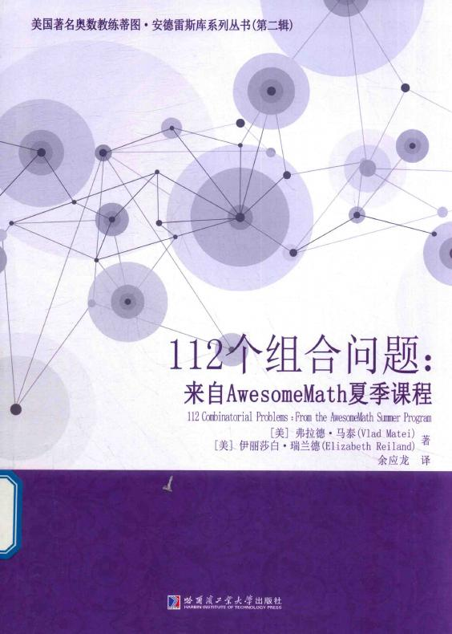

## 关于这本书

- 原书: *112 Combinatorial Problems: From the AwesomeMath Summer Program*
- 作者: Vlad Matei, Elizabeth Reiland
- 译者: 余应龙
- 出版: 哈尔滨工业大学出版社（美国著名奥数教练蒂图·安德雷斯库系列丛书 第二辑）

这本书从集合论和两个基本计数法则讲起，一路做到容斥、二项式定理、递推、图论、不变量、组合几何、母函数和概率法，
最后是入门题与提高题各一套，并附完整解答。对准备组合方向的竞赛（CSP/NOIP 之外的数学竞赛，或 OI 里的计数与构造题）都算不错的基础读物。

## 内容

- [序言](./00-序言.md)
- [第1章 计数的基本知识](./01-计数的基本知识.md)
- [第2章 排列与组合](./02-排列与组合.md)
- [第3章 星星、杠杠和多项式](./03-星星、杠杠和多项式.md)
- [第4章 容斥原理](./04-容斥原理.md)
- [第5章 帕斯卡三角形和二项式定理](./05-帕斯卡三角形和二项式定理.md)
- [第6章 用一种以上的方法计数](./06-用一种以上的方法计数.md)
- [第7章 鸽巢原理](./07-鸽巢原理.md)
- [第8章 归纳法](./08-归纳法.md)
- [第9章 递推关系](./09-递推关系.md)
- [第10章 图论](./10-图论.md)
- [第11章 不变量](./11-不变量.md)
- [第12章 组合几何](./12-组合几何.md)
- [第13章 母函数](./13-母函数.md)
- [第14章 概率和概率法](./14-概率和概率法.md)
- [第15章 入门题](./15-入门题.md)
- [第16章 提高题](./16-提高题.md)
- [第17章 入门题的解答](./17-入门题的解答.md)
- [第18章 提高题的解答](./18-提高题的解答.md)
- [附录 递推关系](./19-附录-递推关系.md)
- [词汇表](./20-词汇表.md)

## 说明

正文由扫描版 PDF 经 MinerU OCR 得到，公式为 LaTeX，图与表是原页截图。
已按原书 PDF 逐页核对修正过一批系统性识别错误（二项式系数排版、破折号当减号、`\equiv` 误作等号等），
仍有个别 `\hat` / 点号之类的小瑕疵未逐处确认，阅读时以原书为准。
