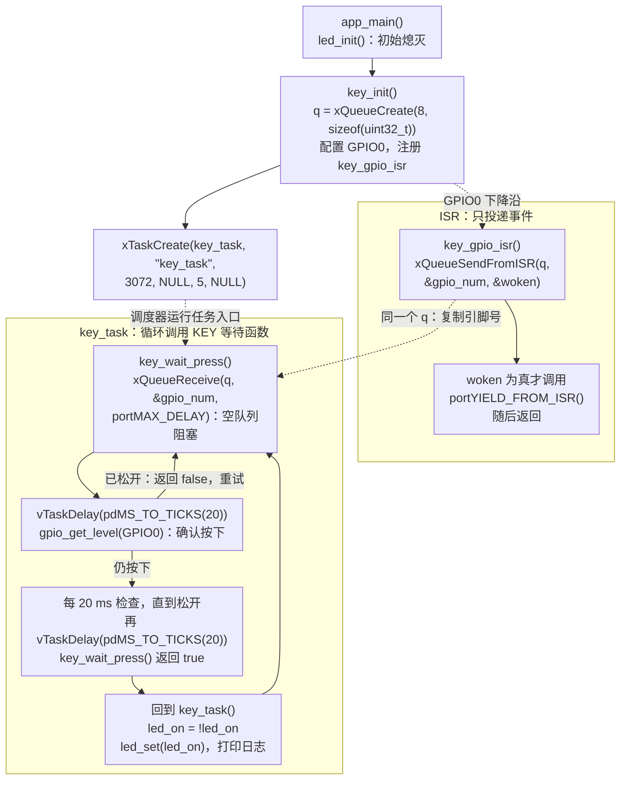

[第 03 课](./03-dnesp32s3-boot-key-control-led.md)每 10 ms 轮询一次 BOOT 按键。这种写法容易理解，但即使一直不按键，任务也会定时醒来读取 GPIO。本课跟学《DNESP32S3 使用指南（IDF 版）》第 12 章，改用 **GPIO 外部中断**：GPIO0 出现下降沿时，ISR 投递事件；普通任务在 `key_wait_press()` 中完成消抖、等待松开，最后翻转 LED。

配套工程位于 [`examples/04-gpio-interrupt-led/`](https://github.com/Rainboylvx/esp32-learning-code/tree/main/examples/04-gpio-interrupt-led/)。工程沿用前几课的 GPIO1 红色 LED 和 GPIO0 BOOT 按键。`KEY` 模块管理中断、队列和消抖，应用层只处理一次完整按键后的 LED 翻转。**本课在松开按键后翻转 LED，按住期间不翻转。**

> [!INFO] 验证范围
> 本文以当前 `KEY` 版代码为准。已在隔离副本中使用 ESP-IDF v5.5.5 完成 `idf.py build`，并核对源码与流程。尚未烧录验收新版；短按、长按、松开后的 LED 响应和消抖效果仍需接上目标开发板验证。

## 1. 先核对两个引脚

本课没有增加外部接线。正点原子 DNESP32S3 V1.2 的原理图给出：

| 资源 | GPIO | 有效状态 | 本课用途 |
| --- | --- | --- | --- |
| 红色用户 LED | GPIO1 | 低电平点亮 | 观察中断事件是否被接受 |
| BOOT 按键 | GPIO0 | 按下接地，低电平 | 下降沿触发 GPIO 中断 |

GPIO0 还是 ESP32-S3 的启动配置脚。开发板复位或上电时一直按住 BOOT，芯片可能进入下载模式。实验时先松开按键，让程序正常启动。

GPIO1 的 LED 电路仍然是 `3.3 V → 限流电阻 → LED → GPIO1`，所以应用层的 `led_set(true)` 最终写入低电平。判断 LED 极性时，要核对板卡原理图和 BSP 中的电平转换，不能只凭亮灭现象猜测。

## 2. 轮询和中断的职责差异

第 03 课的任务大致是：

```text
每 10 ms 读取 GPIO0
    ├─ 读到低电平：延时后再次读取，确认一次按下
    └─ 读到高电平：确认松开，允许下一次按下
```

中断版本把“什么时候发生了边沿”交给 GPIO 外设：

```text
GPIO0 下降沿
    -> GPIO ISR（只投递引脚号）
    -> FreeRTOS 队列
    -> key_task 调用 key_wait_press()
    -> 延时消抖、确认低电平、等待松开
    -> 返回 true，key_task 翻转 GPIO1 LED
```

中断并不能自动消除机械抖动。按下一次按键，可能在短时间内产生多个边沿，因此 ISR 只负责快速记录事件，不能把每个边沿都当作一次有效按下。

## 一图看懂关键调用

先看上方的启动顺序，再看 ISR 如何把事件交给等待中的任务。实线表示执行顺序，虚线表示回调触发、任务调度或队列传递。



图中的 `q` 是 `key.c` 私有的 `s_event_queue`：`key_init()` 创建它，ISR 写入，`key_wait_press()` 读取。`key_wait_press()` 是 `key_task()` 调用的普通函数，接收队列、消抖和等松开都在这个任务内执行，没有额外创建一个消抖任务。图中的 `woken` 是 `higher_priority_task_woken` 的简写。

复用时记住：**先创建队列、注册事件源，再创建接收任务；ISR 发送，任务接收并处理。** `xTaskCreate()` 交给调度器运行任务入口，不是同步调用任务函数。当前代码把接收与消抖封装成 `key_wait_press()`，只有它返回 `true`，应用才翻转 LED。

## 3. 工程结构

```text
04-gpio-interrupt-led/
├── CMakeLists.txt
├── sdkconfig.defaults
├── main/
│   ├── CMakeLists.txt
│   └── main.c                 # key_task：完整按键后翻转 LED、打印日志
└── components/
    └── BSP/
        ├── CMakeLists.txt
        ├── LED/
        │   ├── led.c          # GPIO1、低电平点亮
        │   └── led.h
        └── KEY/
            ├── key.c          # GPIO0、中断、私有队列、消抖与等待松开
            └── key.h          # key_init()、key_wait_press()
```

`KEY` 对外只有初始化和等待按键两个接口，应用不需要持有队列句柄，也不直接读取 GPIO0。`LED` 对外提供 `led_init()`、`led_set(bool on)`，负责把逻辑亮灭转换成 GPIO 电平。

`main/CMakeLists.txt` 声明应用依赖：

```cmake
idf_component_register(SRCS "main.c"
                    INCLUDE_DIRS "."
                    PRIV_REQUIRES BSP freertos)
```

GPIO 驱动由 BSP 使用，因此依赖放在 `components/BSP/CMakeLists.txt`：

```cmake
idf_component_register(SRCS "LED/led.c" "KEY/key.c"
                    INCLUDE_DIRS "LED" "KEY"
                    PRIV_REQUIRES esp_driver_gpio freertos)
```

`esp_driver_gpio` 是 ESP-IDF v5.5 的 GPIO 驱动组件名。应用只依赖 BSP 接口，不必再直接声明 GPIO 驱动。

## 4. ISR 只投递事件

`KEY` 模块自己创建并保存队列。GPIO 中断服务调用 `key_gpio_isr()` 时，ISR 把 GPIO0 的编号复制到这个队列中：

```c
static QueueHandle_t s_event_queue;

static void IRAM_ATTR key_gpio_isr(void *arg)
{
    uint32_t gpio_num = (uint32_t)(uintptr_t)arg;
    BaseType_t higher_priority_task_woken = pdFALSE;

    xQueueSendFromISR(s_event_queue,
                      &gpio_num,
                      &higher_priority_task_woken);
    if (higher_priority_task_woken == pdTRUE) {
        portYIELD_FROM_ISR();
    }
}
```

这段 ISR 需要同时满足四个约束：

1. 本课通过 `ESP_INTR_FLAG_IRAM` 安装中断服务，ISR 使用 `IRAM_ATTR`；若改动内存配置，还需检查整条调用链及所访问数据是否满足 IRAM 安全要求；
2. 使用 `xQueueSendFromISR()`，不能在中断上下文调用普通的 `xQueueSend()`；
3. 队列中的数据是一个简单的整数，避免在 ISR 中分配内存或访问复杂对象；
4. `higher_priority_task_woken` 为真时请求一次任务切换，让等待队列的任务尽快运行。

本课 ISR 不打印日志、不延时、不做消抖，也不操作 LED。日志和等待会拉长或阻塞中断处理；LED 翻转则交给任务，便于在确认一次完整按键后统一处理。发送时若队列已满，`xQueueSendFromISR()` 立即返回失败，本课未检查该返回值，因此这次边沿不会入队。

### 队列保存的是数值副本，不是指针

本工程创建队列时写的是：

```c
s_event_queue = xQueueCreate(8, sizeof(uint32_t));
```

第二个参数规定了**每个队列元素的大小**，这里每个槽位保存一个 `uint32_t` 的值。发送和接收时，`&gpio_num` 告诉 FreeRTOS 从哪里读取数据，或把数据写到哪里：

```text
ISR 中的 gpio_num       --发送-->  队列内部的 4 字节副本
任务中的 gpio_num       <--接收--  队列内部的 4 字节副本
```

- `xQueueSendFromISR(..., &gpio_num, ...)`：从 ISR 局部变量的地址读取 4 字节，复制到队列；
- `xQueueReceive(..., &gpio_num, ...)`：把队列中的 4 字节复制到任务自己的局部变量；
- 两处的 `gpio_num` 是两个不同的变量，名字相同不代表它们共享地址。

`&gpio_num` 是地址，**队列保存的是它指向的数值副本，不是地址本身**。ISR 返回后，其中的局部变量就不再有效，但数值已经复制到队列中，任务仍然可以安全读取自己的副本。

要让队列保存指针值，需要把元素大小设为指针的大小。例如，大结构体不适合频繁整体复制时，可以这样设计：

```c
QueueHandle_t queue = xQueueCreate(8, sizeof(MyStruct *));
MyStruct *p = malloc(sizeof(*p));
xQueueSend(queue, &p, portMAX_DELAY);  // 拷贝的是地址值
```

这里的 `&p` 仍然是数据的来源地址，队列复制的是指针 `p` 的值。这种设计需要约定清楚内存所有权：接收端取出指针后负责使用并 `free()`，避免内存泄漏或重复释放。本课只传递一个 GPIO 编号，直接按值拷贝更简单，也不需要动态内存。

## 5. 配置下降沿和注册服务

`key_init()` 先创建私有队列，再配置 GPIO0、安装共享中断服务、注册本引脚的回调：

```c
void key_init(void)
{
    s_event_queue = xQueueCreate(8, sizeof(uint32_t));

    gpio_config(&(gpio_config_t){
        .pin_bit_mask = 1ULL << BOOT_KEY_GPIO,
        .mode = GPIO_MODE_INPUT,
        .pull_up_en = GPIO_PULLUP_ENABLE,
        .intr_type = GPIO_INTR_NEGEDGE,
    });

    gpio_install_isr_service(ESP_INTR_FLAG_IRAM);
    gpio_isr_handler_add(BOOT_KEY_GPIO, key_gpio_isr,
                         (void *)(uintptr_t)BOOT_KEY_GPIO);
}
```

`BOOT_KEY_GPIO` 在 `key.c` 中定义为 `GPIO_NUM_0`。BOOT 松开时，内部上拉使 GPIO0 保持高电平；按下接地，电平由高变低，因此配置为 `GPIO_INTR_NEGEDGE`。

`gpio_install_isr_service()` 安装共享的 GPIO 中断服务，`gpio_isr_handler_add()` 把 GPIO0 与 `key_gpio_isr()` 关联，第三个参数把引脚号传给 ISR。同一个应用只安装一次服务，不要每次按键都重新安装。

当前代码没有单独调用 `gpio_intr_enable()`。ESP-IDF v5.5.5 的 `gpio_isr_handler_add()` 在注册处理函数时会使能对应引脚中断，具体实现可查阅[官方 GPIO 驱动源码](https://github.com/espressif/esp-idf/blob/v5.5.5/components/esp_driver_gpio/src/gpio.c)。

## 6. 普通任务完成消抖和业务处理

`key_task()` 的业务代码只需要等待一次完整按键，再翻转 LED：

```c
static void key_task(void *arg)
{
    (void)arg;
    bool led_on = false;

    while (1) {
        if (!key_wait_press()) {
            continue;
        }
        led_on = !led_on;
        led_set(led_on);
        ESP_LOGI(TAG, "BOOT press, LED %s", led_on ? "on" : "off");
    }
}
```

队列接收、消抖和等待松开都在 `key_wait_press()` 内完成。下面保留完整控制流程，其中 `DEBOUNCE_MS` 为 20：

```c
bool key_wait_press(void)
{
    uint32_t gpio_num;

    if (xQueueReceive(s_event_queue, &gpio_num, portMAX_DELAY) != pdTRUE) {
        return false;
    }

    vTaskDelay(pdMS_TO_TICKS(DEBOUNCE_MS));
    if (gpio_get_level(BOOT_KEY_GPIO) != 0) {
        return false;
    }

    while (gpio_get_level(BOOT_KEY_GPIO) == 0) {
        vTaskDelay(pdMS_TO_TICKS(DEBOUNCE_MS));
    }
    vTaskDelay(pdMS_TO_TICKS(DEBOUNCE_MS));
    return true;
}
```

按调用顺序理解：队列为空时，当前任务阻塞；收到边沿后等 20 ms，再检查是否仍按下。若已经松开，返回 `false`，任务重新等待；若仍按下，每隔 20 ms 检查一次，直到读到松开，再等 20 ms 后返回 `true`。

**LED 在这个 `true` 返回之后才翻转。** 一直按住 BOOT，任务就一直留在等待松开的循环中，不会连续翻转。`vTaskDelay()` 阻塞的是当前任务，其他就绪任务仍可运行。

这个函数会消费队列事件，但没有主动清空整个队列。抖动留下的边沿仍会被逐个取出；取出后若读到高电平，便返回 `false`。松开后追加的 20 ms 延时也不等于重新确认了连续稳定 20 ms。因此，这种教学用消抖方式仍需通过连续短按、长按和松开抖动实测；需要更严格的行为时，可以改用状态机或定时采样，并明确队列满时的处理策略。

## 7. 按依赖顺序启动

应用入口依次初始化 LED、初始化按键、创建处理任务：

```c
void app_main(void)
{
    led_init();
    key_init();
    xTaskCreate(key_task, "key_task", 3072, NULL, 5, NULL);

    ESP_LOGI(TAG, "Ready: press BOOT to toggle LED");
}
```

`key_init()` 内先创建队列，再注册 ISR。这样即使任务尚未运行，已经发生的边沿也可以先入队，任务启动后再取出。注册中断前，队列句柄必须有效。

`xTaskCreate()` 把 `key_task` 交给调度器，它不是等待该函数执行完再返回的普通调用。`app_main()` 返回后，已创建的按键任务仍会继续运行。

当前教学版省略了初始化、任务创建和 LED 写入的返回值检查。`key_init()`、`led_init()`、`led_set()` 的返回类型都是 `void`，不能直接套上 `ESP_ERROR_CHECK()`。若要补齐错误处理，需要先让 BSP 检查底层调用并返回 `esp_err_t`，再由应用检查；`xTaskCreate()` 则应判断是否返回 `pdPASS`。

## 用到的 FreeRTOS 函数查询表

下面先查 FreeRTOS 调用，再查本课 BSP 接口。名称链接到 ESP-IDF v5.5.5 的官方文档；宏的定义链接到该版本的官方源码。

| 函数或宏 | 本课用途 | 调用环境 |
| --- | --- | --- |
| [`xTaskCreate()`](https://docs.espressif.com/projects/esp-idf/en/v5.5.5/esp32s3/api-reference/system/freertos_idf.html#xTaskCreate__TaskFunction_t.cCPC.configSTACK_DEPTH_TYPEC.voidPC.UBaseType_t.TaskHandle_tPC) | 创建处理按键事件的任务 | 任务中，不能在 ISR 中调用 |
| [`xQueueCreate()`](https://docs.espressif.com/projects/esp-idf/en/v5.5.5/esp32s3/api-reference/system/freertos_idf.html#c.xQueueCreate) | 创建保存 GPIO 编号的队列 | 任务中，不能在 ISR 中调用 |
| [`xQueueSendFromISR()`](https://docs.espressif.com/projects/esp-idf/en/v5.5.5/esp32s3/api-reference/system/freertos_idf.html#c.xQueueSendFromISR) | 从 GPIO 中断向队列发送事件 | ISR 中，不等待空位 |
| [`xQueueReceive()`](https://docs.espressif.com/projects/esp-idf/en/v5.5.5/esp32s3/api-reference/system/freertos_idf.html#xQueueReceive__QueueHandle_t.voidPC.TickType_t) | 从队列取出 GPIO 编号 | 任务中，不能在 ISR 中调用 |
| [`vTaskDelay()`](https://docs.espressif.com/projects/esp-idf/en/v5.5.5/esp32s3/api-reference/system/freertos_idf.html#vTaskDelay__TickType_tC) | 消抖、等待按键松开时暂停当前任务 | 任务中，不能在 ISR 中调用 |
| [`pdMS_TO_TICKS()`](https://github.com/espressif/esp-idf/blob/v5.5.5/components/freertos/FreeRTOS-Kernel/include/freertos/projdefs.h) | 将毫秒换算为 tick 数 | 计算宏，任务和 ISR 中均可使用 |
| [`portYIELD_FROM_ISR()`](https://github.com/espressif/esp-idf/blob/v5.5.5/components/freertos/FreeRTOS-Kernel/portable/xtensa/include/freertos/portmacro.h) | 唤醒更高优先级任务后请求切换 | ISR 中 |

### 创建任务：`xTaskCreate()`

对照第 7 节的调用，六个参数依次是：

| 本文传入的值 | 含义 |
| --- | --- |
| `key_task` | 任务入口函数，创建后由调度器安排运行 |
| `"key_task"` | 任务名称，便于调试时辨认 |
| `3072` | 任务栈大小；**ESP-IDF 中的单位是字节**，这里是 3072 字节 |
| 第一个 `NULL` | 不向任务入口传递参数 |
| `5` | 任务优先级，数值越大，优先级越高 |
| 最后一个 `NULL` | 不接收新任务的句柄；若需要保存句柄，可传入句柄变量的地址 |

创建成功返回 `pdPASS`；内存不足时返回 `errCOULD_NOT_ALLOCATE_REQUIRED_MEMORY`。当前工程没有检查返回值；需要补充检查时，应判断是否等于 `pdPASS`，不能按 `esp_err_t` 处理。

### 创建队列：`xQueueCreate()`

`xQueueCreate(8, sizeof(uint32_t))` 的第一个参数是队列容量，即最多暂存 8 个元素；第二个参数是每个元素的字节数，即每次复制一个 GPIO 编号。

成功时返回 `QueueHandle_t` 类型的队列句柄，失败时返回 `NULL`。本课在 `key_init()` 内把结果保存为 `s_event_queue`，供 ISR 和等待函数共同使用，不向应用暴露。当前代码未检查创建失败的情况。

### 中断发送：`xQueueSendFromISR()`

`xQueueSendFromISR(s_event_queue, &gpio_num, &higher_priority_task_woken)` 的三个参数依次是：

- `s_event_queue`：要写入的队列句柄。
- `&gpio_num`：待复制数据的来源地址，复制大小由创建队列时的元素大小决定。
- `&higher_priority_task_woken`：输出标志的地址。如果这次发送唤醒了更高优先级的任务，标志会被置为 `pdTRUE`。

发送成功返回 `pdTRUE`，队列已满则返回 `errQUEUE_FULL`。它没有等待时间参数，不能留在 ISR 中等队列腾出空位。本课 ISR 没有检查这个返回值，因此队列满时，该次事件不会入队。

`higher_priority_task_woken` 在调用前初始化为 `pdFALSE`，调用后若为 `pdTRUE`，再执行 `portYIELD_FROM_ISR()` 请求任务切换。这个标志表示是否需要切换任务，**不表示发送是否成功**；发送结果应看函数返回值。

### 任务接收：`xQueueReceive()`

`key_wait_press()` 内调用 `xQueueReceive(s_event_queue, &gpio_num, portMAX_DELAY)`，三个参数依次是：

- `s_event_queue`：`KEY` 模块内部保存的队列句柄，与 ISR 发送时使用的是同一个队列。
- `&gpio_num`：接收缓冲区地址，队列中的数值会复制到这个变量中。
- `portMAX_DELAY`：等待时间参数。本课用它等待事件，队列为空时任务阻塞，不会反复读取 GPIO。

接收成功返回 `pdTRUE`，并从队列移除该元素；在等待期限内未收到元素则返回 `pdFALSE`。等待参数的单位是 tick，传 `0` 表示不等待、立即返回。`portMAX_DELAY` 在 `INCLUDE_vTaskSuspend` 为 `1` 时表示无限期等待。

### 延时与时间换算：`vTaskDelay()`、`pdMS_TO_TICKS()`

`vTaskDelay(pdMS_TO_TICKS(20))` 分两步理解：`pdMS_TO_TICKS(20)` 按 tick 频率把 20 ms 换算成 tick 数，`vTaskDelay()` 再让当前任务阻塞相应的 tick 数，期间其他就绪任务可以运行。`vTaskDelay()` 没有返回值。

不要直接写 `vTaskDelay(20)` 来表示 20 ms：这里的 `20` 是 tick 数。换算结果受 tick 频率和整数取整影响，任务何时继续运行还取决于调度，因此它不保证精确延时 20 ms。

### 常量和扩展示例中的接口

- `pdTRUE`、`pdFALSE`：分别表示真、假；本文用于判断收发结果和是否需要任务切换。
- `pdPASS`：任务创建成功状态，可用于检查 `xTaskCreate()` 的返回值；当前简化版没有检查。它们的定义可查阅官方源码 [`projdefs.h`](https://github.com/espressif/esp-idf/blob/v5.5.5/components/freertos/FreeRTOS-Kernel/include/freertos/projdefs.h)。
- [`xQueueSend()`](https://docs.espressif.com/projects/esp-idf/en/v5.5.5/esp32s3/api-reference/system/freertos_idf.html#c.xQueueSend)：只出现在第 4 节传递结构体指针的扩展示例中，配套工程没有调用。三个参数分别是队列句柄、数据来源地址和最长等待 tick 数；成功返回 `pdPASS`，在指定等待时间内仍无法入队时返回 `errQUEUE_FULL`。它用于任务上下文，不能替换 ISR 中的 `xQueueSendFromISR()`。

### 本课 BSP 接口

| 接口 | 调用位置 | 返回值与含义 |
| --- | --- | --- |
| `key_init()` | `app_main()`，启动时一次 | `void`；创建私有队列、配置 GPIO0 并注册 ISR |
| `key_wait_press()` | `key_task()` 的循环中 | `bool`；收到事件、确认按下并等待松开后返回 `true`，接收失败或消抖检查时已松开返回 `false` |
| `led_init()` | `app_main()`，启动时一次 | `void`；配置 GPIO1 输出并熄灭 LED |
| `led_set(on)` | 按键处理成功后 | `void`；`true` 点亮、`false` 熄灭，内部调用 `gpio_set_level()` |

这些是配套工程自己的函数，不是 FreeRTOS API。`key_wait_press()` 会阻塞调用它的任务，不应放进 ISR 或要求立即返回的回调中。

## 8. 编译、烧录与验收

在工程根目录执行：

```bash
source "$HOME/.espressif/tools/activate_idf_v5.5.5.sh"
idf.py --version
idf.py set-target esp32s3
idf.py build
```

确认 `build` 成功后，插拔开发板比较串口列表，再替换实际端口：

```bash
idf.py -p '/dev/cu.开发板实际端口' flash monitor
```

串口启动后应看到：

```text
Ready: press BOOT to toggle LED
```

完成一次短按并松开后，预期打印：

```text
BOOT press, LED on
```

再按下并松开一次，预期打印 `BOOT press, LED off`。以上是预期格式，不是本次实测日志。

逐条验收：

1. 启动后 LED 熄灭，出现 `Ready: press BOOT to toggle LED`。
2. 按住 BOOT 两秒，LED 保持原状态，不连续翻转。
3. 松开后，等待松开检测和追加的消抖延时结束，LED 翻转一次，出现一条 `BOOT press` 日志。
4. 再次短按并松开，LED 再翻转一次；连续重复，检查是否漏记或重复触发。
5. 能指出 `key_wait_press()` 在任务上下文等待，ISR 中没有消抖或 LED 业务。

如果按键完全没有反应，先检查：

- 是否把串口线插在真正的 ESP32-S3 开发板上；
- 上电或复位时是否仍按住 GPIO0，导致芯片进入下载模式；
- 原理图和 `key.c` 中的 `BOOT_KEY_GPIO` 是否都为 GPIO0；
- GPIO0 是否被其他外设或调试配置占用；
- 队列、GPIO 中断服务和任务是否创建成功。当前代码未检查这些返回值，排查时需要补充观测。

## 9. 与官方 `03_exit` 对答案

教材配套 `03_exit` 同样使用 GPIO0 下降沿、内部上拉、`gpio_install_isr_service()` 和 `gpio_isr_handler_add()`。当前工程保留这些配置，把按键识别封装进 `KEY`：

| 位置 | 官方示例 | 本工程 |
| --- | --- | --- |
| ISR | 判断引脚号后直接 `LED_TOGGLE()` | 用 `xQueueSendFromISR()` 投递引脚号 |
| 中断服务标志 | `gpio_install_isr_service(0)` | `gpio_install_isr_service(ESP_INTR_FLAG_IRAM)` |
| 消抖与长按 | 没有软件消抖或等待松开 | `key_wait_press()` 延时确认，并等待松开 |
| LED 翻转时机 | ISR 收到边沿时 | 等待函数返回 `true` 后，任务调用 `led_set()` |
| 中断使能 | 显式调用 `gpio_intr_enable()` | 注册回调时由当前版本驱动使能 |
| LED GPIO 配置 | 输入输出模式，开启上拉，供宏读写电平 | 输出模式，不启用上下拉，应用保存 `led_on` |
| 错误处理 | BSP 接口为 `void`，未逐项检查 | `key_init()`、LED 接口同为 `void`，也省略了底层返回值检查 |
| 组件组织 | `LED`、`EXIT` 及课程宏 | `LED`、`KEY`；队列私有，应用组合接口 |

官方实现展示中断到来后如何翻转 LED。本工程的应用层只判断一次完整按键是否完成；若以后要增加日志或其他业务，可以放在 `key_task()` 的成功分支中，ISR 保持简短。

## 10. 小结

- GPIO0 下降沿触发 `key_gpio_isr()`，它把引脚号复制进 `KEY` 的私有队列。
- `key_init()` 负责创建队列、配置引脚、安装服务和注册回调。
- `xTaskCreate()` 创建 `key_task`；任务循环调用 `key_wait_press()`。
- `key_wait_press()` 接收事件、消抖、等待松开，返回 `true` 后才翻转 LED。
- 当前版本未检查多项初始化返回值，实板消抖与连续按键行为仍需验收。

下一步可以结合[第 05 课的任务、队列和任务通知](./05-freertos-task-queue-notify.md)，比较队列传数据与任务通知的用法。

## 参考资料

- 《DNESP32S3 使用指南（IDF 版）》第 12 章 EXIT 实验
- 正点原子课程源码 `03_exit`
- [ESP-IDF v5.5.5 GPIO API 文档](https://docs.espressif.com/projects/esp-idf/en/v5.5.5/esp32s3/api-reference/peripherals/gpio.html)
- [ESP-IDF v5.5.5 FreeRTOS API 文档](https://docs.espressif.com/projects/esp-idf/en/v5.5.5/esp32s3/api-reference/system/freertos_idf.html)
- [配套示例工程](https://github.com/Rainboylvx/esp32-learning-code/tree/main/examples/04-gpio-interrupt-led/)
