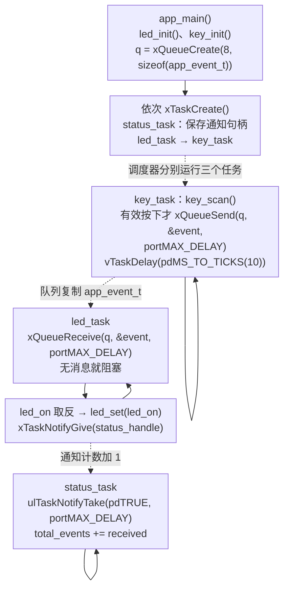
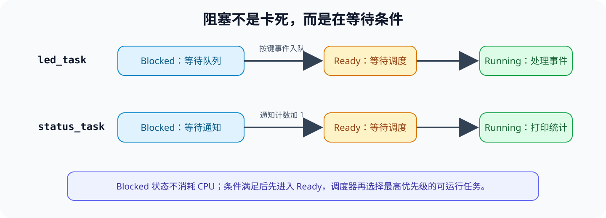
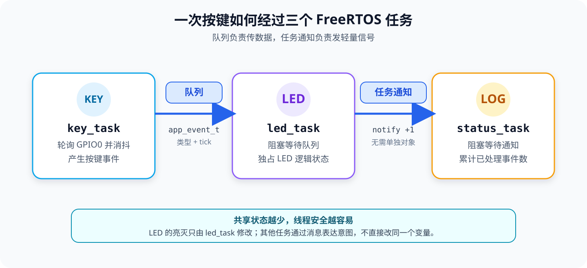

[第 03 课](./03-dnesp32s3-boot-key-control-led.md)用一个循环完成了“扫描 BOOT 按键 → 翻转 LED”。代码很直观，但随着串口、传感器和网络功能加入，一个循环会同时承担越来越多的职责。

这一课仍使用 DNESP32S3 的 **BOOT/GPIO0** 和红色用户 **LED/GPIO1**，不增加新硬件，把原来的循环拆成三个长期运行的任务：

1. `key_task` 扫描按键，产生带数据的事件；
2. `led_task` 从队列接收事件，只由它修改 LED 状态；
3. `status_task` 接收轻量任务通知，统计已经处理的事件数。

配套工程位于 [`examples/05-freertos-task-queue-notify/`](https://github.com/Rainboylvx/esp32-learning-code/tree/main/examples/05-freertos-task-queue-notify/)。本课演示任务间传递数据和通知，是后续定时器与多外设协作的基础。

> [!INFO] 验证范围
> 当前简化版已在隔离副本中按工程默认配置通过 ESP-IDF v5.5.5 编译，本次未烧录。此前版本曾通过 `/dev/cu.usbmodem31101` 烧录，串口确认了工程名、ESP-IDF 版本、三个任务创建完成和 `app_main()` 正常返回；物理按键、LED 翻转与通知计数仍待人工验收。旧固件记录见后文。

## 一图看懂关键调用

实线表示同一执行路径上的顺序，虚线表示任务调度、回调触发或消息传递；它们不表示跨任务的直接函数调用。



`key_task`、`led_task`、`status_task` 是三个长期运行的任务，消息箭头不是直接函数调用。`q` 是 `s_event_queue`，`status_handle` 是 `s_status_task_handle`；任务创建时先取得状态任务句柄，再启动会发送通知的 LED 任务。按键任务在确认按下时产生事件，不必等松手；通知返回多少次，就累加多少次。

## 1. `app_main` 本来就在 FreeRTOS 里

ESP-IDF 启动应用时，FreeRTOS 调度器已经运行，`app_main()` 本身就在一个任务里执行。因此不需要也不应该在应用中再次调用 `vTaskStartScheduler()`。

任务不是“只运行一次的函数”。典型任务函数包含一个无限循环，并在没有工作时主动进入阻塞状态：

```c
static void worker_task(void *arg)
{
    while (1) {
        // 等待工作并处理。
    }
}
```

FreeRTOS 任务常见的四种状态是：

| 状态 | 含义 |
| --- | --- |
| Running | 此刻正在某个 CPU 核心上执行 |
| Ready | 已具备运行条件，等待调度器选择 |
| Blocked | 正在等待时间、队列、通知等条件 |
| Suspended | 被显式挂起，恢复前不参与调度 |

调度器从 Ready 任务中选择可以运行的最高优先级任务。优先级高不代表它应该一直占用 CPU；任务没有工作时应使用 `vTaskDelay()`、`xQueueReceive()` 或 `ulTaskNotifyTake()` 等阻塞 API。



*图 1：等待队列或通知时，任务处于 Blocked 状态，不会用循环持续占用 CPU。*

> [!NOTE] ESP32-S3 是双核芯片
> ESP-IDF v5.5.5 使用支持双核 SMP 的 FreeRTOS。普通 `xTaskCreate()` 创建的任务不绑定核心，调度器可以安排它运行在任一核心。本课不依靠“任务碰巧在哪个核心”，通信都通过 FreeRTOS 提供的同步机制完成。

## 2. 为什么不能只共享一个全局变量

最容易想到的写法是让按键任务修改一个全局标志，让 LED 任务反复读取：

```c
// 错误示意：volatile 不能把共享变量变成可靠的任务通信。
static volatile bool key_pressed;

// key_task
key_pressed = true;

// led_task
if (key_pressed) {
    key_pressed = false;
    // 处理按键……
}
```

它至少有三个问题：

1. LED 任务清零前发生两次按下，两个事件会合并成一个；
2. 两个任务同时读写，操作顺序依赖调度时机；
3. LED 任务必须不断轮询，没事件时仍然消耗 CPU。

`volatile` 只要求编译器每次真正访问内存，不提供互斥、事件计数或跨任务的执行顺序保证。ESP32-S3 还是双核系统，关闭当前核心的中断也不能自动保护另一个核心上的访问。

可以让每个任务保存自己的状态，通过消息请求其他任务执行操作。本课让 `led_task` 独占 `led_on`，其他任务不直接修改它。

## 3. 队列和任务通知分别解决什么



*图 2：队列携带完整事件，任务通知只传递“又完成一次”的计数信号。*

### 3.1 队列：需要保存数据和顺序

本课使用队列传递下面的结构体：

```c
typedef enum {
    APP_EVENT_BOOT_PRESSED = 1,
} app_event_type_t;

typedef struct {
    app_event_type_t type;  // 事件类型。
    TickType_t tick;        // 事件产生时的系统 tick。
} app_event_t;
```

创建队列时必须指定两个参数：

```c
s_event_queue = xQueueCreate(8, sizeof(app_event_t));
```

- `8` 表示最多暂存 8 条尚未处理的消息；
- `sizeof(app_event_t)` 表示每条消息的固定大小。

`xQueueSend()` 会把结构体内容复制进队列，因此生产者可以安全地发送栈上的局部变量。`xQueueReceive()` 再把队首消息复制到接收者提供的变量中。队列由 FreeRTOS 管理并发访问，不需要我们再给队列本身加锁。

队列适合这些情况：

- 需要传递事件类型、时间、测量值等数据；
- 同一时间可能积累多条消息；
- 接收者必须按先后顺序处理。

### 3.2 任务通知：明确通知某一个任务

每个任务内部都有通知状态和 32 位通知值。发送者知道目标任务句柄时，可以直接通知它，不需要另外创建队列对象。

本课使用通知的“计数信号”形式：

```c
// led_task：通知值加 1。
xTaskNotifyGive(s_status_task_handle);

// status_task：阻塞等待；pdTRUE 表示返回后把计数清零。
uint32_t received = ulTaskNotifyTake(pdTRUE, portMAX_DELAY);
```

如果状态任务得到调度前连续收到三次通知，`ulTaskNotifyTake()` 可以返回 `3`，因此代码应累计返回值。

任务通知适合这些情况：

- 发送目标只有一个任务；
- 只需要唤醒、计数、位标志或一个 32 位值；
- 不需要建立可以被多个接收者读取的消息容器。

| 选择问题 | 队列 | 任务通知 |
| --- | --- | --- |
| 是否有独立对象 | 有 `QueueHandle_t` | 通知状态属于目标任务 |
| 携带内容 | 固定大小消息的副本 | 32 位值、位或计数 |
| 是否能积累多条不同消息 | 可以 | 不适合保存多条结构化消息 |
| 接收者 | 持有队列句柄的任务 | 指定的一个任务 |
| 本课用途 | BOOT 按下事件和产生时间 | 已处理事件计数 |

## 4. 工程结构与组件依赖

工程继续复用第 03 课的 KEY 和 LED BSP：

```text
05-freertos-task-queue-notify/
├── CMakeLists.txt
├── sdkconfig.defaults
├── main/
│   ├── CMakeLists.txt
│   └── main.c                 # 任务、队列、通知和应用规则
└── components/
    └── BSP/
        ├── CMakeLists.txt
        ├── KEY/
        │   ├── key.c          # GPIO0、内部上拉、轮询消抖
        │   └── key.h
        └── LED/
            ├── led.c          # GPIO1、低电平点亮
            └── led.h
```

本课继续轮询按键，与第 03 课保持相同的事件来源，便于集中学习任务通信；GPIO 外部中断课则由 ISR 与任务协作产生事件。

`main/CMakeLists.txt` 同时声明 BSP 和 FreeRTOS 私有依赖：

```cmake
# main 组合 KEY、LED 与 FreeRTOS 通信；GPIO 细节仍封装在 BSP 中。
idf_component_register(SRCS "main.c"
                    INCLUDE_DIRS "."
                    PRIV_REQUIRES BSP freertos)
```

ESP-IDF 会从工程的 `components/BSP/` 找到名为 `BSP` 的组件。FreeRTOS 是 ESP-IDF 自带组件，因此 `PRIV_REQUIRES freertos` 不需要在项目中复制一份源码。

## 5. 编写三个任务

### 5.1 按键任务：事件生产者

`key_scan()` 在按下确认后就返回事件，长按期间不会重复；松开并确认后才允许下一次按下。它在按下与松开检查中各可能延时 10 ms。这与第 04 课等待松开后才返回的 `key_wait_press()` 不同。

```c
static void key_task(void *arg)
{
    (void)arg;

    while (1) {
        if (key_scan() == KEY_EVENT_BOOT_PRESS) {
            const app_event_t event = {
                .type = APP_EVENT_BOOT_PRESSED,
                .tick = xTaskGetTickCount(),
            };
            /* portMAX_DELAY：队列满时阻塞等待，不忙等，也不悄悄丢事件。 */
            xQueueSend(s_event_queue, &event, portMAX_DELAY);
        }

        vTaskDelay(pdMS_TO_TICKS(KEY_SCAN_INTERVAL_MS)); /* 让出 CPU 给其他任务 */
    }
}
```

`portMAX_DELAY` 用于等待队列出现空间，等待期间任务进入 Blocked 状态。此时按键任务也停止扫描，不能保证任意速度的连续输入都不遗漏。若生产者改为 ISR，就不能阻塞等待，必须使用 `FromISR` 接口并决定队列满时如何处理。

`KEY_SCAN_INTERVAL_MS` 为 10，`vTaskDelay(pdMS_TO_TICKS(KEY_SCAN_INTERVAL_MS))` 也会阻塞当前任务，但它等待的是时间。两种阻塞都不会把整个芯片停住，其他 Ready 任务仍能运行。

### 5.2 LED 任务：队列消费者

```c
static void led_task(void *arg)
{
    (void)arg;
    bool led_on = false;
    app_event_t event;

    while (1) {
        /* 队列为空时本任务挂起，不占 CPU。 */
        if (xQueueReceive(s_event_queue, &event, portMAX_DELAY) != pdTRUE) {
            continue;
        }

        if (event.type == APP_EVENT_BOOT_PRESSED) {
            led_on = !led_on;
            led_set(led_on);
            ESP_LOGI(TAG,
                     "queue event: tick=%lu, LED %s",
                     (unsigned long)event.tick,
                     led_on ? "on" : "off");

            /* 通知只表达「又处理完一个事件」，不必再建第二个队列。 */
            xTaskNotifyGive(s_status_task_handle);
        }
    }
}
```

`led_on` 是 `led_task` 的局部变量，只有这个任务修改它。按键任务表达“BOOT 被按下”，LED 任务决定如何改变 LED。这样不需要用互斥锁保护 LED 状态。

### 5.3 状态任务：通知接收者

```c
static void status_task(void *arg)
{
    (void)arg;
    uint32_t total_events = 0;

    while (1) {
        /* pdTRUE 表示读取后清零；唤醒前若累计了多次通知，返回值会大于 1。 */
        const uint32_t received = ulTaskNotifyTake(pdTRUE, portMAX_DELAY);
        total_events += received;

        ESP_LOGI(TAG,
                 "notification: received=%lu, total=%lu",
                 (unsigned long)received,
                 (unsigned long)total_events);
    }
}
```

如果只写 `total_events++`，一次取出多次累计通知时就会少算。累加 API 返回的 `received`，才能统计实际收到的通知数。

## 6. 在 `app_main()` 中按依赖顺序创建资源

```c
void app_main(void)
{
    led_init();
    key_init();

    /* 8 个位置是为了让读者看清「队列可以排队」，人的按键速度远用不满。 */
    s_event_queue = xQueueCreate(8, sizeof(app_event_t));

    /* 先创建 status_task 并拿到句柄，led_task 才能向它发通知。 */
    xTaskCreate(status_task, "status_task", TASK_STACK_SIZE, NULL, TASK_PRIORITY,
                &s_status_task_handle);
    xTaskCreate(led_task, "led_task", TASK_STACK_SIZE, NULL, TASK_PRIORITY, NULL);
    xTaskCreate(key_task, "key_task", TASK_STACK_SIZE, NULL, TASK_PRIORITY, NULL);

    ESP_LOGI(TAG, "Ready: press BOOT to send an event");

    /* app_main 也是任务，返回后由 IDF 删除；上面三个任务继续跑。 */
}
```

`TASK_STACK_SIZE=3072`，`TASK_PRIORITY=5`，由 `main.c` 的宏定义提供。创建顺序体现了依赖关系：

1. 初始化硬件；
2. 创建队列；
3. 创建状态任务并取得句柄；
4. 创建可能使用这些资源的任务。

当前教学版未检查队列和任务创建结果。`xTaskCreate()` 成功返回 `pdPASS`，它不是 `esp_err_t`；如需补充错误处理，应单独判断，不能直接交给 `ESP_ERROR_CHECK()`。`key_init()`、`led_init()`、`led_set()` 均返回 `void`。

这里三个任务使用相同优先级 `5`，通过队列和通知协调数据依赖，不需要靠调整优先级安排执行顺序。调度器只在 Ready 任务中选择，两个消费者大部分时间都在阻塞。

> [!IMPORTANT] ESP-IDF 的任务栈单位是字节
> 在原版 FreeRTOS 中，`xTaskCreate()` 的栈深度通常以 `StackType_t` 的字为单位；ESP-IDF FreeRTOS 把这个参数改为**字节数**。本课的 `3072` 表示 3072 字节。后续可以用 `uxTaskGetStackHighWaterMark()` 观察余量，再决定是否调整。

`app_main()` 返回并不代表应用结束。ESP-IDF 会删除执行完的 `app_main` 任务，刚才创建的三个任务继续运行。

## 用到的 FreeRTOS 函数查询表

名称链接到 ESP-IDF v5.5.5 官方文档或该版本源码。表中的调用环境按本课用法标注；带 `FromISR` 的接口用于中断，普通任务接口不能直接搬进 ISR。

| 函数或宏 | 本课用途 | 调用环境 |
| --- | --- | --- |
| [`xTaskCreate()`](https://docs.espressif.com/projects/esp-idf/en/v5.5.5/esp32s3/api-reference/system/freertos_idf.html#task_8h_1a5489235b8b4658d05fc45e3cccd41ba0) | 创建应用任务 | 普通任务，不能在 ISR 中调用 |
| [`xQueueCreate()`](https://docs.espressif.com/projects/esp-idf/en/v5.5.5/esp32s3/api-reference/system/freertos_idf.html#queue_8h_1aeb858b824bd74a934ea7ebb81af2a6bb) | 创建固定元素大小的队列 | 普通任务，不能在 ISR 中调用 |
| [`xQueueSend()`](https://docs.espressif.com/projects/esp-idf/en/v5.5.5/esp32s3/api-reference/system/freertos_idf.html#queue_8h_1af7eb49d3249351176992950d9185abe9) | 按值复制一条消息到队尾 | 普通任务，不能在 ISR 中调用 |
| [`xQueueReceive()`](https://docs.espressif.com/projects/esp-idf/en/v5.5.5/esp32s3/api-reference/system/freertos_idf.html#queue_8h_1ad0a166f3b1219a5e37e31f8090d4800d) | 从队首取出一条消息 | 普通任务，不能在 ISR 中调用 |
| [`xTaskNotifyGive()`](https://github.com/espressif/esp-idf/blob/v5.5.5/components/freertos/FreeRTOS-Kernel/include/freertos/task.h#L2348) | 将指定任务的通知计数加 1 | 普通任务，不能在 ISR 中调用 |
| [`ulTaskNotifyTake()`](https://github.com/espressif/esp-idf/blob/v5.5.5/components/freertos/FreeRTOS-Kernel/include/freertos/task.h#L2530) | 读取并处理当前任务的通知计数 | 普通任务，不能在 ISR 中调用 |
| [`xTaskGetTickCount()`](https://docs.espressif.com/projects/esp-idf/en/v5.5.5/esp32s3/api-reference/system/freertos_idf.html#task_8h_1a5fa24e36d5e1eeb57f5b73b72ea048e7) | 读取系统 tick 计数 | 普通任务，不能在 ISR 中调用 |
| [`vTaskDelay()`](https://docs.espressif.com/projects/esp-idf/en/v5.5.5/esp32s3/api-reference/system/freertos_idf.html#task_8h_1a9917b05abb77e75e959151ae67065dce) | 按 tick 数阻塞当前任务 | 普通任务，不能在 ISR 中调用 |
| [`pdMS_TO_TICKS()`](https://github.com/espressif/esp-idf/blob/v5.5.5/components/freertos/FreeRTOS-Kernel/include/freertos/projdefs.h#L46) | 毫秒换算为 tick 数 | 计算宏，不会延时 |

### 创建任务与队列

`xTaskCreate(entry, name, stack_bytes, arg, priority, handle_out)` 的六个参数依次是任务入口、名称、栈字节数、入口参数、优先级和句柄输出地址。ESP-IDF 中 `3072` 是 **3072 字节**；优先级数值越大，优先级越高。最后一个参数传 `NULL` 表示不保存句柄，传句柄变量地址则由函数写回。成功返回 `pdPASS`，内存不足时返回 `errCOULD_NOT_ALLOCATE_REQUIRED_MEMORY`。

`xQueueCreate(8, sizeof(app_event_t))` 最多保存 8 条固定大小消息，成功返回 `QueueHandle_t` 句柄，失败返回 `NULL`。

`xQueueSend(queue, &event, wait_ticks)` 的参数是队列句柄、待复制消息地址、最长等待 tick 数。发送成功返回 `pdPASS`，在指定时间内仍无法入队返回 `errQUEUE_FULL`。`xQueueReceive(queue, &event, wait_ticks)` 的第二个参数则是接收地址；成功返回 `pdTRUE` 并移除队首元素，未收到返回 `pdFALSE`。两者复制的字节数由创建队列时的元素大小决定。

### 通知目标、清零方式与返回计数

`xTaskNotifyGive(s_status_task_handle)` 通知句柄指定的任务，使其通知计数加 1，返回 `pdPASS`。它不携带本课的事件结构体。

`ulTaskNotifyTake(pdTRUE, portMAX_DELAY)` 读取当前任务的通知计数：第一个参数为 `pdTRUE` 时，取出后清零；为 `pdFALSE` 时只减 1。返回值是修改前的通知计数，等待超时则为 `0`。所以本课累加返回值，而不是每次只加 1。

`xTaskGetTickCount()` 无参数，返回 `TickType_t` 类型的系统 tick 计数；本课把它写入事件时间戳，不是读取微秒数。

### tick、毫秒与等待时间

`pdMS_TO_TICKS(ms)` 返回按 tick 频率换算的 tick 数，不会让任务等待。`vTaskDelay(ticks)` 才会阻塞当前任务，没有返回值；时间受 tick 粒度和调度影响，不能把毫秒换算结果当成精确的物理延时。

`portMAX_DELAY` 在 `INCLUDE_vTaskSuspend=1` 时表示无限期阻塞等待；传 `0` 则不等待。等待会让出当前任务的 CPU 执行机会，不会暂停整个芯片。`pdTRUE`、`pdFALSE` 是真假状态；`pdPASS` 用于成功状态判断，不要与 ESP-IDF 的 `ESP_OK` 混用。

正文提到的 `uxTaskGetStackHighWaterMark()` 是后续观察栈余量的接口，本课工程未调用；`vTaskStartScheduler()` 只是用于说明 ESP-IDF 已经启动调度器，应用不应再次调用。

### 当前代码的接口与错误处理

| 本工程接口 | 用途与条件 | 返回类型 |
| --- | --- | --- |
| `key_init() / led_init()` | 初始化 GPIO0 输入、GPIO1 输出并熄灯 | `void` |
| `key_scan()` | 确认按下返回 KEY_EVENT_BOOT_PRESS，否则 KEY_EVENT_NONE；按住不重复 | `key_event_t` |
| `led_set(on)` | 将逻辑亮灭映射为 GPIO1 电平 | `void` |

这些接口属于配套工程 BSP 或业务代码，不是同名的 ESP-IDF 底层 API。返回 `void` 的接口没有可检查的返回值，不能直接放进 `ESP_ERROR_CHECK()`。

当前教学版省略了多项初始化、资源创建和驱动调用的返回值检查。查询表保留底层 API 的成功与失败返回值，表示接口本身的约定；不代表当前源码已经检查。若要补齐，应在 BSP 内处理底层错误、按需返回 `esp_err_t`，并单独判断 FreeRTOS 创建结果。

## 7. 编译、烧录与验收

在工程根目录执行：

```bash
# 每个新终端都先激活本课使用的 ESP-IDF。
source "$HOME/.espressif/tools/activate_idf_v5.5.5.sh"

# 新工程首次选择 ESP32-S3，然后编译。
idf.py set-target esp32s3
idf.py build

# 插拔开发板前后比较端口，再替换成实际端口。
find /dev -maxdepth 1 -name 'cu.*' -print | sort
idf.py -p '/dev/cu.开发板实际端口' flash monitor
```

按 `Ctrl+]` 退出 Monitor。每按一次 BOOT，预期看到两类日志：

```text
I (...) freertos_demo: queue event: tick=12345, LED on
I (...) freertos_demo: notification: received=1, total=1
```

再次按下时 LED 熄灭，`total` 增加：

```text
I (...) freertos_demo: queue event: tick=13579, LED off
I (...) freertos_demo: notification: received=1, total=2
```

逐条验收：

1. 启动后出现 `Ready: press BOOT to send an event`，红色 LED 初始熄灭；
2. 短按 BOOT 一次，只出现一条 `queue event`，LED 翻转一次；
3. 随后出现 `notification`，`total` 每次恰好增加 1；
4. 一直按住 BOOT 不会连续产生事件；松开后再次按下才能产生下一条；
5. 空闲时没有高速重复日志，说明等待任务没有用忙循环占用 CPU。

> [!INFO] 此前版本的实机记录
> `idf.py build` 已通过，固件大小为 `0x302c0` 字节，应用分区剩余 81%；烧录、Flash 哈希校验和复位启动均成功。Monitor 已看到项目 `05-freertos-task-queue-notify`、ESP-IDF v5.5.5、`Ready: press BOOT to send an event` 以及 `main_task: Returned from app_main()`。尚未人工按下 BOOT，因此当时第 2～4 项仍待实板验收；这些固件大小、哈希校验与启动结果属于此前版本，不能当作本次简化版的烧录结果。课程状态继续保留为“进行中”。

## 8. 这段程序为什么是线程安全的

先减少共享状态，再判断哪些访问需要加锁，通常更容易写出线程安全的程序：

| 数据或资源 | 所有者 | 其他任务如何访问 |
| --- | --- | --- |
| BOOT 扫描状态 | `key_task` 内部的 KEY BSP | 通过队列发布事件 |
| `led_on` | `led_task` | 其他任务不直接访问 |
| 事件消息 | FreeRTOS 队列 | `xQueueSend()` / `xQueueReceive()` 复制 |
| 通知计数 | `status_task` 的任务通知值 | `led_task` 只执行 Give |
| 总事件数 | `status_task` 的局部变量 | 其他任务不访问 |

如果多个任务以后必须共同修改一份配置，就需要互斥锁等同步机制；如果只是把工作交给另一个任务，优先考虑队列或任务通知。

## 9. 小结

本课把一个顺序循环改成了三个可以独立等待和运行的任务：

```text
BOOT 物理动作
    ↓ key_task
app_event_t 队列消息
    ↓ led_task
LED 状态翻转
    ↓ 任务通知计数
status_task 输出统计
```

使用这些 API 时，要记住三条规则：

1. 没有工作就阻塞等待，不要忙循环；
2. 带数据、要排队的事件使用队列；
3. 明确唤醒一个任务的轻量信号可以使用任务通知。

若把 `key_task` 的轮询换成 GPIO 外部中断，LED 和状态任务仍可接收同一种应用事件；中断侧需使用 ISR 安全接口，并把消抖留给任务。

## 参考资料

- [ESP-IDF v5.5.5：FreeRTOS（IDF）](https://docs.espressif.com/projects/esp-idf/en/v5.5.5/esp32s3/api-reference/system/freertos_idf.html)
- [FreeRTOS：`xQueueCreate()`](https://www.freertos.org/Documentation/02-Kernel/04-API-references/06-Queues/01-xQueueCreate)
- [FreeRTOS：`xTaskNotify()` 与任务通知](https://www.freertos.org/Documentation/02-Kernel/04-API-references/05-Direct-to-task-notifications/04-xTaskNotify)
- [FreeRTOS：`ulTaskNotifyTake()`](https://www.freertos.org/Documentation/02-Kernel/04-API-references/05-Direct-to-task-notifications/03-ulTaskNotifyTake)
