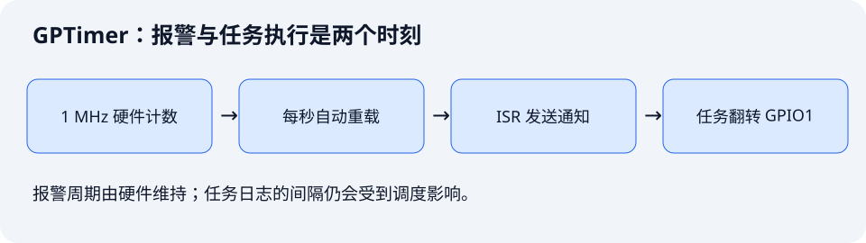

[第 06 课](./06-esp-timer-periodic-task.md)用 `esp_timer` 产生周期事件。本课跟学教材第 15 章，让 GPTimer 的硬件计数器每隔 1 秒触发一次报警，再通过任务通知翻转红色 LED。

配套工程：[`examples/07-gptimer-periodic-led`](https://github.com/Rainboylvx/esp32-learning-code/tree/main/examples/07-gptimer-periodic-led)。本文使用 ESP-IDF v5.5.5 的 `driver/gptimer.h`。

> [!INFO] 验证范围
> 构建结果见文末。本文的日志是预期格式，尚未对本课进行实板烧录或波形测量。工程可以编译，不等于硬件周期已经实测合格。

## 1. 硬件连接与实验现象

GPTimer 是片上资源，无需外接定时器。输出仍使用 DNESP32S3 V1.2 的 GPIO1 红色 LED。


*正点原子原理图：GPIO1 输出低电平时点亮红色 LED。BSP 的 `led_set(true)` 负责转换电平。*

烧录后先熄灭，每隔约 1 秒翻转一次，因此一个完整亮灭周期是约 2 秒。BOOT 不参与本课。



这里要分清三个时间：计数器达到报警值的时刻、中断开始执行的时刻、LED 任务获得 CPU 的时刻。硬件自动重载决定下一次报警的基准；中断和任务仍可能延后执行。

## 2. 把时间换成计数值

本课使用向上计数，分辨率设置为 1 MHz：

```c
// 分辨率是每秒计数多少次，不是报警频率。
gptimer_config_t config = {
    .clk_src = GPTIMER_CLK_SRC_DEFAULT,
    .direction = GPTIMER_COUNT_UP,
    .resolution_hz = 1000000,
};
```

一次计数对应 `1 / 1000000 s = 1 us`。计数从 0 到 1000000 需要 1 秒：

```c
gptimer_alarm_config_t alarm = {
    .alarm_count = 1000000, // 达到此值时产生报警。
    .reload_count = 0,     // 报警时重新装载为零。
    .flags.auto_reload_on_alarm = true,
};
```

向上计数时，周期为 `(alarm_count - reload_count) / resolution_hz`。例如把报警值改成 250000，就每隔 250 ms 报警一次。重载值和报警值不能相同。

自动重载发生在硬件侧。如果改成“任务醒来后再从零启动”，任务执行耗时也会加进周期，长期运行就容易产生漂移。

## 3. 初始化顺序与 BSP

工程结构如下：

```text
07-gptimer-periodic-led/
├── CMakeLists.txt
├── sdkconfig.defaults
├── components/BSP/
│   ├── CMakeLists.txt
│   ├── LED/led.c、led.h
│   └── TICK/tick.c、tick.h
└── main/main.c、CMakeLists.txt
```

`TICK` 暴露 `tick_start(TaskHandle_t receiver)`，调用者提供接收通知的任务。模块依次创建定时器、注册回调、设置报警、使能、启动：

```c
// 下面是初始化顺序摘要，完整错误检查见 tick.c。
ESP_ERROR_CHECK(gptimer_new_timer(&config, &timer));
ESP_ERROR_CHECK(gptimer_register_event_callbacks(timer, &callbacks, receiver));
ESP_ERROR_CHECK(gptimer_set_alarm_action(timer, &alarm));
ESP_ERROR_CHECK(gptimer_enable(timer));
ESP_ERROR_CHECK(gptimer_start(timer));
```

这里的 `timer` 和 `callbacks` 是顺序示意中的变量；直接构建仓库里的完整工程即可。注册回调必须在使能之前完成。若以后需要释放资源，按 `stop → disable → del_timer` 的顺序收尾，并保证任务句柄在回调停止之前有效。

```cmake
# INCLUDE_DIRS 导出头文件目录；PRIV_REQUIRES 声明实现所需驱动。
idf_component_register(SRCS "LED/led.c" "TICK/tick.c"
    INCLUDE_DIRS "LED" "TICK"
    PRIV_REQUIRES esp_driver_gpio esp_driver_gptimer freertos)
```

ESP-IDF 默认会搜索工程根目录下的 `components/`，因此 `main` 声明 `PRIV_REQUIRES BSP` 后，就能找到 `components/BSP/CMakeLists.txt`。

## 4. 报警回调运行在 ISR

```c
static bool on_alarm(gptimer_handle_t timer,
                     const gptimer_alarm_event_data_t *event, void *arg)
{
    (void)timer;
    (void)event;
    BaseType_t woken = pdFALSE;
    // ISR 发通知，不能使用普通任务版 xTaskNotifyGive()。
    vTaskNotifyGiveFromISR((TaskHandle_t)arg, &woken);
    // GPTimer 驱动会根据返回值请求切换任务。
    return woken == pdTRUE;
}
```

这与上一课默认 `ESP_TIMER_TASK` 回调的上下文不同。GPTimer 回调不能 `vTaskDelay()`、等队列、执行耗时打印或调用可能阻塞的业务。

本例没有启用 GPTimer 的 cache safe 选项。给函数加 `IRAM_ATTR` 也不能单独保证 Flash cache 关闭时整条调用链都安全；那需要同时检查回调、被调用函数和数据的位置。

## 5. 任务通知与测量边界

```c
// task 暂时未调度时，多次报警可以累计成一个通知计数。
uint32_t count = ulTaskNotifyTake(pdTRUE, portMAX_DELAY);
if (count & 1U) on = !on;
ESP_ERROR_CHECK(led_set(on));
```

`pdTRUE` 使读取后清空累计计数。翻转偶数次等于没翻转，奇数次才改变最终状态。任务只输出最终电平，无法补回此前漏掉的物理闪光。

任务用 `esp_timer_get_time()` 打印两次处理之间的间隔，用来观察调度影响。它不能证明硬件报警的抖动有多小。需要测量边沿时，应另用 GPIO 标记 ISR，再用示波器或逻辑分析仪测量；标记本身也会引入开销。

## 6. 什么时候选 GPTimer

| 工具 | 本系列采用的回调上下文 | 适合的工作 |
| --- | --- | --- |
| `vTaskDelayUntil()` | 普通任务 | 毫秒级任务循环、传感器轮询 |
| `esp_timer` 默认模式 | 高优先级公共任务 | 多个轻量周期任务、刷新通知 |
| GPTimer | ISR | 独立硬件计数、可控的报警与重载 |
| LEDC | 硬件持续输出 | 连续 PWM，避免逐边沿中断 |

选择 GPTimer 的原因是需要其计数和报警能力。把 GPIO 操作放回普通任务后，GPIO 边沿仍受调度影响；它不适合代替 LEDC 输出高频 PWM。

## 7. 构建、烧录与验收

```bash
# 每个新终端先激活 ESP-IDF。
source ~/.espressif/tools/activate_idf_v5.5.5.sh
# 进入本课工程，默认配置已经选择 esp32s3。
cd ~/mycode/esp32-blog/examples/07-gptimer-periodic-led
idf.py build
# 用插拔对比找到的实际串口替换占位值。
idf.py -p <实际串口> flash monitor
# 串口监视中按 Ctrl+] 退出。
```

预期格式如下，数值只表示示例：

```text
gptimer: alarms=1, task interval=1000xxx us, LED=1
gptimer: alarms=1, task interval=999xxx us, LED=0
```

验收时检查：LED 每秒翻转；正常负载下 `alarms` 通常为 1；能解释为何日志不严格等于 1000000 us；把报警值改为 250000 后，翻转速度变为原来的 4 倍。

对照教材与本地官方 `06_gptim`：教材正文介绍新 GPTimer API，本地源码仍使用 `driver/timer.h` 的旧 Timer Group 接口。本课统一使用新驱动、自动重载和任务通知；官方源码在 ISR 中直接翻转 LED，因此两者的 GPIO 边沿测量含义不同。

API 依据：[ESP-IDF v5.5.5 GPTimer 文档](https://docs.espressif.com/projects/esp-idf/en/v5.5.5/esp32s3/api-reference/peripherals/gptimer.html)。

下一课：[看门狗：发现并定位失去响应的任务](./08-task-watchdog.md)。
