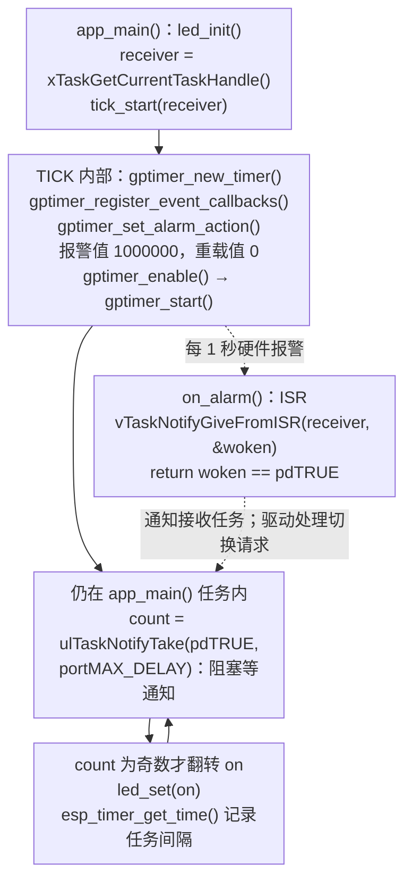

[第 06 课](./06-esp-timer-periodic-task.md)用 `esp_timer` 产生周期事件。本课跟学教材第 15 章，让 GPTimer 的硬件计数器每隔 1 秒触发一次报警，再通过任务通知翻转红色 LED。

配套工程：[`examples/07-gptimer-periodic-led`](https://github.com/Rainboylvx/esp32-learning-code/tree/main/examples/07-gptimer-periodic-led)。本文使用 ESP-IDF v5.5.5 的 `driver/gptimer.h`。

> [!INFO] 验证范围
> 当前代码已在默认配置的隔离副本中通过 ESP-IDF v5.5.5 编译。本文日志为预期格式，尚未对本版进行实板烧录或波形测量，硬件周期仍需实测。

## 一图看懂关键调用

实线表示同一执行路径上的顺序，虚线表示任务调度、回调触发或消息传递；它们不表示跨任务的直接函数调用。



本课没有调用 `xTaskCreate()`。`tick_start()` 只配置硬件，之后由原本运行 `app_main()` 的任务循环接收通知，因此它不能在初始化后直接返回。图中省略了配置结构体细节；1 MHz 计数分辨率下，报警值 1000000、重载值 0 对应 1 秒。

## 1. 硬件连接与实验现象

GPTimer 是片上资源，无需外接定时器。输出仍使用 DNESP32S3 V1.2 的 GPIO1 红色 LED。


*正点原子原理图：GPIO1 输出低电平时点亮红色 LED。BSP 的 `led_set(true)` 负责转换电平。*

烧录后先熄灭，每隔约 1 秒翻转一次，因此一个完整亮灭周期是约 2 秒。BOOT 不参与本课。


这里要分清三个时间：计数器达到报警值的时刻、中断开始执行的时刻、LED 任务获得 CPU 的时刻。硬件自动重载决定下一次报警的基准；中断和任务仍可能延后执行。

## 2. 把时间换成计数值

本课使用向上计数，分辨率设置为 1 MHz：

```c
gptimer_new_timer(&(gptimer_config_t){
        .clk_src = GPTIMER_CLK_SRC_DEFAULT,
        .direction = GPTIMER_COUNT_UP,
        .resolution_hz = 1000000, /* 每计数一次 1 us */
    }, &s_timer);
```

一次计数对应 `1 / 1000000 s = 1 us`。计数从 0 到 1000000 需要 1 秒：

```c
gptimer_set_alarm_action(s_timer, &(gptimer_alarm_config_t){
        .alarm_count = 1000000,
        .flags.auto_reload_on_alarm = true,
    });
```

向上计数时，周期为 `(alarm_count - reload_count) / resolution_hz`。例如把报警值改成 250000，就每隔 250 ms 报警一次。重载值和报警值不能相同。

自动重载发生在硬件侧。如果改成“任务醒来后再从零启动”，任务执行耗时也会加进周期，长期运行就容易产生漂移。

## 3. 初始化顺序与 BSP

工程结构如下：

```text
07-gptimer-periodic-led/
├── CMakeLists.txt
├── sdkconfig.defaults
├── components/BSP/
│   ├── CMakeLists.txt
│   ├── LED/led.c、led.h
│   └── TICK/tick.c、tick.h
└── main/main.c、CMakeLists.txt
```

`TICK` 暴露 `void tick_start(TaskHandle_t receiver)`。当前 `app_main()` 把自己的句柄传进去，在同一个任务内等待通知，不调用 `xTaskCreate()`。模块依次创建定时器、注册回调、设置报警、使能、启动：

```c
void tick_start(TaskHandle_t receiver)
{
    gptimer_new_timer(&(gptimer_config_t){
        .clk_src = GPTIMER_CLK_SRC_DEFAULT,
        .direction = GPTIMER_COUNT_UP,
        .resolution_hz = 1000000, /* 每计数一次 1 us */
    }, &s_timer);

    gptimer_register_event_callbacks(s_timer,
        &(gptimer_event_callbacks_t){.on_alarm = on_alarm}, receiver);

    /* (1000000 - 0) / 1000000 Hz = 1 s。 */
    gptimer_set_alarm_action(s_timer, &(gptimer_alarm_config_t){
        .alarm_count = 1000000,
        .flags.auto_reload_on_alarm = true,
    });

    gptimer_enable(s_timer);
    gptimer_start(s_timer);
}
```

配置结构体通过复合字面量直接传入，未写出的 `reload_count` 默认为 0。注册回调必须在使能之前完成。若以后需要释放资源，按 `stop → disable → del_timer` 的顺序收尾，并保证任务句柄在回调停止之前有效。

```cmake
# INCLUDE_DIRS 导出头文件目录；PRIV_REQUIRES 声明实现所需驱动。
idf_component_register(SRCS "LED/led.c" "TICK/tick.c"
    INCLUDE_DIRS "LED" "TICK"
    PRIV_REQUIRES esp_driver_gpio esp_driver_gptimer freertos)
```

ESP-IDF 默认会搜索工程根目录下的 `components/`，因此 `main` 声明 `PRIV_REQUIRES BSP` 后，就能找到 `components/BSP/CMakeLists.txt`。

## 4. 报警回调运行在 ISR

```c
static bool on_alarm(gptimer_handle_t timer,
                     const gptimer_alarm_event_data_t *event, void *arg)
{
    (void)timer;
    (void)event;
    BaseType_t woken = pdFALSE;
    /* GPTimer 回调运行在 ISR，只能用 FromISR 版本。 */
    vTaskNotifyGiveFromISR((TaskHandle_t)arg, &woken);
    /* 驱动按返回值决定是否请求切换任务，无需再 portYIELD_FROM_ISR。 */
    return woken == pdTRUE;
}
```

这与上一课默认 `ESP_TIMER_TASK` 回调的上下文不同。GPTimer 回调不能 `vTaskDelay()`、等队列、执行耗时打印或调用可能阻塞的业务。

本例没有启用 GPTimer 的 cache safe 选项。即使给函数加上 `IRAM_ATTR`，仍需检查回调、被调用函数和数据的位置，才能判断 Flash cache 关闭时整条调用链是否安全。

## 5. 任务通知与测量边界

```c
void app_main(void)
{
    led_init();
    tick_start(xTaskGetCurrentTaskHandle()); /* 通知发到当前任务，句柄须一直有效 */
    bool on = false;
    int64_t previous = esp_timer_get_time();
    while (1) {
        /* 阻塞让出 CPU；通知计数保留「任务暂时没空」期间收到的次数。 */
        uint32_t count = ulTaskNotifyTake(pdTRUE, portMAX_DELAY);
        if (count & 1U) on = !on; /* 奇数次报警才翻转，偶数次相互抵消 */
        led_set(on);
        int64_t now = esp_timer_get_time();
        ESP_LOGI("gptimer", "alarms=%" PRIu32 ", task interval=%" PRId64
                 " us, LED=%d", count, now - previous, on);
        previous = now;
    }
}
```

`pdTRUE` 使读取后清空累计计数。翻转偶数次等于没翻转，奇数次才改变最终状态。任务只输出最终电平，无法补回此前漏掉的物理闪光。

任务用 `esp_timer_get_time()` 打印两次处理之间的间隔，用来观察调度影响。它不能证明硬件报警的抖动有多小。需要测量边沿时，应另用 GPIO 标记 ISR，再用示波器或逻辑分析仪测量；标记本身也会引入开销。

## 6. 什么时候选 GPTimer

| 工具 | 本系列采用的回调上下文 | 适合的工作 |
| --- | --- | --- |
| `vTaskDelayUntil()` | 普通任务 | 毫秒级任务循环、传感器轮询 |
| `esp_timer` 默认模式 | 高优先级公共任务 | 多个轻量周期任务、刷新通知 |
| GPTimer | ISR | 独立硬件计数、可控的报警与重载 |
| LEDC | 硬件持续输出 | 连续 PWM，避免逐边沿中断 |

需要硬件计数和报警时，可以选择 GPTimer。但本例由普通任务操作 GPIO，输出边沿仍受调度影响，不适合用它代替 LEDC 输出高频 PWM。

## 用到的 GPTimer 与任务通知 函数查询表

名称链接到 ESP-IDF v5.5.5 官方文档或该版本源码。表中的调用环境按本课用法标注；带 `FromISR` 的接口用于中断，普通任务接口不能直接搬进 ISR。

| 函数或宏 | 本课用途 | 调用环境 |
| --- | --- | --- |
| [`gptimer_new_timer()`](https://docs.espressif.com/projects/esp-idf/en/v5.5.5/esp32s3/api-reference/peripherals/gptimer.html#gptimer_8h_1a0ff72b8504c944a4db511e0c71e50922) | 按配置申请硬件定时器 | 普通任务，不能在 ISR 中调用 |
| [`gptimer_register_event_callbacks()`](https://docs.espressif.com/projects/esp-idf/en/v5.5.5/esp32s3/api-reference/peripherals/gptimer.html#gptimer_8h_1ace2479ceae75e79c2730d8ef0552642d) | 注册报警回调和用户参数 | 普通任务，不能在 ISR 中调用 |
| [`gptimer_set_alarm_action()`](https://docs.espressif.com/projects/esp-idf/en/v5.5.5/esp32s3/api-reference/peripherals/gptimer.html#gptimer_8h_1a33aa960104b3358d5ae87e320770c8fd) | 设置报警计数、重载值与自动重载 | 本课在任务中配置；驱动也支持 ISR 调用 |
| [`gptimer_enable()`](https://docs.espressif.com/projects/esp-idf/en/v5.5.5/esp32s3/api-reference/peripherals/gptimer.html#gptimer_8h_1a7433ec78be15278588d5ce83bc446cb9) | 使能定时器及相关资源 | 普通任务，不能在 ISR 中调用 |
| [`gptimer_start()`](https://docs.espressif.com/projects/esp-idf/en/v5.5.5/esp32s3/api-reference/peripherals/gptimer.html#gptimer_8h_1a1f37cb270dd5ca60f192e7fd21105c66) | 开始计数 | 本课在任务中启动；驱动也支持 ISR 调用 |
| [`vTaskNotifyGiveFromISR()`](https://docs.espressif.com/projects/esp-idf/en/v5.5.5/esp32s3/api-reference/system/freertos_idf.html#task_8h_1a1add9ef24d3763e34603b18802fae9d7) | 从中断通知指定任务 | ISR 中，不能阻塞 |
| [`ulTaskNotifyTake()`](https://github.com/espressif/esp-idf/blob/v5.5.5/components/freertos/FreeRTOS-Kernel/include/freertos/task.h#L2530) | 读取并处理当前任务的通知计数 | 普通任务，不能在 ISR 中调用 |
| [`xTaskGetCurrentTaskHandle()`](https://github.com/espressif/esp-idf/blob/v5.5.5/components/freertos/FreeRTOS-Kernel/include/freertos/task.h#L2893) | 获取当前 app_main 任务句柄 | 普通任务中调用 |
| [`esp_timer_get_time()`](https://docs.espressif.com/projects/esp-idf/en/v5.5.5/esp32s3/api-reference/system/esp_timer.html#esp__timer_8h_1ab38881d22858adab666843cee4ba6589) | 读取单调时间，单位微秒 | 本课在任务中读取；也可在 ISR 中读取 |

### 定时器参数与生命周期

`gptimer_new_timer(&config, &timer)` 从配置读取时钟源、计数方向和 `resolution_hz`，通过第二个参数写回句柄。成功返回 `ESP_OK`；没有空闲硬件可返回 `ESP_ERR_NOT_FOUND`，内存不足可返回 `ESP_ERR_NO_MEM`。

`gptimer_register_event_callbacks(timer, &callbacks, user_ctx)` 为该实例注册回调，第三个参数会原样传给回调。它必须在使能之前调用。`gptimer_set_alarm_action(timer, &alarm)` 设置 `alarm_count`、`reload_count` 与自动重载标志，计数值不是直接以毫秒表示的时间。

`gptimer_enable(timer)` 准备资源，`gptimer_start(timer)` 才开始计数。这几项配置和控制接口成功返回 `ESP_OK`，参数或生命周期状态不符时按接口返回 `ESP_ERR_INVALID_ARG`、`ESP_ERR_INVALID_STATE` 等错误。

本课 `resolution_hz=1000000`，报警值 `1000000`、重载值 `0`，因此每 1 秒报警一次。释放资源时才依次调用 [`gptimer_stop()`](https://docs.espressif.com/projects/esp-idf/en/v5.5.5/esp32s3/api-reference/peripherals/gptimer.html#gptimer_8h_1a98ee619e279f647baea168716e7da537)、[`gptimer_disable()`](https://docs.espressif.com/projects/esp-idf/en/v5.5.5/esp32s3/api-reference/peripherals/gptimer.html#gptimer_8h_1aed5b16068e124dc5f349c8df43af0cae)、[`gptimer_del_timer()`](https://docs.espressif.com/projects/esp-idf/en/v5.5.5/esp32s3/api-reference/peripherals/gptimer.html#gptimer_8h_1af72c98ee800ee39760b3cfea931aec2f)，它们都接收定时器句柄并以 `ESP_OK` 表示成功；主工程没有执行释放路径。

### ISR 如何唤醒任务

`vTaskNotifyGiveFromISR(receiver, &woken)` 的参数是接收任务句柄和输出标志地址，没有返回值。调用前把 `woken` 初始化为 `pdFALSE`；如果唤醒了更高优先级任务，标志会置为 `pdTRUE`。GPTimer 的 `on_alarm` 回调返回这个判断结果，由驱动请求任务切换，本课不再手动调用切换宏。

`ulTaskNotifyTake(pdTRUE, portMAX_DELAY)` 返回当前任务清零前的累计通知数。返回奇数时翻转 LED，偶数时维持最终状态；这不会补回此前没有输出的物理边沿。

### 当前任务句柄与读取时间 {#创建接收任务与读取时间}

`xTaskGetCurrentTaskHandle()` 无参数，返回当前任务的 `TaskHandle_t`。本课直接执行 `tick_start(xTaskGetCurrentTaskHandle())`，再由 `app_main()` 自己循环接收通知；没有另建 LED 任务，因此这里不能返回并销毁接收任务。

`esp_timer_get_time()` 返回 `int64_t` 微秒时间，本课用相邻读数相减观察任务处理间隔，不把它当作硬件报警边沿的实测结果。

### 当前代码的接口与错误处理

| 本工程接口 | 用途与条件 | 返回类型 |
| --- | --- | --- |
| `tick_start(receiver)` | 配置并启动 1 秒硬件报警，把通知发给 receiver；句柄需持续有效 | `void` |
| `led_init() / led_set(on)` | 初始化并输出 LED 逻辑状态 | `void` |

这些接口属于配套工程 BSP 或业务代码，不是同名的 ESP-IDF 底层 API。返回 `void` 的接口没有可检查的返回值，不能直接放进 `ESP_ERROR_CHECK()`。

当前教学版省略了多项初始化、资源创建和驱动调用的返回值检查。查询表保留底层 API 的成功与失败返回值，表示接口本身的约定；不代表当前源码已经检查。若要补齐，应在 BSP 内处理底层错误、按需返回 `esp_err_t`，并单独判断 FreeRTOS 创建结果。

## 7. 构建、烧录与验收

```bash
# 每个新终端先激活 ESP-IDF。
source ~/.espressif/tools/activate_idf_v5.5.5.sh
# 进入本课工程，默认配置已经选择 esp32s3。
cd ~/mycode/esp32-blog/examples/07-gptimer-periodic-led
idf.py build
# 用插拔对比找到的实际串口替换占位值。
idf.py -p <实际串口> flash monitor
# 串口监视中按 Ctrl+] 退出。
```

预期格式如下，数值只表示示例：

```text
gptimer: alarms=1, task interval=1000xxx us, LED=1
gptimer: alarms=1, task interval=999xxx us, LED=0
```

验收时检查：LED 每秒翻转；正常负载下 `alarms` 通常为 1；能解释为何日志不严格等于 1000000 us；把报警值改为 250000 后，翻转速度变为原来的 4 倍。

对照教材与本地官方 `06_gptim`：教材正文介绍新 GPTimer API，本地源码仍使用 `driver/timer.h` 的旧 Timer Group 接口。本课统一使用新驱动、自动重载和任务通知；官方源码在 ISR 中直接翻转 LED，因此两者的 GPIO 边沿测量含义不同。

API 依据：[ESP-IDF v5.5.5 GPTimer 文档](https://docs.espressif.com/projects/esp-idf/en/v5.5.5/esp32s3/api-reference/peripherals/gptimer.html)。

下一课：[看门狗：发现并定位失去响应的任务](./08-task-watchdog.md)。
