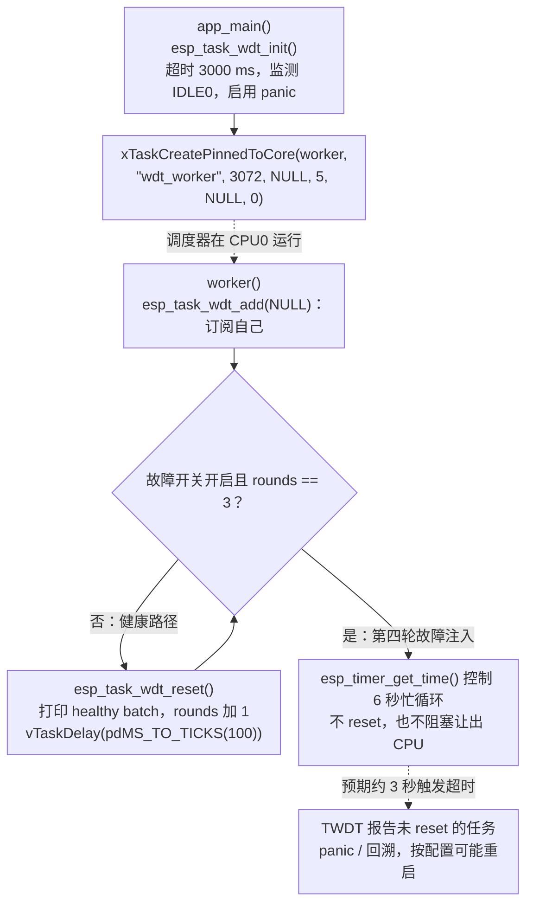
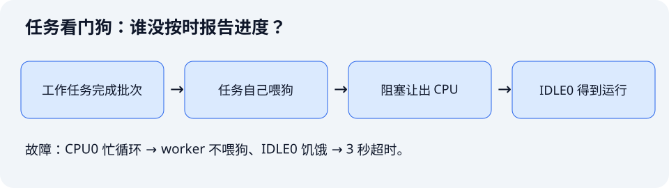

这一课主动制造一次任务失去响应，读取任务看门狗日志，再通过分批处理与主动阻塞修复它。配套工程：[`examples/08-task-watchdog`](https://github.com/Rainboylvx/esp32-learning-code/tree/main/examples/08-task-watchdog)。

教材第 16 章用 `esp_timer` 超时后调用重启来模拟看门狗，按 BOOT 表示“喂狗”。本课使用 ESP-IDF 的任务看门狗 TWDT，重点学习如何定位真实任务饥饿。两种实验的预期现象不同。

> [!INFO] 验证范围
> 当前默认修复版和开启 `CONFIG_DEMO_WDT_FAULT` 的故障版，均已在隔离副本中通过 ESP-IDF v5.5.5 编译。故障注入需手动开启；本次未烧录并实际触发超时。下文日志仅说明如何阅读，不代表实测输出。

## 一图看懂关键调用

实线表示同一执行路径上的顺序，虚线表示任务调度、回调触发或消息传递；它们不表示跨任务的直接函数调用。



`NULL` 在 `esp_task_wdt_add()` 中表示当前 worker。正常循环主动阻塞，使 CPU0 的 idle 也有机会运行；故障路径让 worker 和 IDLE0 都无法按时报告。图中的超时是代码配置下的预期流程，不是本次实板测量结果。

## 1. 看门狗到底在检查什么

“系统还在运行”与“每项工作都在推进”是两件事。某个任务可能一直占用 CPU，让空闲任务运行不了；也可能每次都睡眠，却永远等不到自己需要的事件。

| 看门狗 | 主要检查对象 | 本课中的关系 |
| --- | --- | --- |
| IWDT，中断看门狗 | 中断是否长期得不到执行 | 长时间关闭中断、过长临界区可能触发 |
| TWDT，任务看门狗 | 被订阅任务是否按时 reset | 本课监测 worker 和 CPU0 的 idle |
| 定时器模拟超时 | 应用自己设计的条件 | 教材第 16 章的演示方法 |

TWDT 并不会自动理解业务成功与否。任务必须在确认一批业务取得进展后，再调用自己的喂狗接口。



## 2. 本课不需要新的接线

TWDT 使用片上看门狗与软件订阅列表。本例通过日志观察结果，不驱动 LED，也不读取 BOOT，无需购买或连接外设。

工作任务固定在 CPU0，优先级为 5。TWDT 同时订阅 `wdt_worker` 与 `IDLE0`。正常版本每 100 ms 阻塞一次，让 CPU0 空闲任务有运行机会。

## 3. 明确初始化方式，避免重复初始化

工程的 `sdkconfig.defaults` 包含：

```text
# 关闭开机自动初始化，由 app_main 设置本实验的超时和订阅范围。
CONFIG_ESP_TASK_WDT_INIT=n
```

```c
void app_main(void)
{
    esp_task_wdt_init(&(esp_task_wdt_config_t){
        .timeout_ms = 3000,
        .idle_core_mask = 1U << 0, /* 同时监测 CPU0 空闲任务能否获得运行机会 */
        .trigger_panic = true,
    });

    xTaskCreatePinnedToCore(worker, "wdt_worker", 3072, NULL, 5, NULL, 0);
}
```

如果接入一个已经自动初始化 TWDT 的工程，应使用 `esp_task_wdt_reconfigure()` 调整配置，不能再次初始化。这份全局配置会影响其他订阅者，移入大型工程前需要核对。

修改 defaults 只影响新配置。已经存在的 `sdkconfig` 应通过 `idf.py menuconfig` 检查最终设置，不能假设改 defaults 后旧工程会自动改变。

## 4. 任务自己订阅、自己报告进度

下面摘出健康路径，省略日志和可选故障分支；订阅与 reset 都在 `worker()` 内执行：

```c
// 在 worker 内调用；NULL 指当前任务。
esp_task_wdt_add(NULL);
while (1) {
    // 真实项目先处理一批数据、确认进展，再报告本任务仍然健康。
    esp_task_wdt_reset();
    vTaskDelay(pdMS_TO_TICKS(100));
}
```

本例只打印健康批次日志，便于观察任务调度。`pdMS_TO_TICKS(100)` 把 100 ms 转成调度器 tick 数；`vTaskDelay()` 阻塞当前任务，让调度器运行其他就绪任务。

`esp_task_wdt_reset()` 只报告当前订阅任务的进度。其他订阅任务也必须按时报告；某个任务频繁 reset，不能替另一个任务解除超时。

若任务要结束，应先 `esp_task_wdt_delete(NULL)` 取消订阅。本实验 worker 永久运行，因此没有走退出路径。

## 5. 主动制造“中断没死，任务饿死”

`main/Kconfig.projbuild` 提供 `CONFIG_DEMO_WDT_FAULT`，默认关闭。开启后，前三轮健康运行，第四轮进入下面的故障分支：

```c
// 故障演示：持续忙循环 6 秒，不喂狗，也不让出 CPU。
int64_t deadline = esp_timer_get_time() + 6000000;
while (esp_timer_get_time() < deadline) { }
```

这个循环保留中断，因此常见现象是 TWDT 报告 `wdt_worker` 和 `IDLE0` 未及时 reset。即使另一核仍在运行、系统仍能输出日志，CPU0 上的任务调度也可能已经出现问题。

`taskYIELD()` 不能可靠修复这种情况：当前任务仍然就绪，低优先级 idle 未必能运行。需要等待事件、延时阻塞，或重新设计为有限批次。

## 6. 读懂超时日志

典型格式如下，CPU、地址与行号以你的实际固件为准：

```text
task_wdt: Task watchdog got triggered.
task_wdt: The following tasks/users did not reset the watchdog in time:
task_wdt: - IDLE0 (CPU 0)
task_wdt: - wdt_worker (CPU 0)
... Backtrace: ...
```

按这个顺序看：

1. 先看谁没有 reset：这份列表描述未按时报告的任务。
2. 再看当时 CPU 正在运行谁：它与超时列表不是同一个概念。
3. 用 Monitor 自动解码的回溯找到自己源码的行，检查忙循环、临界区和持锁等待。
4. 保留对应构建的 ELF。用另一版固件的 ELF 解码，源码位置可能错误。

没有回溯时，先检查 `CONFIG_ESP_TASK_WDT_PANIC`、本例 `trigger_panic` 和 panic handler 配置。使用 OpenOCD/JTAG 单步调试时，看门狗行为也可能被调试器改变，因此验收超时应断开调试会话，用串口观察。

## 7. 修复的完成标准

在 `menuconfig` 关闭故障选项，恢复每批工作后阻塞的正常循环。真正的业务还要限制每批处理量，并为外设访问设置超时。

给死循环无条件补一个 reset，可能只会掩盖故障；把全局超时时间调得很大，也不能让 IDLE0 获得 CPU。反过来，一个订阅任务长期等待队列，即使完全不占用 CPU，也可能因自己没有报告进度而超时。因此，需要根据任务职责决定监测哪些任务，以及何时报告进度。

## 用到的 TWDT 与任务调度 函数查询表

名称链接到 ESP-IDF v5.5.5 官方文档或该版本源码。表中的调用环境按本课用法标注；带 `FromISR` 的接口用于中断，普通任务接口不能直接搬进 ISR。

| 函数或宏 | 本课用途 | 调用环境 |
| --- | --- | --- |
| [`esp_task_wdt_init()`](https://docs.espressif.com/projects/esp-idf/en/v5.5.5/esp32s3/api-reference/system/wdts.html#esp__task__wdt_8h_1a35f090c757737bc0bd9e0d2213c60dce) | 初始化任务看门狗 | 普通任务，不能在 ISR 中调用 |
| [`esp_task_wdt_add()`](https://docs.espressif.com/projects/esp-idf/en/v5.5.5/esp32s3/api-reference/system/wdts.html#esp__task__wdt_8h_1a2f6ed3df1695d9a512c864b7cd9157b6) | 订阅需要监测的任务 | 普通任务，不能在 ISR 中调用 |
| [`esp_task_wdt_reset()`](https://docs.espressif.com/projects/esp-idf/en/v5.5.5/esp32s3/api-reference/system/wdts.html#esp__task__wdt_8h_1a962752554e8ae7b53e3c8dbcec61f34d) | 报告当前订阅任务的进度 | 普通任务，不能在 ISR 中调用 |
| [`xTaskCreatePinnedToCore()`](https://github.com/espressif/esp-idf/blob/v5.5.5/components/freertos/esp_additions/include/freertos/idf_additions.h#L63) | 将 worker 固定在 CPU0 | 普通任务，不能在 ISR 中调用 |
| [`vTaskDelay()`](https://docs.espressif.com/projects/esp-idf/en/v5.5.5/esp32s3/api-reference/system/freertos_idf.html#task_8h_1a9917b05abb77e75e959151ae67065dce) | 按 tick 数阻塞当前任务 | 普通任务，不能在 ISR 中调用 |
| [`pdMS_TO_TICKS()`](https://github.com/espressif/esp-idf/blob/v5.5.5/components/freertos/FreeRTOS-Kernel/include/freertos/projdefs.h#L46) | 毫秒换算为 tick 数 | 计算宏，不会延时 |
| [`esp_timer_get_time()`](https://docs.espressif.com/projects/esp-idf/en/v5.5.5/esp32s3/api-reference/system/esp_timer.html#esp__timer_8h_1ab38881d22858adab666843cee4ba6589) | 读取单调时间，单位微秒 | 本课在任务中读取；也可在 ISR 中读取 |
| [`esp_task_wdt_reconfigure()`](https://docs.espressif.com/projects/esp-idf/en/v5.5.5/esp32s3/api-reference/system/wdts.html#esp__task__wdt_8h_1a353553a8e4f0e9782a3c6aac491a8c10) | 接入已有工程时：调整已初始化配置 | 普通任务，不能在 ISR 中调用 |
| [`esp_task_wdt_delete()`](https://docs.espressif.com/projects/esp-idf/en/v5.5.5/esp32s3/api-reference/system/wdts.html#esp__task__wdt_8h_1afef7cdbd33bdd67a529629c7bb2e2585) | 退出时：取消任务订阅 | 普通任务，不能在 ISR 中调用 |
| [`taskYIELD()`](https://github.com/espressif/esp-idf/blob/v5.5.5/components/freertos/FreeRTOS-Kernel/include/freertos/task.h#L224) | 正文比较：主动请求调度，但不阻塞 | 普通任务，不能在 ISR 中调用 |

### TWDT 的配置与返回值

`esp_task_wdt_init()` 接收配置地址，源码直接传入 `&(esp_task_wdt_config_t){...}` 复合字面量，`timeout_ms=3000` 的单位是毫秒；`idle_core_mask=1U<<0` 选择 CPU0 的空闲任务，`trigger_panic=true` 控制超时是否进入 panic。成功返回 `ESP_OK`，重复初始化返回 `ESP_ERR_INVALID_STATE`。

`esp_task_wdt_add(NULL)` 订阅当前任务，也可以传入明确的任务句柄。`esp_task_wdt_reset()` 无参数，只报告当前任务，不能替其他任务喂狗。两者成功均返回 `ESP_OK`，其他结果表示订阅或报告失败；当前教学版没有检查这些结果。

`esp_task_wdt_reconfigure(&config)` 用于已经初始化的 TWDT，未初始化时返回 `ESP_ERR_INVALID_STATE`；`esp_task_wdt_delete(NULL)` 取消当前任务订阅，成功返回 `ESP_OK`。这两个接口属于正文的接入和退出说明，本课永久运行的 worker 没有调用。

### 固定核心、阻塞与主动让出

`xTaskCreatePinnedToCore(worker, "wdt_worker", 3072, NULL, 5, NULL, 0)` 在普通任务创建的六个参数之后增加核心编号 `0`。本例栈大小为 3072 字节、优先级为 5，不保存任务句柄。成功返回 `pdPASS`，内存不足时返回 `errCOULD_NOT_ALLOCATE_REQUIRED_MEMORY`。

`taskYIELD()` 没有返回值，只请求重新调度，当前任务仍处于就绪状态，低优先级 idle 不一定获得运行机会。它不能替代本课的 `vTaskDelay(pdMS_TO_TICKS(100))`。

### tick、毫秒与等待时间

`pdMS_TO_TICKS(ms)` 返回按 tick 频率换算的 tick 数，不会让任务等待。`vTaskDelay(ticks)` 才会阻塞当前任务，没有返回值；时间受 tick 粒度和调度影响，不能把毫秒换算结果当成精确的物理延时。

`esp_timer_get_time()` 返回微秒数，故障分支用“当前时间 + 6000000”构造 6 秒忙循环；TWDT 配置却使用毫秒。查询和修改参数时先核对单位，不能把两个数值直接互换。

### 当前代码的接口与错误处理

本课没有 BSP。当前代码未检查 TWDT 初始化、任务订阅、reset 和任务创建结果；查询表中的返回值是 API 约定。补齐错误处理时，应检查 `esp_task_wdt_*()` 的 `esp_err_t`，并单独判断 `xTaskCreatePinnedToCore()` 是否返回 `pdPASS`。

## 8. 构建与两轮实板实验

```bash
# 激活环境并构建默认的修复版。
source ~/.espressif/tools/activate_idf_v5.5.5.sh
cd ~/mycode/esp32-blog/examples/08-task-watchdog
idf.py build
# 打开项目菜单，启用 Watchdog teaching demo 下的故障注入。
idf.py menuconfig
# 使用真实端口烧录故障版，观察超时任务和解码后的回溯。
idf.py -p <实际串口> flash monitor
# 退出 Monitor 后，再次进入菜单关闭故障，重新烧录修复版。
idf.py menuconfig
idf.py -p <实际串口> flash monitor
```

故障版可能在 panic 后重启并再次触发故障，这是预期；完成观察后要烧回修复版。修复版至少观察 30 秒，确认持续打印健康批次、没有 TWDT 超时。记录实际日志后，再把课程目录勾选为完成。

与教材的差异：教材用 BOOT 重启应用定时器，并在定时器到期时重启芯片；本例使用 TWDT 监测任务与 idle，不需要 LED/BOOT BSP，实验现象也与教材不同。

依据：[ESP-IDF v5.5.5 看门狗文档](https://docs.espressif.com/projects/esp-idf/en/v5.5.5/esp32s3/api-reference/system/wdts.html)。

下一课：[状态机与非阻塞程序](./09-event-state-machine.md)。
