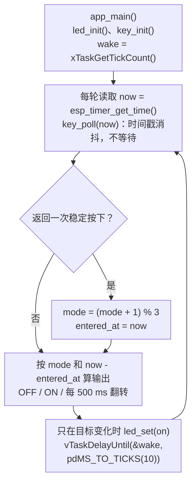
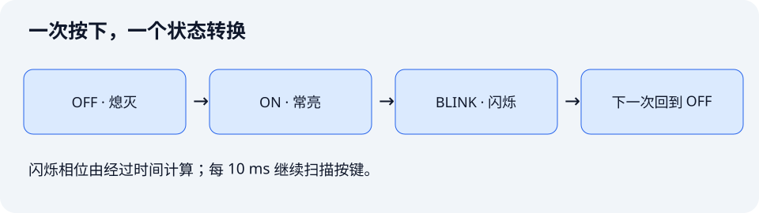
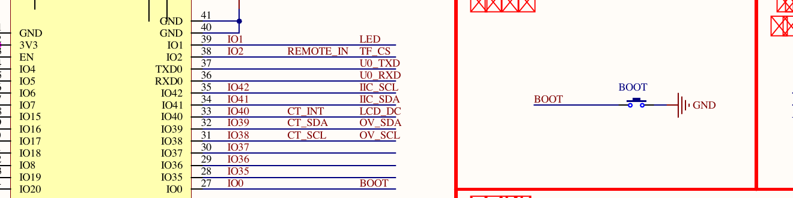

本课是基础补充：用一个任务同时扫描 BOOT、切换模式、定时闪灯。任务在两次闪灯之间仍会检查按键，无需暂停整个业务来等待下一次闪灯。

配套工程：[`examples/09-event-state-machine`](https://github.com/Rainboylvx/esp32-learning-code/tree/main/examples/09-event-state-machine)。当前代码已在默认配置的隔离副本中通过 ESP-IDF v5.5.5 编译，本次未烧录；按键、消抖与实际响应延迟尚待实板验收。

## 一图看懂关键调用

实线表示同一执行路径上的顺序，虚线表示任务调度、回调触发或消息传递；它们不表示跨任务的直接函数调用。



所有节点都在同一个 `app_main()` 任务中执行，没有队列或额外任务。`key_poll()` 只更新采样状态并立即返回；真正的等待只发生在每轮末尾的短扫描节拍中，闪烁相位按微秒时间计算。

## 1. 从“按顺序等完”变成“每次推进一点”

如果主循环先点灯、等 500 ms、熄灯、再等 500 ms，按键可能需要等待接近 1 秒才被扫描。即使 `vTaskDelay()` 已经把 CPU 让给其他任务，本任务内的后续业务仍要等它返回。

解决办法是保存状态和进入状态的时间。每轮检查有没有新输入、当前应该输出什么，处理后便进入下一轮。



模式顺序是：熄灭 → 常亮 → 闪烁 → 熄灭。每次稳定按下只转换一次；长按不连续跳转。进入闪烁时立即点亮，500 ms 后熄灭，再过 500 ms 点亮。

## 2. 接线与电平




DNESP32S3 V1.2：BOOT 按下使 GPIO0 变低，程序启用内部上拉；GPIO1 低电平点亮 LED。无需外设。BOOT 也是启动配置引脚，实验时先正常启动，再按键，不要按住 BOOT 复位来测试业务。

## 3. 状态、事件和输出分别是什么

| 名称 | 本例内容 | 保存在哪里 |
| --- | --- | --- |
| 状态 | OFF、ON、BLINK | `mode` |
| 输入事件 | 一次稳定按下 | `key_poll()` 返回值 |
| 时间基准 | 进入当前模式的时刻 | `entered_at` |
| 输出 | 此时 LED 应该亮还是灭 | `on` |

本例只有一个业务任务，可以直接处理事件，无需增加队列。变量由一个任务独占，状态转换也在同一处完成。第 12 课有多个生产者时再使用队列。

```c
// 枚举比散落在各处的 0、1、2 更容易表达业务含义。
typedef enum { MODE_OFF, MODE_ON, MODE_BLINK } mode_t;

if (key_poll(now)) {
    mode = (mode + 1) % 3; // 一次事件只前进一个状态。
    entered_at = now;     // 每次进入新状态重新建立时间基准。
}
```

## 4. 消抖也要分成多次检查

第 03 课的消抖函数通过短暂 `vTaskDelay()` 再次确认电平。本课把等待改成时间戳，`KEY` BSP 提供：

```c
// now_us 来自单调时钟。函数立即返回，不在内部等待触点稳定。
bool key_poll(int64_t now_us);
```

它保存原始电平、已经确认的稳定电平，以及原始电平最近变化的时间：

```c
if (raw != s_raw) {
    s_raw = raw;
    s_changed_at = now_us; // 每次抖动都会重新开始计时。
}
if (now_us - s_changed_at < DEBOUNCE_US) return false;
```

`DEBOUNCE_US` 为 20000，即 20 ms。轮询连续读到稳定电平达到这个时长后，才更新稳定状态。稳定下降沿产生一次按下事件；稳定松开后才允许下一次按下。这样，松开时的抖动不会立即让程序接受下一次按下。代码还避免把上电时已经按住的键当成新按下。

`key_poll()` 必须定期调用，不能两秒才检查一次。它的内部状态由扫描任务独占，不允许多个任务同时调用。

## 5. 按经过时间计算闪烁相位

```c
// now 和 entered_at 的单位都是微秒。
bool on = mode == MODE_ON ||
    (mode == MODE_BLINK && ((now - entered_at) / 500000) % 2 == 0);
```

进入 BLINK 后经过 0～499999 us，整数除法结果是 0，LED 点亮；经过 500000～999999 us，结果是 1，LED 熄灭；下一段结果变成 2，又点亮。

如果任务因别的工作迟到 20 ms，下次仍按真实经过时间计算，不会每次把延迟都叠加进周期。若系统迟到得太久，部分闪烁会被跳过；状态机不能恢复没有实际输出的历史边沿。

只有目标输出变化时才调用 `led_set()`，避免每轮重复写相同电平。

## 6. “非阻塞业务”为什么还有 delay

```c
// 相对上一轮计划唤醒时间，保持约 10 ms 的扫描节拍。
vTaskDelayUntil(&wake, pdMS_TO_TICKS(10));
```

这里阻塞当前任务 10 ms 左右是主动让出 CPU。业务没有为了等待闪灯暂停 500 ms，按键检查一直按短节拍进行。这就是本课所说的非阻塞程序。

本工程设置 `CONFIG_FREERTOS_HZ=1000`，所以 10 ms 对应 10 个 tick。`pdMS_TO_TICKS()` 是换算宏，不是延时函数；真正阻塞的是 `vTaskDelayUntil()`。

若每轮业务长期超过 10 ms，固定周期循环可能赶不上计划，需要减少每轮工作量或把慢 I/O 交给其他任务。不能把此调用理解为保证任何负载下都能准时响应。

## 7. BSP、应用与工程注册

`components/BSP/KEY` 只输出按键事件，`components/BSP/LED` 只转换逻辑亮灭与 GPIO 电平。OFF/ON/BLINK 和 500 ms 间隔属于应用，保存在 `main.c`。

```cmake
# main 的依赖包括 BSP、单调时钟和任务 API。
idf_component_register(SRCS "main.c" INCLUDE_DIRS "."
    PRIV_REQUIRES BSP esp_timer freertos)
```

这里使用 `esp_timer_get_time()` 读取时间，没有创建 `esp_timer` 定时回调。读取单调时钟与申请一个周期定时器是两种不同操作。

当前完整应用循环如下，它直接运行在 `app_main()` 任务中：

```c
void app_main(void)
{
    led_init();
    key_init();
    mode_t mode = MODE_OFF;
    int64_t entered_at = esp_timer_get_time();
    bool previous_on = false;
    TickType_t wake = xTaskGetTickCount();
    while (1) {
        int64_t now = esp_timer_get_time();
        /* 按键事件触发状态转移；长按只算一次，不会连续切换。 */
        if (key_poll(now)) {
            mode = (mode + 1) % 3;
            entered_at = now;
            ESP_LOGI("state", "mode=%d (0=OFF, 1=ON, 2=BLINK)", mode);
        }
        /* 每 500 ms 变一次状态但不阻塞 500 ms；漏拍时按实际时间求相位。 */
        bool on = mode == MODE_ON ||
            (mode == MODE_BLINK && ((now - entered_at) / 500000) % 2 == 0);
        if (on != previous_on) {
            led_set(on);
            previous_on = on;
        }
        /* 10 ms 是输入采样节拍，阻塞期间 CPU 可以让给其他任务。 */
        vTaskDelayUntil(&wake, pdMS_TO_TICKS(10));
    }
}
```

## 用到的时间与任务调度函数查询表

名称链接到 ESP-IDF v5.5.5 官方文档或该版本源码。表中的调用环境按本课用法标注；带 `FromISR` 的接口用于中断，普通任务接口不能直接搬进 ISR。

| 函数或宏 | 本课用途 | 调用环境 |
| --- | --- | --- |
| [`esp_timer_get_time()`](https://docs.espressif.com/projects/esp-idf/en/v5.5.5/esp32s3/api-reference/system/esp_timer.html#esp__timer_8h_1ab38881d22858adab666843cee4ba6589) | 读取单调时间，单位微秒 | 本课在任务中读取；也可在 ISR 中读取 |
| [`xTaskGetTickCount()`](https://docs.espressif.com/projects/esp-idf/en/v5.5.5/esp32s3/api-reference/system/freertos_idf.html#task_8h_1a5fa24e36d5e1eeb57f5b73b72ea048e7) | 读取系统 tick 计数 | 普通任务，不能在 ISR 中调用 |
| [`vTaskDelayUntil()`](https://github.com/espressif/esp-idf/blob/v5.5.5/components/freertos/FreeRTOS-Kernel/include/freertos/task.h#L905) | 相对计划唤醒时间维持扫描节拍 | 普通任务，不能在 ISR 中调用 |
| [`pdMS_TO_TICKS()`](https://github.com/espressif/esp-idf/blob/v5.5.5/components/freertos/FreeRTOS-Kernel/include/freertos/projdefs.h#L46) | 毫秒换算为 tick 数 | 计算宏，不会延时 |

### 读取时间与保存扫描基准

`esp_timer_get_time()` 无参数，返回 `int64_t` 微秒时间。本课把它传给 `key_poll(now)`，并与 `entered_at` 相减计算闪烁相位；这里只读时钟，没有创建定时器回调。

`xTaskGetTickCount()` 无参数，返回系统 tick 计数，类型是 `TickType_t`。它用来初始化扫描节拍变量 `wake`，不能与微秒变量直接相减。

### 固定节拍的两个参数

`vTaskDelayUntil(&wake, pdMS_TO_TICKS(10))` 的第一个参数指向保存计划唤醒时间的变量，第二个参数是每轮间隔 tick 数。先用 `xTaskGetTickCount()` 初始化 `wake`，后续调用会更新它，不要在每轮重新置为当前时间。

`vTaskDelayUntil()` 没有返回值。它在本版本中调用 `xTaskDelayUntil()` 并忽略返回值；后者返回 `pdTRUE` 表示本轮发生了延时，返回 `pdFALSE` 表示计划时刻已到、无需再阻塞。两者都不能保证超负载循环按时完成。

`pdMS_TO_TICKS(10)` 是换算宏，返回 10 ms 对应的 tick 数。本工程配置 `CONFIG_FREERTOS_HZ=1000`，结果为 10 tick；换用其他配置时不能默认仍为 10。

### BSP 函数不是系统 API

`key_init()`、`key_poll(now_us)`、`led_init()` 和 `led_set(on)` 是本工程的 BSP 接口。`key_poll()` 接收微秒时间戳，立即返回是否出现一次稳定按下；`led_set()` 接收逻辑亮灭值，由 BSP 转换 GPIO 电平。这些接口没有 FreeRTOS 官方文档，应对照配套工程的头文件阅读。

正文中的 `vTaskDelay()` 用于与旧消抖方式作比较；当前工程使用 `vTaskDelayUntil()` 维持短扫描节拍，不在消抖函数内部延时。

### 当前代码的接口与错误处理

| 本工程接口 | 用途与条件 | 返回类型 |
| --- | --- | --- |
| `key_init() / led_init()` | 初始化板载按键和 LED | `void` |
| `key_poll(now_us)` | 使用微秒时间戳消抖；稳定按下返回 true，其他情况返回 false | `bool` |
| `led_set(on)` | 设置当前逻辑亮灭状态 | `void` |

这些接口属于配套工程 BSP 或业务代码，不是同名的 ESP-IDF 底层 API。返回 `void` 的接口没有可检查的返回值，不能直接放进 `ESP_ERROR_CHECK()`。

当前教学版省略了多项初始化、资源创建和驱动调用的返回值检查。查询表保留底层 API 的成功与失败返回值，表示接口本身的约定；不代表当前源码已经检查。若要补齐，应在 BSP 内处理底层错误、按需返回 `esp_err_t`，并单独判断 FreeRTOS 创建结果。

## 8. 构建与实板验收

```bash
# 激活环境后进入本课根目录。
source ~/.espressif/tools/activate_idf_v5.5.5.sh
cd ~/mycode/esp32-blog/examples/09-event-state-machine
idf.py build
# 替换为真实开发板端口。
idf.py -p <实际串口> flash monitor
```

依次按 BOOT，日志应该显示 `mode=1`、`mode=2`、`mode=0`。观察常亮、500 ms 翻转和熄灭是否对应；按住两秒只切换一次；在闪烁刚开始和即将结束时按键，模式都应及时切换。

消抖时间 20 ms，加上约 10 ms 扫描粒度与调度延迟，响应不是零延迟，也不能仅靠这些配置声称实测响应一定小于某个数值。

进一步练习：增加“快闪”状态，修改状态转换和相位计算，不要增加长时间等待。这个练习可以帮助理解如何用状态机保存进度。

本课为基础补充，没有一一对应的官方实验源码。它沿用前面课程的 GPIO 约定，由一个任务保存和修改状态，避免跨任务共享这些变量。

下一课：[软件 PWM：用定时节拍调节 LED 亮度](./10-software-pwm.md)。
