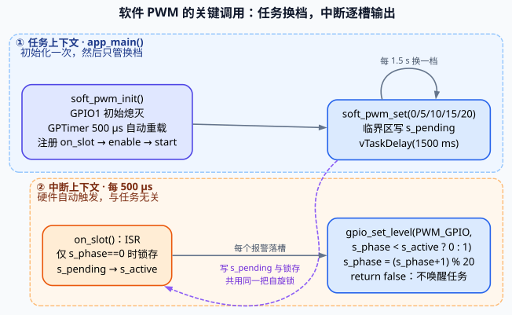
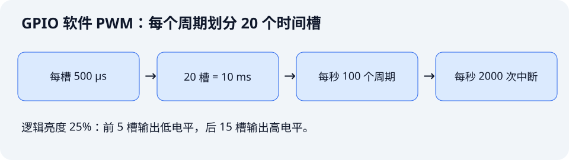

闪灯改变的是人能看清的亮灭状态；PWM 则把一个短周期分成亮和灭两部分，通过改变点亮时间比例调节平均亮度。本课用 GPTimer 中断逐槽写 GPIO，做出 0%、25%、50%、75%、100% 五档亮度。

配套工程：[`examples/10-software-pwm`](https://github.com/Rainboylvx/esp32-learning-code/tree/main/examples/10-software-pwm)。当前代码已在默认配置的隔离副本中通过 ESP-IDF v5.5.5 编译，本次未烧录；亮度、频率和抖动尚待实板验收。

> [!INFO] 与教材第 17 章的区别
> 教材“SW_PWM”使用 LEDC 生成波形，由软件调用 API 更新占空比。本课进一步拆解波形生成过程，在 GPTimer 中断中用软件决定 GPIO 的高低电平。理解两者后，再进入第 11 课的 LEDC 硬件渐变。

## 一图看懂关键调用

实线表示同一执行路径上的顺序，虚线表示锁共享或硬件触发；蓝色区域是任务上下文，橙色区域是中断上下文。图源为 [`call-flow.dot`](./assets/10-software-pwm/call-flow.dot)，用 `dot -Tsvg call-flow.dot -o call-flow.svg` 重新生成。



任务只更新目标并等待展示时间，逐槽 GPIO 输出由 ISR 持续执行。`soft_pwm_set()` 不立即改当前周期，下一次相位归零才锁存目标。每槽 500 μs、每周期 20 槽，得到 100 Hz PWM；GPTimer 中断频率是 2000 Hz。

## 1. GPIO1 的有效电平决定占空比怎么解释


板载红色 LED 低电平点亮。因此本课约定“逻辑亮度”是**低电平占整个周期的比例**。示波器按高电平计算的 duty 会与它互补。

| 逻辑亮度 | 低电平槽数 | 高电平槽数 | 预期现象 |
| --- | --- | --- | --- |
| 0% | 0 | 20 | 熄灭 |
| 25% | 5 | 15 | 较暗 |
| 50% | 10 | 10 | 中间亮度 |
| 75% | 15 | 5 | 较亮 |
| 100% | 20 | 0 | 常亮 |

真实视觉亮度与 duty 不成简单线性关系。实验要观察各档亮度是否有变化；50% duty 并不表示人眼感受到的亮度恰好是一半。

## 2. 先算清频率、时间槽与中断负担



本例每 500 us 进入一次 GPTimer 报警回调，每周期 20 槽：

```text
PWM 周期 = 500 us × 20 = 10000 us = 10 ms
PWM 频率 = 1 / 10 ms = 100 Hz
逻辑亮度步长 = 1 / 20 = 5%
中断频率 = 100 Hz × 20 = 2000 次/秒
```

20 槽提供包含两端在内的 21 个逻辑亮度值。这是按槽数描述的分辨率，不应称为“20 位分辨率”。

如果希望同时做到 1 kHz PWM 和 256 槽，就要每秒执行 256000 次中断，单槽仅约 3.9 us。中断处理和函数调用很容易占满这段时间，因此本课采用较保守的教学参数，不追求高频、高精度。

## 3. BSP 如何逐槽产生波形

`components/BSP/SOFT_PWM` 独占 GPIO1 和 GPTimer，向应用提供两个接口：

```c
// 初始化硬件并启动软件 PWM，默认熄灭。
void soft_pwm_init(void);
// 设置下一周期的点亮槽数，有效范围 0..20。
void soft_pwm_set(unsigned slots_on);
```

`PWM_GPIO` 在 `soft_pwm.c` 中定义为 `GPIO_NUM_1`。GPTimer 配置为 1 MHz，每计数一次是 1 us；报警值为 500，未写出的重载值默认为 0。回调的关键部分是：

```c
// s_phase 依次经过 0..19，前 s_active 个槽点亮。
gpio_set_level(PWM_GPIO, s_phase < s_active ? 0 : 1);
s_phase = (s_phase + 1) % SOFT_PWM_SLOTS;
```

ISR 不等待、不分配内存、不打印日志。这里必须在 ISR 写 GPIO：如果每个槽都先通知任务，再由任务写 GPIO，调度延迟会进一步破坏波形。

ISR 中只保留锁存目标值、输出电平和推进相位三项操作，其他业务仍应放在任务中。

## 4. 新占空比为什么到下一周期才生效

假设当前周期已经走到第 12 槽，此时把亮度从 25% 改为 75%。如果直接修改当前比较值，后半周期可能突然再次点亮，出现一个周期内两段低电平。

本例区分两个变量：

- `s_pending`：任务刚提交的新目标。
- `s_active`：当前周期已经锁存的目标。

```c
if (s_phase == 0) {
    // ISR 与任务共享 pending，使用同一把自旋锁保护。
    portENTER_CRITICAL_ISR(&s_lock);
    s_active = s_pending;
    portEXIT_CRITICAL_ISR(&s_lock);
}
```

任务通过对应的 `portENTER_CRITICAL()` 写入 `s_pending`。ESP32-S3 是双核，不能用一个 `volatile` 就宣称共享访问安全。`s_phase`、`s_active` 则只由 ISR 修改。

新目标最迟在下一个 PWM 周期边界锁存。因此，从任务提交目标到输出生效，可能相差接近 10 ms。

## 5. 亮度演示任务

```c
const unsigned levels[] = {0, 5, 10, 15, 20};
while (1) {
    for (unsigned i = 0; i < sizeof(levels) / sizeof(levels[0]); ++i) {
        soft_pwm_set(levels[i]);
        // 停留 1.5 秒便于观察档位，PWM ISR 会继续运行。
        vTaskDelay(pdMS_TO_TICKS(1500));
    }
}
```

`soft_pwm_init()` 在进入展示循环前调用一次。这里没有同时处理按键，所以允许任务等待一个档位的展示时间。如果之后加按键控制，应参考第 09 课的时间戳状态机，避免让同一个业务任务睡满 1.5 秒。

## 6. 软件 PWM 的边界

GPTimer 自动重载稳定地安排报警，但 GPIO 仍是 CPU 执行代码后才改变。中断被延迟时，实际脉冲宽度就会改变；延迟过久也不能保证补执行所有历史时间槽。

工程没有启用 GPTimer cache safe 模式，Flash cache 不可用时中断可能延后。不要把本例作为 Flash 写入期间仍然严格连续的波形源。也不能只加 `IRAM_ATTR` 就声称安全，还需要检查驱动、GPIO 操作和数据放置。

100 Hz 只是教学参数，移动视线或用相机拍摄仍可能看见闪烁或条纹。实际产品需要结合负载、视觉要求与功耗选频率，连续 LED 调光优先使用 LEDC。

## 用到的 GPTimer、GPIO 与临界区函数查询表

名称链接到 ESP-IDF v5.5.5 官方文档或该版本源码。表中的调用环境按本课用法标注；带 `FromISR` 的接口用于中断，普通任务接口不能直接搬进 ISR。

| 函数或宏 | 本课用途 | 调用环境 |
| --- | --- | --- |
| [`gptimer_new_timer()`](https://docs.espressif.com/projects/esp-idf/en/v5.5.5/esp32s3/api-reference/peripherals/gptimer.html#gptimer_8h_1a0ff72b8504c944a4db511e0c71e50922) | 按配置申请硬件定时器 | 普通任务，不能在 ISR 中调用 |
| [`gptimer_register_event_callbacks()`](https://docs.espressif.com/projects/esp-idf/en/v5.5.5/esp32s3/api-reference/peripherals/gptimer.html#gptimer_8h_1ace2479ceae75e79c2730d8ef0552642d) | 注册报警回调和用户参数 | 普通任务，不能在 ISR 中调用 |
| [`gptimer_set_alarm_action()`](https://docs.espressif.com/projects/esp-idf/en/v5.5.5/esp32s3/api-reference/peripherals/gptimer.html#gptimer_8h_1a33aa960104b3358d5ae87e320770c8fd) | 设置报警计数、重载值与自动重载 | 本课在任务中配置；驱动也支持 ISR 调用 |
| [`gptimer_enable()`](https://docs.espressif.com/projects/esp-idf/en/v5.5.5/esp32s3/api-reference/peripherals/gptimer.html#gptimer_8h_1a7433ec78be15278588d5ce83bc446cb9) | 使能定时器及相关资源 | 普通任务，不能在 ISR 中调用 |
| [`gptimer_start()`](https://docs.espressif.com/projects/esp-idf/en/v5.5.5/esp32s3/api-reference/peripherals/gptimer.html#gptimer_8h_1a1f37cb270dd5ca60f192e7fd21105c66) | 开始计数 | 本课在任务中启动；驱动也支持 ISR 调用 |
| [`gpio_config()`](https://docs.espressif.com/projects/esp-idf/en/v5.5.5/esp32s3/api-reference/peripherals/gpio.html#gpio_8h_1a994c5b8ab2930c7cb0e13427bba38658) | 把 GPIO1 配置为输出 | 普通任务，不能在 ISR 中调用 |
| [`gpio_set_level()`](https://docs.espressif.com/projects/esp-idf/en/v5.5.5/esp32s3/api-reference/peripherals/gpio.html#gpio_8h_1afadd72970c01a00f25df734eba0d2b29) | 在每个时间槽写 GPIO1 电平 | 本课在任务初始化及 GPTimer ISR 中调用 |
| [`portENTER_CRITICAL()`](https://github.com/espressif/esp-idf/blob/v5.5.5/components/freertos/FreeRTOS-Kernel/portable/xtensa/include/freertos/portmacro.h#L451) | 任务中进入共享数据临界区 | 任务中，与同一把自旋锁配对 |
| [`portEXIT_CRITICAL()`](https://github.com/espressif/esp-idf/blob/v5.5.5/components/freertos/FreeRTOS-Kernel/portable/xtensa/include/freertos/portmacro.h#L452) | 任务中退出共享数据临界区 | 任务中，与进入操作配对 |
| [`portENTER_CRITICAL_ISR()`](https://github.com/espressif/esp-idf/blob/v5.5.5/components/freertos/FreeRTOS-Kernel/portable/xtensa/include/freertos/portmacro.h#L460) | ISR 中进入共享数据临界区 | ISR 中，与同一把自旋锁配对 |
| [`portEXIT_CRITICAL_ISR()`](https://github.com/espressif/esp-idf/blob/v5.5.5/components/freertos/FreeRTOS-Kernel/portable/xtensa/include/freertos/portmacro.h#L461) | ISR 中退出共享数据临界区 | ISR 中，与进入操作配对 |
| [`vTaskDelay()`](https://docs.espressif.com/projects/esp-idf/en/v5.5.5/esp32s3/api-reference/system/freertos_idf.html#task_8h_1a9917b05abb77e75e959151ae67065dce) | 按 tick 数阻塞当前任务 | 普通任务，不能在 ISR 中调用 |
| [`pdMS_TO_TICKS()`](https://github.com/espressif/esp-idf/blob/v5.5.5/components/freertos/FreeRTOS-Kernel/include/freertos/projdefs.h#L46) | 毫秒换算为 tick 数 | 计算宏，不会延时 |

### 定时器参数与生命周期

`gptimer_new_timer(&config, &timer)` 从配置读取时钟源、计数方向和 `resolution_hz`，通过第二个参数写回句柄。成功返回 `ESP_OK`；没有空闲硬件可返回 `ESP_ERR_NOT_FOUND`，内存不足可返回 `ESP_ERR_NO_MEM`。

`gptimer_register_event_callbacks(timer, &callbacks, user_ctx)` 为该实例注册回调，第三个参数会原样传给回调。它必须在使能之前调用。`gptimer_set_alarm_action(timer, &alarm)` 设置 `alarm_count`、`reload_count` 与自动重载标志，计数值不是直接以毫秒表示的时间。

`gptimer_enable(timer)` 准备资源，`gptimer_start(timer)` 才开始计数。这几项配置和控制接口成功返回 `ESP_OK`，参数或生命周期状态不符时按接口返回 `ESP_ERR_INVALID_ARG`、`ESP_ERR_INVALID_STATE` 等错误。

本课分辨率为 1 MHz，报警值 500、重载值 0，每 500 μs 进入一次 `on_slot`。回调没有唤醒任务，返回 `false`，无需请求任务切换。

### GPIO 参数与有效电平

`gpio_config(&gpio)` 读取输出模式和引脚位掩码；`gpio_set_level(GPIO_NUM_1, level)` 的两个参数是引脚号和电平，`0` 点亮、`1` 熄灭。两者成功返回 `ESP_OK`，参数错误返回 `ESP_ERR_INVALID_ARG`。`gpio_set_level()` 可以在 ISR 中调用，但本工程未启用 cache safe 模式，不能由此推断 Flash cache 关闭时波形仍连续。

### 同一把锁的两套入口

四个临界区宏都接收 `&s_lock`，没有返回值。任务使用不带 `_ISR` 的入口和出口，中断使用带 `_ISR` 的版本，必须配对并操作同一把锁。这里只保护 `s_pending` 的短暂读写，不在锁内延时、打印或等待其他资源。

`portMUX_TYPE` 是锁类型，`portMUX_INITIALIZER_UNLOCKED` 把它初始化为未占用状态；两者不是函数。相关宏定义见表中的官方 `portmacro.h` 链接。

### 档位展示与 BSP 接口

`soft_pwm_init()`、`soft_pwm_set(slots_on)` 均返回 `void`。后者接受 0..20 点亮槽数，越界时直接忽略，不返回错误码；合法目标写入 `s_pending`，在下一 PWM 周期边界锁存。

### tick、毫秒与等待时间

`pdMS_TO_TICKS(ms)` 返回按 tick 频率换算的 tick 数，不会让任务等待。`vTaskDelay(ticks)` 才会阻塞当前任务，没有返回值；时间受 tick 粒度和调度影响，不能把毫秒换算结果当成精确的物理延时。

本课用 `vTaskDelay(pdMS_TO_TICKS(1500))` 展示每档亮度。任务阻塞时，GPTimer 中断继续逐槽输出。

### 当前代码的接口与错误处理

| 本工程接口 | 用途与条件 | 返回类型 |
| --- | --- | --- |
| `soft_pwm_init()` | 配置 GPIO1 与 GPTimer，输出初始熄灭 | `void` |
| `soft_pwm_set(slots_on)` | 合法范围 0..20；越界直接忽略，合法值在周期边界生效 | `void` |

这些接口属于配套工程 BSP 或业务代码，不是同名的 ESP-IDF 底层 API。返回 `void` 的接口没有可检查的返回值，不能直接放进 `ESP_ERROR_CHECK()`。

当前教学版省略了多项初始化、资源创建和驱动调用的返回值检查。查询表保留底层 API 的成功与失败返回值，表示接口本身的约定；不代表当前源码已经检查。若要补齐，应在 BSP 内处理底层错误、按需返回 `esp_err_t`，并单独判断 FreeRTOS 创建结果。

## 7. 编译、烧录与测量

```bash
# 激活 IDF 后构建本课。
source ~/.espressif/tools/activate_idf_v5.5.5.sh
cd ~/mycode/esp32-blog/examples/10-software-pwm
idf.py build
# 用实际端口烧录并查看每 1.5 秒一次的亮度档位日志。
idf.py -p <实际串口> flash monitor
```

预期日志依次为 `logical brightness=0%`、`25%`、`50%`、`75%`、`100%`，然后循环。肉眼检查五档变化；有仪器时，将探头接 GPIO1，地接板上 GND，观察约 10 ms 周期。

25% 逻辑亮度时，预期低电平约 2.5 ms，高电平约 7.5 ms；0% 和 100% 是稳定电平，不能要求它们仍然有 PWM 边沿。不要把 GPIO 接入超过 3.3V 的外部驱动信号。

完成标准：能设置任意 0..20 槽、看到档位变化，并解释 `f_ISR = f_PWM × 槽数`。测量值与理论值不同时，应分别检查参数和中断延迟；仅凭串口日志无法判断波形是否合格。

对照教材：第 17 章的 `ledc_set_duty()` 和 `ledc_update_duty()` 只在软件侧修改目标，波形始终由 LEDC 硬件产生。本课的 GPIO 写入频率随槽数增加，是为了展示真正的软件逐槽 PWM 成本。

相关依据：[GPTimer 驱动与回调约束](https://docs.espressif.com/projects/esp-idf/en/v5.5.5/esp32s3/api-reference/peripherals/gptimer.html)、[LEDC 软件更新占空比接口](https://docs.espressif.com/projects/esp-idf/en/v5.5.5/esp32s3/api-reference/peripherals/ledc.html)。

下一课：[LEDC 硬件 PWM：制作平滑呼吸灯](./11-ledc-hardware-fade.md)。
