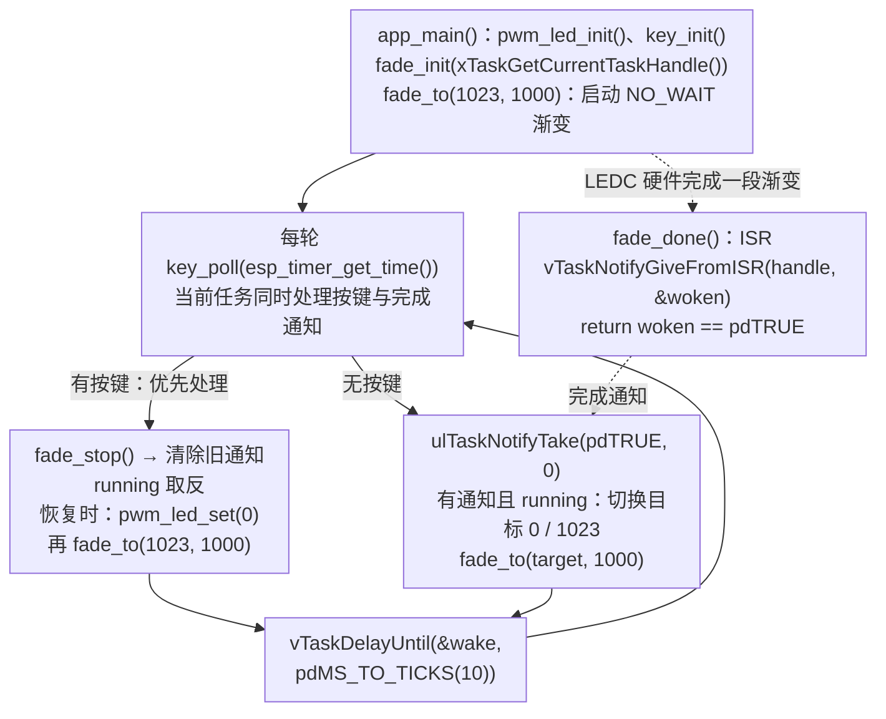

这一课跟学教材第 18 章，用 LEDC 产生 PWM，并由硬件渐变单元自动改变占空比。红色 LED 约 1 秒渐亮、1 秒渐暗；BOOT 可以暂停，再按一次从暗端重新开始。

配套工程：[`examples/11-ledc-hardware-fade`](https://github.com/Rainboylvx/esp32-learning-code/tree/main/examples/11-ledc-hardware-fade)。当前代码已在默认配置的隔离副本中通过 ESP-IDF v5.5.5 编译，本次未烧录；本课的实板渐变、按键和波形尚未验收。

## 一图看懂关键调用

实线表示同一执行路径上的顺序，虚线表示任务调度、回调触发或消息传递；它们不表示跨任务的直接函数调用。



本课直接使用运行 `app_main()` 的任务，不另外创建 LED 任务。`fade_init()` 注册完成回调；`fade_to()` 内部依次调用 `ledc_set_fade_with_time()`、`ledc_fade_start(..., LEDC_FADE_NO_WAIT)`。按键分支与完成通知分支是 `if / else if`，暂停时保留亮度，恢复时从暗端重启。

## 1. 两种频率分别控制什么


本例的 PWM 载波是 5 kHz，每个 PWM 周期为 200 us；亮度从暗到亮则需要约 1 秒。载波周期和渐变时长要分开理解。

第 10 课需要每秒 2000 次中断决定 GPIO 电平。这里持续波形交给 LEDC，任务只在一段渐变完成后安排下一段，并按短节拍处理输入。

## 2. 定时器决定频率，通道决定输出引脚

```c
void pwm_led_init(void)
{
    ledc_timer_config(&(ledc_timer_config_t){
        .speed_mode = LEDC_LOW_SPEED_MODE, // S3 的 LEDC 仅支持低速模式。
        .duty_resolution = LEDC_TIMER_10_BIT,
        .timer_num = LEDC_TIMER_0, .freq_hz = 5000, .clk_cfg = LEDC_AUTO_CLK,
    });
    // 硬件反相：内部 duty 越大，GPIO1 低电平时间越长，LED 越亮。
    ledc_channel_config(&(ledc_channel_config_t){
        .gpio_num = 1, .speed_mode = LEDC_LOW_SPEED_MODE, .channel = LEDC_CHANNEL_0,
        .timer_sel = LEDC_TIMER_0, .flags.output_invert = 1,
    });
}
```

ESP32-S3 的 LEDC 只支持低速模式。“低速”是外设模式名称，不代表只能生成低频信号。10 位占空比分辨率，本例使用 0..1023 的安全范围；不要把 10 位当成 10 档，也不要无条件把 `1 << bits` 当最大可用值。

初始化先调用 `ledc_timer_config()`，再调用 `ledc_channel_config()`。通道配置中的 `duty`、`hpoint` 未显式填写，复合字面量将它们初始化为 0；`output_invert=1` 使低电平点亮的 LED 保持“目标值越大越亮”的方向。

这样，应用传给 BSP 的亮度值越大，LED 就越亮，无需在应用中逐个取反。0 对应熄灭，1023 接近全亮；在这个取值约定下最大值并非严格 100% 点亮，肉眼通常难以分辨，但测量时要知道差异。

同一个 GPIO1 已经被 LEDC 接管，不能同时再运行第 10 课的 GPIO 软件 PWM，或让别的任务直接调用 `gpio_set_level()` 来竞争输出。

## 3. 非阻塞地发起一段硬件渐变

`PWM_LED` 封装硬件初始化和亮度输出，`fade.c` 封装渐变功能：

```c
void fade_init(TaskHandle_t receiver)
{
    ledc_fade_func_install(0);
    ledc_cb_register(LEDC_LOW_SPEED_MODE, LEDC_CHANNEL_0,
                     &(ledc_cbs_t){.fade_cb = fade_done}, receiver);
}

void fade_to(uint32_t brightness, int duration_ms)
{
    // 越界亮度或零时长直接忽略，否则暂停/继续的逻辑状态会与实际 PWM 脱节。
    if (brightness > PWM_LED_MAX || duration_ms <= 0) return;
    ledc_set_fade_with_time(LEDC_LOW_SPEED_MODE, LEDC_CHANNEL_0, brightness, duration_ms);
    ledc_fade_start(LEDC_LOW_SPEED_MODE, LEDC_CHANNEL_0, LEDC_FADE_NO_WAIT);
}
```

`LEDC_FADE_NO_WAIT` 允许发起任务继续处理按键；`LEDC_FADE_WAIT_DONE` 则等待渐变完成。硬件完成时间受步进量化影响，所以参数中的 1000 ms 是目标时间，不宜写成实测精确时长。

## 4. 完成回调只通知任务

```c
static bool IRAM_ATTR fade_done(const ledc_cb_param_t *event, void *arg)
{
    (void)event;
    BaseType_t woken = pdFALSE;
    // 渐变完成回调在 ISR；只通知任务，由任务启动下一段渐变。
    vTaskNotifyGiveFromISR((TaskHandle_t)arg, &woken);
    return woken == pdTRUE;
}
```

应用每轮检查通知，如果渐亮完成，就把下一目标改成 0；渐暗完成，再改成 1023。只有应用任务启动、停止渐变并更新目标，避免多个任务同时操作一个通道。

回调放在 IRAM，通知对象使用默认配置下位于内部 RAM 的任务句柄；不在回调中访问 Flash 字符串或外部 RAM。若以后改变内存配置，还需要检查整条 ISR 调用链和上下文数据。

```c
// 零等待读取通知，因此检查本身不会阻塞按键。
if (ulTaskNotifyTake(pdTRUE, 0) && running) {
    target = target == PWM_LED_MAX ? 0 : PWM_LED_MAX;
    fade_to(target, 1000);
}
```

使用 `NO_WAIT` 后，启动调用无需等待渐变完成，但仍不能随意重写正在渐变的同一个通道。修改前要按芯片和驱动支持的方式停止旧操作。

## 5. BOOT 如何及时暂停渐变

本例复用第 09 课基于时间戳的 20 ms 消抖，每 10 ms 扫描一次。按键事件优先于当前轮的完成通知：

```c
fade_stop(); // ESP32-S3 支持中止 NO_WAIT 渐变。
ulTaskNotifyTake(pdTRUE, 0);  // 丢弃已经排队的旧完成通知。
running = !running;
```

暂停时保留当前亮度；再次按下时，先设置亮度为 0，再启动到 1023 的新渐变。从暗端重新开始，便于观察重新启动的过程，也能避免在终点暂停后启动零距离渐变，难以判断完成事件。

`ledc_fade_stop()` 依赖芯片能力。ESP32-S3 支持，不能假定其他 ESP32 型号都支持。停止返回后输出的稳定也有硬件周期边界，不能把它当成零延迟电平开关。

BOOT 电路仍是 GPIO0 按下接地。程序正常启动后再测试，不要按住 BOOT 复位。按键与 GPIO1 无需额外接线。

## 6. 源码分层与依赖

```text
components/BSP/
├── KEY/key.c、key.h       # 输出一次稳定按下事件
└── PWM_LED/
    ├── pwm_led.c、pwm_led.h # 初始化、逻辑亮度映射
    └── fade.c、fade.h       # 渐变服务、完成通知和停止
main/main.c                 # 暂停状态、渐变方向、输入调度
```

下面是实际 `app_main()`：它复用当前任务，通过 `if / else if` 让按键分支优先于本轮的完成通知。

```c
void app_main(void)
{
    pwm_led_init();
    key_init();
    fade_init(xTaskGetCurrentTaskHandle()); // 完成通知投递给本任务
    bool running = true;
    uint32_t target = PWM_LED_MAX;
    fade_to(target, 1000);
    TickType_t wake = xTaskGetTickCount();
    while (1) {
        bool pressed = key_poll(esp_timer_get_time());
        if (pressed) {
            // 先终止旧渐变，再清除已排队的完成通知，防止误启动下一段。
            fade_stop();
            ulTaskNotifyTake(pdTRUE, 0);
            running = !running;
            if (running) {
                // 从暗端重新开始，避免暂停恰好落在终点时发起零距离渐变。
                pwm_led_set(0);
                target = PWM_LED_MAX;
                fade_to(target, 1000);
            }
            ESP_LOGI("fade", "%s", running ? "restart" : "paused");
        } else if (ulTaskNotifyTake(pdTRUE, 0) && running) {
            target = target == PWM_LED_MAX ? 0 : PWM_LED_MAX;
            fade_to(target, 1000);
        }
        // PWM 和渐变由硬件继续执行；任务每 10 ms 检查按键和完成事件。
        vTaskDelayUntil(&wake, pdMS_TO_TICKS(10));
    }
}
```

`main` 依赖 `BSP esp_timer freertos`；BSP 实现依赖 `esp_driver_ledc esp_driver_gpio freertos`。自建模块的头文件不要也命名为 `ledc.h`，以免需要依靠包含顺序区分。本例使用 `pwm_led.h`，便于与官方驱动区分。

## 用到的 LEDC 与任务通知 函数查询表

名称链接到 ESP-IDF v5.5.5 官方文档或该版本源码。表中的调用环境按本课用法标注；带 `FromISR` 的接口用于中断，普通任务接口不能直接搬进 ISR。

| 函数或宏 | 本课用途 | 调用环境 |
| --- | --- | --- |
| [`ledc_timer_config()`](https://docs.espressif.com/projects/esp-idf/en/v5.5.5/esp32s3/api-reference/peripherals/ledc.html#ledc_8h_1ac03b21c3f48674c5017d09808a7eaf7b) | 配置 5 kHz、10 位 PWM 定时器 | 普通任务，不能在 ISR 中调用 |
| [`ledc_channel_config()`](https://docs.espressif.com/projects/esp-idf/en/v5.5.5/esp32s3/api-reference/peripherals/ledc.html#ledc_8h_1a1f64acaab8033c9de1dde3f4c111fb6d) | 将通道、定时器和 GPIO1 关联 | 普通任务，不能在 ISR 中调用 |
| [`ledc_set_duty()`](https://docs.espressif.com/projects/esp-idf/en/v5.5.5/esp32s3/api-reference/peripherals/ledc.html#ledc_8h_1a1a4d1fbfae9233199a2d463c58551235) | 设置目标占空比 | 本课由应用任务调用，不与渐变并发写同一通道 |
| [`ledc_update_duty()`](https://docs.espressif.com/projects/esp-idf/en/v5.5.5/esp32s3/api-reference/peripherals/ledc.html#ledc_8h_1a919a48a0b2456c07be9cac72fc6c8b4a) | 使设置的占空比更新到输出 | 本课由应用任务调用 |
| [`ledc_fade_func_install()`](https://docs.espressif.com/projects/esp-idf/en/v5.5.5/esp32s3/api-reference/peripherals/ledc.html#ledc_8h_1ae96eee7a81d019cfc0f2c3d74c047004) | 安装渐变服务 | 普通任务，不能在 ISR 中调用 |
| [`ledc_cb_register()`](https://docs.espressif.com/projects/esp-idf/en/v5.5.5/esp32s3/api-reference/peripherals/ledc.html#ledc_8h_1a2a52a47a74186acb7337b0f637b42e10) | 为通道注册渐变完成回调 | 普通任务，不能在 ISR 中调用 |
| [`ledc_set_fade_with_time()`](https://docs.espressif.com/projects/esp-idf/en/v5.5.5/esp32s3/api-reference/peripherals/ledc.html#ledc_8h_1a42e08eec8bddf8ba7c6d0937bae1d15f) | 设置下一段渐变目标与时长 | 普通任务，不能在 ISR 中调用 |
| [`ledc_fade_start()`](https://docs.espressif.com/projects/esp-idf/en/v5.5.5/esp32s3/api-reference/peripherals/ledc.html#ledc_8h_1ab08f273c6d9047c84d6cfd7f1efcab10) | 启动设置好的渐变 | 普通任务，不能在 ISR 中调用 |
| [`ledc_fade_stop()`](https://docs.espressif.com/projects/esp-idf/en/v5.5.5/esp32s3/api-reference/peripherals/ledc.html#ledc_8h_1a921d16d1daa8b5037d2e1cef1ea497a3) | 中止 NO_WAIT 渐变 | 普通任务，不能在 ISR 中调用 |
| [`xTaskGetCurrentTaskHandle()`](https://github.com/espressif/esp-idf/blob/v5.5.5/components/freertos/FreeRTOS-Kernel/include/freertos/task.h#L2893) | 取得接收完成通知的当前任务句柄 | 普通任务，不能在 ISR 中调用 |
| [`vTaskNotifyGiveFromISR()`](https://docs.espressif.com/projects/esp-idf/en/v5.5.5/esp32s3/api-reference/system/freertos_idf.html#task_8h_1a1add9ef24d3763e34603b18802fae9d7) | 从中断通知指定任务 | ISR 中，不能阻塞 |
| [`ulTaskNotifyTake()`](https://github.com/espressif/esp-idf/blob/v5.5.5/components/freertos/FreeRTOS-Kernel/include/freertos/task.h#L2530) | 读取并处理当前任务的通知计数 | 普通任务，不能在 ISR 中调用 |
| [`esp_timer_get_time()`](https://docs.espressif.com/projects/esp-idf/en/v5.5.5/esp32s3/api-reference/system/esp_timer.html#esp__timer_8h_1ab38881d22858adab666843cee4ba6589) | 读取单调时间，单位微秒 | 本课在任务中读取；也可在 ISR 中读取 |
| [`xTaskGetTickCount()`](https://docs.espressif.com/projects/esp-idf/en/v5.5.5/esp32s3/api-reference/system/freertos_idf.html#task_8h_1a5fa24e36d5e1eeb57f5b73b72ea048e7) | 读取系统 tick 计数 | 普通任务，不能在 ISR 中调用 |
| [`vTaskDelayUntil()`](https://github.com/espressif/esp-idf/blob/v5.5.5/components/freertos/FreeRTOS-Kernel/include/freertos/task.h#L905) | 相对计划唤醒时间维持扫描节拍 | 普通任务，不能在 ISR 中调用 |
| [`pdMS_TO_TICKS()`](https://github.com/espressif/esp-idf/blob/v5.5.5/components/freertos/FreeRTOS-Kernel/include/freertos/projdefs.h#L46) | 毫秒换算为 tick 数 | 计算宏，不会延时 |

### 定时器、通道与直接亮度更新

`ledc_timer_config(&timer)` 接收模式、定时器编号、频率和分辨率配置；本课是低速模式、定时器 0、5000 Hz、10 位。`ledc_channel_config(&channel)` 再指定 GPIO1、通道 0、定时器 0、初始 duty 和输出反相。

`ledc_set_duty(mode, channel, duty)` 设置目标，`ledc_update_duty(mode, channel)` 提交更新。这里 mode 为 `LEDC_LOW_SPEED_MODE`，channel 为 `LEDC_CHANNEL_0`，逻辑亮度使用 0..1023。配置和更新接口成功返回 `ESP_OK`；参数错误、资源未初始化等失败情况按接口返回错误码，应逐项检查。

`pwm_led_set()` 是 BSP 封装，内部依次调用设置和更新接口；本课重新开始呼吸前用它把亮度置为 0。正在运行的渐变要先停止，再修改同一通道。

### 渐变服务、回调与目标时间

`ledc_fade_func_install(0)` 的参数是中断分配标志；本例传 `0`。成功返回 `ESP_OK`，内存不足可返回 `ESP_ERR_NO_MEM`。`ledc_cb_register(mode, channel, &callbacks, receiver)` 的最后一个参数会传给完成回调，本例用它保存接收任务句柄。注册成功返回 `ESP_OK`，通道未初始化可返回 `ESP_ERR_INVALID_STATE`。

`ledc_set_fade_with_time(mode, channel, target_duty, duration_ms)` 设置目标占空比和目标渐变毫秒数；`ledc_fade_start(mode, channel, LEDC_FADE_NO_WAIT)` 启动后立即返回，由硬件继续渐变。它们成功返回 `ESP_OK`，参数或初始化有误则返回错误码。`NO_WAIT`、`WAIT_DONE` 是等待方式枚举，不是函数。

`ledc_fade_stop(mode, channel)` 用于本课 ESP32-S3 的 NO_WAIT 渐变，成功返回 `ESP_OK`。函数返回后，输出最迟还需一个 PWM 周期才固定，不能按零延迟理解。`fade_init()`、`fade_to()` 和 `fade_stop()` 是 BSP 对这些接口的封装。

### 完成通知与按键扫描

`xTaskGetCurrentTaskHandle()` 无参数，返回调用者的 `TaskHandle_t`，本例即运行 `app_main()` 的任务。ISR 中的 `vTaskNotifyGiveFromISR(handle, &woken)` 无返回值，通过 `woken` 报告是否唤醒更高优先级任务；回调返回相应布尔值，由 LEDC 驱动处理切换请求。

`ulTaskNotifyTake(pdTRUE, 0)` 在当前任务中读取并清零通知计数，不等待，返回 `0` 表示没有完成通知。停止旧渐变后也用它清除已经到达的旧通知。

`esp_timer_get_time()` 提供微秒时间供按键消抖；`xTaskGetTickCount()` 初始化扫描用的 tick 基准。这两个时间单位不同。

### 固定节拍的两个参数

`vTaskDelayUntil(&wake, pdMS_TO_TICKS(10))` 的第一个参数指向保存计划唤醒时间的变量，第二个参数是每轮间隔 tick 数。先用 `xTaskGetTickCount()` 初始化 `wake`，后续调用会更新它，不要在每轮重新置为当前时间。

`vTaskDelayUntil()` 没有返回值。它在本版本中调用 `xTaskDelayUntil()` 并忽略返回值；后者返回 `pdTRUE` 表示本轮发生了延时，返回 `pdFALSE` 表示计划时刻已到、无需再阻塞。两者都不能保证超负载循环按时完成。

### 当前代码的接口与错误处理

| 本工程接口 | 用途与条件 | 返回类型 |
| --- | --- | --- |
| `pwm_led_init() / key_init()` | 配置 LEDC 输出和按键输入 | `void` |
| `key_poll(now_us)` | 稳定按下时返回 true；内部不延时 | `bool` |
| `fade_init(receiver)` | 安装渐变服务，注册向 receiver 发通知的完成 ISR | `void` |
| `fade_to(brightness, duration_ms)` | 启动目标渐变；亮度大于 1023 或时长非正时直接忽略 | `void` |
| `fade_stop()` | 请求停止 NO_WAIT 渐变 | `void` |
| `pwm_led_set(brightness)` | 直接设置并更新 duty；调用者保证 0..1023，BSP 不检查越界 | `void` |

这些接口属于配套工程 BSP 或业务代码，不是同名的 ESP-IDF 底层 API。返回 `void` 的接口没有可检查的返回值，不能直接放进 `ESP_ERROR_CHECK()`。

当前教学版省略了多项初始化、资源创建和驱动调用的返回值检查。查询表保留底层 API 的成功与失败返回值，表示接口本身的约定；不代表当前源码已经检查。若要补齐，应在 BSP 内处理底层错误、按需返回 `esp_err_t`，并单独判断 FreeRTOS 创建结果。

## 7. 构建、验收与常见问题

```bash
# 使用与前面课程一致的 IDF 版本。
source ~/.espressif/tools/activate_idf_v5.5.5.sh
cd ~/mycode/esp32-blog/examples/11-ledc-hardware-fade
idf.py build
# 换成实际端口；Ctrl+] 退出监视。
idf.py -p <实际串口> flash monitor
```

检查 LED 连续渐亮渐暗；在中间亮度按 BOOT，应该很快暂停；再按一次从暗端重新呼吸。持续按住不反复切换。需要量化响应时间时，应测量按键稳定到输出变化的间隔；肉眼观察无法给出精确延迟。

灯越来越暗却显示目标在增加，先查 `output_invert`；完全不动，先查 GPIO、LEDC 定时器和通道是否一致；只能渐亮一次，检查是否注册完成回调、是否处理通知、是否又启动了下一段。

教材第 18 章使用硬件渐变，本课保持这个核心，再增加“完成 ISR → 普通任务”的通知和可中止操作。频率、分辨率与渐变幅度采用本例自己的参数，BSP 对外统一逻辑亮度方向。

依据：[ESP-IDF v5.5.5 LEDC 文档](https://docs.espressif.com/projects/esp-idf/en/v5.5.5/esp32s3/api-reference/peripherals/ledc.html)及本机 v5.5.5 的 `driver/ledc.h`、ESP32-S3 `soc_caps.h`。

下一课：[阶段项目：按键切换呼吸灯模式](./12-key-breathing-modes.md)。
