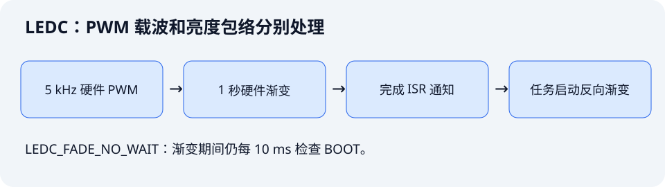

这一课跟学教材第 18 章，用 LEDC 产生 PWM，并由硬件渐变单元自动改变占空比。红色 LED 约 1 秒渐亮、1 秒渐暗；BOOT 可以暂停，再按一次从暗端重新开始。

配套工程：[`examples/11-ledc-hardware-fade`](https://github.com/Rainboylvx/esp32-learning-code/tree/main/examples/11-ledc-hardware-fade)。构建结果见文末，本课的实板渐变、按键和波形尚未验收。

## 1. 两种频率分别控制什么




本例的 PWM 载波是 5 kHz，每个 PWM 周期 200 us；亮度从暗到亮约 1 秒，两者不在同一个时间尺度上。

第 10 课需要每秒 2000 次中断决定 GPIO 电平。这里持续波形交给 LEDC，任务只在一段渐变完成后安排下一段，并按短节拍处理输入。

## 2. 定时器决定频率，通道决定输出引脚

```c
ledc_timer_config_t timer = {
    .speed_mode = LEDC_LOW_SPEED_MODE,
    .duty_resolution = LEDC_TIMER_10_BIT,
    .timer_num = LEDC_TIMER_0,
    .freq_hz = 5000,
    .clk_cfg = LEDC_AUTO_CLK,
};
```

ESP32-S3 的 LEDC 只支持低速模式。“低速”是外设模式名称，不代表只能生成低频信号。10 位占空比分辨率，本例使用 0..1023 的安全范围；不要把 10 位当成 10 档，也不要无条件把 `1 << bits` 当最大可用值。

先配置定时器，再配置通道：

```c
ledc_channel_config_t channel = {
    .gpio_num = 1,
    .speed_mode = LEDC_LOW_SPEED_MODE,
    .channel = LEDC_CHANNEL_0,
    .timer_sel = LEDC_TIMER_0,
    .duty = 0,
    .hpoint = 0,
    // 低电平点亮的 LED，在硬件输出端反相。
    .flags.output_invert = 1,
};
```

这样 BSP 继续保持“亮度值越大越亮”的接口。应用不需要把每个值重新取反。0 对应熄灭，1023 接近全亮；在这个取值约定下最大值并非严格 100% 点亮，肉眼通常难以分辨，但测量时要知道差异。

同一个 GPIO1 已经被 LEDC 接管，不能同时再运行第 10 课的 GPIO 软件 PWM，或让别的任务直接调用 `gpio_set_level()` 来竞争输出。

## 3. 非阻塞地发起一段硬件渐变

`PWM_LED` 封装硬件初始化和亮度输出，`fade.c` 封装渐变功能：

```c
// 先安装渐变服务，并注册本课自己的完成回调。
ESP_ERROR_CHECK(ledc_fade_func_install(0));

// 以下示意启动“1 秒渐亮”，实际模块封装为 fade_to()。
ESP_ERROR_CHECK(ledc_set_fade_with_time(LEDC_LOW_SPEED_MODE,
    LEDC_CHANNEL_0, PWM_LED_MAX, 1000));
ESP_ERROR_CHECK(ledc_fade_start(LEDC_LOW_SPEED_MODE,
    LEDC_CHANNEL_0, LEDC_FADE_NO_WAIT));
```

`LEDC_FADE_NO_WAIT` 允许发起任务继续处理按键；`LEDC_FADE_WAIT_DONE` 则等待渐变完成。硬件完成时间受步进量化影响，所以参数中的 1000 ms 是目标时间，不宜写成实测精确时长。

## 4. 完成回调只通知任务

```c
static bool IRAM_ATTR fade_done(const ledc_cb_param_t *event, void *arg)
{
    (void)event;
    BaseType_t woken = pdFALSE;
    // LEDC 完成回调在 ISR，不能在这里阻塞或执行按键业务。
    vTaskNotifyGiveFromISR((TaskHandle_t)arg, &woken);
    return woken == pdTRUE;
}
```

应用每轮检查通知，如果渐亮完成，就把下一目标改成 0；渐暗完成，再改成 1023。只有应用任务启动、停止渐变并更新目标，避免多个任务同时操作一个通道。

回调放在 IRAM，通知对象使用默认配置下位于内部 RAM 的任务句柄；不在回调中访问 Flash 字符串或外部 RAM。若以后改变内存配置，还需要检查整条 ISR 调用链和上下文数据。

```c
// 零等待读取通知，因此检查本身不会阻塞按键。
if (ulTaskNotifyTake(pdTRUE, 0) && running) {
    target = target == PWM_LED_MAX ? 0 : PWM_LED_MAX;
    ESP_ERROR_CHECK(fade_to(target, 1000));
}
```

`NO_WAIT` 解决的是启动调用等待完成的问题。它不表示可以在渐变中随意重写同一个通道；必须按照芯片和驱动的能力正确停止旧操作。

## 5. BOOT 如何及时暂停渐变

本例复用第 09 课基于时间戳的 20 ms 消抖，每 10 ms 扫描一次。按键事件优先于当前轮的完成通知：

```c
ESP_ERROR_CHECK(fade_stop()); // ESP32-S3 支持中止 NO_WAIT 渐变。
ulTaskNotifyTake(pdTRUE, 0);  // 丢弃已经排队的旧完成通知。
running = !running;
```

暂停时保留当前亮度；再次按下时，先设置亮度为 0，再启动到 1023 的新渐变。选择从暗端重新开始，是为了让重新启动的行为明确，也避免暂停刚好落在终点时启动零距离渐变而难以推断完成事件。

`ledc_fade_stop()` 依赖芯片能力。ESP32-S3 支持，不能假定其他 ESP32 型号都支持。停止返回后输出的稳定也有硬件周期边界，不能把它当成零延迟电平开关。

BOOT 电路仍是 GPIO0 按下接地。程序正常启动后再测试，不要按住 BOOT 复位。按键与 GPIO1 无需额外接线。

## 6. 源码分层与依赖

```text
components/BSP/
├── KEY/key.c、key.h       # 输出一次稳定按下事件
└── PWM_LED/
    ├── pwm_led.c、pwm_led.h # 初始化、逻辑亮度映射
    └── fade.c、fade.h       # 渐变服务、完成通知和停止
main/main.c                 # 暂停状态、渐变方向、输入调度
```

`main` 依赖 `BSP esp_timer freertos`；BSP 实现依赖 `esp_driver_ledc esp_driver_gpio freertos`。不要把官方模块名也命名为 `ledc.h` 再依赖包含顺序，本例使用 `pwm_led.h` 避免与驱动概念混淆。

## 7. 构建、验收与常见问题

```bash
# 使用与前面课程一致的 IDF 版本。
source ~/.espressif/tools/activate_idf_v5.5.5.sh
cd ~/mycode/esp32-blog/examples/11-ledc-hardware-fade
idf.py build
# 换成实际端口；Ctrl+] 退出监视。
idf.py -p <实际串口> flash monitor
```

检查 LED 连续渐亮渐暗；在中间亮度按 BOOT，应该很快暂停；再按一次从暗端重新呼吸。持续按住不反复切换。需要量化响应时，应测量按键稳定时刻与输出变化，不能仅凭肉眼写出精确延迟。

灯越来越暗却显示目标在增加，先查 `output_invert`；完全不动，先查 GPIO、LEDC 定时器和通道是否一致；只能渐亮一次，检查是否注册完成回调、是否处理通知、是否又启动了下一段。

教材第 18 章使用硬件渐变，本课保持这个核心，再增加“完成 ISR → 普通任务”的通知和可中止操作。频率、分辨率与渐变幅度采用本例自己的参数，BSP 对外统一逻辑亮度方向。

依据：[ESP-IDF v5.5.5 LEDC 文档](https://docs.espressif.com/projects/esp-idf/en/v5.5.5/esp32s3/api-reference/peripherals/ledc.html)及本机 v5.5.5 的 `driver/ledc.h`、ESP32-S3 `soc_caps.h`。

下一课：[阶段项目：按键切换呼吸灯模式](./12-key-breathing-modes.md)。
