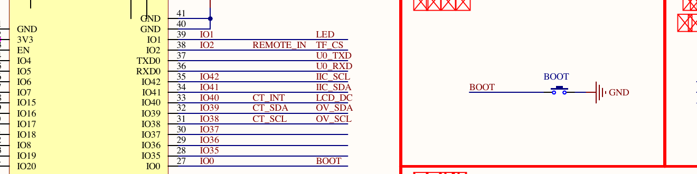
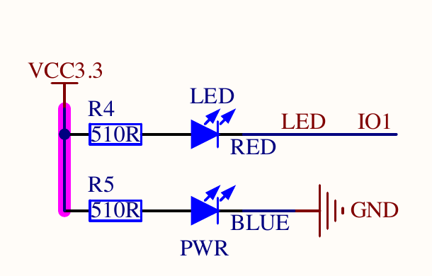
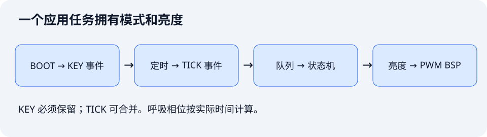

这一课把第 05～11 课组合成一个可继续扩展的程序：BOOT 产生事件，队列传递事件，状态机选择熄灭、常亮或呼吸模式，LEDC 持续输出 PWM。

配套工程：[`examples/12-key-breathing-modes`](https://github.com/Rainboylvx/esp32-learning-code/tree/main/examples/12-key-breathing-modes)。构建结果见文末，模式切换与实际视觉效果尚待实板验收。

## 1. 先写清可观察的行为

| 操作 | 模式 | LED 表现 |
| --- | --- | --- |
| 上电 | OFF | 熄灭 |
| 第一次稳定按下 BOOT | ON | 常亮 |
| 第二次按下 | BREATH | 从暗到亮，再从亮到暗循环 |
| 第三次按下 | OFF | 立即切到熄灭状态 |

持续按住只算一次按下。呼吸周期约 2 秒：前 1 秒渐亮，后 1 秒渐暗。输入检查约每 10 ms 一次，亮度刷新机会约每 20 ms 一次；按键事件到达后直接计算新模式输出，不必等下一次刷新 tick。

## 2. 硬件仍然只有 BOOT 和红色 LED





原理图约定：GPIO0 按下为低；GPIO1 低电平点亮。KEY 使用内部上拉；PWM BSP 在硬件输出端反相，因此业务亮度 0 表示灭、1023 表示最大亮度。

不要让其他 GPIO/PWM 模块同时控制 GPIO1。正常启动后再测试 BOOT；按住它复位可能进入下载模式。

## 3. 事件从哪里来，谁可以改状态



| 模块 | 输入 | 输出 | 不承担的业务 |
| --- | --- | --- | --- |
| KEY BSP + 输入任务 | GPIO0 | `EVENT_KEY` | 不决定 LED 模式 |
| 默认 `esp_timer` 回调 | 每 20 ms 到期 | `EVENT_TICK` | 不设置亮度 |
| 应用任务 | 队列事件、单调时间 | 模式、目标亮度 | 不直接操作引脚 |
| PWM BSP | 0..1023 亮度 | LEDC 输出 | 不读取按键或时钟 |

只有应用任务拥有 `app_model_t` 和修改 PWM 的权限。KEY 和定时器没有共享“当前模式”变量，这样就不会出现两个回调同时写模式或占空比的问题。

## 4. 把状态机写成可以单独理解的普通 C

`main/app_model.h` 不包含任何 ESP-IDF 头文件：

```c
typedef enum { APP_OFF, APP_ON, APP_BREATH } app_mode_t;
typedef struct {
    app_mode_t mode;
    int64_t entered_at_us;
} app_model_t;
```

按键事件使模式前进，并记录进入新状态的时间：

```c
// 时间由调用者传入，业务层不调用 esp_timer。
model->mode = (model->mode + 1) % 3;
model->entered_at_us = now_us;
```

计算输出时，OFF 返回 0，ON 返回 1023，BREATH 根据经过时间计算亮度。

## 5. 呼吸曲线按真实时间计算

```c
// 2 秒一周期，前后各 1 秒。phase 和 ramp 单位都是微秒。
int64_t phase = (now_us - model->entered_at_us) % 2000000;
int64_t ramp = phase <= 1000000 ? phase : 2000000 - phase;
// 近似平方曲线，改善低亮度的层次；不是严格的视觉 gamma 校准。
return (uint32_t)(ramp * ramp * 1023 / 1000000000000LL);
```

`ramp` 从 0 增加到 1000000，再降到 0。乘法在 64 位整数中计算，避免用 32 位整数先乘导致溢出。调用者保证 `now_us` 不早于进入状态的时间。

即使某次刷新延后，下一次也按真实时间得到当前亮度，不会因为少处理几个 tick 就把整个呼吸周期拖慢。刷新过慢仍会造成肉眼可见的跳变；时间计算能避免相位累计误差，不能凭空补出未显示的中间亮度。

## 6. 为什么这一课没有继续等待硬件渐变完成

第 11 课已经练习硬件 fade。本项目使用“软件更新亮度包络 + LEDC 硬件生成载波”：状态机每 20 ms 左右提供一次目标亮度，5 kHz PWM 仍由硬件持续输出。

这样一次模式切换只需覆盖目标亮度，不需要中止正在运行的 fade 或辨认旧渐变的完成事件。定时模块只负责提醒刷新，PWM 模块只负责执行目标，两者通过应用协调，便于后面把曲线换成传感器或串口输入。

这里的软件工作频率约 50 次/秒；第 10 课的软件 PWM 是每个时间槽都写 GPIO，每秒 2000 次 ISR。两者的软件职责和成本不同。

## 7. 队列满时，按键与刷新机会不能同样处理

```c
// esp_timer 默认任务回调：不能等待队列腾位置。
event_t event = EVENT_TICK;
xQueueSend(s_events, &event, 0);
```

队列满时，这次 tick 会丢弃。亮度由单调时钟计算，所以旧刷新机会可以合并；此处忽略返回值是经过选择的策略。

```c
// 普通输入任务允许阻塞，确保一个已经确认的按下不会静默丢失。
event_t event = EVENT_KEY;
xQueueSend(s_events, &event, portMAX_DELAY);
```

本例队列容量 16，应用只做短计算和占空比更新，正常情况下会及时消费。如果以后给应用加上长时间文件读写，KEY 任务可能阻塞并停止扫描，短按仍可能遗漏。因此扩展时必须继续限制消费者的处理时间，不能把“阻塞发送”当成无限吞吐保证。

两个回调上下文也要区分：这里的 `esp_timer` 使用 `ESP_TIMER_TASK`，因此调用普通 `xQueueSend()`；第 07 课 GPTimer ISR 使用 `FromISR` API。

## 8. 应用主循环只有三件事

```c
// 等事件时阻塞，让出 CPU；有事件后处理一次便回到等待。
xQueueReceive(s_events, &event, portMAX_DELAY);
int64_t now = esp_timer_get_time();
if (event == EVENT_KEY) app_model_next(&model, now);
uint32_t brightness = app_model_brightness(&model, now);
// 真实代码还比较 last，只在目标变化时写 PWM。
ESP_ERROR_CHECK(pwm_led_set(brightness));
```

这段循环没有长时间等待业务步骤完成。它可以阻塞等待输入，因为没有事件时就没有需要执行的应用动作。初始化先创建队列与接收状态，再启动生产者，避免回调向不存在的队列发送。

源码结构：

```text
components/BSP/KEY/            # 无内部延时的消抖
components/BSP/PWM_LED/        # 5 kHz、10 位、GPIO1 反相
main/app_model.c、app_model.h  # 模式和曲线计算
main/main.c                   # 事件生产、队列和输出协调
```

## 9. 构建与完整验收

```bash
# 使用与本阶段一致的工具链。
source ~/.espressif/tools/activate_idf_v5.5.5.sh
cd ~/mycode/esp32-blog/examples/12-key-breathing-modes
idf.py build
# 用真实端口烧录，观察 mode=1、2、0 的循环。
idf.py -p <实际串口> flash monitor
```

验收时逐条检查：

1. 上电熄灭，每次按键按 ON → BREATH → OFF 顺序变化。
2. 呼吸过程中任意时刻按键，能够切到 OFF；常亮时也能及时切换。
3. 长按两秒只产生一次模式切换，松开后再次按下才能继续切换。
4. 呼吸持续观察至少 30 秒，没有周期逐步变慢或模式自行跳转。
5. 能指出状态只由一个任务修改，并解释 tick 可以合并、KEY 不能随意丢弃。

还可以给 `app_model_brightness()` 人工传入进入呼吸后 0、0.5、1、1.5、2 秒的时间，预期结果约为 0、255、1023、255、0。这个纯 C 验证只证明曲线与状态转换，不证明实板亮度、消抖或调度延迟。

本课是阶段项目，没有一一对应的官方工程。它整合教材定时器、PWM 的概念，并把输入、时间、业务和输出的依赖放在应用层。

后续可以增加串口命令，让它也投递一个模式事件；应保留同一个状态拥有者，避免串口任务直接修改 PWM。下一阶段从 UART 开始。
