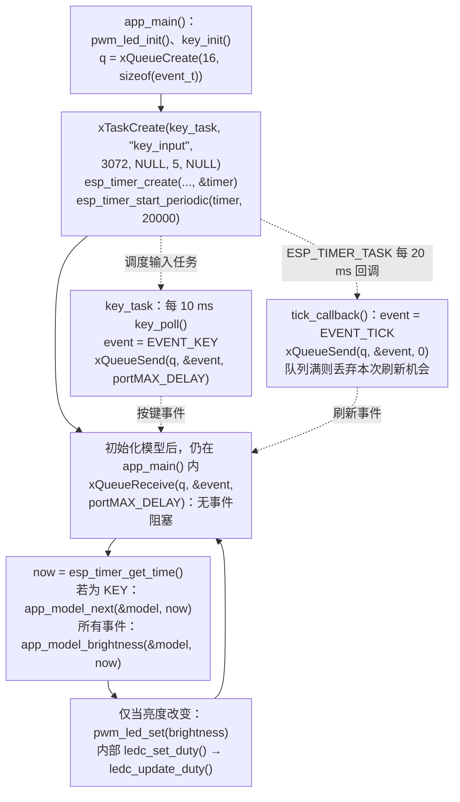

这一课把第 05～11 课组合成一个可继续扩展的程序：BOOT 产生事件，队列传递事件，状态机选择熄灭、常亮或呼吸模式，LEDC 持续输出 PWM。

配套工程：[`examples/12-key-breathing-modes`](https://github.com/Rainboylvx/esp32-learning-code/tree/main/examples/12-key-breathing-modes)。当前代码已在默认配置的隔离副本中通过 ESP-IDF v5.5.5 编译，本次未烧录；模式切换与实际视觉效果尚待实板验收。

## 一图看懂关键调用

实线表示同一执行路径上的顺序，虚线表示任务调度、回调触发或消息传递；它们不表示跨任务的直接函数调用。



`q` 是 `s_events`，`timer` 是 `s_timer`，周期参数 20000 的单位是微秒。发送时 `&event` 是局部变量的来源地址，队列保存事件值副本。两个生产者只发送事件，当前 `app_main()` 任务独占模型和 PWM 输出。这里不等待硬件 fade 完成，呼吸亮度由单调时间计算。

## 1. 先写清可观察的行为

| 操作 | 模式 | LED 表现 |
| --- | --- | --- |
| 上电 | OFF | 熄灭 |
| 第一次稳定按下 BOOT | ON | 常亮 |
| 第二次按下 | BREATH | 从暗到亮，再从亮到暗循环 |
| 第三次按下 | OFF | 立即切到熄灭状态 |

持续按住只算一次按下。呼吸周期约 2 秒：前 1 秒渐亮，后 1 秒渐暗。输入检查约每 10 ms 一次，亮度刷新机会约每 20 ms 一次；按键事件到达后直接计算新模式输出，不必等下一次刷新 tick。

## 2. 硬件仍然只有 BOOT 和红色 LED


原理图约定：GPIO0 按下为低；GPIO1 低电平点亮。KEY 使用内部上拉；PWM BSP 在硬件输出端反相，因此业务亮度 0 表示灭、1023 表示最大亮度。

不要让其他 GPIO/PWM 模块同时控制 GPIO1。正常启动后再测试 BOOT；按住它复位可能进入下载模式。

## 3. 事件从哪里来，谁可以改状态


| 模块 | 输入 | 输出 | 不承担的业务 |
| --- | --- | --- | --- |
| KEY BSP + 输入任务 | GPIO0 | `EVENT_KEY` | 不决定 LED 模式 |
| 默认 `esp_timer` 回调 | 每 20 ms 到期 | `EVENT_TICK` | 不设置亮度 |
| 应用任务 | 队列事件、单调时间 | 模式、目标亮度 | 不直接操作引脚 |
| PWM BSP | 0..1023 亮度 | LEDC 输出 | 不读取按键或时钟 |

`app_model_t` 和 PWM 输出都只由应用任务修改。KEY 和定时器不共享“当前模式”变量，避免了两个回调同时写模式或占空比。

## 4. 把状态机写成可以单独理解的普通 C

`main/app_model.h` 不包含任何 ESP-IDF 头文件：

```c
typedef enum { APP_OFF, APP_ON, APP_BREATH } app_mode_t;
typedef struct {
    app_mode_t mode;
    int64_t entered_at_us;
} app_model_t;
```

按键事件使模式前进，并记录进入新状态的时间：

```c
// 时间由调用者传入，业务层不调用 esp_timer。
model->mode = (model->mode + 1) % 3;
model->entered_at_us = now_us;
```

计算输出时，OFF 返回 0，ON 返回 1023，BREATH 根据经过时间计算亮度。

## 5. 呼吸曲线按真实时间计算

```c
// 2 秒一周期，前后各 1 秒。phase 和 ramp 单位都是微秒。
int64_t phase = (now_us - model->entered_at_us) % 2000000;
int64_t ramp = phase <= 1000000 ? phase : 2000000 - phase;
// 近似平方曲线，改善低亮度的层次；不是严格的视觉 gamma 校准。
return (uint32_t)(ramp * ramp * 1023 / 1000000000000LL);
```

`ramp` 从 0 增加到 1000000，再降到 0。乘法在 64 位整数中计算，避免用 32 位整数先乘导致溢出。调用者保证 `now_us` 不早于进入状态的时间。

即使某次刷新延后，下一次也按真实时间得到当前亮度，不会因为少处理几个 tick 就把整个呼吸周期拖慢。刷新过慢仍会造成肉眼可见的跳变；时间计算能避免相位累计误差，无法补回未显示的中间亮度。

## 6. 为什么这一课没有继续等待硬件渐变完成

第 11 课已经练习硬件 fade。本项目使用“软件更新亮度包络 + LEDC 硬件生成载波”：状态机每 20 ms 左右提供一次目标亮度，5 kHz PWM 仍由硬件持续输出。

这样一次模式切换只需覆盖目标亮度，不需要中止正在运行的 fade 或辨认旧渐变的完成事件。定时模块提醒刷新，PWM 模块执行目标亮度，由应用协调两者。以后改用传感器或串口提供目标时，也能沿用这两个模块。

这里的软件工作频率约 50 次/秒；第 10 课的软件 PWM 是每个时间槽都写 GPIO，每秒 2000 次 ISR。两者的软件职责和成本不同。

## 7. 队列满时，按键与刷新机会不能同样处理

```c
static void tick_callback(void *arg)
{
    (void)arg;
    event_t event = EVENT_TICK;
    // 默认 esp_timer 任务上下文：普通 API，零等待，队列满时合并刷新机会。
    // 亮度按绝对时间计算，因此不需要补放所有过期的 tick。
    xQueueSend(s_events, &event, 0);
}
```

队列满时，这次 tick 会丢弃。亮度由单调时钟计算，所以旧刷新机会可以合并；因此，这里允许发送失败，未检查返回值。

```c
static void key_task(void *arg)
{
    (void)arg;
    TickType_t wake = xTaskGetTickCount();
    while (1) {
        if (key_poll(esp_timer_get_time())) {
            event_t event = EVENT_KEY;
            // 普通按键任务允许阻塞；与可合并 tick 不同，模式切换必须保留。
            xQueueSend(s_events, &event, portMAX_DELAY);
        }
        vTaskDelayUntil(&wake, pdMS_TO_TICKS(10));
    }
}
```

本例队列容量 16，应用只做短计算和占空比更新，正常情况下会及时消费。如果以后给应用加上长时间文件读写，KEY 任务可能阻塞并停止扫描，短按仍可能遗漏。因此扩展时必须继续限制消费者的处理时间，阻塞发送并不能保证任意输入速度下都不丢按键。

两个回调上下文也要区分：这里的 `esp_timer` 使用 `ESP_TIMER_TASK`，因此调用普通 `xQueueSend()`；第 07 课 GPTimer ISR 使用 `FromISR` API。

## 8. 应用主循环只有三件事

```c
void app_main(void)
{
    pwm_led_init();
    key_init();
    s_events = xQueueCreate(16, sizeof(event_t));
    xTaskCreate(key_task, "key_input", 3072, NULL, 5, NULL);
    esp_timer_create(&(esp_timer_create_args_t){.callback = tick_callback,
        .dispatch_method = ESP_TIMER_TASK, .name = "refresh"}, &s_timer);
    esp_timer_start_periodic(s_timer, 20000);
    app_model_t model = {.mode = APP_OFF, .entered_at_us = esp_timer_get_time()};
    uint32_t last = 0;
    while (1) {
        event_t event;
        xQueueReceive(s_events, &event, portMAX_DELAY);
        int64_t now = esp_timer_get_time();
        // 状态和 PWM 输出只由这个任务修改；生产者只投递事件。
        if (event == EVENT_KEY) {
            app_model_next(&model, now);
            ESP_LOGI("modes", "mode=%d (0=OFF, 1=ON, 2=BREATH)", model.mode);
        }
        uint32_t brightness = app_model_brightness(&model, now);
        if (brightness != last) {
            pwm_led_set(brightness);
            last = brightness;
        }
    }
}
```

这段循环只在等待输入事件时阻塞，收到事件后就完成本轮计算和输出，不会停下来等待某个业务步骤。初始化先准备 PWM、KEY 和队列，再启动输入任务、刷新定时器，最后初始化模型并进入接收循环。模型由当前任务独占；生产者只访问已创建的队列，较早到达的事件可以暂存。

源码结构：

```text
components/BSP/KEY/            # 无内部延时的消抖
components/BSP/PWM_LED/        # 5 kHz、10 位、GPIO1 反相
main/app_model.c、app_model.h  # 模式和曲线计算
main/main.c                   # 事件生产、队列和输出协调
```

## 用到的事件、定时与 PWM 函数查询表

名称链接到 ESP-IDF v5.5.5 官方文档或该版本源码。表中的调用环境按本课用法标注；带 `FromISR` 的接口用于中断，普通任务接口不能直接搬进 ISR。

| 函数或宏 | 本课用途 | 调用环境 |
| --- | --- | --- |
| [`xQueueCreate()`](https://docs.espressif.com/projects/esp-idf/en/v5.5.5/esp32s3/api-reference/system/freertos_idf.html#queue_8h_1aeb858b824bd74a934ea7ebb81af2a6bb) | 创建固定元素大小的队列 | 普通任务，不能在 ISR 中调用 |
| [`xQueueSend()`](https://docs.espressif.com/projects/esp-idf/en/v5.5.5/esp32s3/api-reference/system/freertos_idf.html#queue_8h_1af7eb49d3249351176992950d9185abe9) | 按值复制一条消息到队尾 | 普通任务，不能在 ISR 中调用 |
| [`xQueueReceive()`](https://docs.espressif.com/projects/esp-idf/en/v5.5.5/esp32s3/api-reference/system/freertos_idf.html#queue_8h_1ad0a166f3b1219a5e37e31f8090d4800d) | 从队首取出一条消息 | 普通任务，不能在 ISR 中调用 |
| [`xTaskCreate()`](https://docs.espressif.com/projects/esp-idf/en/v5.5.5/esp32s3/api-reference/system/freertos_idf.html#task_8h_1a5489235b8b4658d05fc45e3cccd41ba0) | 创建应用任务 | 普通任务，不能在 ISR 中调用 |
| [`xTaskGetTickCount()`](https://docs.espressif.com/projects/esp-idf/en/v5.5.5/esp32s3/api-reference/system/freertos_idf.html#task_8h_1a5fa24e36d5e1eeb57f5b73b72ea048e7) | 读取系统 tick 计数 | 普通任务，不能在 ISR 中调用 |
| [`vTaskDelayUntil()`](https://github.com/espressif/esp-idf/blob/v5.5.5/components/freertos/FreeRTOS-Kernel/include/freertos/task.h#L905) | 相对计划唤醒时间维持扫描节拍 | 普通任务，不能在 ISR 中调用 |
| [`pdMS_TO_TICKS()`](https://github.com/espressif/esp-idf/blob/v5.5.5/components/freertos/FreeRTOS-Kernel/include/freertos/projdefs.h#L46) | 毫秒换算为 tick 数 | 计算宏，不会延时 |
| [`esp_timer_create()`](https://docs.espressif.com/projects/esp-idf/en/v5.5.5/esp32s3/api-reference/system/esp_timer.html#esp__timer_8h_1a74e9327734f0b5a209863df5a21d43a1) | 创建刷新定时器 | 普通任务，不能在 ISR 中调用 |
| [`esp_timer_start_periodic()`](https://docs.espressif.com/projects/esp-idf/en/v5.5.5/esp32s3/api-reference/system/esp_timer.html#esp__timer_8h_1a9a7b439c818e9bda87b0101b92439686) | 每 20 ms 发出一次刷新机会 | 普通任务，不能在 ISR 中调用 |
| [`esp_timer_get_time()`](https://docs.espressif.com/projects/esp-idf/en/v5.5.5/esp32s3/api-reference/system/esp_timer.html#esp__timer_8h_1ab38881d22858adab666843cee4ba6589) | 读取单调时间，单位微秒 | 本课在任务中读取；也可在 ISR 中读取 |
| [`ledc_timer_config()`](https://docs.espressif.com/projects/esp-idf/en/v5.5.5/esp32s3/api-reference/peripherals/ledc.html#ledc_8h_1ac03b21c3f48674c5017d09808a7eaf7b) | 配置 5 kHz、10 位 PWM 定时器 | 普通任务，不能在 ISR 中调用 |
| [`ledc_channel_config()`](https://docs.espressif.com/projects/esp-idf/en/v5.5.5/esp32s3/api-reference/peripherals/ledc.html#ledc_8h_1a1f64acaab8033c9de1dde3f4c111fb6d) | 将通道、定时器和 GPIO1 关联 | 普通任务，不能在 ISR 中调用 |
| [`ledc_set_duty()`](https://docs.espressif.com/projects/esp-idf/en/v5.5.5/esp32s3/api-reference/peripherals/ledc.html#ledc_8h_1a1a4d1fbfae9233199a2d463c58551235) | 设置目标占空比 | 本课由应用任务调用，不与渐变并发写同一通道 |
| [`ledc_update_duty()`](https://docs.espressif.com/projects/esp-idf/en/v5.5.5/esp32s3/api-reference/peripherals/ledc.html#ledc_8h_1a919a48a0b2456c07be9cac72fc6c8b4a) | 使设置的占空比更新到输出 | 本课由应用任务调用 |

### 队列参数与两种发送策略

`xQueueCreate(16, sizeof(event_t))` 最多保存 16 个事件值，成功返回队列句柄，失败返回 `NULL`。发送和接收都按这个元素大小复制，不是保存局部变量地址。

`xQueueSend(s_events, &event, wait_ticks)` 的第三个参数决定满队列时是否等待：刷新回调传 `0`，无法立即入队就返回 `errQUEUE_FULL`；按键任务传 `portMAX_DELAY`，等待有空位后再发送。成功返回 `pdPASS`。默认 `ESP_TIMER_TASK` 回调使用普通发送 API，但不能等待，避免拖住其他定时器回调。

`xQueueReceive(s_events, &event, portMAX_DELAY)` 把队首事件复制到接收变量，成功返回 `pdTRUE` 并移除元素，等待超时返回 `pdFALSE`。本课以无限期等待事件的方式运行应用循环。`portMAX_DELAY` 的无限期等待语义要求 `INCLUDE_vTaskSuspend=1`。

### 创建生产者与刷新定时器

`xTaskCreate(entry, name, stack_bytes, arg, priority, handle_out)` 的六个参数依次是任务入口、名称、栈字节数、入口参数、优先级和句柄输出地址。ESP-IDF 中 `3072` 是 **3072 字节**；优先级数值越大，优先级越高。最后一个参数传 `NULL` 表示不保存句柄，传句柄变量地址则由函数写回。成功返回 `pdPASS`，内存不足时返回 `errCOULD_NOT_ALLOCATE_REQUIRED_MEMORY`。

`esp_timer_create()` 接收配置和句柄输出地址，成功返回 `ESP_OK`；本课直接传入 `&(esp_timer_create_args_t){...}`，没有单独声明 `config` 变量。本课指定 `ESP_TIMER_TASK`，回调只发送刷新事件。`esp_timer_start_periodic(s_timer, 20000)` 中的 `20000` 是微秒，即 20 ms；成功返回 `ESP_OK`，对已运行定时器再次启动会返回 `ESP_ERR_INVALID_STATE`。

`esp_timer_get_time()` 返回 `int64_t` 微秒时间，应用据此计算进入模式后的相位。刷新事件只是提醒重新计算，不代表时间本身只前进了一个 tick。

### 输入任务的扫描节拍

### 固定节拍的两个参数

`vTaskDelayUntil(&wake, pdMS_TO_TICKS(10))` 的第一个参数指向保存计划唤醒时间的变量，第二个参数是每轮间隔 tick 数。先用 `xTaskGetTickCount()` 初始化 `wake`，后续调用会更新它，不要在每轮重新置为当前时间。

`vTaskDelayUntil()` 没有返回值。它在本版本中调用 `xTaskDelayUntil()` 并忽略返回值；后者返回 `pdTRUE` 表示本轮发生了延时，返回 `pdFALSE` 表示计划时刻已到、无需再阻塞。两者都不能保证超负载循环按时完成。

`pdMS_TO_TICKS(10)` 把扫描间隔毫秒数换算成 tick，`xTaskGetTickCount()` 返回初始化用的 tick 基准。微秒时间用于曲线和消抖，tick 用于任务调度，两者不能直接混算。

### PWM 输出与应用函数

`ledc_timer_config(&timer)` 接收模式、定时器编号、频率和分辨率配置；本课是低速模式、定时器 0、5000 Hz、10 位。`ledc_channel_config(&channel)` 再指定 GPIO1、通道 0、定时器 0、初始 duty 和输出反相。

`ledc_set_duty(mode, channel, duty)` 设置目标，`ledc_update_duty(mode, channel)` 提交更新。这里 mode 为 `LEDC_LOW_SPEED_MODE`，channel 为 `LEDC_CHANNEL_0`，逻辑亮度使用 0..1023。配置和更新接口成功返回 `ESP_OK`；参数错误、资源未初始化等失败情况按接口返回错误码，应逐项检查。

`pwm_led_set(brightness)` 是本工程 BSP 封装；`app_model_next(model, now_us)`、`app_model_brightness(model, now_us)` 是普通 C 业务函数，不属于 ESP-IDF API。前者推进模式并记录进入时间，后者按模式和微秒时间返回亮度。它们不创建定时器，也不调用硬件渐变服务。

### 当前代码的接口与错误处理

| 本工程接口 | 用途与条件 | 返回类型 |
| --- | --- | --- |
| `key_init() / pwm_led_init()` | 初始化按键和反相 LEDC 输出 | `void` |
| `key_poll(now_us)` | 稳定按下返回 true；与第 04 课等待松开的接口不同 | `bool` |
| `pwm_led_set(brightness)` | 设置并更新 duty；调用者保证 0..1023 | `void` |
| `app_model_next(model, now_us)` | 按 OFF → ON → BREATH 循环转移并记录时间 | `void` |
| `app_model_brightness(model, now_us)` | 纯 C 计算当前目标亮度；不读 GPIO 或系统时钟 | `uint32_t` |

这些接口属于配套工程 BSP 或业务代码，不是同名的 ESP-IDF 底层 API。返回 `void` 的接口没有可检查的返回值，不能直接放进 `ESP_ERROR_CHECK()`。

当前教学版省略了多项初始化、资源创建和驱动调用的返回值检查。查询表保留底层 API 的成功与失败返回值，表示接口本身的约定；不代表当前源码已经检查。若要补齐，应在 BSP 内处理底层错误、按需返回 `esp_err_t`，并单独判断 FreeRTOS 创建结果。

## 9. 构建与完整验收

```bash
# 使用与本阶段一致的工具链。
source ~/.espressif/tools/activate_idf_v5.5.5.sh
cd ~/mycode/esp32-blog/examples/12-key-breathing-modes
idf.py build
# 用真实端口烧录，观察 mode=1、2、0 的循环。
idf.py -p <实际串口> flash monitor
```

验收时逐条检查：

1. 上电熄灭，每次按键按 ON → BREATH → OFF 顺序变化。
2. 呼吸过程中任意时刻按键，能够切到 OFF；常亮时也能及时切换。
3. 长按两秒只产生一次模式切换，松开后再次按下才能继续切换。
4. 呼吸持续观察至少 30 秒，没有周期逐步变慢或模式自行跳转。
5. 能指出状态只由一个任务修改，并解释 tick 可以合并、KEY 不能随意丢弃。

还可以给 `app_model_brightness()` 人工传入进入呼吸后 0、0.5、1、1.5、2 秒的时间，预期结果约为 0、255、1023、255、0。这个纯 C 验证只证明曲线与状态转换，不证明实板亮度、消抖或调度延迟。

本课是阶段项目，没有一一对应的官方工程。它整合教材定时器、PWM 的概念，并把输入、时间、业务和输出的依赖放在应用层。

后续可以增加串口命令，让它也投递一个模式事件；应保留同一个状态拥有者，避免串口任务直接修改 PWM。下一阶段从 UART 开始。
