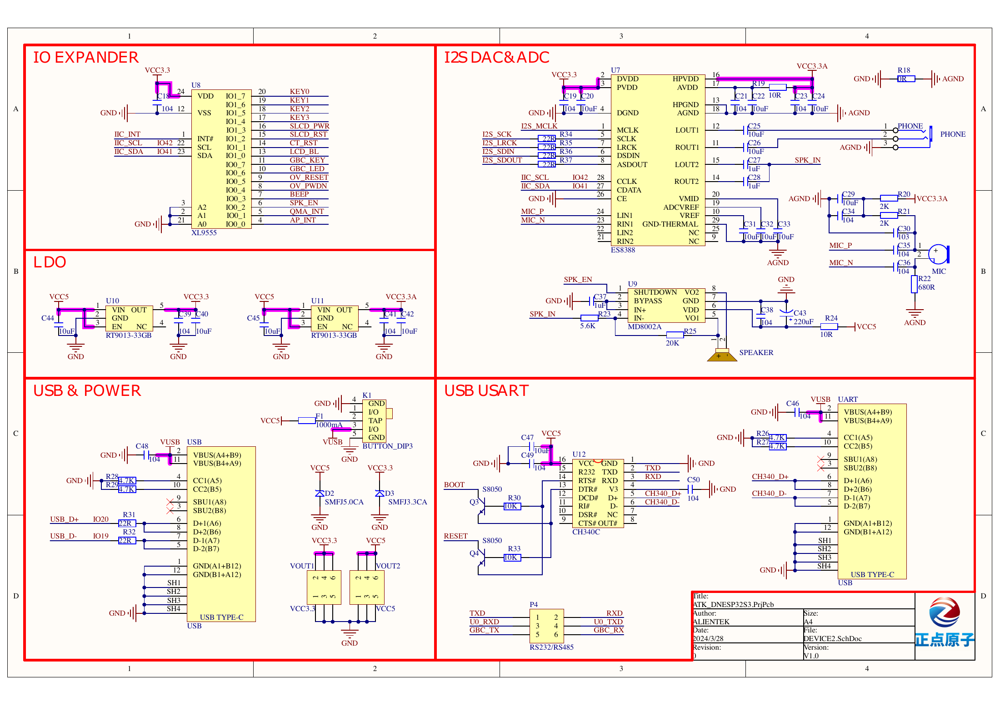
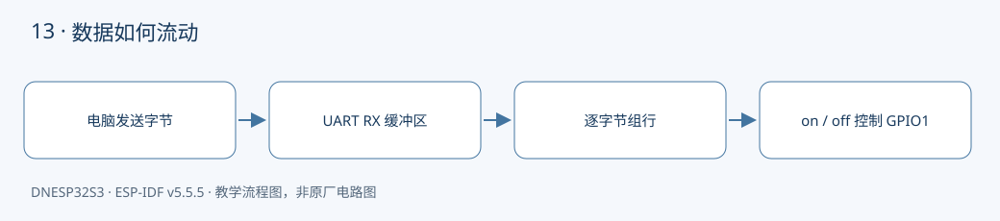

本课对应《DNESP32S3 使用指南（IDF 版）》第 13 章。配套完整工程：[examples/13-uart-command](https://github.com/Rainboylvx/esp32-learning-code/tree/main/examples/13-uart-command)。

**环境与验收边界：** DNESP32S3 V1.2，ESP-IDF v5.5.5；本机 macOS 构建通过。Ubuntu 26、外设接线、屏幕效果和实际测量仍待实板验收。下文输出均为预期格式，不能当作已采集的硬件日志。

## 本课完成后能做什么

- 分两次发送 o 和 n 加换行，最终只执行一次 LED ON。
- 一次粘贴 on、off 两行，依次执行；发送 help 显示帮助。
- 发送超过 63 个字符的一行，得到 ERR line too long，随后正常命令仍可用。
- 发送半行后等超过 2 秒，再发送命令，确认超时恢复。

## 硬件连接与资源

| 信号或资源 | 对应关系 |
| --- | --- |
| UART0 TX | GPIO43 → P4 U0TX → CH340 RXD |
| UART0 RX | GPIO44 ← P4 U0RX ← CH340 TXD |
| 红色 LED | GPIO1，低电平点亮 |

以下为正点原子 DNESP32S3 V1.2 原理图的相关页，保留原厂标识；表格用于快速定位，遇到板卡版本差异以实际原理图为准。点击图片可查看引脚与网络名。






## 从字节流到命令：不能把一次读取当一行

UART 没有“这一行已经发完”的概念。115200、8N1 表示每秒 115200 bit，8 个数据位、无校验、1 个停止位；连同起始位，一个字符约需 10 bit。设备可以收到 `o`，下一次才收到 `n\n`；也可能一次读到 `on\noff\n`。因此接收循环必须逐字节处理。

本例用 64 字节行缓冲，最多保存 63 个字符，最后一个位置留给 C 字符串结尾。遇到 CR 或 LF 才执行命令；连续的 CRLF 中，第二个结束符遇到空行，不会再次执行。超过容量后丢弃整行直到结束符，避免把非法长输入的前缀误认成合法命令。

两秒没有收到后续字符，会清除未完成的行。这是教学协议约定，不是 UART 硬件限制。每次 `uart_read_bytes()` 最多等待 20 ms，任务等待期间不占用 CPU，也不影响其他任务。

## 日志、回显和业务消息共用串口

连接板上的 **UART** USB 口，P4 将 U0RX 接 TXD、U0TX 接 RXD。不要误接只有原生 USB 功能的另一个接口。终端设置 115200 8N1，关闭本地回显；程序已经逐字节回显，再开启本地回显会显示两遍。

这里仅安装一份 UART0 驱动，不再让另一套 console REPL 抢读输入。启动日志和响应都会出现在串口中，适合人工实验；正式二进制协议应另开 UART 或明确分帧，不能让日志混入协议数据。

第 03 课用 BOOT 控制 GPIO1，这一课把输入来源换成命令，LED 的低电平有效关系没有变化。

## 工程如何组织

`components/BSP/UART/serial.c` 负责 UART 和板载 LED 初始化、收发；`main/main.c` 负责行缓冲、超时和命令分派。BSP 不认识 on/off 命令，应用也不用重复配置波特率。完整驱动见配套仓库。

固定引脚以 `CONFIG_LESSON_*` 常量写入本工程 `Kconfig.projbuild`，构建后可在 `sdkconfig` 核对；这些默认值对应本板连线，不表示任意改数字就能改变硬件。

### 应用代码：入口与处理流程

下面代码直接取自配套工程的 `main/main.c`，头文件和 BSP 实现在仓库中一并提供。初学时先看 `app_main()`，再追踪它调用的模块。

```c
#include "sdkconfig.h"
#include <stdio.h>
#include <stdint.h>
#include <stdbool.h>
#include <string.h>
#include <stdlib.h>
#include <assert.h>
#include "esp_err.h"
#include "esp_log.h"
#include "esp_timer.h"
#include "freertos/FreeRTOS.h"
#include "freertos/task.h"
#include "serial.h"
// UART 是字节流：一个 read 可能只含半条命令，也可能含多条命令。
void app_main(void)
{
    ESP_ERROR_CHECK(serial_init());
    char line[64]; size_t used=0; bool dropping=false;
    int64_t last=esp_timer_get_time();
    puts("Commands: on / off / help (press Enter)");
    while(1) {
        uint8_t bytes[64];
        int n=serial_read(bytes,sizeof(bytes));
        if((used || dropping) && esp_timer_get_time()-last>2000000) {
            used=0; dropping=false;
            puts("\r\nERR incomplete line timed out");
        }
        for(int i=0;i<n;i++) {
            unsigned char c=bytes[i]; last=esp_timer_get_time();
            serial_echo(c); // 终端关闭本地回显，避免显示两遍。
            if(c=='\r' || c=='\n') {
                if(dropping) puts("\r\nERR line too long");
                else if(used) {
                    line[used]=0;
                    if(!strcmp(line,"on")) { serial_led(true); puts("\r\nLED ON"); }
                    else if(!strcmp(line,"off")) { serial_led(false); puts("\r\nLED OFF"); }
                    else if(!strcmp(line,"help")) puts("\r\non / off / help");
                    else puts("\r\nERR unknown command");
                }
                used=0; dropping=false;
            } else if(!dropping) {
                if(c==8 || c==127) { if(used) used--; }
                else if(c>=32 && c<127) {
                    if(used<sizeof(line)-1) line[used++]=c;
                    else dropping=true; // 整行丢弃，不能执行被截断的前缀。
                }
            }
        }
    }
}
```

### CMake 与中文注释

```cmake
# 私有依赖只供本组件源码使用。
idf_component_register(SRCS "main.c" INCLUDE_DIRS "."
    PRIV_REQUIRES BSP esp_timer)
```

每个工程有自己的 `project()` 名称和 `sdkconfig.defaults`。VS Code 设置已关闭普通 CMake 自动配置，C/C++ 语言服务读取 `build/compile_commands.json`；首次构建前文件尚不存在，应先激活 IDF 并构建，而不是手工拼头文件路径。

## 编译、烧录与观察

```bash
# 激活 EIM 安装的 IDF；每个新终端都需要激活。
source ~/.espressif/tools/activate_idf_v5.5.5.sh
# 进入单个示例根目录，不是在 examples 总目录运行。
cd ~/mycode/esp32-blog/examples/13-uart-command
# 首次配置目标；已有正确配置时不用每次重复 set-target。
idf.py set-target esp32s3
# 编译会生成 build/compile_commands.json，供 VS Code 使用。
idf.py build
# 把这个值换成实际连接开发板的端口；macOS 通常为 /dev/cu.*。
PORT=/dev/ttyUSB0
idf.py -p "$PORT" flash monitor
# 串口监视退出：Ctrl+]。
```

预期输出或屏幕内容（示意；数值、日志前缀和启动时间依现场而变）：

```text
Commands: on / off / help (press Enter)
on
LED ON
off
LED OFF
```

## 故障定位与逐项验收

先检查目标是否是 `esp32s3`、实际端口与供电，再按本文引脚表核对跳线。编译成功只能说明源码与工具链兼容，无法证明模块型号、物理线路或时序已经正确。

- [ ] 分两次发送 o 和 n 加换行，最终只执行一次 LED ON。
- [ ] 一次粘贴 on、off 两行，依次执行；发送 help 显示帮助。
- [ ] 发送超过 63 个字符的一行，得到 ERR line too long，随后正常命令仍可用。
- [ ] 发送半行后等超过 2 秒，再发送命令，确认超时恢复。

遇到通信错误先看错误码和对应模块，禁止简单用“错误时返回 0”掩盖异常。预期日志是阅读程序的参考，验收时应保存自己的现象、日志与接线照片。

## 与教材和官方实现对照

对照教材第 13 章与 04_uart：保留 UART0、115200 和 GPIO43/44；用有界行解析代替“收到了就认为是一条命令”，增加超长行、CRLF 和半帧超时处理。

## 本地验证记录与参考

- 2026-10-24：ESP-IDF v5.5.5、目标 ESP32-S3，本机 macOS `idf.py build` 通过。
- Hugo 草稿页面、文内本地图片和课程入口已检查；`draft: true` 保留，实板验收后再考虑发布。
- 未执行本课硬件烧录、波形测量或外设现象验收，以上待办不提前勾选。
- [ESP-IDF v5.5.5 官方接口文档](https://docs.espressif.com/projects/esp-idf/en/v5.5.5/esp32s3/api-reference/peripherals/uart.html)。
- 教材第 13 章；DNESP32S3 V1.2 原理图第 1、3、4 页。

[返回课程目录](./_index.md)
