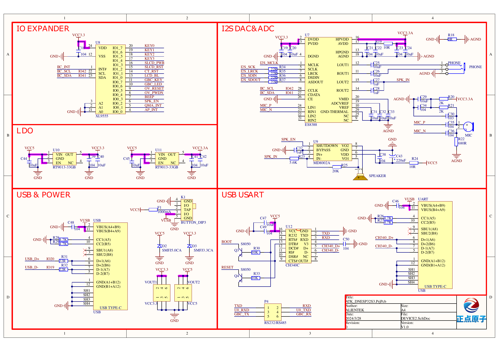
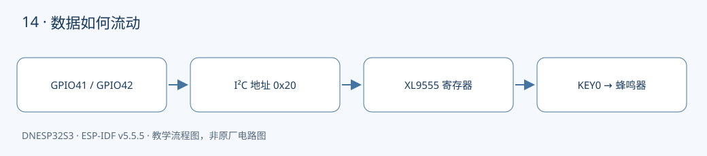

本课对应《DNESP32S3 使用指南（IDF 版）》第 19 章。配套完整工程：[examples/14-i2c-xl9555](https://github.com/Rainboylvx/esp32-learning-code/tree/main/examples/14-i2c-xl9555)。

**环境与验收边界：** DNESP32S3 V1.2，ESP-IDF v5.5.5；本机 macOS 构建通过。Ubuntu 26、外设接线、屏幕效果和实际测量仍待实板验收。下文输出均为预期格式，不能当作已采集的硬件日志。

## 本课完成后能做什么

- 扫描日志含 0x20；其他地址按实际焊接器件解释，不要求只有一个地址。
- KEY0 按下蜂鸣器响、松开停止，KEY1/2 不触发。
- 说明为什么 0x8000 对应 IO1_7，以及为什么不能把整个方向寄存器清零。

## 硬件连接与资源

| 信号或资源 | 对应关系 |
| --- | --- |
| I²C0 SDA | GPIO41，板载上拉 |
| I²C0 SCL | GPIO42，板载上拉 |
| XL9555 | 7 位地址 0x20 |
| KEY0 / 蜂鸣器 | IO1_7 / IO0_3，均低电平有效 |

以下为正点原子 DNESP32S3 V1.2 原理图的相关页，保留原厂标识；表格用于快速定位，遇到板卡版本差异以实际原理图为准。点击图片可查看引脚与网络名。






## 两根信号线为什么能连接多个芯片

SDA 传数据，SCL 给出时钟。主机先发送目标的 7 位地址，再发送读写位；被点名的器件在第 9 个时钟应答 ACK。程序扫描的是 0x08～0x77，跳过保留地址。扫描到一个地址，只说明有器件应答，不代表已经识别了型号。

I²C 采用开漏输出：芯片能拉低线路，逻辑高依靠上拉电阻。V1.2 原理图中总线上已有 2.2 kΩ 上拉，内部弱上拉只是辅助。多个模块自带的上拉电阻并联后，总阻值会降低，因此不能一味增加上拉。全总线无应答时先检查供电、公共地、SDA/SCL 和上拉。

## GPIO 编号和扩展 IO 编号不是同一个空间

`GPIO1` 是 ESP32-S3 自身引脚；`IO1_7` 是 XL9555 的第 1 组第 7 位。后者不能传给 `gpio_set_level()`。读写扩展口要通过 I²C 寄存器：

| 寄存器 | 组 0 / 组 1 | 用途 |
| --- | --- | --- |
| 输入 | 0 / 1 | 读取当前引脚电平 |
| 输出锁存 | 2 / 3 | 设置输出电平 |
| 极性反转 | 4 / 5 | 对输入读数反相 |
| 方向 | 6 / 7 | 1 输入，0 输出 |

两个 8 位寄存器合并成 16 位数后，KEY0 对应 bit15，即 0x8000；蜂鸣器对应 bit3，即 0x0008。应用只修改蜂鸣器对应的输出位，避免同时覆盖屏幕复位、电源和中断脚的状态。

## 先设置输出值，再改变方向

`exio_output(mask, value)` 先读输出锁存寄存器，只替换 mask 选中的位，再把对应方向位清零。这样把蜂鸣器切为输出前，已经预置为高电平关闭，减少上电误鸣。

读改写需要两次总线事务。驱动虽能保证单次 I²C 事务串行，却不能保证整个读改写是原子操作。因此该接口要求同一任务调用；若以后多个任务控制 XL9555，应在 BSP 内增加互斥锁。

本例每 20 ms 读取 KEY0，用按住鸣叫、松开关闭展示输入和输出。这里只做电平控制，不生成“单次按下事件”；如果要计数，仍需第 03 课的消抖。

## 工程如何组织

驱动放在 `components/BSP/`，应用放在 `main/main.c`。本工程包含 `BUS`、`EXIO` 模块。ESP-IDF 会自动发现项目根目录下的 `components/BSP`。`main` 通过 `PRIV_REQUIRES BSP` 声明组件依赖，`INCLUDE_DIRS` 则导出编译时使用的头文件搜索路径，不涉及运行时文件查找。


### 应用代码：入口与处理流程

下面代码直接取自配套工程的 `main/main.c`，头文件和 BSP 实现在仓库中一并提供。初学时先看 `app_main()`，再追踪它调用的模块。

```c
#include <stdio.h>
#include <stdint.h>
#include <stdbool.h>
#include <string.h>
#include <stdlib.h>
#include <assert.h>
#include "esp_err.h"
#include "esp_log.h"
#include "esp_timer.h"
#include "freertos/FreeRTOS.h"
#include "freertos/task.h"
#include "exio.h"
void app_main(void)
{
    i2c_master_bus_handle_t bus;
    ESP_ERROR_CHECK(bus_init(0,CONFIG_LESSON_I2C_SDA,CONFIG_LESSON_I2C_SCL,&bus));
    for(int addr=8;addr<0x78;addr++)
        if(i2c_master_probe(bus,addr,10)==ESP_OK) ESP_LOGI("scan","ACK 0x%02x",addr);
    ESP_ERROR_CHECK(exio_init(bus));
    ESP_ERROR_CHECK(exio_output(0x0008,0x0008)); // 蜂鸣器默认关闭。
    uint16_t previous=0xffff;
    while(1) {
        uint16_t value;
        esp_err_t err=exio_read(&value);
        if(err==ESP_OK) {
            // KEY0 接 IO1_7，按下为 0；控制 IO0_3 蜂鸣器，松开即关闭。
            bool pressed=!(value&0x8000);
            err=exio_output(0x0008,pressed ? 0 : 0x0008);
            if(value!=previous) ESP_LOGI("exio","input=0x%04x KEY0=%d",value,pressed);
            previous=value;
        }
        if(err!=ESP_OK) ESP_LOGW("exio","%s",esp_err_to_name(err));
        vTaskDelay(pdMS_TO_TICKS(20));
    }
}
```

### BSP 关键实现：EXIO

以下是本课对应驱动的完整源文件。对外声明见 [exio.h](https://github.com/Rainboylvx/esp32-learning-code/tree/main/examples/14-i2c-xl9555/components/BSP/EXIO/exio.h)。公共 BUS 模块统一使用新 I²C master API，将单次事务等待限制在 50 ms；设备 API 使用 7 位地址。

```c
#include "exio.h"
static i2c_master_dev_handle_t s_dev;
static esp_err_t update(uint8_t reg, uint16_t mask, uint16_t value)
{
    uint8_t b[2];
    ESP_RETURN_ON_ERROR(reg_read(s_dev, reg, b, 2), "exio", "read");
    uint16_t old = b[0] | ((uint16_t)b[1] << 8);
    uint16_t next = (old & ~mask) | (value & mask);
    uint8_t packet[] = {reg, next & 255, next >> 8};
    return i2c_master_transmit(s_dev, packet, sizeof(packet), 50);
}
esp_err_t exio_init(i2c_master_bus_handle_t bus)
{
    return bus_device(bus, 0x20, &s_dev);
}
esp_err_t exio_output(uint16_t mask, uint16_t value)
{
    // 先预置输出锁存器，再切换输出方向，避免瞬间输出错误电平。
    ESP_RETURN_ON_ERROR(update(2, mask, value), "exio", "output");
    return update(6, mask, 0); // 配置位 0=输出，1=输入。
}
esp_err_t exio_read(uint16_t *value)
{
    uint8_t b[2];
    ESP_RETURN_ON_ERROR(reg_read(s_dev, 0, b, 2), "exio", "input");
    *value = b[0] | ((uint16_t)b[1] << 8);
    return ESP_OK;
}
```

### CMake 与中文注释

```cmake
# 私有依赖只供本组件源码使用。
idf_component_register(SRCS "main.c" INCLUDE_DIRS "."
    PRIV_REQUIRES esp_timer BSP )
```

每个工程有自己的 `project()` 名称和 `sdkconfig.defaults`。VS Code 已关闭普通 CMake 自动配置，C/C++ 语言服务从 `build/compile_commands.json` 读取编译信息。首次构建前，这个文件还不存在，需要先激活 IDF 并完成构建，无需手工拼接头文件路径。

## 编译、烧录与观察

```bash
# 激活 EIM 安装的 IDF；每个新终端都需要激活。
source ~/.espressif/tools/activate_idf_v5.5.5.sh
# 进入单个示例根目录，不是在 examples 总目录运行。
cd ~/mycode/esp32-blog/examples/14-i2c-xl9555
# 首次配置目标；已有正确配置时不用每次重复 set-target。
idf.py set-target esp32s3
# 编译会生成 build/compile_commands.json，供 VS Code 使用。
idf.py build
# 把这个值换成实际连接开发板的端口；macOS 通常为 /dev/cu.*。
PORT=/dev/ttyUSB0
idf.py -p "$PORT" flash monitor
# 串口监视退出：Ctrl+]。
```

预期输出或屏幕内容（示意；数值、日志前缀和启动时间依现场而变）：

```text
scan: ACK 0x20
exio: input=0xffff KEY0=0
exio: input=0x7fff KEY0=1
```

## 故障定位与逐项验收

先确认目标为 `esp32s3`，再检查实际端口、供电，并按本文引脚表核对跳线。编译成功只能说明源码与工具链兼容，模块型号、物理线路和时序仍需实板确认。

- [ ] 扫描日志含 0x20；其他地址按实际焊接器件解释，不要求只有一个地址。
- [ ] KEY0 按下蜂鸣器响、松开停止，KEY1/2 不触发。
- [ ] 说明为什么 0x8000 对应 IO1_7，以及为什么不能把整个方向寄存器清零。

遇到通信错误，先检查错误码和对应模块，不要用“错误时返回 0”掩盖异常。文中的预期日志只供阅读程序时参考；实板验收时，应记录实际现象，保存日志和接线照片。

## 与教材和官方实现对照

对照 08_iic_exio：保持地址、寄存器及蜂鸣器极性；从旧 i2c.h 迁移到 i2c_master.h；输出改为按位保留，避免初始化时影响屏幕和其他设备。输入其他位可能不同，日志数值仅示意。

## 本地验证记录与参考

- 2026-10-24：ESP-IDF v5.5.5、目标 ESP32-S3，本机 macOS `idf.py build` 通过。
- Hugo 草稿页面、文内本地图片和课程入口已检查；`draft: true` 保留，实板验收后再考虑发布。
- 未执行本课硬件烧录、波形测量或外设现象验收，以上待办不提前勾选。
- [ESP-IDF v5.5.5 官方接口文档](https://docs.espressif.com/projects/esp-idf/en/v5.5.5/esp32s3/api-reference/peripherals/i2c.html)。
- 教材第 19 章；DNESP32S3 V1.2 原理图第 2、3 页。

[返回课程目录](./_index.md)
