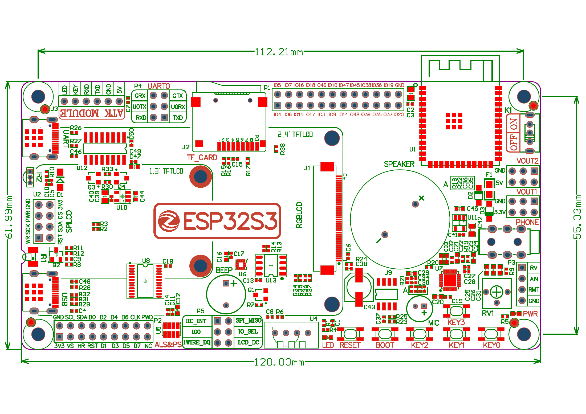
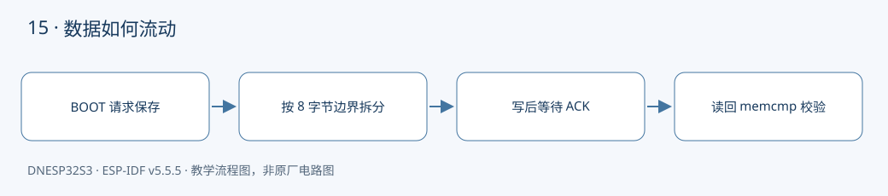

本课对应《DNESP32S3 使用指南（IDF 版）》第 20 章。配套完整工程：[examples/15-i2c-eeprom](https://github.com/Rainboylvx/esp32-learning-code/tree/main/examples/15-i2c-eeprom)。

**环境与验收边界：** DNESP32S3 V1.2，ESP-IDF v5.5.5；本机 macOS 构建通过。Ubuntu 26、外设接线、屏幕效果和实际测量仍待实板验收。下文输出均为预期格式，不能当作已采集的硬件日志。

## 本课完成后能做什么

- 按 BOOT 后 write + verify 为 ESP_OK。
- 断电再上电，不触发写入，saved 字节仍对应原字符串。
- 理解 6 起始的跨页拆分，并能解释地址 250 写 15 字节为何应拒绝。

## 硬件连接与资源

| 信号或资源 | 对应关系 |
| --- | --- |
| SDA / SCL | GPIO41 / GPIO42 |
| AT24C02 | 地址 0x50，容量 256 字节 |
| 页大小 / WP | 8 字节 / 板载接地允许写入 |
| 写入触发 | BOOT GPIO0，正常启动后按下 |

以下为正点原子 DNESP32S3 V1.2 原理图的相关页，保留原厂标识；表格用于快速定位，遇到板卡版本差异以实际原理图为准。点击图片可查看引脚与网络名。






## EEPROM 与普通变量有什么不同

RAM 中的变量断电后丢失，AT24C02 的 EEPROM 在断电后保留数据。它适合保存变化不频繁的小配置，例如上次使用的模式，不适合把每次循环的传感器值都写进去。写入有耗时，也有擦写寿命限制。

AT24C02 有 256 个字节地址，范围 0～255。本例使用 7 位 I²C 地址 0x50，不要把旧资料中的写地址 0xA0 直接传给新驱动。板卡的 A0～A2 和 WP 接地，分别确定地址和允许写入。

## 跨页写入为什么必须拆包

EEPROM 的页写缓冲只有 8 字节。一次事务越过页尾，不会自动按你想象的方式写到下一页，可能在同页内回绕覆盖。

例如，从地址 6 保存含字符串结束符的 15 字节数据，需要拆成：

| 起点 | 本次字节数 | 写入范围 |
| --- | --- | --- |
| 6 | 2 | 6～7 |
| 8 | 8 | 8～15 |
| 16 | 5 | 16～20 |

计算式为 `min(剩余字节数, 8 - 地址 % 8)`。每一包先发送存储地址，再发送数据。总线事务结束不等于内部写周期结束，因此每包之后用有上限的 ACK 轮询等待器件重新应答。

## 怎样证明真的保存了，而不是刚写又读

程序启动时先读地址 6 并输出十六进制字节，**不自动写入**。按 BOOT 才保存 `EEPROM-PERSIST\0`，随后读回用 `memcmp()` 校验。校验使用固定长度，不依赖未初始化存储里是否恰好存在字符串结束符。

第一次上电读出 0xff 或旧内容都正常。完成写入后断电重启，不按 BOOT，确认启动日志仍有同样字节，才能证明持久化。本例使用固定内容，不是事务数据库；若产品要求断电写入也能恢复，应增加版本、长度、CRC 和双槽提交策略。

## 工程如何组织

驱动放在 `components/BSP/`，应用放在 `main/main.c`。本工程包含 `BUS`、`EEPROM` 模块。项目根目录的 `components/BSP` 会被 ESP-IDF 自动发现，`main` 的 `PRIV_REQUIRES BSP` 声明组件依赖；`INCLUDE_DIRS` 导出头文件搜索路径，不是运行时查找文件。

固定引脚以 `CONFIG_LESSON_*` 常量写入本工程 `Kconfig.projbuild`，构建后可在 `sdkconfig` 核对；这些默认值对应本板连线，不表示任意改数字就能改变硬件。

### 应用代码：入口与处理流程

下面代码直接取自配套工程的 `main/main.c`，头文件和 BSP 实现在仓库中一并提供。初学时先看 `app_main()`，再追踪它调用的模块。

```c
#include "sdkconfig.h"
#include <stdio.h>
#include <stdint.h>
#include <stdbool.h>
#include <string.h>
#include <stdlib.h>
#include <assert.h>
#include "esp_err.h"
#include "esp_log.h"
#include "esp_timer.h"
#include "freertos/FreeRTOS.h"
#include "freertos/task.h"
#include "eeprom.h"
#include "driver/gpio.h"
void app_main(void)
{
    i2c_master_bus_handle_t bus;
    ESP_ERROR_CHECK(bus_init(0,CONFIG_LESSON_I2C_SDA,CONFIG_LESSON_I2C_SCL,&bus));
    ESP_ERROR_CHECK(eeprom_open(bus));
    gpio_config_t key={.pin_bit_mask=1ULL<<CONFIG_LESSON_KEY,.mode=GPIO_MODE_INPUT,.pull_up_en=true};
    ESP_ERROR_CHECK(gpio_config(&key));
    const char message[]="EEPROM-PERSIST"; // 含结尾 0，共 15 字节，从地址 6 开始跨三页。
    char data[sizeof(message)];
    esp_err_t err=eeprom_read(6,data,sizeof(data));
    if(err==ESP_OK) ESP_LOG_BUFFER_HEX("saved",data,sizeof(data));
    ESP_LOGI("eeprom","Press BOOT to write; power cycle to inspect saved bytes");
    bool previous=false;
    while(1) {
        bool pressed=gpio_get_level(CONFIG_LESSON_KEY)==0;
        if(pressed && !previous) {
            vTaskDelay(pdMS_TO_TICKS(30));
            if(gpio_get_level(CONFIG_LESSON_KEY)==0) {
                err=eeprom_write(6,message,sizeof(message));
                if(err==ESP_OK) err=eeprom_read(6,data,sizeof(data));
                if(err==ESP_OK && memcmp(data,message,sizeof(data))) err=ESP_ERR_INVALID_RESPONSE;
                ESP_LOGI("eeprom","write + verify: %s",esp_err_to_name(err));
            }
        }
        previous=pressed;
        vTaskDelay(pdMS_TO_TICKS(20));
    }
}
```

### BSP 关键实现：EEPROM

以下是本课对应驱动的完整源文件。对外声明见 [eeprom.h](https://github.com/Rainboylvx/esp32-learning-code/tree/main/examples/15-i2c-eeprom/components/BSP/EEPROM/eeprom.h)。公共 BUS 模块统一使用新 I²C master API，将单次事务等待限制在 50 ms；设备 API 使用 7 位地址。

```c
#include "eeprom.h"
#include <string.h>
#include "freertos/FreeRTOS.h"
#include "freertos/task.h"
static i2c_master_dev_handle_t s_dev;
static i2c_master_bus_handle_t s_bus;
esp_err_t eeprom_open(i2c_master_bus_handle_t bus)
{
    s_bus=bus;
    return bus_device(bus,0x50,&s_dev);
}
esp_err_t eeprom_read(size_t address, void *data, size_t n)
{
    if(!data || !n || address>=256 || n>256-address) return ESP_ERR_INVALID_ARG;
    return reg_read(s_dev,(uint8_t)address,data,n);
}
esp_err_t eeprom_write(size_t address, const void *data, size_t n)
{
    if(!data || !n || address>=256 || n>256-address) return ESP_ERR_INVALID_ARG;
    const uint8_t *p=data;
    while(n) {
        size_t chunk=8-address%8; // AT24C02 一页只有 8 字节，不能跨页发一次写命令。
        if(chunk>n) chunk=n;
        uint8_t packet[9]={(uint8_t)address};
        memcpy(packet+1,p,chunk);
        ESP_RETURN_ON_ERROR(i2c_master_transmit(s_dev,packet,chunk+1,50),"eeprom","write");
        esp_err_t ready=ESP_FAIL;
        // 写周期内芯片 NACK 是正常忙状态；最多等约 20 ms，不能无限等。
        for(int attempt=0;attempt<10;attempt++) {
            vTaskDelay(pdMS_TO_TICKS(2));
            ready=i2c_master_probe(s_bus,0x50,2);
            if(ready==ESP_OK) break;
        }
        if(ready!=ESP_OK) return ready;
        address+=chunk; p+=chunk; n-=chunk;
    }
    return ESP_OK;
}
```

### CMake 与中文注释

```cmake
# 私有依赖只供本组件源码使用。
idf_component_register(SRCS "main.c" INCLUDE_DIRS "."
    PRIV_REQUIRES esp_timer BSP esp_driver_gpio)
```

每个工程有自己的 `project()` 名称和 `sdkconfig.defaults`。VS Code 设置已关闭普通 CMake 自动配置，C/C++ 语言服务读取 `build/compile_commands.json`；首次构建前文件尚不存在，应先激活 IDF 并构建，而不是手工拼头文件路径。

## 编译、烧录与观察

```bash
# 激活 EIM 安装的 IDF；每个新终端都需要激活。
source ~/.espressif/tools/activate_idf_v5.5.5.sh
# 进入单个示例根目录，不是在 examples 总目录运行。
cd ~/mycode/esp32-blog/examples/15-i2c-eeprom
# 首次配置目标；已有正确配置时不用每次重复 set-target。
idf.py set-target esp32s3
# 编译会生成 build/compile_commands.json，供 VS Code 使用。
idf.py build
# 把这个值换成实际连接开发板的端口；macOS 通常为 /dev/cu.*。
PORT=/dev/ttyUSB0
idf.py -p "$PORT" flash monitor
# 串口监视退出：Ctrl+]。
```

预期输出或屏幕内容（示意；数值、日志前缀和启动时间依现场而变）：

```text
saved: 45 45 50 52 4f 4d 2d 50 45 52 53 49 53 54 00
eeprom: write + verify: ESP_OK
```

## 故障定位与逐项验收

先检查目标是否是 `esp32s3`、实际端口与供电，再按本文引脚表核对跳线。编译成功只能说明源码与工具链兼容，无法证明模块型号、物理线路或时序已经正确。

- [ ] 按 BOOT 后 write + verify 为 ESP_OK。
- [ ] 断电再上电，不触发写入，saved 字节仍对应原字符串。
- [ ] 理解 6 起始的跨页拆分，并能解释地址 250 写 15 字节为何应拒绝。

遇到通信错误先看错误码和对应模块，禁止简单用“错误时返回 0”掩盖异常。预期日志是阅读程序的参考，验收时应保存自己的现象、日志与接线照片。

## 与教材和官方实现对照

对照 09_iic_eeprom：保留 AT24C02、0x50 和 8 字节页；增加容量校验、跨页拆分、有界 ACK 轮询，以及启动只读、按键才写的持久化验收流程。

## 本地验证记录与参考

除了构建，本课的真实 EEPROM BSP 还通过主机模拟测试：模拟器故意实现页内回绕，检查跨页拆分是否保护相邻数据，并验证越界拒绝和忙状态超时。它不模拟断电保持，后者必须实板验证。

```bash
# 在 esp32-blog 根目录运行，不需要接开发板。
bash examples/tests/stage3/run.sh
```

- 2026-10-24：ESP-IDF v5.5.5、目标 ESP32-S3，本机 macOS `idf.py build` 通过。
- Hugo 草稿页面、文内本地图片和课程入口已检查；`draft: true` 保留，实板验收后再考虑发布。
- 未执行本课硬件烧录、波形测量或外设现象验收，以上待办不提前勾选。
- [ESP-IDF v5.5.5 官方接口文档](https://docs.espressif.com/projects/esp-idf/en/v5.5.5/esp32s3/api-reference/peripherals/i2c.html)。
- 教材第 20 章；DNESP32S3 V1.2 原理图第 2、4 页。

[返回课程目录](./_index.md)
