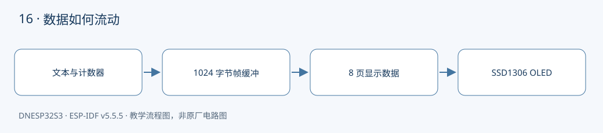

本课对应《DNESP32S3 使用指南（IDF 版）》第 21 章。配套完整工程：[examples/16-i2c-oled](https://github.com/Rainboylvx/esp32-learning-code/tree/main/examples/16-i2c-oled)。

**环境与验收边界：** DNESP32S3 V1.2，ESP-IDF v5.5.5；本机 macOS 构建通过。Ubuntu 26、外设接线、屏幕效果和实际测量仍待实板验收。下文输出均为预期格式，不能当作已采集的硬件日志。

## 本课完成后能做什么

- 上电出现 DNESP32S3 OLED，COUNT 每 500 ms 增加。
- UPTIME 随运行时间增加，观察更新时无主动清屏造成的黑闪。
- 改 column/page 能预测字符位置；断开显示屏后日志报错而非伪成功。

## 硬件连接与资源

| 信号或资源 | 对应关系 |
| --- | --- |
| OLED 控制器 | SSD1306，128×64，地址 0x3c |
| I²C1 SDA / SCL | GPIO5 / GPIO4 |
| 教材 16 针模块 D/C / RESET | GPIO38 拉低 / XL9555 IO0_5 |
| 模块模式 | BS2 接地，D1 与 D2 按教材桥接；GPIO6 仅输入 |

以下为正点原子 DNESP32S3 V1.2 原理图的相关页，保留原厂标识；表格用于快速定位，遇到板卡版本差异以实际原理图为准。点击图片可查看引脚与网络名。




## 先确认模块接口，不能只看“0.96 寸 OLED”

本例默认教材的 **16 针多接口 SSD1306** 模块，按教材将模块配置为 I²C，连接到板上 P2。D1、D2 桥接之后，GPIO6 不得输出；D/C 拉低选择 0x3c，复位由 XL9555 IO0_5 控制。SPI 模式的同款模块即使插上排针，也不会回应 I²C 扫描。

如果用四针 SSD1306 模块，接 3.3V、GND、SDA→GPIO5、SCL→GPIO4，并在 `idf.py menuconfig` 的 `Lesson hardware` 中开启 `Use four-pin SSD1306 OLED`。这会跳过额外复位与 D/C 控制。四针模块仍需上拉；不要默认兼容 SH1106 或 0x3d 地址模块。

## 显示坐标如何变成字节

128×64 单色像素只需要 128×64÷8=1024 字节。SSD1306 的一页包含连续的 8 行像素，一个字节表示同一列的 8 个点。我们分配 `s_frame[1024]`，页号 page 的起点是 `page*128`。

为避免依赖大字库，工程自带小型 3×5 字模，支持数字、大写字母和少量标点，每个字符占 4 列。接口 `oled_text(column, page, text)` 的 column 是字符格，不是像素坐标；例如 `oled_text(2, 3, "COUNT")` 从 x=8、y=24 开始绘制。中文和小写字母留到后续字库课程。

## 为什么先清缓冲区再刷新不会明显闪屏

`oled_clear()` 只修改内存，`oled_text()` 继续在同一块内存里绘图，最后 `oled_refresh()` 才把完整结果发到屏幕。应避免“清屏并立即传输 → 画字再传输”的顺序，否则会人为显示一帧空白。

每页先发送页号及列地址，再发送控制字节 0x40 和 128 字节数据。100 kHz 总线上整帧传输约百毫秒，适合本课每 500 ms 更新的文字界面；这不属于高速视频刷新方案，也不表示整屏在物理上同时更新。

## 工程如何组织

驱动放在 `components/BSP/`，应用放在 `main/main.c`。本工程包含 `BUS`、`EXIO`、`OLED` 模块。ESP-IDF 会自动发现项目根目录下的 `components/BSP`。`main` 通过 `PRIV_REQUIRES BSP` 声明组件依赖，`INCLUDE_DIRS` 则导出编译时使用的头文件搜索路径，不涉及运行时文件查找。

固定引脚通过 `CONFIG_LESSON_*` 常量定义在本工程的 `Kconfig.projbuild` 中，构建后可在 `sdkconfig` 中核对。这些默认值对应本板连线，仅修改配置数字并不能改变硬件连接。

### 应用代码：入口与处理流程

下面代码直接取自配套工程的 `main/main.c`，头文件和 BSP 实现在仓库中一并提供。初学时先看 `app_main()`，再追踪它调用的模块。

```c
#include "sdkconfig.h"
#include <stdio.h>
#include <stdint.h>
#include <stdbool.h>
#include <string.h>
#include <stdlib.h>
#include <assert.h>
#include "esp_err.h"
#include "esp_log.h"
#include "esp_timer.h"
#include "freertos/FreeRTOS.h"
#include "freertos/task.h"
#include "oled.h"
#include "exio.h"
void app_main(void)
{
    i2c_master_bus_handle_t onboard, display;
    ESP_ERROR_CHECK(bus_init(0,CONFIG_LESSON_I2C_SDA,CONFIG_LESSON_I2C_SCL,&onboard));
    ESP_ERROR_CHECK(exio_init(onboard));
    ESP_ERROR_CHECK(bus_init(1,CONFIG_LESSON_OLED_SDA,CONFIG_LESSON_OLED_SCL,&display));
    ESP_ERROR_CHECK(oled_open(display));
    ESP_ERROR_CHECK(oled_reset());
    uint32_t count=0;
    while(1) {
        char text[32];
        oled_clear(); // 只清 RAM，不会立即让屏幕黑掉。
        oled_text(0,0,"DNESP32S3 OLED");
        snprintf(text,sizeof(text),"COUNT %lu",(unsigned long)count++);
        oled_text(0,2,text);
        snprintf(text,sizeof(text),"UPTIME %lld S",esp_timer_get_time()/1000000);
        oled_text(0,4,text);
        esp_err_t err=oled_refresh();
        if(err!=ESP_OK) ESP_LOGW("oled","refresh: %s",esp_err_to_name(err));
        vTaskDelay(pdMS_TO_TICKS(500));
    }
}
```

### BSP 关键实现：OLED

以下是本课对应驱动的完整源文件。对外声明见 [oled.h](https://github.com/Rainboylvx/esp32-learning-code/tree/main/examples/16-i2c-oled/components/BSP/OLED/oled.h)。公共 BUS 模块统一使用新 I²C master API，将单次事务等待限制在 50 ms；设备 API 使用 7 位地址。

```c
#include "oled.h"
#include <string.h>
#include "driver/gpio.h"
#include "exio.h"
#include "sdkconfig.h"
#include "freertos/FreeRTOS.h"
#include "freertos/task.h"
static i2c_master_dev_handle_t s_dev;
static uint8_t s_frame[1024];
// 自制 3x5 字模，每行 3 位，从最高行到最低行。放大为 6x10 不适合 8 像素页，故用原尺寸。
static const uint16_t digits[] = {0x7b6f,0x2492,0x73e7,0x73cf,0x5bc9,0x79cf,0x79ef,0x7249,0x7bef,0x7bcf};
static const uint16_t letters[] = {
 0x2bed,0x6bae,0x7927,0x6b6e,0x79a7,0x79a4,0x796f,0x5bed,0x7497,
 0x124e,0x5bad,0x4927,0x5fed,0x5ffd,0x7b6f,0x7be4,0x7b7b,0x7bad,
 0x79cf,0x7492,0x5b6f,0x5b6a,0x5bfd,0x5aad,0x5a92,0x72a7};
static uint16_t glyph(char c)
{
    if(c>='0' && c<='9') return digits[c-'0'];
    if(c>='A' && c<='Z') return letters[c-'A'];
    if(c=='.') return 2;
    if(c=='-') return 0x1c0;
    if(c==':') return 0x410;
    if(c=='/') return 0x12a4;
    return 0; // 本课仅提供数字、大写英文字母和少量符号。
}
static esp_err_t command(uint8_t value)
{
    uint8_t packet[] = {0x00, value}; // Co=0, D/C#=0：后面是命令。
    return i2c_master_transmit(s_dev, packet, 2, 50);
}
esp_err_t oled_open(i2c_master_bus_handle_t bus) { return bus_device(bus, 0x3c, &s_dev); }
esp_err_t oled_reset(void)
{
#ifndef CONFIG_LESSON_OLED_SIMPLE
    // 教材 16 针 OLED：D/C 拉低选地址 0x3c；D2 与 D1 相连时不得驱动 GPIO6。
    gpio_config_t c = {.pin_bit_mask=1ULL<<CONFIG_LESSON_OLED_DC, .mode=GPIO_MODE_OUTPUT};
    ESP_RETURN_ON_ERROR(gpio_config(&c), "oled", "DC");
    gpio_set_level(CONFIG_LESSON_OLED_DC, 0);
    gpio_set_direction(CONFIG_LESSON_OLED_D2, GPIO_MODE_INPUT);
    ESP_RETURN_ON_ERROR(exio_output(0x20, 0), "oled", "reset low");
    vTaskDelay(pdMS_TO_TICKS(10));
    ESP_RETURN_ON_ERROR(exio_output(0x20, 0x20), "oled", "reset high");
#endif
    vTaskDelay(pdMS_TO_TICKS(100));
    const uint8_t init[] = {0xae,0xd5,0x80,0xa8,0x3f,0xd3,0,0x40,
        0x8d,0x14,0x20,0x02,0xa1,0xc8,0xda,0x12,0x81,0x7f,
        0xd9,0xf1,0xdb,0x40,0xa4,0xa6,0xaf};
    for(size_t i=0;i<sizeof(init);++i)
        ESP_RETURN_ON_ERROR(command(init[i]), "oled", "init");
    return ESP_OK;
}
void oled_clear(void) { memset(s_frame,0,sizeof(s_frame)); }
void oled_text(int column, int page, const char *text)
{
    if(page<0 || page>=8 || column<0) return;
    // column 是字符格，每格 4 像素，page 对应屏幕 8 行像素。
    while(*text && column<32) {
        uint16_t bits=glyph(*text++);
        for(int x=0;x<3;x++) {
            uint8_t v=0;
            for(int y=0;y<5;y++) if(bits & (1U<<(14-y*3-x))) v |= 1U<<y;
            s_frame[page*128+column*4+x]=v;
        }
        s_frame[page*128+column*4+3]=0;
        column++;
    }
}
esp_err_t oled_refresh(void)
{
    // RAM 中完成绘图后才传屏；不会先把清空画面显示出来。
    for(int page=0;page<8;page++) {
        ESP_RETURN_ON_ERROR(command(0xb0+page), "oled", "page");
        ESP_RETURN_ON_ERROR(command(0), "oled", "column low");
        ESP_RETURN_ON_ERROR(command(0x10), "oled", "column high");
        uint8_t packet[129]={0x40}; // D/C#=1：显示数据。
        memcpy(packet+1,s_frame+page*128,128);
        ESP_RETURN_ON_ERROR(i2c_master_transmit(s_dev,packet,sizeof(packet),50), "oled", "data");
    }
    return ESP_OK;
}
```

### CMake 与中文注释

```cmake
# 私有依赖只供本组件源码使用。
idf_component_register(SRCS "main.c" INCLUDE_DIRS "."
    PRIV_REQUIRES esp_timer BSP )
```

每个工程有自己的 `project()` 名称和 `sdkconfig.defaults`。VS Code 已关闭普通 CMake 自动配置，C/C++ 语言服务从 `build/compile_commands.json` 读取编译信息。首次构建前，这个文件还不存在，需要先激活 IDF 并完成构建，无需手工拼接头文件路径。

## 编译、烧录与观察

```bash
# 激活 EIM 安装的 IDF；每个新终端都需要激活。
source ~/.espressif/tools/activate_idf_v5.5.5.sh
# 进入单个示例根目录，不是在 examples 总目录运行。
cd ~/mycode/esp32-blog/examples/16-i2c-oled
# 首次配置目标；已有正确配置时不用每次重复 set-target。
idf.py set-target esp32s3
# 编译会生成 build/compile_commands.json，供 VS Code 使用。
idf.py build
# 把这个值换成实际连接开发板的端口；macOS 通常为 /dev/cu.*。
PORT=/dev/ttyUSB0
idf.py -p "$PORT" flash monitor
# 串口监视退出：Ctrl+]。
```

预期输出或屏幕内容（示意；数值、日志前缀和启动时间依现场而变）：

```text
DNESP32S3 OLED
COUNT 12
UPTIME 6 S
```

## 故障定位与逐项验收

先确认目标为 `esp32s3`，再检查实际端口、供电，并按本文引脚表核对跳线。编译成功只能说明源码与工具链兼容，模块型号、物理线路和时序仍需实板确认。

- [ ] 上电出现 DNESP32S3 OLED，COUNT 每 500 ms 增加。
- [ ] UPTIME 随运行时间增加，观察更新时无主动清屏造成的黑闪。
- [ ] 改 column/page 能预测字符位置；断开显示屏后日志报错而非伪成功。

遇到通信错误，先检查错误码和对应模块，不要用“错误时返回 0”掩盖异常。文中的预期日志只供阅读程序时参考；实板验收时，应记录实际现象，保存日志和接线照片。

## 与教材和官方实现对照

对照教材第 21 章正文（无配套独立工程）：使用硬件 I²C1 和小型自制字模，保留教材模块的模式选择与复位接线；四针模式明确作为可选接法。

## 本地验证记录与参考

- 2026-10-24：ESP-IDF v5.5.5、目标 ESP32-S3，本机 macOS `idf.py build` 通过。
- Hugo 草稿页面、文内本地图片和课程入口已检查；`draft: true` 保留，实板验收后再考虑发布。
- 未执行本课硬件烧录、波形测量或外设现象验收，以上待办不提前勾选。
- [ESP-IDF v5.5.5 官方接口文档](https://docs.espressif.com/projects/esp-idf/en/v5.5.5/esp32s3/api-reference/peripherals/i2c.html)。
- 教材第 21 章；DNESP32S3 V1.2 原理图第 1、2、3、4 页。

[返回课程目录](./_index.md)
