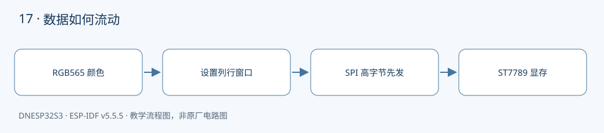

本课对应《DNESP32S3 使用指南（IDF 版）》第 22 章。配套完整工程：[examples/17-spi-lcd](https://github.com/Rainboylvx/esp32-learning-code/tree/main/examples/17-spi-lcd)。

**环境与验收边界：** DNESP32S3 V1.2，ESP-IDF v5.5.5；本机 macOS 构建通过。Ubuntu 26、外设接线、屏幕效果和实际测量仍待实板验收。下文输出均为预期格式，不能当作已采集的硬件日志。

## 本课完成后能做什么

- 红、绿、蓝、白、黑每秒切换一次，全屏范围正确。
- 日志报告每次填充耗时；用逻辑分析仪可看到 D/C 区分命令与数据。
- 解释只写屏为何不需要 MISO，但 SPI 仍具有全双工能力。

## 硬件连接与资源

| 信号或资源 | 对应关系 |
| --- | --- |
| 模块 | ATK-MD0240，ST7789V；本例竖屏 240×320 |
| MOSI / SCLK / CS | GPIO11 / GPIO12 / GPIO21 |
| D/C | GPIO40，P5 IO_SEL 与 LCD_DC 跳线 |
| 复位 / 供电使能 | XL9555 IO1_2 / IO1_3 |
| MISO | 本例只写屏，设 -1；板上总线信号为 GPIO13 |

以下为正点原子 DNESP32S3 V1.2 原理图的相关页，保留原厂标识；表格用于快速定位，遇到板卡版本差异以实际原理图为准。点击图片可查看引脚与网络名。




## SPI 的四根线与本例的三线写屏

通常 SPI 有 SCLK、MOSI、MISO、CS。主机每发一个时钟，可以同时移出和移入一位，因此总线具备全双工能力。但显示屏绘图主要向显存写数据，本例不读取屏幕，MISO 配置为 -1。不能由此推断所有 SPI 外设都不需要 MISO。

D/C 是屏幕另外增加的信号：0 表示命令，1 表示命令参数或像素数据。CS 由 SPI 驱动控制，D/C 在事务开始前设置。P5 必须把 IO_SEL 接到 LCD_DC，否则 GPIO40 的变化到不了屏幕。

本工程明确针对 **2.4 寸 ATK-MD0240 / ST7789V**。模块常以 320×240 横屏宣传，本例 MADCTL=0 使用 240×320 竖屏。1.3 寸 240×240 模块可能需要显示偏移和初始化差异，不属于此默认配置。

## 一个像素为什么是两个字节

RGB565 分给红色 5 位、绿色 6 位、蓝色 5 位：

| 颜色 | 16 位值 | 发送字节 |
| --- | --- | --- |
| 红 | 0xF800 | F8 00 |
| 绿 | 0x07E0 | 07 E0 |
| 蓝 | 0x001F | 00 1F |

不能直接按 ESP32 内存中的小端布局发送数据，屏幕要求的字节顺序与之不同。本例显式生成高字节、低字节，避免红蓝或明暗出现难以理解的异常。

## 先窗口，再像素

0x2A 设置列范围 0～239，0x2B 设置行范围 0～319，0x2C 开始写显存。程序只准备一行 480 字节，重复写 320 次，省去 153600 字节整屏缓冲。

`spi_device_polling_transmit()` 返回后才能复用行缓冲。本例使用同步接口，便于说明缓冲区的生命周期。以后若改为异步 DMA，必须等到完成事件才能改写数据，不能提交后立即修改。10 MHz 下仅像素净荷的理论下限约 122.9 ms，实际还包含事务和软件开销，不应把日志耗时当成精确 FPS。

驱动先打开屏幕电源、拉低复位，再释放并等待，随后退出睡眠、设置 RGB565 和显示方向。初始化次序与等待时间同样属于协议。

## 工程如何组织

驱动放在 `components/BSP/`，应用放在 `main/main.c`。本工程包含 `BUS`、`EXIO`、`LCD` 模块。ESP-IDF 会自动发现项目根目录下的 `components/BSP`。`main` 通过 `PRIV_REQUIRES BSP` 声明组件依赖，`INCLUDE_DIRS` 则导出编译时使用的头文件搜索路径，不涉及运行时文件查找。

固定引脚通过 `CONFIG_LESSON_*` 常量定义在本工程的 `Kconfig.projbuild` 中，构建后可在 `sdkconfig` 中核对。这些默认值对应本板连线，仅修改配置数字并不能改变硬件连接。

### 应用代码：入口与处理流程

下面代码直接取自配套工程的 `main/main.c`，头文件和 BSP 实现在仓库中一并提供。初学时先看 `app_main()`，再追踪它调用的模块。

```c
#include <stdio.h>
#include <stdint.h>
#include <stdbool.h>
#include <string.h>
#include <stdlib.h>
#include <assert.h>
#include "esp_err.h"
#include "esp_log.h"
#include "esp_timer.h"
#include "freertos/FreeRTOS.h"
#include "freertos/task.h"
#include "lcd.h"
#include "exio.h"
void app_main(void)
{
    i2c_master_bus_handle_t bus;
    ESP_ERROR_CHECK(bus_init(0,CONFIG_LESSON_I2C_SDA,CONFIG_LESSON_I2C_SCL,&bus));
    ESP_ERROR_CHECK(exio_init(bus));
    ESP_ERROR_CHECK(lcd_init());
    const uint16_t colors[]={0xf800,0x07e0,0x001f,0xffff,0};
    while(1) for(int i=0;i<5;i++) {
        int64_t begin=esp_timer_get_time();
        ESP_ERROR_CHECK(lcd_fill(colors[i]));
        ESP_LOGI("lcd","RGB565=0x%04x fill=%lld us",colors[i],esp_timer_get_time()-begin);
        vTaskDelay(pdMS_TO_TICKS(1000));
    }
}
```

### BSP 关键实现：LCD

以下是本课对应驱动的完整源文件。对外声明见 [lcd.h](https://github.com/Rainboylvx/esp32-learning-code/tree/main/examples/17-spi-lcd/components/BSP/LCD/lcd.h)。公共 BUS 模块统一使用新 I²C master API，将单次事务等待限制在 50 ms；设备 API 使用 7 位地址。

```c
#include "sdkconfig.h"
#include "lcd.h"
#include "exio.h"
#include "driver/spi_master.h"
#include "driver/gpio.h"
#include "freertos/FreeRTOS.h"
#include "freertos/task.h"
// ATK-MD0240 / ST7789V，竖屏 240x320；其他屏幕不能只改分辨率就假定兼容。
static spi_device_handle_t s_spi;
static esp_err_t transfer(int dc,const void *data,size_t n)
{
    gpio_set_level(CONFIG_LESSON_LCD_DC,dc);
    spi_transaction_t t={.length=n*8,.tx_buffer=data};
    return spi_device_polling_transmit(s_spi,&t); // 返回后缓冲区才可复用。
}
static esp_err_t command(uint8_t cmd,const void *data,size_t n)
{
    ESP_RETURN_ON_ERROR(transfer(0,&cmd,1),"lcd","command");
    return n ? transfer(1,data,n) : ESP_OK;
}
esp_err_t lcd_init(void)
{
    gpio_config_t g={.pin_bit_mask=1ULL<<CONFIG_LESSON_LCD_DC,.mode=GPIO_MODE_OUTPUT};
    ESP_RETURN_ON_ERROR(gpio_config(&g),"lcd","DC");
    spi_bus_config_t bus={.mosi_io_num=CONFIG_LESSON_SPI_MOSI,.miso_io_num=-1,.sclk_io_num=CONFIG_LESSON_SPI_SCLK,
        .quadwp_io_num=-1,.quadhd_io_num=-1,.max_transfer_sz=480};
    ESP_RETURN_ON_ERROR(spi_bus_initialize(SPI2_HOST,&bus,SPI_DMA_CH_AUTO),"lcd","bus");
    spi_device_interface_config_t dev={.clock_speed_hz=10000000,.mode=0,
        .spics_io_num=CONFIG_LESSON_LCD_CS,.queue_size=1};
    ESP_RETURN_ON_ERROR(spi_bus_add_device(SPI2_HOST,&dev,&s_spi),"lcd","device");
    ESP_RETURN_ON_ERROR(exio_output(0x0c00,0x0800),"lcd","power/reset");
    vTaskDelay(pdMS_TO_TICKS(20));
    ESP_RETURN_ON_ERROR(exio_output(0x0400,0x0400),"lcd","reset release");
    vTaskDelay(pdMS_TO_TICKS(120));
    ESP_RETURN_ON_ERROR(command(0x11,NULL,0),"lcd","sleep out");
    vTaskDelay(pdMS_TO_TICKS(120));
    uint8_t format=0x55,orientation=0;
    ESP_RETURN_ON_ERROR(command(0x3a,&format,1),"lcd","RGB565");
    ESP_RETURN_ON_ERROR(command(0x36,&orientation,1),"lcd","orientation");
    ESP_RETURN_ON_ERROR(command(0x21,NULL,0),"lcd","inversion on");
    return command(0x29,NULL,0);
}
esp_err_t lcd_fill(uint16_t rgb565)
{
    const uint8_t xs[]={0,0,0,239},ys[]={0,0,1,63}; // 319=0x013f。
    ESP_RETURN_ON_ERROR(command(0x2a,xs,4),"lcd","x window");
    ESP_RETURN_ON_ERROR(command(0x2b,ys,4),"lcd","y window");
    ESP_RETURN_ON_ERROR(command(0x2c,NULL,0),"lcd","RAM write");
    uint8_t row[480];
    for(int x=0;x<240;x++) {
        row[2*x]=rgb565>>8; row[2*x+1]=rgb565&255; // 屏幕要求高字节先发送。
    }
    for(int y=0;y<320;y++)
        ESP_RETURN_ON_ERROR(transfer(1,row,sizeof(row)),"lcd","row");
    return ESP_OK;
}
```

### CMake 与中文注释

```cmake
# 私有依赖只供本组件源码使用。
idf_component_register(SRCS "main.c" INCLUDE_DIRS "."
    PRIV_REQUIRES esp_timer BSP )
```

每个工程有自己的 `project()` 名称和 `sdkconfig.defaults`。VS Code 已关闭普通 CMake 自动配置，C/C++ 语言服务从 `build/compile_commands.json` 读取编译信息。首次构建前，这个文件还不存在，需要先激活 IDF 并完成构建，无需手工拼接头文件路径。

## 编译、烧录与观察

```bash
# 激活 EIM 安装的 IDF；每个新终端都需要激活。
source ~/.espressif/tools/activate_idf_v5.5.5.sh
# 进入单个示例根目录，不是在 examples 总目录运行。
cd ~/mycode/esp32-blog/examples/17-spi-lcd
# 首次配置目标；已有正确配置时不用每次重复 set-target。
idf.py set-target esp32s3
# 编译会生成 build/compile_commands.json，供 VS Code 使用。
idf.py build
# 把这个值换成实际连接开发板的端口；macOS 通常为 /dev/cu.*。
PORT=/dev/ttyUSB0
idf.py -p "$PORT" flash monitor
# 串口监视退出：Ctrl+]。
```

预期输出或屏幕内容（示意；数值、日志前缀和启动时间依现场而变）：

```text
lcd: RGB565=0xf800 fill=<实测微秒> us
lcd: RGB565=0x07e0 fill=<实测微秒> us
```

## 故障定位与逐项验收

先确认目标为 `esp32s3`，再检查实际端口、供电，并按本文引脚表核对跳线。编译成功只能说明源码与工具链兼容，模块型号、物理线路和时序仍需实板确认。

- [ ] 红、绿、蓝、白、黑每秒切换一次，全屏范围正确。
- [ ] 日志报告每次填充耗时；用逻辑分析仪可看到 D/C 区分命令与数据。
- [ ] 解释只写屏为何不需要 MISO，但 SPI 仍具有全双工能力。

遇到通信错误，先检查错误码和对应模块，不要用“错误时返回 0”掩盖异常。文中的预期日志只供阅读程序时参考；实板验收时，应记录实际现象，保存日志和接线照片。

## 与教材和官方实现对照

对照 10_spilcd：保留 SPI2、GPIO11/12/21/40 和 XL9555 屏幕控制；将示例范围收窄为 ST7789V 240×320 色块显示，不引入字体与多型号自动判断。

## 本地验证记录与参考

- 2026-10-24：ESP-IDF v5.5.5、目标 ESP32-S3，本机 macOS `idf.py build` 通过。
- Hugo 草稿页面、文内本地图片和课程入口已检查；`draft: true` 保留，实板验收后再考虑发布。
- 未执行本课硬件烧录、波形测量或外设现象验收，以上待办不提前勾选。
- [ESP-IDF v5.5.5 官方接口文档](https://docs.espressif.com/projects/esp-idf/en/v5.5.5/esp32s3/api-reference/peripherals/spi_master.html)。
- 教材第 22 章；DNESP32S3 V1.2 原理图第 1、2、3、4 页。

[返回课程目录](./_index.md)
