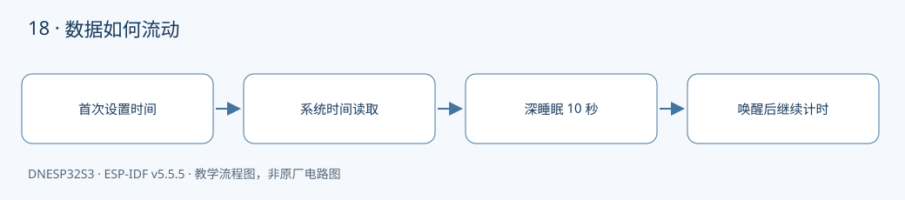

本课对应《DNESP32S3 使用指南（IDF 版）》第 23 章。配套完整工程：[examples/18-rtc-system-time](https://github.com/Rainboylvx/esp32-learning-code/tree/main/examples/18-rtc-system-time)。

**环境与验收边界：** DNESP32S3 V1.2，ESP-IDF v5.5.5；本机 macOS 构建通过。Ubuntu 26、外设接线、屏幕效果和实际测量仍待实板验收。下文输出均为预期格式，不能当作已采集的硬件日志。

## 本课完成后能做什么

- 首轮输出示例日期，并明确它不是自动校时结果。
- 深睡眠唤醒后 wake_count 增加，时间包含约十秒睡眠和之前运行时间。
- 彻底断电后重启，识别重新设置示例时间的日志，不误称掉电保持。

## 硬件连接与资源

| 信号或资源 | 对应关系 |
| --- | --- |
| 计时资源 | ESP32-S3 内部 RTC 与高分辨率系统时间 |
| 外部接线 | 无 |
| 保持条件 | 整板持续供电；本例验证深睡眠 |
| 断电继续计时 | 需另外选用电池供电 RTC，本例没有该硬件 |



## 先修正“掉电计时”这个说法

教材第 23 章使用芯片内部 RTC。RTC 是实时时钟的缩写，不代表器件一定有后备电池。DNESP32S3 整板断电后，本例没有独立供电的时间源，因此不能继续计时。

这里区分三种情况：普通任务延时期间系统时间继续前进；深睡眠期间由 RTC 保持计时；完全断电后时间不可依赖。软件复位和 EN 复位应分别验收，并记录复位原因和实际保持情况。本课选择可重复的“深睡眠十秒再唤醒”作为验收场景，不保证所有形式的重启都能保持时间。

若产品必须拔掉主电源仍准确计时，需要带后备电池的外部 RTC；联网设备则可启动后使用 SNTP 校时。把最后一个时间戳写 EEPROM 只能记住断电前的时刻，无法知道断电持续了多久。

## 日历时间与单调时间分别解决什么问题

`time()` 返回 Unix 秒数，适合显示日期；`localtime_r()` 按时区展开为年月日。代码通过 `settimeofday()` 设置时间，并设置 `TZ=CST-8` 显示北京时间。POSIX TZ 符号方向容易误读，CST-8 在这里表示 UTC+8。

校时可能让系统时间向前或向后跳变。因此，测量任务间隔时仍用第 06 课的 `esp_timer_get_time()`，不能直接用日期时间之差作为可靠的计时依据。

## 为什么不能每次启动都设置同一个时间

程序先判断时间是否处于合理年代，只有未校时时才写入示例日期。这个日期是教学输入，**不是自动获取的真实当前时间**。每次唤醒都重写相同日期，会把之前累计的十秒抵消，看起来像 RTC 没有工作。

`RTC_DATA_ATTR wake_count` 保存在 RTC 内存中，用于观察深睡眠唤醒次数，不负责计时，也不保证掉电保存。程序输出五次日期后进入十秒深睡眠，唤醒会重新执行 `app_main()`，时间应包含睡眠期间经过的秒数。

## 工程如何组织

本例围绕一个系统外设展开，先在 `main/main.c` 中按顺序展示完整调用过程；可复用的多设备驱动在后续工程中放到 `components/BSP/`。不要把芯片驱动的初始化藏在无法看到的外部脚本里。


### 应用代码：入口与处理流程

下面代码直接取自配套工程的 `main/main.c`，头文件和 BSP 实现在仓库中一并提供。初学时先看 `app_main()`，再追踪它调用的模块。

```c
#include <stdio.h>
#include <stdint.h>
#include <stdbool.h>
#include <string.h>
#include <stdlib.h>
#include <assert.h>
#include "esp_err.h"
#include "esp_log.h"
#include "esp_timer.h"
#include "freertos/FreeRTOS.h"
#include "freertos/task.h"
#include <time.h>
#include <sys/time.h>
#include "esp_sleep.h"
#include "esp_system.h"
#include "esp_attr.h"
RTC_DATA_ATTR static unsigned wake_count;
void app_main(void)
{
    setenv("TZ","CST-8",1); // POSIX 时区符号与通常的 UTC+8 写法方向相反。
    tzset();
    time_t now; time(&now);
    // 仅在未校时状态设置示例时间，不能每次启动都覆盖已经前进的 RTC。
    if(now<1700000000) {
        struct tm initial={.tm_year=2026-1900,.tm_mon=9,.tm_mday=24,.tm_hour=12};
        struct timeval tv={.tv_sec=mktime(&initial)};
        ESP_ERROR_CHECK(settimeofday(&tv,NULL)==0 ? ESP_OK : ESP_FAIL);
        ESP_LOGW("rtc","Using DEMO time; replace with actual time or SNTP");
    }
    ESP_LOGI("rtc","reset=%d wake_count=%u",esp_reset_reason(),wake_count++);
    for(int i=0;i<5;i++) {
        time(&now);
        struct tm local; localtime_r(&now,&local);
        char text[40]; strftime(text,sizeof(text),"%Y-%m-%d %H:%M:%S",&local);
        ESP_LOGI("rtc","%s",text);
        vTaskDelay(pdMS_TO_TICKS(1000));
    }
    ESP_LOGI("rtc","deep sleep 10 seconds; disconnecting power loses time");
    ESP_ERROR_CHECK(esp_sleep_enable_timer_wakeup(10000000));
    esp_deep_sleep_start();
}
```

### CMake 与中文注释

```cmake
# 私有依赖只供本组件源码使用。
idf_component_register(SRCS "main.c" INCLUDE_DIRS "."
    PRIV_REQUIRES esp_timer esp_hw_support)
```

每个工程有自己的 `project()` 名称和 `sdkconfig.defaults`。VS Code 已关闭普通 CMake 自动配置，C/C++ 语言服务从 `build/compile_commands.json` 读取编译信息。首次构建前，这个文件还不存在，需要先激活 IDF 并完成构建，无需手工拼接头文件路径。

## 编译、烧录与观察

```bash
# 激活 EIM 安装的 IDF；每个新终端都需要激活。
source ~/.espressif/tools/activate_idf_v5.5.5.sh
# 进入单个示例根目录，不是在 examples 总目录运行。
cd ~/mycode/esp32-blog/examples/18-rtc-system-time
# 首次配置目标；已有正确配置时不用每次重复 set-target。
idf.py set-target esp32s3
# 编译会生成 build/compile_commands.json，供 VS Code 使用。
idf.py build
# 把这个值换成实际连接开发板的端口；macOS 通常为 /dev/cu.*。
PORT=/dev/ttyUSB0
idf.py -p "$PORT" flash monitor
# 串口监视退出：Ctrl+]。
```

预期输出或屏幕内容（示意；数值、日志前缀和启动时间依现场而变）：

```text
rtc: Using DEMO time; replace with actual time or SNTP
rtc: 2026-10-24 12:00:00
rtc: deep sleep 10 seconds; disconnecting power loses time
```

## 故障定位与逐项验收

先确认目标为 `esp32s3`，再检查实际端口、供电，并按本文引脚表核对跳线。编译成功只能说明源码与工具链兼容，模块型号、物理线路和时序仍需实板确认。

- [ ] 首轮输出示例日期，并明确它不是自动校时结果。
- [ ] 深睡眠唤醒后 wake_count 增加，时间包含约十秒睡眠和之前运行时间。
- [ ] 彻底断电后重启，识别重新设置示例时间的日志，不误称掉电保持。

遇到通信错误，先检查错误码和对应模块，不要用“错误时返回 0”掩盖异常。文中的预期日志只供阅读程序时参考；实板验收时，应记录实际现象，保存日志和接线照片。

## 与教材和官方实现对照

对照教材第 23 章正文：保留系统时间 API，增加首次校时判断、时区说明和深睡眠演示；修正原路线中容易误解的“掉电计时”标题。

## 本地验证记录与参考

- 2026-10-24：ESP-IDF v5.5.5、目标 ESP32-S3，本机 macOS `idf.py build` 通过。
- Hugo 草稿页面、文内本地图片和课程入口已检查；`draft: true` 保留，实板验收后再考虑发布。
- 未执行本课硬件烧录、波形测量或外设现象验收，以上待办不提前勾选。
- [ESP-IDF v5.5.5 官方接口文档](https://docs.espressif.com/projects/esp-idf/en/v5.5.5/esp32s3/api-reference/system/system_time.html)。
- 教材第 23 章；DNESP32S3 V1.2 原理图中的芯片资源说明。

[返回课程目录](./_index.md)
