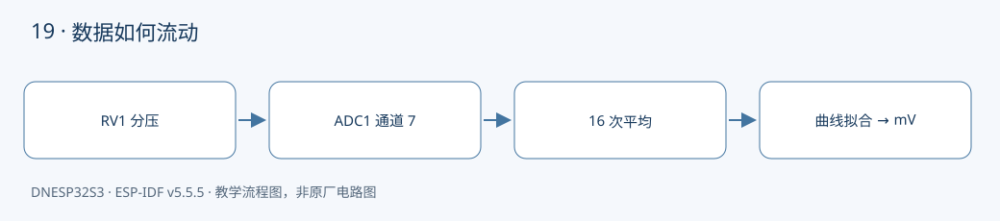

本课对应《DNESP32S3 使用指南（IDF 版）》第 24 章。配套完整工程：[examples/19-adc-calibration](https://github.com/Rainboylvx/esp32-learning-code/tree/main/examples/19-adc-calibration)。

**环境与验收边界：** DNESP32S3 V1.2，ESP-IDF v5.5.5；本机 macOS 构建通过。Ubuntu 26、外设接线、屏幕效果和实际测量仍待实板验收。下文输出均为预期格式，不能当作已采集的硬件日志。

## 本课完成后能做什么

- 旋转 RV1，raw 和 mV 随位置变化。
- 选择低、中、高三个未饱和位置，与万用表比较并记录误差。
- 拆掉跳线后认识悬空抖动，不能解释为有效传感器数据。

## 硬件连接与资源

| 信号或资源 | 对应关系 |
| --- | --- |
| 模拟输入 | GPIO8 = ADC1_CHANNEL_7 |
| P3 跳线 | RV 与 AIN 连接；断开 AIN 与 RMT |
| 被测量 | 板载 RV1 电位器的分压 |
| 输入电压 | 以 3.3V 供电范围为界，禁止接入 5V |

以下为正点原子 DNESP32S3 V1.2 原理图的相关页，保留原厂标识；表格用于快速定位，遇到板卡版本差异以实际原理图为准。点击图片可查看引脚与网络名。




## 旋钮位置如何变成一个整数

RV1 两端连接 3.3V 和 GND，滑动端经 P3 跳线送到 GPIO8。ADC 对输入电压采样，给出原始整数。GPIO8 的 ADC 功能是 ADC1_CHANNEL_7，GPIO 编号与通道号不能混用。

P3 同时承担红外发射切换。采集电压时接 RV↔AIN，红外发射时接 AIN↔RMT；两课不能同时让 GPIO8 当模拟输入和数字输出。

## 为什么不直接 raw × 3300 ÷ 4095

位宽说明码值数量，衰减决定输入量程，参考电压和芯片误差影响转换关系。原始值达到满量程，并不代表输入电压恰好是 3.300V。ESP32-S3 在本例使用 12 dB 衰减，其有效测量范围也不等于电源轨，旋钮接近顶端可能饱和。

工程使用 oneshot 驱动，创建与通道、衰减和位宽配置匹配的曲线拟合校准句柄，再调用 `adc_cali_raw_to_voltage()` 获得毫伏。若校准不可用，只报告 raw，不把一个估算值伪装成已校准值。驱动参考见文末官方文档。

## 平均值能消除哪些问题

每轮读取 16 次，间隔 1 ms，再求整数平均。它可减轻部分随机噪声，但无法修复引脚接错、量程饱和或系统性偏差。某一轮采样失败时，不输出这一轮的新结果，避免用未赋值的变量继续计算。

实板验证应把旋钮固定在几个位置，用万用表同时量 GPIO8 对地电压，与日志的 mV 比较；不要用“日志数字在变化”替代准确度验证。

## 工程如何组织

`components/BSP/ADC/voltage.c` 管理 ADC 和校准句柄，负责采样平均与单位转换；`main/main.c` 只负责周期和显示。`calibrated` 明确告诉应用毫伏值是否可信。

固定引脚通过 `CONFIG_LESSON_*` 常量定义在本工程的 `Kconfig.projbuild` 中，构建后可在 `sdkconfig` 中核对。这些默认值对应本板连线，仅修改配置数字并不能改变硬件连接。

### 应用代码：入口与处理流程

下面代码直接取自配套工程的 `main/main.c`，头文件和 BSP 实现在仓库中一并提供。初学时先看 `app_main()`，再追踪它调用的模块。

```c
#include "voltage.h"
#include "esp_log.h"
#include "freertos/FreeRTOS.h"
#include "freertos/task.h"
void app_main(void)
{
    ESP_ERROR_CHECK(voltage_init());
    while(1) {
        int raw,mv; bool calibrated;
        esp_err_t err=voltage_read(&raw,&mv,&calibrated);
        if(err!=ESP_OK) ESP_LOGW("adc","%s",esp_err_to_name(err));
        else if(calibrated) ESP_LOGI("adc","raw=%d voltage=%d mV",raw,mv);
        else ESP_LOGI("adc","raw=%d (uncalibrated)",raw);
        vTaskDelay(pdMS_TO_TICKS(200));
    }
}
```

### BSP 采样与校准实现

```c
#include "voltage.h"
#include "sdkconfig.h"
#include "esp_adc/adc_oneshot.h"
#include "esp_adc/adc_cali.h"
#include "esp_adc/adc_cali_scheme.h"
#include "esp_check.h"
#include "freertos/FreeRTOS.h"
#include "freertos/task.h"
static adc_oneshot_unit_handle_t s_unit;
static adc_cali_handle_t s_calibration;
esp_err_t voltage_init(void)
{
    adc_oneshot_unit_init_cfg_t u={.unit_id=ADC_UNIT_1};
    ESP_RETURN_ON_ERROR(adc_oneshot_new_unit(&u,&s_unit),"adc","unit");
    adc_oneshot_chan_cfg_t channel={.atten=ADC_ATTEN_DB_12,.bitwidth=ADC_BITWIDTH_DEFAULT};
    ESP_RETURN_ON_ERROR(adc_oneshot_config_channel(s_unit,CONFIG_LESSON_ADC_CHANNEL,&channel),"adc","channel");
    adc_cali_curve_fitting_config_t c={.unit_id=ADC_UNIT_1,.chan=CONFIG_LESSON_ADC_CHANNEL,
        .atten=ADC_ATTEN_DB_12,.bitwidth=ADC_BITWIDTH_DEFAULT};
    esp_err_t result=adc_cali_create_scheme_curve_fitting(&c,&s_calibration);
    if(result!=ESP_OK) ESP_LOGW("adc","Calibration unavailable: %s; raw only",esp_err_to_name(result));
    return ESP_OK; // 校准不可用时仍允许读取 raw。
}
esp_err_t voltage_read(int *raw,int *millivolts,bool *calibrated)
{
    int sum=0;
    for(int i=0;i<16;i++) {
        int value;
        ESP_RETURN_ON_ERROR(adc_oneshot_read(s_unit,CONFIG_LESSON_ADC_CHANNEL,&value),"adc","read");
        sum+=value;
        vTaskDelay(pdMS_TO_TICKS(1)); // 分散采样并让出 CPU。
    }
    int average=sum/16,mv=0;
    bool valid=s_calibration && adc_cali_raw_to_voltage(s_calibration,average,&mv)==ESP_OK;
    *raw=average; *millivolts=mv; *calibrated=valid;
    return ESP_OK;
}
```

### CMake 与中文注释

```cmake
# 应用依赖 BSP，不直接操作 ADC 句柄。
idf_component_register(SRCS "main.c" INCLUDE_DIRS "." PRIV_REQUIRES BSP)
```

每个工程有自己的 `project()` 名称和 `sdkconfig.defaults`。VS Code 已关闭普通 CMake 自动配置，C/C++ 语言服务从 `build/compile_commands.json` 读取编译信息。首次构建前，这个文件还不存在，需要先激活 IDF 并完成构建，无需手工拼接头文件路径。

## 编译、烧录与观察

```bash
# 激活 EIM 安装的 IDF；每个新终端都需要激活。
source ~/.espressif/tools/activate_idf_v5.5.5.sh
# 进入单个示例根目录，不是在 examples 总目录运行。
cd ~/mycode/esp32-blog/examples/19-adc-calibration
# 首次配置目标；已有正确配置时不用每次重复 set-target。
idf.py set-target esp32s3
# 编译会生成 build/compile_commands.json，供 VS Code 使用。
idf.py build
# 把这个值换成实际连接开发板的端口；macOS 通常为 /dev/cu.*。
PORT=/dev/ttyUSB0
idf.py -p "$PORT" flash monitor
# 串口监视退出：Ctrl+]。
```

预期输出或屏幕内容（示意；数值、日志前缀和启动时间依现场而变）：

```text
adc: raw=<采样平均值> voltage=<校准结果> mV
```

## 故障定位与逐项验收

先确认目标为 `esp32s3`，再检查实际端口、供电，并按本文引脚表核对跳线。编译成功只能说明源码与工具链兼容，模块型号、物理线路和时序仍需实板确认。

- [ ] 旋转 RV1，raw 和 mV 随位置变化。
- [ ] 选择低、中、高三个未饱和位置，与万用表比较并记录误差。
- [ ] 拆掉跳线后认识悬空抖动，不能解释为有效传感器数据。

遇到通信错误，先检查错误码和对应模块，不要用“错误时返回 0”掩盖异常。文中的预期日志只供阅读程序时参考；实板验收时，应记录实际现象，保存日志和接线照片。

## 与教材和官方实现对照

对照 11_adc：保留 GPIO8/ADC1_CHANNEL_7，使用 v5.5.5 oneshot 与 curve fitting 接口；增加 16 次平均和校准失败降级。

## 本地验证记录与参考

- 2026-10-24：ESP-IDF v5.5.5、目标 ESP32-S3，本机 macOS `idf.py build` 通过。
- Hugo 草稿页面、文内本地图片和课程入口已检查；`draft: true` 保留，实板验收后再考虑发布。
- 未执行本课硬件烧录、波形测量或外设现象验收，以上待办不提前勾选。
- [ESP-IDF v5.5.5 官方接口文档](https://docs.espressif.com/projects/esp-idf/en/v5.5.5/esp32s3/api-reference/peripherals/adc_calibration.html)。
- 教材第 24 章；DNESP32S3 V1.2 原理图第 1、2、4 页。

[返回课程目录](./_index.md)
