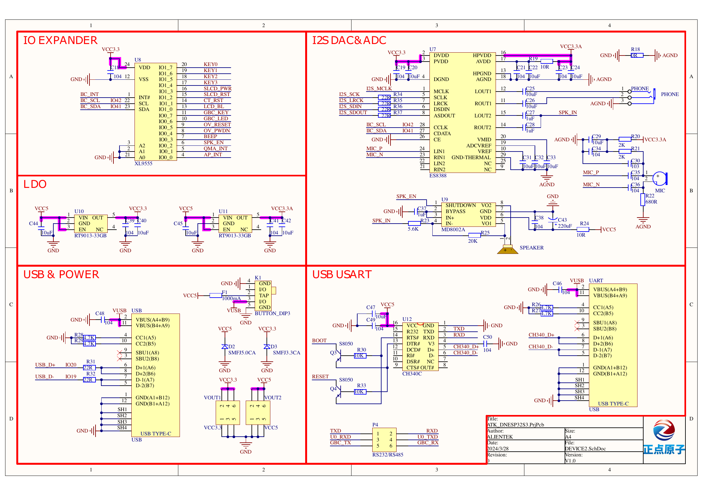
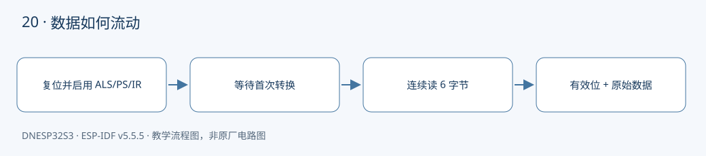

本课对应《DNESP32S3 使用指南（IDF 版）》第 25 章。配套完整工程：[examples/20-ap3216c](https://github.com/Rainboylvx/esp32-learning-code/tree/main/examples/20-ap3216c)。

**环境与验收边界：** DNESP32S3 V1.2，ESP-IDF v5.5.5；本机 macOS 构建通过。Ubuntu 26、外设接线、屏幕效果和实际测量仍待实板验收。下文输出均为预期格式，不能当作已采集的硬件日志。

## 本课完成后能做什么

- 无遮挡和遮挡时观察 ALS、PS 的趋势以及 valid 标志。
- 解释 IR/PS 掩码，能区分通信错误与无效测量。
- 用错误地址实验时得到明确错误，恢复地址后可重新测量。

## 硬件连接与资源

| 信号或资源 | 对应关系 |
| --- | --- |
| I²C0 | SDA GPIO41，SCL GPIO42 |
| AP3216C | 地址 0x1e，板载 |
| 中断输出 | 接 XL9555 IO0_0，本课轮询不用 |
| 外加接线 | 无，直接观察板载 ALS&PS 区域 |

以下为正点原子 DNESP32S3 V1.2 原理图的相关页，保留原厂标识；表格用于快速定位，遇到板卡版本差异以实际原理图为准。点击图片可查看引脚与网络名。






## 一个芯片提供三类读数

ALS 是环境光通道，PS 是接近检测通道，IR 是红外通道。本课读出原始数值并观察变化，不把 PS 的整数说成厘米，也不在没有量程配置依据时把 ALS 直接写成 lux。

芯片地址为 0x1e。向系统配置寄存器 0 写 0x04 复位，等待 10 ms，再写 0x03 启用测量，等待首轮转换。初始化后每 200 ms 读取一次，不用紧密循环向还没完成转换的器件索要“新数据”。

## 寄存器不是每两个字节就能直接拼接

从 0x0A 连续读取 6 字节：

| 通道 | 组装方式 | 有效性 |
| --- | --- | --- |
| IR | 高字节左移 2 位，低字节取 bit1..0 | 低字节 bit7 为无效标志 |
| ALS | 高字节左移 8 位，再或低字节 | 16 位原始值 |
| PS | 高字节取低 6 位左移 4，低字节取低 4 位 | 低字节 bit6 为无效标志 |

这些掩码把状态位从数据位里去掉。把整个低字节拼入 PS，会把无效标志当成测量数值。

## “读失败”和“读到了无效状态”分别处理

I²C 超时是通信错误；通信成功但 IR/PS 有效位未满足，是传感器状态。不能把这两类情况都记成数字 0，因为暗环境或远离物体时，正常读数也可能很小。

BSP 先读入临时数组，确认事务成功后才更新输出结构。应用打印原始值和 valid 标志；通信失败时，改为每秒重试一次，并重新初始化。遮挡、强光或距离变化对应的具体数值取决于现场条件，不能直接把示例数字作为验收门槛。

## 工程如何组织

驱动放在 `components/BSP/`，应用放在 `main/main.c`。本工程包含 `BUS`、`AP3216C` 模块。ESP-IDF 会自动发现项目根目录下的 `components/BSP`。`main` 通过 `PRIV_REQUIRES BSP` 声明组件依赖，`INCLUDE_DIRS` 则导出编译时使用的头文件搜索路径，不涉及运行时文件查找。


### 应用代码：入口与处理流程

下面代码直接取自配套工程的 `main/main.c`，头文件和 BSP 实现在仓库中一并提供。初学时先看 `app_main()`，再追踪它调用的模块。

```c
#include <stdio.h>
#include <stdint.h>
#include <stdbool.h>
#include <string.h>
#include <stdlib.h>
#include <assert.h>
#include "esp_err.h"
#include "esp_log.h"
#include "esp_timer.h"
#include "freertos/FreeRTOS.h"
#include "freertos/task.h"
#include "ap3216c.h"
void app_main(void)
{
    i2c_master_bus_handle_t bus;
    ESP_ERROR_CHECK(bus_init(0,CONFIG_LESSON_I2C_SDA,CONFIG_LESSON_I2C_SCL,&bus));
    ESP_ERROR_CHECK(light_open(bus));
    bool ready=false;
    while(1) {
        esp_err_t err=ESP_OK;
        if(!ready) { err=light_reset(); ready=(err==ESP_OK); }
        light_sample_t s;
        if(ready) err=light_read(&s);
        if(err==ESP_OK) ESP_LOGI("light","ALS=%u IR=%u valid=%d PS=%u valid=%d",
            s.als,s.ir,s.ir_valid,s.ps,s.ps_valid);
        else { ready=false; ESP_LOGW("light","%s",esp_err_to_name(err)); }
        vTaskDelay(pdMS_TO_TICKS(ready ? 200 : 1000));
    }
}
```

### BSP 关键实现：AP3216C

以下是本课对应驱动的完整源文件。对外声明见 [ap3216c.h](https://github.com/Rainboylvx/esp32-learning-code/tree/main/examples/20-ap3216c/components/BSP/AP3216C/ap3216c.h)。公共 BUS 模块统一使用新 I²C master API，将单次事务等待限制在 50 ms；设备 API 使用 7 位地址。

```c
#include "ap3216c.h"
#include "freertos/FreeRTOS.h"
#include "freertos/task.h"
static i2c_master_dev_handle_t s_dev;
esp_err_t light_open(i2c_master_bus_handle_t bus) { return bus_device(bus, 0x1e, &s_dev); }
esp_err_t light_reset(void)
{
    ESP_RETURN_ON_ERROR(reg_write(s_dev, 0, 4), "light", "reset");
    vTaskDelay(pdMS_TO_TICKS(10));
    ESP_RETURN_ON_ERROR(reg_write(s_dev, 0, 3), "light", "enable");
    vTaskDelay(pdMS_TO_TICKS(120)); // 首次转换完成后才能读。
    return ESP_OK;
}
esp_err_t light_read(light_sample_t *out)
{
    uint8_t b[6];
    ESP_RETURN_ON_ERROR(reg_read(s_dev, 0x0a, b, 6), "light", "read");
    light_sample_t next = {.ir=((uint16_t)b[1]<<2)|(b[0]&3),
        .als=((uint16_t)b[3]<<8)|b[2], .ps=((b[5]&63)<<4)|(b[4]&15),
        .ir_valid=!(b[0]&0x80), .ps_valid=!(b[4]&0x40)};
    *out = next; // 只有整次读取成功才交付新数据。
    return ESP_OK;
}
```

### CMake 与中文注释

```cmake
# 私有依赖只供本组件源码使用。
idf_component_register(SRCS "main.c" INCLUDE_DIRS "."
    PRIV_REQUIRES esp_timer BSP )
```

每个工程有自己的 `project()` 名称和 `sdkconfig.defaults`。VS Code 已关闭普通 CMake 自动配置，C/C++ 语言服务从 `build/compile_commands.json` 读取编译信息。首次构建前，这个文件还不存在，需要先激活 IDF 并完成构建，无需手工拼接头文件路径。

## 编译、烧录与观察

```bash
# 激活 EIM 安装的 IDF；每个新终端都需要激活。
source ~/.espressif/tools/activate_idf_v5.5.5.sh
# 进入单个示例根目录，不是在 examples 总目录运行。
cd ~/mycode/esp32-blog/examples/20-ap3216c
# 首次配置目标；已有正确配置时不用每次重复 set-target。
idf.py set-target esp32s3
# 编译会生成 build/compile_commands.json，供 VS Code 使用。
idf.py build
# 把这个值换成实际连接开发板的端口；macOS 通常为 /dev/cu.*。
PORT=/dev/ttyUSB0
idf.py -p "$PORT" flash monitor
# 串口监视退出：Ctrl+]。
```

预期输出或屏幕内容（示意；数值、日志前缀和启动时间依现场而变）：

```text
light: ALS=<raw> IR=<raw> valid=1 PS=<raw> valid=1
```

## 故障定位与逐项验收

先确认目标为 `esp32s3`，再检查实际端口、供电，并按本文引脚表核对跳线。编译成功只能说明源码与工具链兼容，模块型号、物理线路和时序仍需实板确认。

- [ ] 无遮挡和遮挡时观察 ALS、PS 的趋势以及 valid 标志。
- [ ] 解释 IR/PS 掩码，能区分通信错误与无效测量。
- [ ] 用错误地址实验时得到明确错误，恢复地址后可重新测量。

遇到通信错误，先检查错误码和对应模块，不要用“错误时返回 0”掩盖异常。文中的预期日志只供阅读程序时参考；实板验收时，应记录实际现象，保存日志和接线照片。

## 与教材和官方实现对照

对照教材第 25 章正文：保留复位和连续寄存器读取，分别保存有效位，不再把异常统一返回零；中断脚存在但本课不使用。

## 本地验证记录与参考

- 2026-10-24：ESP-IDF v5.5.5、目标 ESP32-S3，本机 macOS `idf.py build` 通过。
- Hugo 草稿页面、文内本地图片和课程入口已检查；`draft: true` 保留，实板验收后再考虑发布。
- 未执行本课硬件烧录、波形测量或外设现象验收，以上待办不提前勾选。
- [ESP-IDF v5.5.5 官方接口文档](https://docs.espressif.com/projects/esp-idf/en/v5.5.5/esp32s3/api-reference/peripherals/i2c.html)。
- 教材第 25 章；DNESP32S3 V1.2 原理图第 2、3、4 页。

[返回课程目录](./_index.md)
