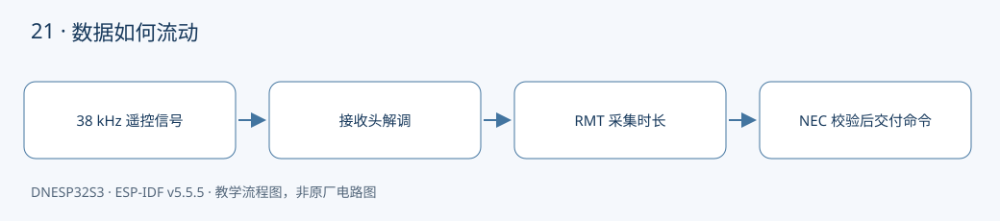

本课对应《DNESP32S3 使用指南（IDF 版）》第 26 章。配套完整工程：[examples/21-rmt-ir-receive](https://github.com/Rainboylvx/esp32-learning-code/tree/main/examples/21-rmt-ir-receive)。

**环境与验收边界：** DNESP32S3 V1.2，ESP-IDF v5.5.5；本机 macOS 构建通过。Ubuntu 26、外设接线、屏幕效果和实际测量仍待实板验收。下文输出均为预期格式，不能当作已采集的硬件日志。

## 本课完成后能做什么

- 短按输出完整 address/command，长按输出 repeat。
- 换按键后 command 改变；释放再按不会沿用错误旧命令。
- 用主机测试验证反码错误、短帧和坏时序均被拒绝。

## 硬件连接与资源

| 信号或资源 | 对应关系 |
| --- | --- |
| 红外接收头 | 板载 REMOTE IN |
| 输出信号 | GPIO2，解调后低电平为 mark |
| 遥控协议 | 标准 8 位地址 NEC，38 kHz 遥控器 |
| 冲突资源 | GPIO2 也与 TF_CS 共用，本课不启用 SD 卡 |

以下为正点原子 DNESP32S3 V1.2 原理图的相关页，保留原厂标识；表格用于快速定位，遇到板卡版本差异以实际原理图为准。点击图片可查看引脚与网络名。




## 接收的是载波，GPIO 看到的是包络

遥控器不是持续点亮红外 LED，而是以约 38 kHz 载波发出一段段光。板载接收头完成滤波与解调，GPIO2 看到的低电平段表示载波存在，因此不要再对这个信号进行 38 kHz 软件采样。

RMT 使用 1 MHz 分辨率，一个计数就是 1 μs。一个 symbol 保存两个连续电平和各自持续时间。ISR 只把本次 symbol 数量送入队列，普通任务再做解码和日志。

## NEC 用高电平时长区分 0 与 1

| 内容 | 接收低电平 | 接收高电平 |
| --- | --- | --- |
| 普通帧前导 | 约 9000 μs | 约 4500 μs |
| 数据 0 | 约 560 μs | 约 560 μs |
| 数据 1 | 约 560 μs | 约 1690 μs |
| 长按重复前导 | 约 9000 μs | 约 2250 μs |

32 位数据依次是地址、地址反码、命令、命令反码，每个字节最低位先发。程序允许约 ±25% 时长容差，检查电平极性、位长、末尾 mark 和两个反码关系。这里不支持扩展地址 NEC 或其他品牌私有协议。

重复帧不带完整命令，只能引用近期收到的完整帧。代码限制距前次有效帧不超过 200 ms，避免很久以前的命令被噪声“复活”。

## 缓冲区由谁拥有

RMT 把采样写入静态缓冲区，完成后 ISR 发通知；任务读取同一块内存，解码完成才重新开始接收。这个先后关系保证不会边读边被 DMA/硬件覆盖。代价是重新布防之间有短暂空隙，本课不是保证零丢失的高速接收器。

没有遥控输入时任务在队列阻塞，不消耗 CPU。接收到的杂波或不支持的协议会记录 ignored，不会当成合法命令。

## 工程如何组织

驱动放在 `components/BSP/`，应用放在 `main/main.c`。本工程包含 `NEC` 模块。项目根目录的 `components/BSP` 会被 ESP-IDF 自动发现，`main` 的 `PRIV_REQUIRES BSP` 声明组件依赖；`INCLUDE_DIRS` 导出头文件搜索路径，不是运行时查找文件。

固定引脚以 `CONFIG_LESSON_*` 常量写入本工程 `Kconfig.projbuild`，构建后可在 `sdkconfig` 核对；这些默认值对应本板连线，不表示任意改数字就能改变硬件。

### 应用代码：入口与处理流程

下面代码直接取自配套工程的 `main/main.c`，头文件和 BSP 实现在仓库中一并提供。初学时先看 `app_main()`，再追踪它调用的模块。

```c
#include "sdkconfig.h"
#include <stdio.h>
#include <stdint.h>
#include <stdbool.h>
#include <string.h>
#include <stdlib.h>
#include <assert.h>
#include "esp_err.h"
#include "esp_log.h"
#include "esp_timer.h"
#include "freertos/FreeRTOS.h"
#include "freertos/task.h"
#include "nec.h"
#include "driver/rmt_rx.h"
#include "freertos/queue.h"
static QueueHandle_t s_done;
static rmt_symbol_word_t s_buffer[64];
static bool received(rmt_channel_handle_t channel,const rmt_rx_done_event_data_t *event,void *arg)
{
    (void)channel; (void)arg;
    BaseType_t wake=pdFALSE;
    size_t n=event->num_symbols;
    // 只送长度；任务处理完再重新接收，因此硬件不会覆盖正在解码的缓冲区。
    xQueueSendFromISR(s_done,&n,&wake);
    return wake==pdTRUE;
}
void app_main(void)
{
    s_done=xQueueCreate(1,sizeof(size_t)); assert(s_done);
    rmt_channel_handle_t rx;
    rmt_rx_channel_config_t c={.gpio_num=CONFIG_LESSON_IR_RX,.clk_src=RMT_CLK_SRC_DEFAULT,
        .resolution_hz=1000000,.mem_block_symbols=64};
    ESP_ERROR_CHECK(rmt_new_rx_channel(&c,&rx));
    rmt_rx_event_callbacks_t cb={.on_recv_done=received};
    ESP_ERROR_CHECK(rmt_rx_register_event_callbacks(rx,&cb,NULL));
    ESP_ERROR_CHECK(rmt_enable(rx));
    rmt_receive_config_t capture={.signal_range_min_ns=100000,.signal_range_max_ns=12000000};
    uint8_t address=0,command=0; int64_t last=0; bool have_last=false;
    while(1) {
        ESP_ERROR_CHECK(rmt_receive(rx,s_buffer,sizeof(s_buffer),&capture));
        size_t n;
        xQueueReceive(s_done,&n,portMAX_DELAY); // 等待外部输入不消耗 CPU。
        uint8_t next_address,next_command;
        nec_result_t result=nec_decode(s_buffer,n,&next_address,&next_command);
        int64_t now=esp_timer_get_time();
        if(result==NEC_FRAME) {
            address=next_address; command=next_command; have_last=true; last=now;
            ESP_LOGI("nec","address=0x%02x command=0x%02x",address,command);
        } else if(result==NEC_REPEAT && have_last && now-last<200000) {
            last=now; ESP_LOGI("nec","repeat command=0x%02x",command);
        } else ESP_LOGW("nec","ignored symbols=%u",(unsigned)n);
    }
}
```

### BSP 关键实现：NEC

以下是本课对应驱动的完整源文件。对外声明见 [nec.h](https://github.com/Rainboylvx/esp32-learning-code/tree/main/examples/21-rmt-ir-receive/components/BSP/NEC/nec.h)。

```c
#include "nec.h"
static bool near(unsigned actual,unsigned expected)
{
    return actual>=expected*3/4 && actual<=expected*5/4;
}
size_t nec_encode(uint8_t address,uint8_t command,rmt_symbol_word_t *out)
{
    uint8_t b[]={address,(uint8_t)~address,command,(uint8_t)~command};
    out[0]=(rmt_symbol_word_t){.level0=1,.duration0=9000,.level1=0,.duration1=4500};
    for(int bit=0;bit<32;bit++)
        out[bit+1]=(rmt_symbol_word_t){.level0=1,.duration0=560,.level1=0,
            .duration1=(b[bit/8]&(1U<<(bit%8))) ? 1690 : 560};
    out[33]=(rmt_symbol_word_t){.level0=1,.duration0=560,.level1=0,.duration1=1000};
    return 34;
}
nec_result_t nec_decode(const rmt_symbol_word_t *s,size_t n,uint8_t *address,uint8_t *command)
{
    // 解调接收头输出低电平表示红外载波存在，极性与发射端相反。
    if(n<2 || s[0].level0!=0 || s[0].level1!=1 || !near(s[0].duration0,9000))
        return NEC_INVALID;
    if(near(s[0].duration1,2250))
        return s[1].level0==0 && near(s[1].duration0,560) ? NEC_REPEAT : NEC_INVALID;
    if(n<34 || !near(s[0].duration1,4500)) return NEC_INVALID;
    uint8_t b[4]={0};
    for(int bit=0;bit<32;bit++) {
        rmt_symbol_word_t v=s[bit+1];
        if(v.level0!=0 || v.level1!=1 || !near(v.duration0,560)) return NEC_INVALID;
        if(near(v.duration1,1690)) b[bit/8] |= 1U<<(bit%8);
        else if(!near(v.duration1,560)) return NEC_INVALID;
    }
    if(s[33].level0!=0 || !near(s[33].duration0,560)) return NEC_INVALID;
    if((uint8_t)(b[0]^b[1])!=255 || (uint8_t)(b[2]^b[3])!=255) return NEC_INVALID;
    *address=b[0]; *command=b[2];
    return NEC_FRAME;
}
```

### CMake 与中文注释

```cmake
# 私有依赖只供本组件源码使用。
idf_component_register(SRCS "main.c" INCLUDE_DIRS "."
    PRIV_REQUIRES esp_timer BSP esp_driver_rmt)
```

每个工程有自己的 `project()` 名称和 `sdkconfig.defaults`。VS Code 设置已关闭普通 CMake 自动配置，C/C++ 语言服务读取 `build/compile_commands.json`；首次构建前文件尚不存在，应先激活 IDF 并构建，而不是手工拼头文件路径。

## 编译、烧录与观察

```bash
# 激活 EIM 安装的 IDF；每个新终端都需要激活。
source ~/.espressif/tools/activate_idf_v5.5.5.sh
# 进入单个示例根目录，不是在 examples 总目录运行。
cd ~/mycode/esp32-blog/examples/21-rmt-ir-receive
# 首次配置目标；已有正确配置时不用每次重复 set-target。
idf.py set-target esp32s3
# 编译会生成 build/compile_commands.json，供 VS Code 使用。
idf.py build
# 把这个值换成实际连接开发板的端口；macOS 通常为 /dev/cu.*。
PORT=/dev/ttyUSB0
idf.py -p "$PORT" flash monitor
# 串口监视退出：Ctrl+]。
```

预期输出或屏幕内容（示意；数值、日志前缀和启动时间依现场而变）：

```text
nec: address=0x00 command=0x45
nec: repeat command=0x45
```

## 故障定位与逐项验收

先检查目标是否是 `esp32s3`、实际端口与供电，再按本文引脚表核对跳线。编译成功只能说明源码与工具链兼容，无法证明模块型号、物理线路或时序已经正确。

- [ ] 短按输出完整 address/command，长按输出 repeat。
- [ ] 换按键后 command 改变；释放再按不会沿用错误旧命令。
- [ ] 用主机测试验证反码错误、短帧和坏时序均被拒绝。

遇到通信错误先看错误码和对应模块，禁止简单用“错误时返回 0”掩盖异常。预期日志是阅读程序的参考，验收时应保存自己的现象、日志与接线照片。

## 与教材和官方实现对照

对照 12_infrared_reception：保留 GPIO2 和 NEC，迁移到 RMT 新驱动；将采样、解码与日志分开，并校验反码、结束脉冲和重复帧时效。

## 本地验证记录与参考

主机测试直接编译本课 `nec.c`，覆盖已知帧位序、极性、短帧、错误反码、错误脉宽、结束 mark 和重复帧。光学链路、RMT 采样及长按行为仍需实板验证。

```bash
# 在 esp32-blog 根目录执行协议测试，无需连接开发板。
bash examples/tests/stage3/run.sh
```

- 2026-10-24：ESP-IDF v5.5.5、目标 ESP32-S3，本机 macOS `idf.py build` 通过。
- Hugo 草稿页面、文内本地图片和课程入口已检查；`draft: true` 保留，实板验收后再考虑发布。
- 未执行本课硬件烧录、波形测量或外设现象验收，以上待办不提前勾选。
- [ESP-IDF v5.5.5 官方接口文档](https://docs.espressif.com/projects/esp-idf/en/v5.5.5/esp32s3/api-reference/peripherals/rmt.html)。
- 教材第 26 章；DNESP32S3 V1.2 原理图第 1、2、4 页。

[返回课程目录](./_index.md)
