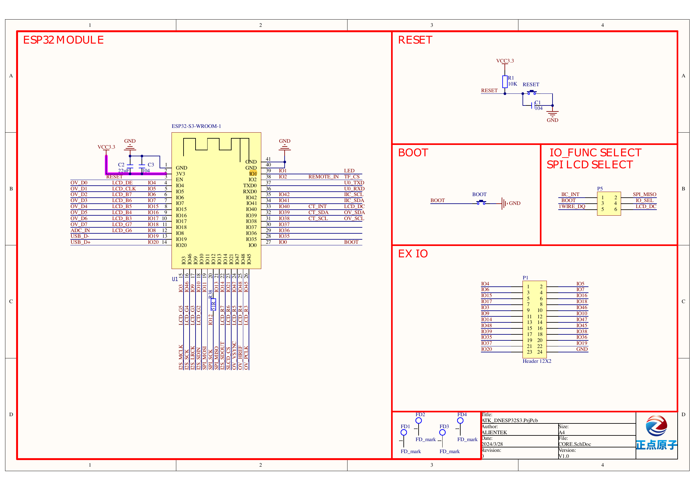
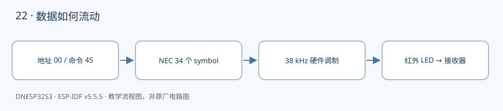

本课对应《DNESP32S3 使用指南（IDF 版）》第 27 章。配套完整工程：[examples/22-rmt-ir-transmit](https://github.com/Rainboylvx/esp32-learning-code/tree/main/examples/22-rmt-ir-transmit)。

**环境与验收边界：** DNESP32S3 V1.2，ESP-IDF v5.5.5；本机 macOS 构建通过。Ubuntu 26、外设接线、屏幕效果和实际测量仍待实板验收。下文输出均为预期格式，不能当作已采集的硬件日志。

## 本课完成后能做什么

- 接收端解析出 00/45，每秒一次。
- 逻辑分析仪检查 mark 内部载波约 38 kHz、空闲低电平。
- 改变命令字节，接收端相应变化；不以 sent 日志代替光学验收。

## 硬件连接与资源

| 信号或资源 | 对应关系 |
| --- | --- |
| 发射控制 | GPIO8，经 P3 AIN↔RMT 跳线 |
| 驱动级 | Q2 MOSFET 驱动红外 LED，GPIO 高电平使能 |
| 载波 | 38 kHz，约 1/3 占空比 |
| 验收接收端 | 第二块板的第 21 课或支持 NEC 的解码设备 |

以下为正点原子 DNESP32S3 V1.2 原理图的相关页，保留原厂标识；表格用于快速定位，遇到板卡版本差异以实际原理图为准。点击图片可查看引脚与网络名。






## 编码与调制分别负责什么

编码决定“一段亮多久、灭多久”，调制决定“亮的时间里以多快的载波闪烁”。本例 `nec_encode()` 生成 34 个 symbol：一个前导、32 位数据、一个结束 mark；RMT 再把高电平段调制成 38 kHz 脉冲。

GPIO8 只是 MOSFET 的控制信号，不直接承担红外 LED 电流。原理图中 Q2 低侧开关在高电平驱动时导通，所以编码的 mark 使用高电平。这与第 21 课解调接收头的低电平 mark 恰好相反。

## 从一个命令计算完整帧

地址 0x00、命令 0x45 对应四个字节 `00 FF 45 BA`。每个字节低位先发；0 用 560/560 μs，1 用 560/1690 μs。发送普通帧结束后等待一秒，再发下一帧。本课发送完整帧，不模拟按住遥控器时的短重复帧。

`rmt_transmit()` 提交之后并不意味着传输完成。代码调用 `rmt_tx_wait_all_done()`，给出 100 ms 上限；等待完成前不能修改 frame 数组。硬件负责微秒时序，应用只负责较慢的发送周期。

## 怎样验收“真的发对了”

串口打印 sent 只表示驱动完成传输，不能证明光学信号被正确接收。最直接的方法是第二块开发板运行第 21 课，接收日志应输出 address=00、command=45；也可用支持 NEC 的红外解码设备。

未知家电不一定采用这个地址、命令甚至协议。不要以“电视没有反应”直接判断 RMT 代码错误。手机相机可能看见红外光，但它也不能校验载波频率与编码。

GPIO8 同时是 ADC 输入。此课必须把 P3 从 RV↔AIN 改为 AIN↔RMT，不可把旋钮分压同时接到数字输出上。

## 工程如何组织

驱动放在 `components/BSP/`，应用放在 `main/main.c`。本工程包含 `NEC` 模块。项目根目录的 `components/BSP` 会被 ESP-IDF 自动发现，`main` 的 `PRIV_REQUIRES BSP` 声明组件依赖；`INCLUDE_DIRS` 导出头文件搜索路径，不是运行时查找文件。

固定引脚以 `CONFIG_LESSON_*` 常量写入本工程 `Kconfig.projbuild`，构建后可在 `sdkconfig` 核对；这些默认值对应本板连线，不表示任意改数字就能改变硬件。

### 应用代码：入口与处理流程

下面代码直接取自配套工程的 `main/main.c`，头文件和 BSP 实现在仓库中一并提供。初学时先看 `app_main()`，再追踪它调用的模块。

```c
#include "sdkconfig.h"
#include <stdio.h>
#include <stdint.h>
#include <stdbool.h>
#include <string.h>
#include <stdlib.h>
#include <assert.h>
#include "esp_err.h"
#include "esp_log.h"
#include "esp_timer.h"
#include "freertos/FreeRTOS.h"
#include "freertos/task.h"
#include "nec.h"
#include "driver/rmt_tx.h"
#include "driver/rmt_encoder.h"
void app_main(void)
{
    rmt_channel_handle_t tx;
    rmt_tx_channel_config_t c={.gpio_num=CONFIG_LESSON_IR_TX,.clk_src=RMT_CLK_SRC_DEFAULT,
        .resolution_hz=1000000,.mem_block_symbols=64,.trans_queue_depth=1};
    ESP_ERROR_CHECK(rmt_new_tx_channel(&c,&tx));
    rmt_carrier_config_t carrier={.frequency_hz=38000,.duty_cycle=0.333f};
    ESP_ERROR_CHECK(rmt_apply_carrier(tx,&carrier));
    rmt_encoder_handle_t encoder;
    rmt_copy_encoder_config_t copy={};
    ESP_ERROR_CHECK(rmt_new_copy_encoder(&copy,&encoder));
    ESP_ERROR_CHECK(rmt_enable(tx));
    rmt_symbol_word_t frame[34];
    size_t n=nec_encode(0x00,0x45,frame);
    rmt_transmit_config_t send={.loop_count=0};
    while(1) {
        ESP_ERROR_CHECK(rmt_transmit(tx,encoder,frame,n*sizeof(frame[0]),&send));
        ESP_ERROR_CHECK(rmt_tx_wait_all_done(tx,100)); // 完成前不能改写 frame。
        ESP_LOGI("ir_tx","sent NEC address=00 command=45");
        vTaskDelay(pdMS_TO_TICKS(1000));
    }
}
```

### BSP 关键实现：NEC

以下是本课对应驱动的完整源文件。对外声明见 [nec.h](https://github.com/Rainboylvx/esp32-learning-code/tree/main/examples/22-rmt-ir-transmit/components/BSP/NEC/nec.h)。

```c
#include "nec.h"
static bool near(unsigned actual,unsigned expected)
{
    return actual>=expected*3/4 && actual<=expected*5/4;
}
size_t nec_encode(uint8_t address,uint8_t command,rmt_symbol_word_t *out)
{
    uint8_t b[]={address,(uint8_t)~address,command,(uint8_t)~command};
    out[0]=(rmt_symbol_word_t){.level0=1,.duration0=9000,.level1=0,.duration1=4500};
    for(int bit=0;bit<32;bit++)
        out[bit+1]=(rmt_symbol_word_t){.level0=1,.duration0=560,.level1=0,
            .duration1=(b[bit/8]&(1U<<(bit%8))) ? 1690 : 560};
    out[33]=(rmt_symbol_word_t){.level0=1,.duration0=560,.level1=0,.duration1=1000};
    return 34;
}
nec_result_t nec_decode(const rmt_symbol_word_t *s,size_t n,uint8_t *address,uint8_t *command)
{
    // 解调接收头输出低电平表示红外载波存在，极性与发射端相反。
    if(n<2 || s[0].level0!=0 || s[0].level1!=1 || !near(s[0].duration0,9000))
        return NEC_INVALID;
    if(near(s[0].duration1,2250))
        return s[1].level0==0 && near(s[1].duration0,560) ? NEC_REPEAT : NEC_INVALID;
    if(n<34 || !near(s[0].duration1,4500)) return NEC_INVALID;
    uint8_t b[4]={0};
    for(int bit=0;bit<32;bit++) {
        rmt_symbol_word_t v=s[bit+1];
        if(v.level0!=0 || v.level1!=1 || !near(v.duration0,560)) return NEC_INVALID;
        if(near(v.duration1,1690)) b[bit/8] |= 1U<<(bit%8);
        else if(!near(v.duration1,560)) return NEC_INVALID;
    }
    if(s[33].level0!=0 || !near(s[33].duration0,560)) return NEC_INVALID;
    if((uint8_t)(b[0]^b[1])!=255 || (uint8_t)(b[2]^b[3])!=255) return NEC_INVALID;
    *address=b[0]; *command=b[2];
    return NEC_FRAME;
}
```

### CMake 与中文注释

```cmake
# 私有依赖只供本组件源码使用。
idf_component_register(SRCS "main.c" INCLUDE_DIRS "."
    PRIV_REQUIRES esp_timer BSP esp_driver_rmt)
```

每个工程有自己的 `project()` 名称和 `sdkconfig.defaults`。VS Code 设置已关闭普通 CMake 自动配置，C/C++ 语言服务读取 `build/compile_commands.json`；首次构建前文件尚不存在，应先激活 IDF 并构建，而不是手工拼头文件路径。

## 编译、烧录与观察

```bash
# 激活 EIM 安装的 IDF；每个新终端都需要激活。
source ~/.espressif/tools/activate_idf_v5.5.5.sh
# 进入单个示例根目录，不是在 examples 总目录运行。
cd ~/mycode/esp32-blog/examples/22-rmt-ir-transmit
# 首次配置目标；已有正确配置时不用每次重复 set-target。
idf.py set-target esp32s3
# 编译会生成 build/compile_commands.json，供 VS Code 使用。
idf.py build
# 把这个值换成实际连接开发板的端口；macOS 通常为 /dev/cu.*。
PORT=/dev/ttyUSB0
idf.py -p "$PORT" flash monitor
# 串口监视退出：Ctrl+]。
```

预期输出或屏幕内容（示意；数值、日志前缀和启动时间依现场而变）：

```text
ir_tx: sent NEC address=00 command=45
# 另一块接收板应显示：
nec: address=0x00 command=0x45
```

## 故障定位与逐项验收

先检查目标是否是 `esp32s3`、实际端口与供电，再按本文引脚表核对跳线。编译成功只能说明源码与工具链兼容，无法证明模块型号、物理线路或时序已经正确。

- [ ] 接收端解析出 00/45，每秒一次。
- [ ] 逻辑分析仪检查 mark 内部载波约 38 kHz、空闲低电平。
- [ ] 改变命令字节，接收端相应变化；不以 sent 日志代替光学验收。

遇到通信错误先看错误码和对应模块，禁止简单用“错误时返回 0”掩盖异常。预期日志是阅读程序的参考，验收时应保存自己的现象、日志与接线照片。

## 与教材和官方实现对照

对照教材第 27 章正文：保留 GPIO8 发射级；使用新 RMT copy encoder 发送显式 symbol，借助硬件载波调制，避免忙等手动产生载波。

## 本地验证记录与参考

- 2026-10-24：ESP-IDF v5.5.5、目标 ESP32-S3，本机 macOS `idf.py build` 通过。
- Hugo 草稿页面、文内本地图片和课程入口已检查；`draft: true` 保留，实板验收后再考虑发布。
- 未执行本课硬件烧录、波形测量或外设现象验收，以上待办不提前勾选。
- [ESP-IDF v5.5.5 官方接口文档](https://docs.espressif.com/projects/esp-idf/en/v5.5.5/esp32s3/api-reference/peripherals/rmt.html)。
- 教材第 27 章；DNESP32S3 V1.2 原理图第 1、2、4 页。

[返回课程目录](./_index.md)
