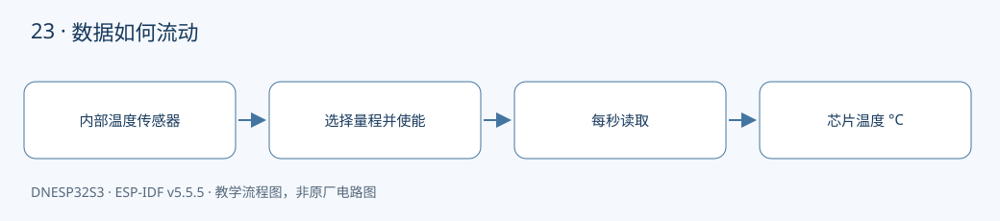

本课对应《DNESP32S3 使用指南（IDF 版）》第 28 章。配套完整工程：[examples/23-internal-temperature](https://github.com/Rainboylvx/esp32-learning-code/tree/main/examples/23-internal-temperature)。

**环境与验收边界：** DNESP32S3 V1.2，ESP-IDF v5.5.5；本机 macOS 构建通过。Ubuntu 26、外设接线、屏幕效果和实际测量仍待实板验收。下文输出均为预期格式，不能当作已采集的硬件日志。

## 本课完成后能做什么

- 每秒输出一次有效芯片温度或明确错误。
- 说明为什么手边温度计与芯片读数不完全相同。
- 能够列出安装、使能、读取和释放的顺序。

## 硬件连接与资源

| 信号或资源 | 对应关系 |
| --- | --- |
| 外设 | 芯片内部温度传感器 |
| 外部引脚 | 无 |
| 请求量程 | -10～80°C，由驱动选择硬件档位 |



## 这个温度到底是谁的温度

传感器位于芯片内部，主要反映芯片自身温度。CPU、无线和其他外设工作会发热，开发板散热条件也会影响结果。它不能直接代替下一课的 DS18B20 环境探头。

本例请求 -10～80°C 测量区间。驱动需要选择合适的硬件档位来满足这个范围，不能只靠软件任意裁剪；读取失败时保留错误，不打印尚未成功赋值的浮点变量。

## 生命周期只有三步

安装 `temperature_sensor_install()`、使能 `temperature_sensor_enable()`、读取 `temperature_sensor_get_celsius()`。长期运行的教学工程会保持句柄有效；应用不再使用传感器时，应先 disable，再 uninstall，释放资源。

应用每秒读取一次，中间调用 `vTaskDelay(pdMS_TO_TICKS(1000))`。这里的宏将毫秒转换为 FreeRTOS tick，并不负责温度转换；真正读取由驱动完成。

## 做一个可解释的观察实验

先空闲运行，记录稳定后的读数；再在后续有 CPU 或无线负载的工程中观察温度变化。比较时保持供电、放置方式和环境温度一致。不要通过让任务永久死循环来“加热”，那会把看门狗问题混进温度实验。

内部温度适合观察趋势、提示热状态和辅助调试。需要对外界温度给出可校准测量时，应选择独立传感器，并考虑探头与热源的距离。

## 工程如何组织

驱动放在 `components/BSP/`，应用放在 `main/main.c`。本工程包含 `TEMP` 模块。ESP-IDF 会自动发现项目根目录下的 `components/BSP`。`main` 通过 `PRIV_REQUIRES BSP` 声明组件依赖，`INCLUDE_DIRS` 则导出编译时使用的头文件搜索路径，不涉及运行时文件查找。


### 应用代码：入口与处理流程

下面代码直接取自配套工程的 `main/main.c`，头文件和 BSP 实现在仓库中一并提供。初学时先看 `app_main()`，再追踪它调用的模块。

```c
#include <stdio.h>
#include <stdint.h>
#include <stdbool.h>
#include <string.h>
#include <stdlib.h>
#include <assert.h>
#include "esp_err.h"
#include "esp_log.h"
#include "esp_timer.h"
#include "freertos/FreeRTOS.h"
#include "freertos/task.h"
#include "temp.h"
void app_main(void)
{
    ESP_ERROR_CHECK(chip_temp_init());
    while(1) {
        float c;
        esp_err_t err=chip_temp_read(&c);
        if(err==ESP_OK) ESP_LOGI("temp","Chip temperature %.2f C",c);
        else ESP_LOGW("temp","%s",esp_err_to_name(err));
        vTaskDelay(pdMS_TO_TICKS(1000));
    }
}
```

### BSP 关键实现：TEMP

以下是本课对应驱动的完整源文件。对外声明见 [temp.h](https://github.com/Rainboylvx/esp32-learning-code/tree/main/examples/23-internal-temperature/components/BSP/TEMP/temp.h)。

```c
#include "temp.h"
#include "driver/temperature_sensor.h"
#include "esp_check.h"
static temperature_sensor_handle_t s_sensor;
esp_err_t chip_temp_init(void)
{
    // 请求测量区间，由驱动选择合适的量程档位。
    temperature_sensor_config_t c = TEMPERATURE_SENSOR_CONFIG_DEFAULT(-10, 80);
    ESP_RETURN_ON_ERROR(temperature_sensor_install(&c, &s_sensor), "temp", "install");
    return temperature_sensor_enable(s_sensor);
}
esp_err_t chip_temp_read(float *celsius)
{
    return temperature_sensor_get_celsius(s_sensor, celsius);
}
```

### CMake 与中文注释

```cmake
# 私有依赖只供本组件源码使用。
idf_component_register(SRCS "main.c" INCLUDE_DIRS "."
    PRIV_REQUIRES esp_timer BSP )
```

每个工程有自己的 `project()` 名称和 `sdkconfig.defaults`。VS Code 已关闭普通 CMake 自动配置，C/C++ 语言服务从 `build/compile_commands.json` 读取编译信息。首次构建前，这个文件还不存在，需要先激活 IDF 并完成构建，无需手工拼接头文件路径。

## 编译、烧录与观察

```bash
# 激活 EIM 安装的 IDF；每个新终端都需要激活。
source ~/.espressif/tools/activate_idf_v5.5.5.sh
# 进入单个示例根目录，不是在 examples 总目录运行。
cd ~/mycode/esp32-blog/examples/23-internal-temperature
# 首次配置目标；已有正确配置时不用每次重复 set-target。
idf.py set-target esp32s3
# 编译会生成 build/compile_commands.json，供 VS Code 使用。
idf.py build
# 把这个值换成实际连接开发板的端口；macOS 通常为 /dev/cu.*。
PORT=/dev/ttyUSB0
idf.py -p "$PORT" flash monitor
# 串口监视退出：Ctrl+]。
```

预期输出或屏幕内容（示意；数值、日志前缀和启动时间依现场而变）：

```text
temp: Chip temperature <实际读数> C
```

## 故障定位与逐项验收

先确认目标为 `esp32s3`，再检查实际端口、供电，并按本文引脚表核对跳线。编译成功只能说明源码与工具链兼容，模块型号、物理线路和时序仍需实板确认。

- [ ] 每秒输出一次有效芯片温度或明确错误。
- [ ] 说明为什么手边温度计与芯片读数不完全相同。
- [ ] 能够列出安装、使能、读取和释放的顺序。

遇到通信错误，先检查错误码和对应模块，不要用“错误时返回 0”掩盖异常。文中的预期日志只供阅读程序时参考；实板验收时，应记录实际现象，保存日志和接线照片。

## 与教材和官方实现对照

对照教材第 28 章正文：使用独立 temperature_sensor 驱动接口，明确温度范围与芯片温度边界，不将其标注为室温。

## 本地验证记录与参考

- 2026-10-24：ESP-IDF v5.5.5、目标 ESP32-S3，本机 macOS `idf.py build` 通过。
- Hugo 草稿页面、文内本地图片和课程入口已检查；`draft: true` 保留，实板验收后再考虑发布。
- 未执行本课硬件烧录、波形测量或外设现象验收，以上待办不提前勾选。
- [ESP-IDF v5.5.5 官方接口文档](https://docs.espressif.com/projects/esp-idf/en/v5.5.5/esp32s3/api-reference/peripherals/temp_sensor.html)。
- 教材第 28 章；DNESP32S3 V1.2 原理图中的芯片资源说明。

[返回课程目录](./_index.md)
