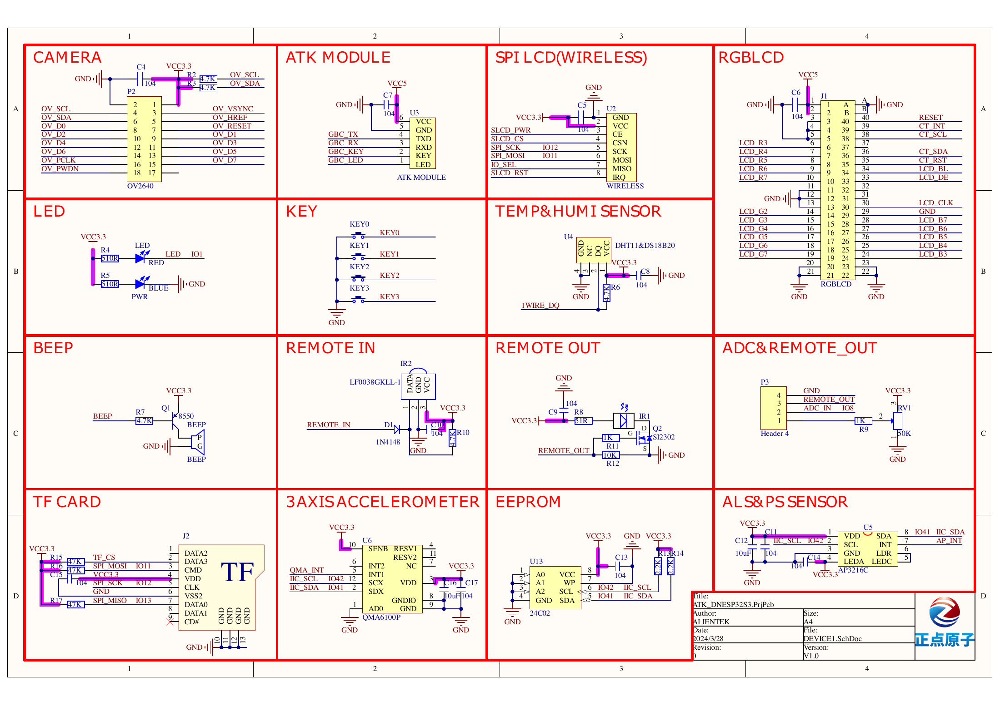
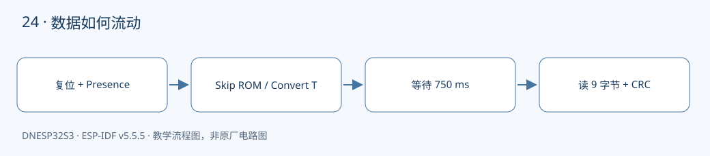
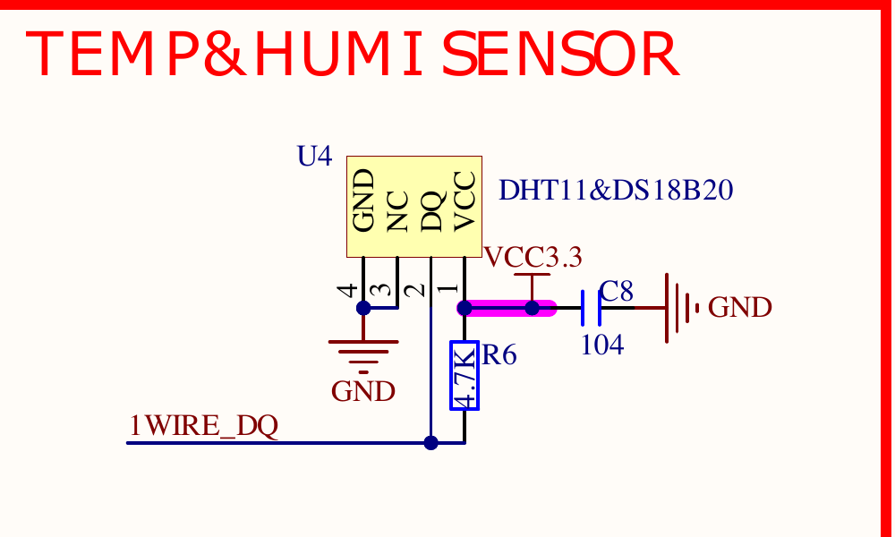

本课对应《DNESP32S3 使用指南（IDF 版）》第 29 章。配套完整工程：[examples/24-ds18b20](https://github.com/Rainboylvx/esp32-learning-code/tree/main/examples/24-ds18b20)。

**环境与验收边界：** DNESP32S3 V1.2，ESP-IDF v5.5.5；本机 macOS 构建通过。Ubuntu 26、外设接线、屏幕效果和实际测量仍待实板验收。下文输出均为预期格式，不能当作已采集的硬件日志。

## 本课完成后能做什么

- 连接正确时周期输出温度，轻触探头温度变化。
- 断开探头得到 NOT_FOUND 或 CRC/响应错误，不能稳定显示假 0°C。
- 解释为什么 750 ms 用任务延时，而 6 μs 时隙不用 vTaskDelay。

## 硬件连接与资源

| 信号或资源 | 对应关系 |
| --- | --- |
| 总线 | GPIO0，P5 IO0↔1WIRE_DQ |
| 供电 | 3.3V、GND，使用三线供电而非寄生供电 |
| 上拉 | 板载 4.7 kΩ |
| 器件 | 单个 DS18B20；与 DHT11/BOOT 共用信号，禁止同时操作 |

以下为正点原子 DNESP32S3 V1.2 原理图的相关页，保留原厂标识；表格用于快速定位，遇到板卡版本差异以实际原理图为准。点击图片可查看引脚与网络名。






## 一根数据线如何实现双向通信

单总线的数据脚用开漏模式。主机输出 0 表示主动拉低，输出 1 表示释放，总线依靠 4.7 kΩ 上拉变高；传感器需要回传 0 时也可以拉低。若主机用推挽持续输出高，就会与传感器争用总线。

本课默认一个 DS18B20，使用 Skip ROM 0xCC。多器件总线需要枚举和 Match ROM，不能直接让所有器件同时回答。使用外部 3.3V 供电，不支持寄生供电所需的强上拉。

对照 U4 插座丝印和传感器具体封装引脚，不能只按“平面朝前”猜线序。V1.2 的 U4 第 1 脚为 3.3V、第 2 脚为 DQ，第 3、4 脚均连地（第 3 脚对 DHT11 标为 NC）。标准 TO-92 DS18B20 的第 1 脚 GND 接 U4 第 3 脚、第 2 脚 DQ 接 U4 第 2 脚、第 3 脚 VDD 接 U4 第 1 脚；带线封装仍应按其厂商引脚表确认，不能凭线色猜测。



P5 连接 IO0 与 1WIRE_DQ 后，不要再按 BOOT，启动时也不要让总线被拉低。

## 从复位到温度要经过哪些步骤

主机拉低约 480 μs，再释放，约 70 μs 后采样 Presence。确认器件存在后发送 0xCC、0x44 开始转换；12 位转换最长等待 750 ms，这段长等待让出 CPU，不应放在临界区。

转换完成后再次复位，发送 0xCC、0xBE，读出 9 字节 scratchpad。前两个字节为有符号温度，默认 12 位分辨率下除以 16 得到摄氏度。例如原始 0x0191 对应 25.0625°C；负温度要先转 int16_t，不能当成无符号大整数。

## CRC 与超时是读数的一部分

最后一个字节是前 8 字节的 CRC-8。代码还检查保留字节和合理温度范围，排除断线或被拉死后出现的全零假数据。失败时不更新调用者温度。

GPIO 位操作仅用于理解时序，短暂临界区保护每个时隙；750 ms 转换期绝不关中断。Wi-Fi、缓存和长临界区可能影响软件时序，复杂产品可改用 RMT 单总线驱动，本课的实板验证仍不可省略。

## 工程如何组织

驱动放在 `components/BSP/`，应用放在 `main/main.c`。本工程包含 `ONEWIRE` 模块。项目根目录的 `components/BSP` 会被 ESP-IDF 自动发现，`main` 的 `PRIV_REQUIRES BSP` 声明组件依赖；`INCLUDE_DIRS` 导出头文件搜索路径，不是运行时查找文件。

固定引脚以 `CONFIG_LESSON_*` 常量写入本工程 `Kconfig.projbuild`，构建后可在 `sdkconfig` 核对；这些默认值对应本板连线，不表示任意改数字就能改变硬件。

### 应用代码：入口与处理流程

下面代码直接取自配套工程的 `main/main.c`，头文件和 BSP 实现在仓库中一并提供。初学时先看 `app_main()`，再追踪它调用的模块。

```c
#include <stdio.h>
#include <stdint.h>
#include <stdbool.h>
#include <string.h>
#include <stdlib.h>
#include <assert.h>
#include "esp_err.h"
#include "esp_log.h"
#include "esp_timer.h"
#include "freertos/FreeRTOS.h"
#include "freertos/task.h"
#include "onewire.h"
void app_main(void)
{
    ESP_ERROR_CHECK(ds_init());
    while(1) {
        float temperature;
        esp_err_t err=ds_read(&temperature);
        if(err==ESP_OK) ESP_LOGI("ds18b20","temperature=%.4f C",temperature);
        else ESP_LOGW("ds18b20","%s",esp_err_to_name(err));
        vTaskDelay(pdMS_TO_TICKS(1000));
    }
}
```

### BSP 关键实现：ONEWIRE

以下是本课对应驱动的完整源文件。对外声明见 [onewire.h](https://github.com/Rainboylvx/esp32-learning-code/tree/main/examples/24-ds18b20/components/BSP/ONEWIRE/onewire.h)。

```c
#include "sdkconfig.h"
#include "onewire.h"
#include "driver/gpio.h"
#include "esp_rom_sys.h"
#include "freertos/FreeRTOS.h"
#include "freertos/task.h"
#define DQ CONFIG_LESSON_ONEWIRE
static portMUX_TYPE s_lock=portMUX_INITIALIZER_UNLOCKED;
esp_err_t ds_init(void)
{
    gpio_config_t c={.pin_bit_mask=1ULL<<DQ,.mode=GPIO_MODE_INPUT_OUTPUT_OD,.pull_up_en=true};
    esp_err_t err=gpio_config(&c);
    gpio_set_level(DQ,1); // 开漏输出 1 表示释放，靠外部 4.7k 拉高。
    return err;
}
static bool reset(void)
{
    gpio_set_level(DQ,0); esp_rom_delay_us(480);
    portENTER_CRITICAL(&s_lock);
    gpio_set_level(DQ,1); esp_rom_delay_us(70);
    bool present=!gpio_get_level(DQ);
    portEXIT_CRITICAL(&s_lock);
    esp_rom_delay_us(410);
    return present && gpio_get_level(DQ); // 排除总线一直短路到地。
}
static void write_byte(uint8_t value)
{
    for(int bit=0;bit<8;bit++) {
        portENTER_CRITICAL(&s_lock);
        gpio_set_level(DQ,0);
        esp_rom_delay_us(value&1 ? 6 : 60);
        gpio_set_level(DQ,1);
        esp_rom_delay_us(value&1 ? 64 : 10);
        portEXIT_CRITICAL(&s_lock);
        value>>=1;
    }
}
static uint8_t read_byte(void)
{
    uint8_t value=0;
    for(int bit=0;bit<8;bit++) {
        portENTER_CRITICAL(&s_lock);
        gpio_set_level(DQ,0); esp_rom_delay_us(3);
        gpio_set_level(DQ,1); esp_rom_delay_us(10);
        if(gpio_get_level(DQ)) value|=1U<<bit;
        esp_rom_delay_us(57);
        portEXIT_CRITICAL(&s_lock);
    }
    return value;
}
uint8_t ds_crc(const uint8_t *bytes,int n)
{
    uint8_t crc=0;
    while(n--) {
        uint8_t value=*bytes++;
        for(int i=0;i<8;i++) {
            uint8_t mix=(crc^value)&1;
            crc>>=1;
            if(mix) crc^=0x8c; // Dallas/Maxim CRC-8，低位优先。
            value>>=1;
        }
    }
    return crc;
}
esp_err_t ds_read(float *celsius)
{
    if(!reset()) return ESP_ERR_NOT_FOUND;
    write_byte(0xcc); write_byte(0x44); // 单个器件：Skip ROM，再开始转换。
    vTaskDelay(pdMS_TO_TICKS(750)); // 12 位转换最大等待时间；此时不关闭中断。
    if(!reset()) return ESP_ERR_NOT_FOUND;
    write_byte(0xcc); write_byte(0xbe);
    uint8_t b[9];
    for(int i=0;i<9;i++) b[i]=read_byte();
    if(ds_crc(b,8)!=b[8]) return ESP_ERR_INVALID_CRC;
    // DS18B20 的保留字节应为 0xff、0x0c、0x10，排除全 0 假数据。
    if(b[5]!=0xff || b[6]!=0x0c || b[7]!=0x10) return ESP_ERR_INVALID_RESPONSE;
    float next=(int16_t)((b[1]<<8)|b[0])/16.0f;
    if(next< -55 || next>125) return ESP_ERR_INVALID_RESPONSE;
    *celsius=next;
    return ESP_OK;
}
```

### CMake 与中文注释

```cmake
# 私有依赖只供本组件源码使用。
idf_component_register(SRCS "main.c" INCLUDE_DIRS "."
    PRIV_REQUIRES esp_timer BSP )
```

每个工程有自己的 `project()` 名称和 `sdkconfig.defaults`。VS Code 设置已关闭普通 CMake 自动配置，C/C++ 语言服务读取 `build/compile_commands.json`；首次构建前文件尚不存在，应先激活 IDF 并构建，而不是手工拼头文件路径。

## 编译、烧录与观察

```bash
# 激活 EIM 安装的 IDF；每个新终端都需要激活。
source ~/.espressif/tools/activate_idf_v5.5.5.sh
# 进入单个示例根目录，不是在 examples 总目录运行。
cd ~/mycode/esp32-blog/examples/24-ds18b20
# 首次配置目标；已有正确配置时不用每次重复 set-target。
idf.py set-target esp32s3
# 编译会生成 build/compile_commands.json，供 VS Code 使用。
idf.py build
# 把这个值换成实际连接开发板的端口；macOS 通常为 /dev/cu.*。
PORT=/dev/ttyUSB0
idf.py -p "$PORT" flash monitor
# 串口监视退出：Ctrl+]。
```

预期输出或屏幕内容（示意；数值、日志前缀和启动时间依现场而变）：

```text
ds18b20: temperature=25.0625 C
# 断线时应得到明确错误，例如：
ds18b20: ESP_ERR_NOT_FOUND
```

## 故障定位与逐项验收

先检查目标是否是 `esp32s3`、实际端口与供电，再按本文引脚表核对跳线。编译成功只能说明源码与工具链兼容，无法证明模块型号、物理线路或时序已经正确。

- [ ] 连接正确时周期输出温度，轻触探头温度变化。
- [ ] 断开探头得到 NOT_FOUND 或 CRC/响应错误，不能稳定显示假 0°C。
- [ ] 解释为什么 750 ms 用任务延时，而 6 μs 时隙不用 vTaskDelay。

遇到通信错误先看错误码和对应模块，禁止简单用“错误时返回 0”掩盖异常。预期日志是阅读程序的参考，验收时应保存自己的现象、日志与接线照片。

## 与教材和官方实现对照

对照教材第 29 章正文：保留单总线时序，加入九字节 CRC、保留字节检查与错误传播；明确单器件、外部供电和 GPIO0 复用约束。

## 本地验证记录与参考

- 2026-10-24：ESP-IDF v5.5.5、目标 ESP32-S3，本机 macOS `idf.py build` 通过。
- Hugo 草稿页面、文内本地图片和课程入口已检查；`draft: true` 保留，实板验收后再考虑发布。
- 未执行本课硬件烧录、波形测量或外设现象验收，以上待办不提前勾选。
- [ESP-IDF v5.5.5 官方接口文档](https://docs.espressif.com/projects/esp-idf/en/v5.5.5/esp32s3/api-reference/peripherals/gpio.html)。
- 教材第 29 章；DNESP32S3 V1.2 原理图第 1、2、4 页。

[返回课程目录](./_index.md)
