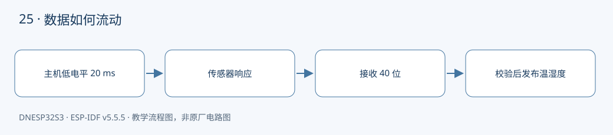
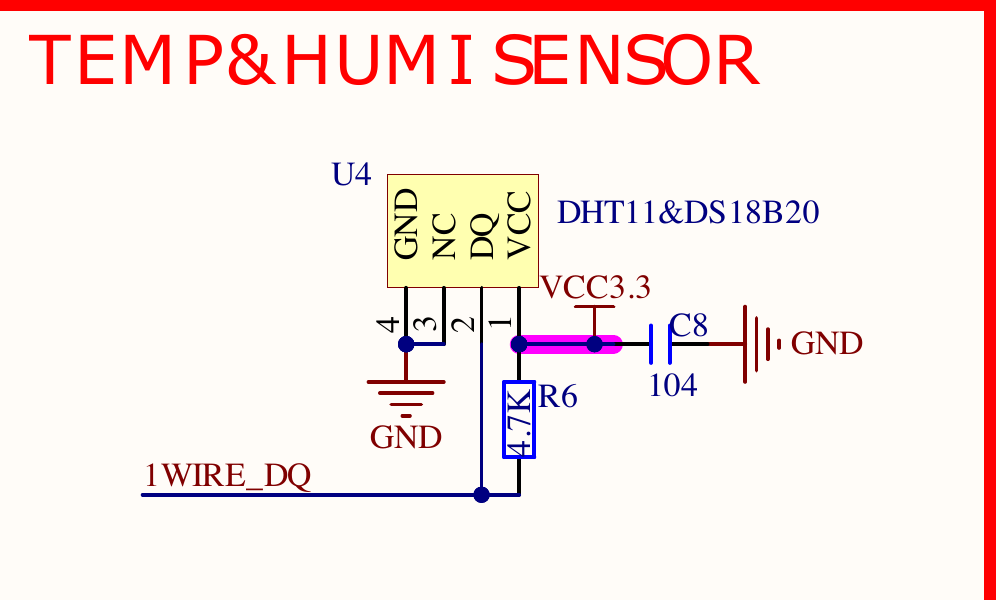

本课对应《DNESP32S3 使用指南（IDF 版）》第 30 章。配套完整工程：[examples/25-dht11](https://github.com/Rainboylvx/esp32-learning-code/tree/main/examples/25-dht11)。

**环境与验收边界：** DNESP32S3 V1.2，ESP-IDF v5.5.5；本机 macOS 构建通过。Ubuntu 26、外设接线、屏幕效果和实际测量仍待实板验收。下文输出均为预期格式，不能当作已采集的硬件日志。

## 本课完成后能做什么

- 每两秒左右更新一组温湿度。
- 断线后及时报超时，重新连接后可恢复；校验错不会更新读数。
- 能解释为何不能把采样周期任意缩短到 10 ms。

## 硬件连接与资源

| 信号或资源 | 对应关系 |
| --- | --- |
| DHT11 数据 | GPIO0，P5 IO0↔1WIRE_DQ |
| 供电与上拉 | U4 的 3.3V、GND、4.7 kΩ |
| 共用资源 | 与 DS18B20 二选一；不要同时按 BOOT |
| 周期 | 上电等 1 秒，采样间隔至少 2 秒 |

以下为正点原子 DNESP32S3 V1.2 原理图的相关页，保留原厂标识；表格用于快速定位，遇到板卡版本差异以实际原理图为准。点击图片可查看引脚与网络名。




## 同样是一根线，协议却不同

V1.2 使用 U4 插座：DHT11 第 1 脚 VCC 对 U4 第 1 脚，第 2 脚 DATA 对 U4 第 2 脚，第 3 脚 NC 对第 3 脚，第 4 脚 GND 对第 4 脚。原理图中第 3、4 脚连地。教材某些段落写成 U6，应按本板 U4 丝印及网络名定位。



DHT11 和 DS18B20 共用板上插座，不代表命令兼容。DHT11 没有 0xCC/0x44 这样的命令流，而是主机给出足够长的起始低电平，再根据传感器脉冲时长读取 40 位。

主机拉低至少 18 ms，本例用 20 ms 任务延时。释放总线后，传感器发出约 80 μs 低、80 μs 高的响应；每个数据位先低约 50 μs，再以约 26～28 μs 高表示 0、约 70 μs 高表示 1。工程用 40 μs 作为分界。

## 40 位拆成哪五个字节

数据按高位先到，依次为湿度整数、湿度小数、温度整数、温度小数、校验和。前四字节相加取低 8 位，应等于第五字节。DHT11 的小数表现依模块版本而异，本例按十分位处理，不把显示小数位数当成真实精度。

每一次等待电平变化最多 100 μs。断线、一直高或一直低都会尽快失败，避免 CPU 永久停在 while 循环里。只有校验成功且范围合理，才把局部解码值复制给调用者。

## 为什么不能用任务延时测量每一位

FreeRTOS tick 即使配置为 1 ms，也远长于几十微秒的高电平。若用 vTaskDelay(1) 等待一个位，采样回来时数据早已结束。本课使用短微秒忙等，并在约几毫秒接收窗口内进入临界区；所有失败路径都退出临界区。

这是一种讲清协议的实现，有明确代价：接收期间会推迟中断处理。不要将它无条件移入高实时性项目；后续可让 RMT 测脉宽。本例不启用无线任务，仍需要实板检验软件循环的测量偏差。

## 工程如何组织

驱动放在 `components/BSP/`，应用放在 `main/main.c`。本工程包含 `DHT` 模块。项目根目录的 `components/BSP` 会被 ESP-IDF 自动发现，`main` 的 `PRIV_REQUIRES BSP` 声明组件依赖；`INCLUDE_DIRS` 导出头文件搜索路径，不是运行时查找文件。

固定引脚以 `CONFIG_LESSON_*` 常量写入本工程 `Kconfig.projbuild`，构建后可在 `sdkconfig` 核对；这些默认值对应本板连线，不表示任意改数字就能改变硬件。

### 应用代码：入口与处理流程

下面代码直接取自配套工程的 `main/main.c`，头文件和 BSP 实现在仓库中一并提供。初学时先看 `app_main()`，再追踪它调用的模块。

```c
#include <stdio.h>
#include <stdint.h>
#include <stdbool.h>
#include <string.h>
#include <stdlib.h>
#include <assert.h>
#include "esp_err.h"
#include "esp_log.h"
#include "esp_timer.h"
#include "freertos/FreeRTOS.h"
#include "freertos/task.h"
#include "dht.h"
void app_main(void)
{
    ESP_ERROR_CHECK(dht_init());
    vTaskDelay(pdMS_TO_TICKS(1000)); // 上电稳定时间。
    while(1) {
        float temperature,humidity;
        esp_err_t err=dht_read(&temperature,&humidity);
        if(err==ESP_OK) ESP_LOGI("dht11","temperature=%.1f C humidity=%.1f %%",temperature,humidity);
        else ESP_LOGW("dht11","%s",esp_err_to_name(err));
        vTaskDelay(pdMS_TO_TICKS(2000)); // DHT11 不适合高速采样。
    }
}
```

### BSP 关键实现：DHT

以下是本课对应驱动的完整源文件。对外声明见 [dht.h](https://github.com/Rainboylvx/esp32-learning-code/tree/main/examples/25-dht11/components/BSP/DHT/dht.h)。

```c
#include "sdkconfig.h"
#include "dht.h"
#include "driver/gpio.h"
#include "esp_rom_sys.h"
#include "freertos/FreeRTOS.h"
#include "freertos/task.h"
#define DQ CONFIG_LESSON_ONEWIRE
static portMUX_TYPE s_lock=portMUX_INITIALIZER_UNLOCKED;
esp_err_t dht_init(void)
{
    gpio_config_t c={.pin_bit_mask=1ULL<<DQ,.mode=GPIO_MODE_INPUT_OUTPUT_OD,.pull_up_en=true};
    esp_err_t err=gpio_config(&c); gpio_set_level(DQ,1); return err;
}
// 记录当前电平维持了多少微秒；每一步都有上限，断线不会永久卡死。
static int pulse(int level,int max_us)
{
    int t=0;
    while(gpio_get_level(DQ)==level) {
        if(t>=max_us) return -1;
        esp_rom_delay_us(1); t++;
    }
    return t;
}
esp_err_t dht_read(float *temperature,float *humidity)
{
    uint8_t b[5]={0};
    gpio_set_level(DQ,0);
    vTaskDelay(pdMS_TO_TICKS(20)); // 主机起始信号至少 18 ms，任务可让出 CPU。
    bool ok=true;
    portENTER_CRITICAL(&s_lock);
    gpio_set_level(DQ,1);
    // 先等响应低电平，再跳过约 80 us 低、80 us 高的响应前导。
    if(pulse(1,100)<0 || pulse(0,100)<0 || pulse(1,100)<0) ok=false;
    for(int bit=0;ok && bit<40;bit++) {
        if(pulse(0,100)<0) { ok=false; break; }
        int high=pulse(1,100);
        if(high<0) { ok=false; break; }
        b[bit/8]=(b[bit/8]<<1)|(high>40);
    }
    portEXIT_CRITICAL(&s_lock); // 包括失败路径，也必须离开临界区。
    if(!ok) return ESP_ERR_TIMEOUT;
    if((uint8_t)(b[0]+b[1]+b[2]+b[3])!=b[4]) return ESP_ERR_INVALID_CRC;
    float h=b[0]+b[1]*0.1f;
    float t=(b[2]&0x7f)+b[3]*0.1f;
    if(b[2]&0x80) t=-t;
    if(h>100 || t<0 || t>50) return ESP_ERR_INVALID_RESPONSE;
    *humidity=h; *temperature=t; // 校验成功之后才更新调用者的数据。
    return ESP_OK;
}
```

### CMake 与中文注释

```cmake
# 私有依赖只供本组件源码使用。
idf_component_register(SRCS "main.c" INCLUDE_DIRS "."
    PRIV_REQUIRES esp_timer BSP )
```

每个工程有自己的 `project()` 名称和 `sdkconfig.defaults`。VS Code 设置已关闭普通 CMake 自动配置，C/C++ 语言服务读取 `build/compile_commands.json`；首次构建前文件尚不存在，应先激活 IDF 并构建，而不是手工拼头文件路径。

## 编译、烧录与观察

```bash
# 激活 EIM 安装的 IDF；每个新终端都需要激活。
source ~/.espressif/tools/activate_idf_v5.5.5.sh
# 进入单个示例根目录，不是在 examples 总目录运行。
cd ~/mycode/esp32-blog/examples/25-dht11
# 首次配置目标；已有正确配置时不用每次重复 set-target。
idf.py set-target esp32s3
# 编译会生成 build/compile_commands.json，供 VS Code 使用。
idf.py build
# 把这个值换成实际连接开发板的端口；macOS 通常为 /dev/cu.*。
PORT=/dev/ttyUSB0
idf.py -p "$PORT" flash monitor
# 串口监视退出：Ctrl+]。
```

预期输出或屏幕内容（示意；数值、日志前缀和启动时间依现场而变）：

```text
dht11: temperature=25.0 C humidity=60.0 %
# 数值是格式示例，不是实测保证。
```

## 故障定位与逐项验收

先检查目标是否是 `esp32s3`、实际端口与供电，再按本文引脚表核对跳线。编译成功只能说明源码与工具链兼容，无法证明模块型号、物理线路或时序已经正确。

- [ ] 每两秒左右更新一组温湿度。
- [ ] 断线后及时报超时，重新连接后可恢复；校验错不会更新读数。
- [ ] 能解释为何不能把采样周期任意缩短到 10 ms。

遇到通信错误先看错误码和对应模块，禁止简单用“错误时返回 0”掩盖异常。预期日志是阅读程序的参考，验收时应保存自己的现象、日志与接线照片。

## 与教材和官方实现对照

对照教材第 30 章正文：保留 DHT11 起始与 40 位时序，增加每个等待阶段上限、校验和和错误隔离；不与 DS18B20 同时运行。

## 本地验证记录与参考

- 2026-10-24：ESP-IDF v5.5.5、目标 ESP32-S3，本机 macOS `idf.py build` 通过。
- Hugo 草稿页面、文内本地图片和课程入口已检查；`draft: true` 保留，实板验收后再考虑发布。
- 未执行本课硬件烧录、波形测量或外设现象验收，以上待办不提前勾选。
- [ESP-IDF v5.5.5 官方接口文档](https://docs.espressif.com/projects/esp-idf/en/v5.5.5/esp32s3/api-reference/peripherals/gpio.html)。
- 教材第 30 章；DNESP32S3 V1.2 原理图第 1、2、4 页。

[返回课程目录](./_index.md)
