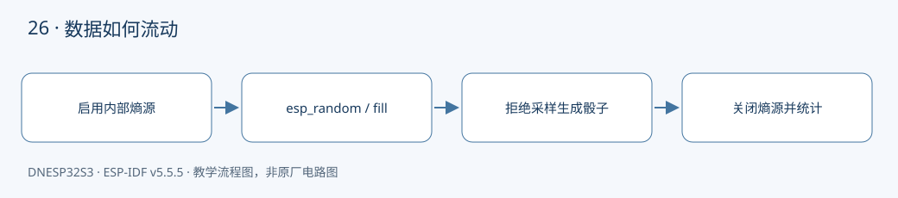

本课对应《DNESP32S3 使用指南（IDF 版）》第 31 章。配套完整工程：[examples/26-rng](https://github.com/Rainboylvx/esp32-learning-code/tree/main/examples/26-rng)。

**环境与验收边界：** DNESP32S3 V1.2，ESP-IDF v5.5.5；本机 macOS 构建通过。Ubuntu 26、外设接线、屏幕效果和实际测量仍待实板验收。下文输出均为预期格式，不能当作已采集的硬件日志。

## 本课完成后能做什么

- 六个计数相加为 6000，重复运行观察波动。
- 解释为什么拒绝前 4 个值能消除模偏差。
- 区分随机字节展示、nonce 规则和密钥管理，知道日志不能泄露秘密。

## 硬件连接与资源

| 信号或资源 | 对应关系 |
| --- | --- |
| 外设 | ESP32-S3 RNG 与本例临时启用的内部熵源 |
| 外部引脚 | 无 |
| 资源约束 | 不同时运行 ADC、Wi-Fi 或蓝牙示例 |



## 不同用途对随机数的要求不一样

游戏骰子关注分布是否合理；协议 nonce 还需要满足协议规定的唯一性或不可预测性；长期密钥涉及足够熵、秘密存储和完整安全设计。不能因为串口输出“看起来很乱”，就断言它适合生成密钥。

ESP32-S3 的随机数保证与硬件熵源状态有关。本例在没有 ADC、Wi-Fi、蓝牙活动的独立工程中，通过 `bootloader_random_enable()` 临时启用内部熵源，采样结束后 disable。不要把这段初始化直接搬进已有无线或 ADC 任务的综合程序。具体约束以官方随机数文档和目标芯片为准。

## 为什么 random % 6 存在微小偏差

32 位无符号数有 2^32 种取值，这个数量除以 6 的余数是 4。直接取模时，有几个点数会比其他点数多对应一个输入。

代码计算 `limit = -bound % bound`，无符号运算下 bound=6 时得到 4；遇到 0～3 重新取样，剩余区间大小可被 6 整除，再对 6 取模。这里要求 bound>0，示例固定为 6。

## 统计实验能证明什么，不能证明什么

程序取 6000 次样本，打印各点数次数。每个点数的次数接近 1000，但不应恰好等于 1000，也不要求每个字节在各次运行中都不同。有限样本只用于理解分布，不能证明加密安全。

打印的 16 个随机字节是演示数据，绝不能把真实密钥或身份凭证照此输出日志。工程每 100 次让出一次 CPU，避免把随机数统计写成长期独占核心的循环。

## 工程如何组织

本例围绕一个系统外设展开，先在 `main/main.c` 中按顺序展示完整调用过程；可复用的多设备驱动在后续工程中放到 `components/BSP/`。不要把芯片驱动的初始化藏在无法看到的外部脚本里。


### 应用代码：入口与处理流程

下面代码直接取自配套工程的 `main/main.c`，头文件和 BSP 实现在仓库中一并提供。初学时先看 `app_main()`，再追踪它调用的模块。

```c
#include <stdio.h>
#include <stdint.h>
#include <stdbool.h>
#include <string.h>
#include <stdlib.h>
#include <assert.h>
#include "esp_err.h"
#include "esp_log.h"
#include "esp_timer.h"
#include "freertos/FreeRTOS.h"
#include "freertos/task.h"
#include "esp_random.h"
#include "bootloader_random.h"
// 拒绝采样消除直接取模的偏差，bound 必须大于 0。
static uint32_t uniform(uint32_t bound)
{
    uint32_t limit=-bound%bound,r;
    do { r=esp_random(); } while(r<limit);
    return r%bound;
}
void app_main(void)
{
    // 本例独占内部 ADC 熵源；不要与 ADC、Wi-Fi、蓝牙示例同时运行。
    bootloader_random_enable();
    uint8_t bytes[16];
    esp_fill_random(bytes,sizeof(bytes));
    ESP_LOG_BUFFER_HEX("random_demo",bytes,sizeof(bytes)); // 仅演示字节，绝不能打印真实密钥。
    unsigned bins[6]={0};
    for(int i=0;i<6000;i++) {
        bins[uniform(6)]++;
        if(i%100==0) vTaskDelay(pdMS_TO_TICKS(1));
    }
    bootloader_random_disable(); // 停止内部熵源后，不再声称后续输出有同等熵保证。
    for(int i=0;i<6;i++) ESP_LOGI("dice","face=%d count=%u",i+1,bins[i]);
}
```

### CMake 与中文注释

```cmake
# 私有依赖只供本组件源码使用。
idf_component_register(SRCS "main.c" INCLUDE_DIRS "."
    PRIV_REQUIRES esp_timer bootloader_support)
```

每个工程有自己的 `project()` 名称和 `sdkconfig.defaults`。VS Code 已关闭普通 CMake 自动配置，C/C++ 语言服务从 `build/compile_commands.json` 读取编译信息。首次构建前，这个文件还不存在，需要先激活 IDF 并完成构建，无需手工拼接头文件路径。

## 编译、烧录与观察

```bash
# 激活 EIM 安装的 IDF；每个新终端都需要激活。
source ~/.espressif/tools/activate_idf_v5.5.5.sh
# 进入单个示例根目录，不是在 examples 总目录运行。
cd ~/mycode/esp32-blog/examples/26-rng
# 首次配置目标；已有正确配置时不用每次重复 set-target。
idf.py set-target esp32s3
# 编译会生成 build/compile_commands.json，供 VS Code 使用。
idf.py build
# 把这个值换成实际连接开发板的端口；macOS 通常为 /dev/cu.*。
PORT=/dev/ttyUSB0
idf.py -p "$PORT" flash monitor
# 串口监视退出：Ctrl+]。
```

预期输出或屏幕内容（示意；数值、日志前缀和启动时间依现场而变）：

```text
dice: face=1 count=<本轮统计>
...
dice: face=6 count=<本轮统计>
```

## 故障定位与逐项验收

先确认目标为 `esp32s3`，再检查实际端口、供电，并按本文引脚表核对跳线。编译成功只能说明源码与工具链兼容，模块型号、物理线路和时序仍需实板确认。

- [ ] 六个计数相加为 6000，重复运行观察波动。
- [ ] 解释为什么拒绝前 4 个值能消除模偏差。
- [ ] 区分随机字节展示、nonce 规则和密钥管理，知道日志不能泄露秘密。

遇到通信错误，先检查错误码和对应模块，不要用“错误时返回 0”掩盖异常。文中的预期日志只供阅读程序时参考；实板验收时，应记录实际现象，保存日志和接线照片。

## 与教材和官方实现对照

对照教材第 31 章正文：增加熵源生命周期、资源冲突说明和无模偏差取样；不把统计结果当成安全认证。

## 本地验证记录与参考

- 2026-10-24：ESP-IDF v5.5.5、目标 ESP32-S3，本机 macOS `idf.py build` 通过。
- Hugo 草稿页面、文内本地图片和课程入口已检查；`draft: true` 保留，实板验收后再考虑发布。
- 未执行本课硬件烧录、波形测量或外设现象验收，以上待办不提前勾选。
- [ESP-IDF v5.5.5 官方接口文档](https://docs.espressif.com/projects/esp-idf/en/v5.5.5/esp32s3/api-reference/system/random.html)。
- 教材第 31 章；DNESP32S3 V1.2 原理图中的芯片资源说明。

[返回课程目录](./_index.md)
