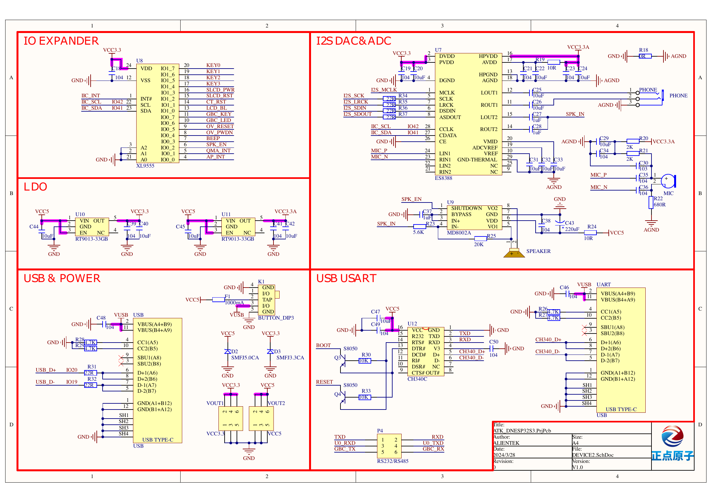
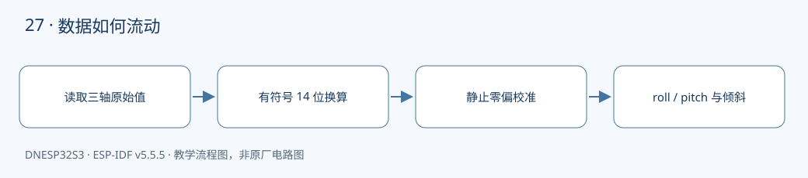

本课对应《DNESP32S3 使用指南（IDF 版）》第 32 章。配套完整工程：[examples/27-qma6100p](https://github.com/Rainboylvx/esp32-learning-code/tree/main/examples/27-qma6100p)。

**环境与验收边界：** DNESP32S3 V1.2，ESP-IDF v5.5.5；本机 macOS 构建通过。Ubuntu 26、外设接线、屏幕效果和实际测量仍待实板验收。下文输出均为预期格式，不能当作已采集的硬件日志。

## 本课完成后能做什么

- 按指定姿态校准后约为 (0,0,1)g。
- 分别沿两轴倾斜，观察 roll/pitch 正负与角度变化。
- 超过 20° 输出 TILTED；知道运动中读数不能直接当静态角度。

## 硬件连接与资源

| 信号或资源 | 对应关系 |
| --- | --- |
| I²C0 | SDA GPIO41，SCL GPIO42 |
| QMA6100P | 地址 0x12，芯片 ID 0x90 |
| 配置 | ±8g，约 100 Hz 输出，1024 LSB/g |
| INT | XL9555 IO0_1，本例轮询不用 |

以下为正点原子 DNESP32S3 V1.2 原理图的相关页，保留原厂标识；表格用于快速定位，遇到板卡版本差异以实际原理图为准。点击图片可查看引脚与网络名。






## 静止为什么仍然能读到约 1g

加速度计测量的是包含重力影响的比力。平放且传感器 +Z 朝上时，X、Y 应接近 0g，Z 接近 +1g。三个轴都减成 0，会把计算静态姿态需要的重力方向也一起删掉。

本例先检查芯片 ID，再执行教材复位序列，设置 ±8g 和 100 Hz。输出数据是左对齐的有符号 14 位数；先把高低字节组合为 int16_t，再换算到 g，避免负加速度被误当成巨大的正数。

## 零偏校准有前提

启动提示后三秒内让板卡静止，确认传感器 +Z 向上，收集 100 个样本取平均。X、Y 的均值作为偏置，Z 的均值减去 1g 作为偏置。

这不是任意姿态自动校准，更不是六面标定。如果板倒放、倾斜或运动，校准就会把重力和运动错记成偏差。测试前核对轴向；需要覆盖未知姿态的产品应另做标定流程及稳定性检测。

## 从三轴到倾斜角

roll 使用 `atan2(y,z)`，pitch 使用 `atan2(-x,sqrt(y*y+z*z))`，弧度再转换成角度。atan2 能保留象限信息，比简单相除后 atan 更方便。

本例任一角绝对值超过 20° 就输出 TILTED，否则 LEVEL。这个阈值适合观察，不是精密姿态控制器；边界处可加入滞回，运动时的加速度也会污染仅靠重力推算的姿态。加速度计无法单独给出可靠的航向 yaw。

## 工程如何组织

驱动放在 `components/BSP/`，应用放在 `main/main.c`。本工程包含 `BUS`、`QMA6100P` 模块。项目根目录的 `components/BSP` 会被 ESP-IDF 自动发现，`main` 的 `PRIV_REQUIRES BSP` 声明组件依赖；`INCLUDE_DIRS` 导出头文件搜索路径，不是运行时查找文件。


### 应用代码：入口与处理流程

下面代码直接取自配套工程的 `main/main.c`，头文件和 BSP 实现在仓库中一并提供。初学时先看 `app_main()`，再追踪它调用的模块。

```c
#include <stdio.h>
#include <stdint.h>
#include <stdbool.h>
#include <string.h>
#include <stdlib.h>
#include <assert.h>
#include "esp_err.h"
#include "esp_log.h"
#include "esp_timer.h"
#include "freertos/FreeRTOS.h"
#include "freertos/task.h"
#include "qma6100p.h"
#include <math.h>
void app_main(void)
{
    i2c_master_bus_handle_t bus;
    ESP_ERROR_CHECK(bus_init(0,CONFIG_LESSON_I2C_SDA,CONFIG_LESSON_I2C_SCL,&bus));
    ESP_ERROR_CHECK(motion_open(bus));
    ESP_ERROR_CHECK(motion_reset());
    ESP_LOGI("qma","Keep board STILL, +Z UP for calibration in 3 seconds");
    vTaskDelay(pdMS_TO_TICKS(3000));
    acceleration_t bias={0},s;
    for(int i=0;i<100;i++) {
        ESP_ERROR_CHECK(motion_read(&s));
        bias.x+=s.x/100; bias.y+=s.y/100; bias.z+=s.z/100;
        vTaskDelay(pdMS_TO_TICKS(10));
    }
    bias.z-=1; // 保留 +Z 方向的 1g 重力，不能把三个轴的均值都减到零。
    while(1) {
        esp_err_t err=motion_read(&s);
        if(err==ESP_OK) {
            s.x-=bias.x; s.y-=bias.y; s.z-=bias.z;
            float roll=atan2f(s.y,s.z)*57.29578f;
            float pitch=atan2f(-s.x,sqrtf(s.y*s.y+s.z*s.z))*57.29578f;
            ESP_LOGI("qma","g=(%.3f,%.3f,%.3f) roll=%.1f pitch=%.1f %s",
                s.x,s.y,s.z,roll,pitch,fabsf(roll)>20 || fabsf(pitch)>20 ? "TILTED":"LEVEL");
        } else ESP_LOGW("qma","%s",esp_err_to_name(err));
        vTaskDelay(pdMS_TO_TICKS(200));
    }
}
```

### BSP 关键实现：QMA6100P

以下是本课对应驱动的完整源文件。对外声明见 [qma6100p.h](https://github.com/Rainboylvx/esp32-learning-code/tree/main/examples/27-qma6100p/components/BSP/QMA6100P/qma6100p.h)。公共 BUS 模块统一使用新 I²C master API，将单次事务等待限制在 50 ms；设备 API 使用 7 位地址。

```c
#include "qma6100p.h"
#include "freertos/FreeRTOS.h"
#include "freertos/task.h"
static i2c_master_dev_handle_t s_dev;
esp_err_t motion_open(i2c_master_bus_handle_t bus) { return bus_device(bus, 0x12, &s_dev); }
esp_err_t motion_reset(void)
{
    uint8_t id;
    ESP_RETURN_ON_ERROR(reg_read(s_dev, 0, &id, 1), "qma", "id");
    if (id != 0x90) return ESP_ERR_NOT_SUPPORTED;
    ESP_RETURN_ON_ERROR(reg_write(s_dev, 0x36, 0xb6), "qma", "reset");
    vTaskDelay(pdMS_TO_TICKS(5));
    ESP_RETURN_ON_ERROR(reg_write(s_dev, 0x36, 0), "qma", "reset release");
    vTaskDelay(pdMS_TO_TICKS(10));
    // 教材的芯片上电序列。每一步都检查 I2C 错误。
    const uint8_t sequence[][2] = {{0x11,0x80},{0x11,0x84},{0x4a,0x20},
        {0x56,0x01},{0x5f,0x80}};
    for (size_t i=0; i<sizeof(sequence)/sizeof(sequence[0]); ++i)
        ESP_RETURN_ON_ERROR(reg_write(s_dev, sequence[i][0], sequence[i][1]), "qma", "setup");
    vTaskDelay(pdMS_TO_TICKS(1));
    ESP_RETURN_ON_ERROR(reg_write(s_dev, 0x5f, 0), "qma", "commit");
    vTaskDelay(pdMS_TO_TICKS(10));
    ESP_RETURN_ON_ERROR(reg_write(s_dev, 0x0f, 4), "qma", "range"); // ±8 g，1024 LSB/g。
    ESP_RETURN_ON_ERROR(reg_write(s_dev, 0x10, 0), "qma", "ODR"); // 100 Hz。
    return reg_write(s_dev, 0x11, 0x84);
}
esp_err_t motion_read(acceleration_t *out)
{
    uint8_t b[6];
    ESP_RETURN_ON_ERROR(reg_read(s_dev, 1, b, 6), "qma", "read");
    // 有符号 14 位数据左对齐；先转 int16_t，避免负值被解释成大正数。
    out->x = ((int16_t)((b[1]<<8)|b[0]) >> 2) / 1024.0f;
    out->y = ((int16_t)((b[3]<<8)|b[2]) >> 2) / 1024.0f;
    out->z = ((int16_t)((b[5]<<8)|b[4]) >> 2) / 1024.0f;
    return ESP_OK;
}
```

### CMake 与中文注释

```cmake
# 私有依赖只供本组件源码使用。
idf_component_register(SRCS "main.c" INCLUDE_DIRS "."
    PRIV_REQUIRES esp_timer BSP )
```

每个工程有自己的 `project()` 名称和 `sdkconfig.defaults`。VS Code 设置已关闭普通 CMake 自动配置，C/C++ 语言服务读取 `build/compile_commands.json`；首次构建前文件尚不存在，应先激活 IDF 并构建，而不是手工拼头文件路径。

## 编译、烧录与观察

```bash
# 激活 EIM 安装的 IDF；每个新终端都需要激活。
source ~/.espressif/tools/activate_idf_v5.5.5.sh
# 进入单个示例根目录，不是在 examples 总目录运行。
cd ~/mycode/esp32-blog/examples/27-qma6100p
# 首次配置目标；已有正确配置时不用每次重复 set-target。
idf.py set-target esp32s3
# 编译会生成 build/compile_commands.json，供 VS Code 使用。
idf.py build
# 把这个值换成实际连接开发板的端口；macOS 通常为 /dev/cu.*。
PORT=/dev/ttyUSB0
idf.py -p "$PORT" flash monitor
# 串口监视退出：Ctrl+]。
```

预期输出或屏幕内容（示意；数值、日志前缀和启动时间依现场而变）：

```text
qma: Keep board STILL, +Z UP for calibration in 3 seconds
qma: g=(0.000,0.000,1.000) roll=0.0 pitch=0.0 LEVEL
```

## 故障定位与逐项验收

先检查目标是否是 `esp32s3`、实际端口与供电，再按本文引脚表核对跳线。编译成功只能说明源码与工具链兼容，无法证明模块型号、物理线路或时序已经正确。

- [ ] 按指定姿态校准后约为 (0,0,1)g。
- [ ] 分别沿两轴倾斜，观察 roll/pitch 正负与角度变化。
- [ ] 超过 20° 输出 TILTED；知道运动中读数不能直接当静态角度。

遇到通信错误先看错误码和对应模块，禁止简单用“错误时返回 0”掩盖异常。预期日志是阅读程序的参考，验收时应保存自己的现象、日志与接线照片。

## 与教材和官方实现对照

对照教材第 32 章正文：保留芯片初始化寄存器序列，检查每次通信返回值；增加带姿态前提的零偏处理和重力保留，不无条件返回 ESP_OK。

## 本地验证记录与参考

- 2026-10-24：ESP-IDF v5.5.5、目标 ESP32-S3，本机 macOS `idf.py build` 通过。
- Hugo 草稿页面、文内本地图片和课程入口已检查；`draft: true` 保留，实板验收后再考虑发布。
- 未执行本课硬件烧录、波形测量或外设现象验收，以上待办不提前勾选。
- [ESP-IDF v5.5.5 官方接口文档](https://docs.espressif.com/projects/esp-idf/en/v5.5.5/esp32s3/api-reference/peripherals/i2c.html)。
- 教材第 32 章；DNESP32S3 V1.2 原理图第 2、3、4 页。

[返回课程目录](./_index.md)
