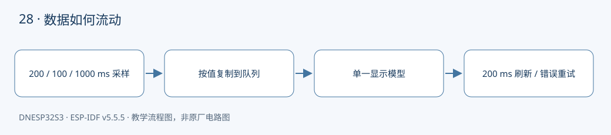

本课将前面的总线、传感器、FreeRTOS 队列和显示知识组合起来。配套完整工程：[examples/28-sensor-dashboard](https://github.com/Rainboylvx/esp32-learning-code/tree/main/examples/28-sensor-dashboard)。

**环境与验收边界：** DNESP32S3 V1.2，ESP-IDF v5.5.5；本机 macOS 构建通过。Ubuntu 26、外设接线、屏幕效果和实际测量仍待实板验收。下文输出均为预期格式，不能当作已采集的硬件日志。

## 本课完成后能做什么

- 三个来源按不同周期更新，屏幕显示字段与串口一致。
- 断开 OLED 后串口采样继续；恢复后显示重试成功。
- 将一个传感器地址临时改错，仅该来源显示 ERR，其他来源保持更新。
- 把共享 SDA 故障与单设备地址错误分开测试，说明影响范围。
- 长时间观察队列满告警和数据年龄，不仅验证第一帧。

## 硬件连接与资源

| 信号或资源 | 对应关系 |
| --- | --- |
| 传感器总线 | I²C0 GPIO41/42，AP3216C 0x1e、QMA6100P 0x12 |
| 显示总线 | I²C1 GPIO5/4，SSD1306 0x3c |
| OLED 复位 | XL9555 IO0_5；四针模式可跳过 |
| 温度来源 | 芯片内部传感器，显示 CHIP C，不标室温 |

以下为正点原子 DNESP32S3 V1.2 原理图的相关页，保留原厂标识；表格用于快速定位，遇到板卡版本差异以实际原理图为准。点击图片可查看引脚与网络名。




## 综合项目先分清谁负责什么

| 任务 | 周期 | 负责的状态 |
| --- | --- | --- |
| 光照采样 | 200 ms | AP3216C 初始化与读数 |
| 加速度采样 | 100 ms | QMA6100P 初始化与读数 |
| 芯片温度采样 | 1000 ms | 温度读取 |
| 应用/显示 | 约 200 ms 刷新 | 最近读数、错误和时间戳 |

采集任务只发送事件，不操作 OLED。应用任务是显示模型的唯一写入者。屏幕显示 ALS 原始值、X 轴 g 和芯片温度，串口每两秒输出状态和数据年龄。这是阶段演示界面，显示内容不代表环境温度或完整运动姿态。

## 事件必须携带来源、结果和时间

`sample_event_t` 包含传感器编号、错误码、采样时间和三个浮点字段。FreeRTOS 队列按值复制结构体，因此任务下一轮复用局部变量不会破坏已入队的数据。不要把临时局部变量的指针发给消费者。

成功、失败、还没收到数据、数据过期是四种不同状态。显示中对应数值、ERR、WAIT、STALE；最近一次采样失败时，不会继续用前一次的成功值掩盖错误。3 秒未更新才标记过期，单调时间不受系统校时影响。

## 如何让一个设备异常不阻止其他设备

总线和设备句柄在启动阶段建立，实际器件初始化移到对应任务。读失败后降为每秒重试；每笔 I²C 事务有 50 ms 上限。显示失败也只进入屏幕自己的限频重试，不终止采样任务。

软件隔离仍受电气连接限制：AP3216C 和 QMA6100P 共用同一物理 I²C 总线，某个器件把 SDA 永久拉低时，两者都可能失败。OLED 用另一条总线，芯片温度不依赖 I²C，仍可继续。验证时分别测试缺少单个地址和整条线被拉低，理解两种故障范围。

## 队列容量不是越大越好

正常每秒约 16 个事件（5 次光照、10 次加速度、1 次温度），32 项队列为短暂显示操作提供余量。采集任务发送事件时最多等待 10 ms。队列满时，程序会记录警告并丢弃这条新样本，避免阻塞整个采样链。

应用每次消费一个事件，最多等待 20 ms，然后检查是否到了刷新时间。绘屏仍是同步传输，100 kHz 下需要约百毫秒，这段时间采集可以继续入队。程序不保证严格实时刷新；若后续加入更多设备，应测量队列压力并采用快照、合并更新或更快总线。

`vTaskDelayUntil()` 按上次唤醒点规划下一次执行，减少周期累积漂移；它不会让一次超过周期的 I²C 操作自动变快。

## 工程如何组织

驱动放在 `components/BSP/`，应用放在 `main/main.c`。本工程包含 `BUS`、`EXIO`、`OLED`、`AP3216C`、`QMA6100P`、`TEMP` 模块。ESP-IDF 会自动发现项目根目录下的 `components/BSP`。`main` 通过 `PRIV_REQUIRES BSP` 声明组件依赖，`INCLUDE_DIRS` 则导出编译时使用的头文件搜索路径，不涉及运行时文件查找。

固定引脚通过 `CONFIG_LESSON_*` 常量定义在本工程的 `Kconfig.projbuild` 中，构建后可在 `sdkconfig` 中核对。这些默认值对应本板连线，仅修改配置数字并不能改变硬件连接。

### 应用代码：入口与处理流程

下面代码直接取自配套工程的 `main/main.c`，头文件和 BSP 实现在仓库中一并提供。初学时先看 `app_main()`，再追踪它调用的模块。

```c
#include "sdkconfig.h"
#include <stdio.h>
#include <stdint.h>
#include <stdbool.h>
#include <string.h>
#include <stdlib.h>
#include <assert.h>
#include "esp_err.h"
#include "esp_log.h"
#include "esp_timer.h"
#include "freertos/FreeRTOS.h"
#include "freertos/task.h"
#include "ap3216c.h"
#include "qma6100p.h"
#include "temp.h"
#include "oled.h"
#include "exio.h"
#include "freertos/queue.h"
typedef enum { LIGHT, MOTION, CHIP, SENSOR_COUNT } sensor_id_t;
typedef struct {
    sensor_id_t id;
    esp_err_t error;
    int64_t sampled_us;
    float x,y,z;
} sample_event_t;
static QueueHandle_t s_samples;
static void sample_task(void *arg)
{
    sensor_id_t id=(sensor_id_t)(intptr_t)arg;
    const int periods[]={200,100,1000};
    bool ready=id==CHIP;
    TickType_t wake=xTaskGetTickCount();
    while(1) {
        sample_event_t e={.id=id,.sampled_us=esp_timer_get_time()};
        if(!ready) {
            e.error=id==LIGHT ? light_reset() : motion_reset();
            ready=e.error==ESP_OK;
        }
        if(ready) {
            if(id==LIGHT) {
                light_sample_t v;
                e.error=light_read(&v);
                if(e.error==ESP_OK) {
                    e.x=v.als; e.y=v.ps; e.z=v.ps_valid;
                    if(!v.ps_valid) e.error=ESP_ERR_INVALID_RESPONSE;
                }
            } else if(id==MOTION) {
                acceleration_t v;
                e.error=motion_read(&v);
                if(e.error==ESP_OK) {e.x=v.x; e.y=v.y; e.z=v.z;}
            } else e.error=chip_temp_read(&e.x);
            if(e.error!=ESP_OK && id!=CHIP) ready=false;
        }
        // 队列按值复制；局部变量离开本轮后不会留下悬空指针。
        if(xQueueSend(s_samples,&e,pdMS_TO_TICKS(10))!=pdTRUE)
            ESP_LOGW("sample","queue full, id=%d",id);
        int delay=e.error==ESP_OK ? periods[id] : 1000;
        vTaskDelayUntil(&wake,pdMS_TO_TICKS(delay));
    }
}
void app_main(void)
{
    i2c_master_bus_handle_t sensors,display;
    ESP_ERROR_CHECK(bus_init(0,CONFIG_LESSON_I2C_SDA,CONFIG_LESSON_I2C_SCL,&sensors));
    ESP_ERROR_CHECK(bus_init(1,CONFIG_LESSON_OLED_SDA,CONFIG_LESSON_OLED_SCL,&display));
    // 注册句柄不会要求器件在线；实际通信在各自任务中完成，便于断线后恢复。
    ESP_ERROR_CHECK(light_open(sensors));
    ESP_ERROR_CHECK(motion_open(sensors));
    ESP_ERROR_CHECK(exio_init(sensors));
    ESP_ERROR_CHECK(oled_open(display));
    ESP_ERROR_CHECK(chip_temp_init());
    s_samples=xQueueCreate(32,sizeof(sample_event_t)); assert(s_samples);
    for(int id=0;id<SENSOR_COUNT;id++)
        ESP_ERROR_CHECK(xTaskCreate(sample_task,"sample",4096,(void *)(intptr_t)id,4,NULL)
                        ==pdPASS ? ESP_OK : ESP_ERR_NO_MEM);
    sample_event_t latest[SENSOR_COUNT]={0};
    bool seen[SENSOR_COUNT]={0},screen_ready=false;
    int64_t next_refresh=0,next_retry=0,next_log=0;
    while(1) {
        sample_event_t e;
        if(xQueueReceive(s_samples,&e,pdMS_TO_TICKS(20))==pdTRUE) {
            latest[e.id]=e; seen[e.id]=true;
        }
        int64_t now=esp_timer_get_time();
        // 即使屏幕失联，仍持续消费事件；重试限频为 1 秒一次。
        if(!screen_ready && now>=next_retry) {
            screen_ready=oled_reset()==ESP_OK;
            next_retry=now+1000000;
        }
        if(now>=next_log) {
            for(int i=0;i<SENSOR_COUNT;i++)
                ESP_LOGI("dashboard","id=%d seen=%d status=%s x=%.2f age=%lld ms",i,seen[i],
                    esp_err_to_name(latest[i].error),latest[i].x,(now-latest[i].sampled_us)/1000);
            next_log=now+2000000;
        }
        if(!screen_ready || now<next_refresh) continue;
        next_refresh=now+200000;
        oled_clear(); oled_text(0,0,"SENSOR DASHBOARD");
        const char *labels[]={"ALS","X G","CHIP C"};
        for(int i=0;i<SENSOR_COUNT;i++) {
            char text[32];
            if(!seen[i]) snprintf(text,sizeof(text),"%s WAIT",labels[i]);
            else if(latest[i].error!=ESP_OK) snprintf(text,sizeof(text),"%s ERR",labels[i]);
            else if(now-latest[i].sampled_us>3000000) snprintf(text,sizeof(text),"%s STALE",labels[i]);
            else snprintf(text,sizeof(text),"%s %.2f",labels[i],latest[i].x);
            oled_text(0,2+i*2,text);
        }
        if(oled_refresh()!=ESP_OK) { screen_ready=false; next_retry=now+1000000; }
    }
}
```

### CMake 与中文注释

```cmake
# 私有依赖只供本组件源码使用。
idf_component_register(SRCS "main.c" INCLUDE_DIRS "."
    PRIV_REQUIRES esp_timer BSP )
```

每个工程有自己的 `project()` 名称和 `sdkconfig.defaults`。VS Code 已关闭普通 CMake 自动配置，C/C++ 语言服务从 `build/compile_commands.json` 读取编译信息。首次构建前，这个文件还不存在，需要先激活 IDF 并完成构建，无需手工拼接头文件路径。

## 编译、烧录与观察

```bash
# 激活 EIM 安装的 IDF；每个新终端都需要激活。
source ~/.espressif/tools/activate_idf_v5.5.5.sh
# 进入单个示例根目录，不是在 examples 总目录运行。
cd ~/mycode/esp32-blog/examples/28-sensor-dashboard
# 首次配置目标；已有正确配置时不用每次重复 set-target。
idf.py set-target esp32s3
# 编译会生成 build/compile_commands.json，供 VS Code 使用。
idf.py build
# 把这个值换成实际连接开发板的端口；macOS 通常为 /dev/cu.*。
PORT=/dev/ttyUSB0
idf.py -p "$PORT" flash monitor
# 串口监视退出：Ctrl+]。
```

预期输出或屏幕内容（示意；数值、日志前缀和启动时间依现场而变）：

```text
SENSOR DASHBOARD
ALS <raw>
X G <g>
CHIP C <摄氏度>
# 设备失败时对应位置显示 ERR。
```

## 故障定位与逐项验收

先确认目标为 `esp32s3`，再检查实际端口、供电，并按本文引脚表核对跳线。编译成功只能说明源码与工具链兼容，模块型号、物理线路和时序仍需实板确认。

- [ ] 三个来源按不同周期更新，屏幕显示字段与串口一致。
- [ ] 断开 OLED 后串口采样继续；恢复后显示重试成功。
- [ ] 将一个传感器地址临时改错，仅该来源显示 ERR，其他来源保持更新。
- [ ] 把共享 SDA 故障与单设备地址错误分开测试，说明影响范围。
- [ ] 长时间观察队列满告警和数据年龄，不仅验证第一帧。

遇到通信错误，先检查错误码和对应模块，不要用“错误时返回 0”掩盖异常。文中的预期日志只供阅读程序时参考；实板验收时，应记录实际现象，保存日志和接线照片。

## 与教材和官方实现对照

这是课程组合项目，无对应官方单一工程。复用 16、20、23、27 课 BSP，通过任务和队列组合；不复用 GPIO0 单总线传感器，以免把微秒忙等与本阶段多任务初次集成混在一起。

## 本地验证记录与参考

- 2026-10-24：ESP-IDF v5.5.5、目标 ESP32-S3，本机 macOS `idf.py build` 通过。
- Hugo 草稿页面、文内本地图片和课程入口已检查；`draft: true` 保留，实板验收后再考虑发布。
- 未执行本课硬件烧录、波形测量或外设现象验收，以上待办不提前勾选。
- [ESP-IDF v5.5.5 官方接口文档](https://docs.espressif.com/projects/esp-idf/en/v5.5.5/esp32s3/api-reference/peripherals/i2c.html)。
- 本系列相关单项课程；DNESP32S3 V1.2 原理图第 1、2、3、4 页。

[返回课程目录](./_index.md)
